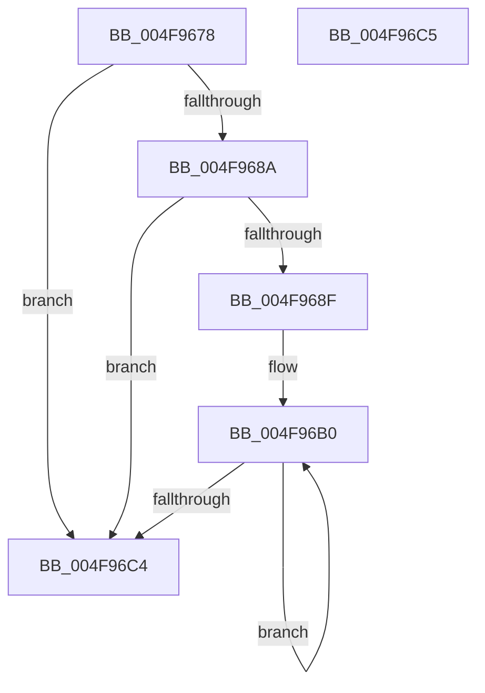

# PpmResetDripsAccountingSnapshot

- RVA: `0x004F9678`–`0x004F96C6` (길이 `78` bytes)
- VA: `0x00000001404F9678`
- 실행 섹션: `.text`
- PDB 이름 있음: `예`; PDB Function 태그: `아니요`
- unwind 정보 RVA: `0x000DB714`
- 디코드: `21`개 명령, `78/78` bytes 표시
- 미해석 바이트: `0` (있으면 어셈블리에 `.byte`로 보존)

> 이 문서는 커널 이미지의 기계어와 PDB 기호를 분석해 생성했습니다. 4번과 5번은 함수 원형과 자료형을 바이너리 사용 방식에서 추정한 C 해석이며 원본 소스 복구 결과는 아닙니다.

## 1. Dependencies

- 직접 호출 지점: **0**; 고유 호출 대상: **0**
- 직접 호출자로 확인된 함수: **1**
- RIP 상대 이미지 참조: **3**

### Outgoing calls
- 직접 디코드된 call 명령이 없습니다.

### Direct callers
- [PopCaptureSleepStudyStatistics](../43/PopCaptureSleepStudyStatistics_function_004399F4.md) at `0x00439E9A`

### Static image references
- `0x004F9678` → RVA `0x00E27EC0` (`.data`; read)
- `0x004F967E` → RVA `0x00FC6AD0` (`ALMOSTRO`; read)
- `0x004F96A9` → RVA `0x00F0BB80` (`.data`; read)

## 2. Other-region calls and transfers

- 다른 실행 섹션으로 향하는 call: **0**
- 별도 외부 분기/꼬리 이동을 확인하지 못했습니다.

## 3. Assembly (complete function range)

```asm
004F9678  8B 05 42 E8 92 00               mov eax, dword ptr [rip + 0x92e842]
004F967E  48 8B 15 4B D4 AC 00            mov rdx, qword ptr [rip + 0xacd44b]
004F9685  48 85 D2                        test rdx, rdx
004F9688  74 3A                           je 0x1404f96c4
004F968A  83 F8 FF                        cmp eax, -1
004F968D  74 35                           je 0x1404f96c4
004F968F  48 8B 52 30                     mov rdx, qword ptr [rdx + 0x30]
004F9693  8B C8                           mov ecx, eax
004F9695  48 C1 E1 0A                     shl rcx, 0xa
004F9699  48 81 C2 E8 00 00 00            add rdx, 0xe8
004F96A0  48 03 D1                        add rdx, rcx
004F96A3  41 B8 1A 00 00 00               mov r8d, 0x1a
004F96A9  48 8D 0D D0 24 A1 00            lea rcx, [rip + 0xa124d0]
004F96B0  48 8B 02                        mov rax, qword ptr [rdx]
004F96B3  48 8D 52 20                     lea rdx, [rdx + 0x20]
004F96B7  48 89 01                        mov qword ptr [rcx], rax
004F96BA  48 8D 49 08                     lea rcx, [rcx + 8]
004F96BE  49 83 E8 01                     sub r8, 1
004F96C2  75 EC                           jne 0x1404f96b0
004F96C4  C3                              ret
004F96C5  CC                              int3
```

## 4. C-style interpretation (structured pseudocode)

```c
__int64 __fastcall PpmResetDripsAccountingSnapshot(void)
{
    if (*(unsigned __int64 *)(v_rip + 11326539) == 0) goto loc_004F96C4;
    if (((unsigned int)((unsigned int)(*(unsigned int *)(v_rip + 9627714)))) == -1) goto loc_004F96C4;
    a1 = ((unsigned int)((unsigned int)((unsigned int)(*(unsigned int *)(v_rip + 9627714))))) << (10);
    a2 = (*(unsigned __int64 *)(*(unsigned __int64 *)(v_rip + 11326539) + 48)) + (232);
    a2 = (a2) + (a1);
loc_004F96B0:
    *(unsigned __int64 *)(v_rip + 10560720) = *(unsigned __int64 *)(a2);
    a3 = (26) - (1);
    if (condition_is_not_equal) goto loc_004F96B0;
loc_004F96C4:
    return *(unsigned __int64 *)(a2);
}
```

## 5. (Beta) C Style

```c
void PpmResetDripsAccountingSnapshot(void)
{
    if (*(uint64_t *)(v_rip + 0xACD44B) == 0) goto loc_004F96C4;
    if (((uint32_t)((uint32_t)(*(uint32_t *)(v_rip + 0x92E842)))) == -1) goto loc_004F96C4;
    a1 = ((uint32_t)((uint32_t)((uint32_t)(*(uint32_t *)(v_rip + 0x92E842))))) << (10);
    a2 = (*(uint64_t *)(*(uint64_t *)(v_rip + 0xACD44B) + 0x30)) + (232);
    a2 = (a2) + (a1);
loc_004F96B0:
    *(uint64_t *)(v_rip + 0xA124D0) = *(uint64_t *)(a2);
    a3 = (26) - (1);
    if (condition_is_not_equal) goto loc_004F96B0;
loc_004F96C4:
    return *(uint64_t *)(a2);
}
```

## 6. Execution-region graph

[열기: 2D/3D 그래프와 함수 탐색 컨트롤 패널](../../../control-panel.html?section=text&rva=0x004F9678&view=graph)

- 2D 그래프는 위에서 아래로 흐르고, 3D 그래프는 빈 공간을 드래그해 회전합니다. Shift+드래그는 이동, 휠은 확대·축소, 함수 노드 선택은 대상 보고서 이동입니다.

### Static fallback


