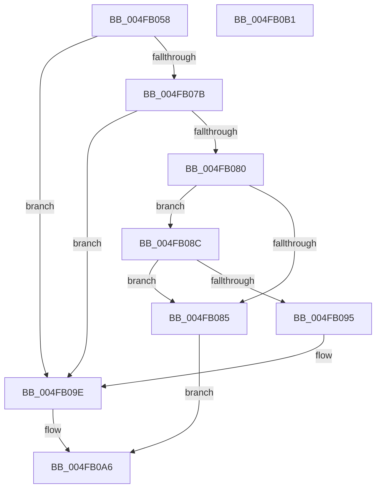

# PrExtApplyPatch

- RVA: `0x004FB058`–`0x004FB0B2` (길이 `90` bytes)
- VA: `0x00000001404FB058`
- 실행 섹션: `.text`
- PDB 이름 있음: `예`; PDB Function 태그: `아니요`
- unwind 정보 RVA: `0x0005CAAC`
- 디코드: `27`개 명령, `90/90` bytes 표시
- 미해석 바이트: `0` (있으면 어셈블리에 `.byte`로 보존)

> 이 문서는 커널 이미지의 기계어와 PDB 기호를 분석해 생성했습니다. 4번과 5번은 함수 원형과 자료형을 바이너리 사용 방식에서 추정한 C 해석이며 원본 소스 복구 결과는 아닙니다.

## 1. Dependencies

- 직접 호출 지점: **2**; 고유 호출 대상: **2**
- 직접 호출자로 확인된 함수: **1**
- RIP 상대 이미지 참조: **2**

### Outgoing calls
- `0x004FB08C` → [Feature_Microcode_Client_CD__private_IsEnabledDeviceUsageNoInline](../66/Feature_Microcode_Client_CD__private_IsEnabledDeviceUsageNoInline_function_00666A18.md) (function, `0x00666A18`)
- `0x004FB0A1` → [MicrocodeUpdate](../66/MicrocodeUpdate_function_00667480.md) (function, `0x00667480`)

### Direct callers
- [HalpMcUpdateMicrocode](../4D/HalpMcUpdateMicrocode_function_004DB3FC.md) at `0x004DB41F`

### Static image references
- `0x004FB062` → RVA `0x00F9053C` (`.data`; read)
- `0x004FB06C` → RVA `0x00FC19F8` (`.data`; read)

## 2. Other-region calls and transfers

- 다른 실행 섹션으로 향하는 call: **0**
- 별도 외부 분기/꼬리 이동을 확인하지 못했습니다.

## 3. Assembly (complete function range)

```asm
004FB058  48 89 5C 24 08                  mov qword ptr [rsp + 8], rbx
004FB05D  57                              push rdi
004FB05E  48 83 EC 20                     sub rsp, 0x20
004FB062  44 8B 05 D3 54 A9 00            mov r8d, dword ptr [rip + 0xa954d3]
004FB069  48 8B DA                        mov rbx, rdx
004FB06C  48 8B 3D 85 69 AC 00            mov rdi, qword ptr [rip + 0xac6985]
004FB073  41 8B C8                        mov ecx, r8d
004FB076  83 E9 01                        sub ecx, 1
004FB079  74 23                           je 0x1404fb09e
004FB07B  83 E9 01                        sub ecx, 1
004FB07E  74 1E                           je 0x1404fb09e
004FB080  83 F9 0B                        cmp ecx, 0xb
004FB083  74 07                           je 0x1404fb08c
004FB085  B8 BB 00 00 C0                  mov eax, 0xc00000bb
004FB08A  EB 1A                           jmp 0x1404fb0a6
004FB08C  E8 87 B9 16 00                  call 0x140666a18
004FB091  85 C0                           test eax, eax
004FB093  74 F0                           je 0x1404fb085
004FB095  41 B8 0D 00 00 00               mov r8d, 0xd
004FB09B  48 8B D3                        mov rdx, rbx
004FB09E  48 8B CF                        mov rcx, rdi
004FB0A1  E8 DA C3 16 00                  call 0x140667480
004FB0A6  48 8B 5C 24 30                  mov rbx, qword ptr [rsp + 0x30]
004FB0AB  48 83 C4 20                     add rsp, 0x20
004FB0AF  5F                              pop rdi
004FB0B0  C3                              ret
004FB0B1  CC                              int3
```

## 4. C-style interpretation (structured pseudocode)

```c
__int64 __fastcall PrExtApplyPatch(__int64 a1, __int64 a2)
{
    __int64 result;
    __int64 v_rsp;
    unsigned __int64 v_stack_p8;

    v_stack_p8 = v_rbx;
    v_rsp = (v_rsp) - (32);
    a1 = (unsigned int)(((unsigned int)((unsigned int)((unsigned int)(*(unsigned int *)(v_rip + 11097299))))) - (1));
    if (condition_is_equal) goto loc_004FB09E;
    a1 = (unsigned int)((a1) - (1));
    if (condition_is_equal) goto loc_004FB09E;
    if (((unsigned int)(a1)) == 11) goto loc_004FB08C;
loc_004FB085:
    goto loc_004FB0A6;
loc_004FB08C:
    result = Feature_Microcode_Client_CD__private_IsEnabledDeviceUsageNoInline(a1, a2, (unsigned int)(*(unsigned int *)(v_rip + 11097299)), a4);
    if ((unsigned int)(result) == 0) goto loc_004FB085;
loc_004FB09E:
    result = MicrocodeUpdate(*(unsigned __int64 *)(v_rip + 11299205), a2, 13, a4);
loc_004FB0A6:
    v_rsp = (v_rsp) + (32);
    return result;
}
```

## 5. (Beta) C Style

```c
int64_t PrExtApplyPatch(int64_t Arg1, int64_t Arg2)
{
    int64_t result;
    int64_t local_rsp;
    uint64_t v_stack_p8;

    v_stack_p8 = local_rbx;
    local_rsp = (local_rsp) - (32);
    Arg1 = (uint32_t)(((uint32_t)((uint32_t)((uint32_t)(*(uint32_t *)(v_rip + 0xA954D3))))) - (1));
    if (condition_is_equal) goto loc_004FB09E;
    Arg1 = (uint32_t)((Arg1) - (1));
    if (condition_is_equal) goto loc_004FB09E;
    if (((uint32_t)(Arg1)) == 11) goto loc_004FB08C;
loc_004FB085:
    goto loc_004FB0A6;
loc_004FB08C:
    result = Feature_Microcode_Client_CD__private_IsEnabledDeviceUsageNoInline(Arg1, Arg2, (uint32_t)(*(uint32_t *)(v_rip + 0xA954D3)), a4);
    if ((uint32_t)(result) == 0) goto loc_004FB085;
loc_004FB09E:
    result = MicrocodeUpdate(*(uint64_t *)(v_rip + 0xAC6985), Arg2, 13, a4);
loc_004FB0A6:
    local_rsp = (local_rsp) + (32);
    return result;
}
```

## 6. Execution-region graph

[열기: 2D/3D 그래프와 함수 탐색 컨트롤 패널](../../../control-panel.html?section=text&rva=0x004FB058&view=graph)

- 2D 그래프는 위에서 아래로 흐르고, 3D 그래프는 빈 공간을 드래그해 회전합니다. Shift+드래그는 이동, 휠은 확대·축소, 함수 노드 선택은 대상 보고서 이동입니다.

### Static fallback


