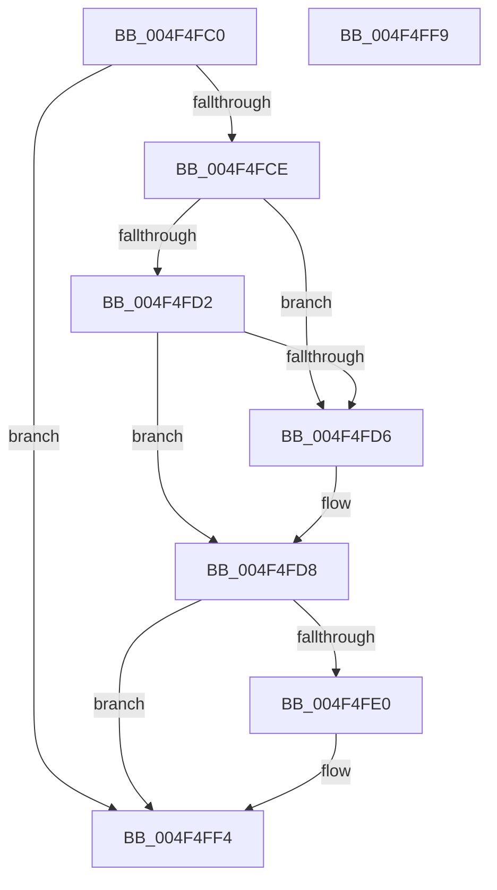

# PsRefreshUserPresencePpmPolicies

- RVA: `0x004F4FC0`–`0x004F4FFA` (길이 `58` bytes)
- VA: `0x00000001404F4FC0`
- 실행 섹션: `.text`
- PDB 이름 있음: `예`; PDB Function 태그: `아니요`
- unwind 정보 RVA: `0x0005C788`
- 디코드: `18`개 명령, `58/58` bytes 표시
- 미해석 바이트: `0` (있으면 어셈블리에 `.byte`로 보존)

> 이 문서는 커널 이미지의 기계어와 PDB 기호를 분석해 생성했습니다. 4번과 5번은 함수 원형과 자료형을 바이너리 사용 방식에서 추정한 C 해석이며 원본 소스 복구 결과는 아닙니다.

## 1. Dependencies

- 직접 호출 지점: **1**; 고유 호출 대상: **1**
- 직접 호출자로 확인된 함수: **1**
- RIP 상대 이미지 참조: **4**

### Outgoing calls
- `0x004F4FEF` → [PsEnumProcesses](../../page/91/PsEnumProcesses_function_0091BE84.md) (function, `0x0091BE84`)

### Direct callers
- [PpmPerfUpdateDomainPolicy](../../page/A9/PpmPerfUpdateDomainPolicy_function_00A97030.md) at `0x00A971A4`

### Static image references
- `0x004F4FC6` → RVA `0x00F06630` (`.data`; read)
- `0x004F4FD8` → RVA `0x00F06634` (`.data`; read)
- `0x004F4FE2` → RVA `0x00F06634` (`.data`; write)
- `0x004F4FE8` → RVA `0x005E3100` (`PspRefreshProcessUserPresencePpmPolicyCallback`; read)

## 2. Other-region calls and transfers

- 다른 실행 섹션으로 향하는 call: **1**
  - `0x004F4FEF` → [PsEnumProcesses](../../page/91/PsEnumProcesses_function_0091BE84.md) (`.text` → `PAGE`)
- 별도 외부 분기/꼬리 이동을 확인하지 못했습니다.

## 3. Assembly (complete function range)

```asm
004F4FC0  48 83 EC 28                     sub rsp, 0x28
004F4FC4  33 C0                           xor eax, eax
004F4FC6  39 05 64 16 A1 00               cmp dword ptr [rip + 0xa11664], eax
004F4FCC  75 26                           jne 0x1404f4ff4
004F4FCE  84 C9                           test cl, cl
004F4FD0  75 04                           jne 0x1404f4fd6
004F4FD2  84 D2                           test dl, dl
004F4FD4  74 02                           je 0x1404f4fd8
004F4FD6  B0 01                           mov al, 1
004F4FD8  38 05 56 16 A1 00               cmp byte ptr [rip + 0xa11656], al
004F4FDE  74 14                           je 0x1404f4ff4
004F4FE0  33 D2                           xor edx, edx
004F4FE2  88 05 4C 16 A1 00               mov byte ptr [rip + 0xa1164c], al
004F4FE8  48 8D 0D 11 E1 0E 00            lea rcx, [rip + 0xee111]
004F4FEF  E8 90 6E 42 00                  call 0x14091be84
004F4FF4  48 83 C4 28                     add rsp, 0x28
004F4FF8  C3                              ret
004F4FF9  CC                              int3
```

## 4. C-style interpretation (structured pseudocode)

```c
__int64 __fastcall PsRefreshUserPresencePpmPolicies(unsigned __int8 a1, int a2)
{
    __int64 result;
    __int64 v_rsp;

    v_rsp = (v_rsp) - (40);
    result = 0;
    if ((*(unsigned int *)(v_rip + 10557028)) != 0) goto loc_004F4FF4;
    if (a1 != 0) goto loc_004F4FD6;
    if ((unsigned __int8)(a2) != 0) {
        result = 1;
    }
    if ((*(unsigned __int8 *)(v_rip + 10557014)) != ((unsigned __int8)(result))) {
        a2 = 0;
        *(unsigned __int8 *)(v_rip + 10557004) = (unsigned __int8)(result);
        a1 = v_rip + 975121;
        result = PsEnumProcesses(a1, a2, a3, a4);
    }
    v_rsp = (v_rsp) + (40);
    return result;
}
```

## 5. (Beta) C Style

```c
int64_t PsRefreshUserPresencePpmPolicies(uint8_t Arg1, int32_t Arg2)
{
    int64_t result;
    int64_t local_rsp;

    local_rsp = (local_rsp) - (40);
    result = 0;
    if ((*(uint32_t *)(v_rip + 0xA11664)) != 0) goto loc_004F4FF4;
    if (Arg1 != 0) goto loc_004F4FD6;
    if ((uint8_t)(Arg2) != 0) {
        result = 1;
    }
    if ((*(uint8_t *)(v_rip + 0xA11656)) != ((uint8_t)(result))) {
        Arg2 = 0;
        *(uint8_t *)(v_rip + 0xA1164C) = (uint8_t)(result);
        Arg1 = v_rip + 975121;
        result = PsEnumProcesses(Arg1, Arg2, a3, a4);
    }
    local_rsp = (local_rsp) + (40);
    return result;
}
```

## 6. Execution-region graph

[열기: 2D/3D 그래프와 함수 탐색 컨트롤 패널](../../../control-panel.html?section=text&rva=0x004F4FC0&view=graph)

- 2D 그래프는 위에서 아래로 흐르고, 3D 그래프는 빈 공간을 드래그해 회전합니다. Shift+드래그는 이동, 휠은 확대·축소, 함수 노드 선택은 대상 보고서 이동입니다.

### Static fallback


