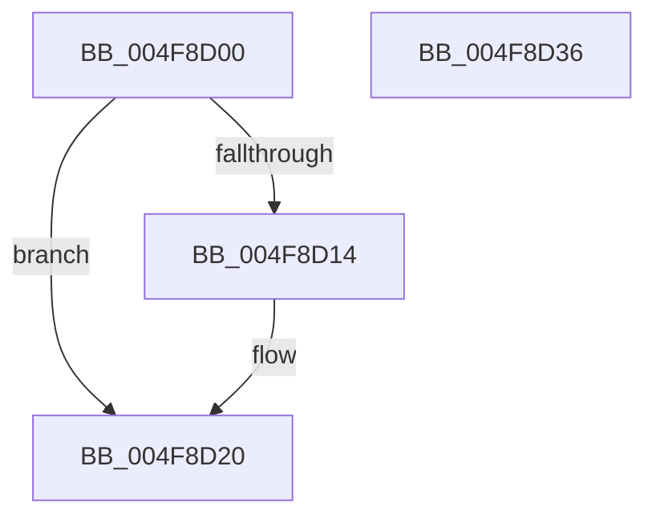

# PspReleasePushLockShared

- RVA: `0x004F8D00`–`0x004F8D37` (길이 `55` bytes)
- VA: `0x00000001404F8D00`
- 실행 섹션: `.text`
- PDB 이름 있음: `예`; PDB Function 태그: `아니요`
- unwind 정보 RVA: `0x0005C788`
- 디코드: `13`개 명령, `55/55` bytes 표시
- 미해석 바이트: `0` (있으면 어셈블리에 `.byte`로 보존)

> 이 문서는 커널 이미지의 기계어와 PDB 기호를 분석해 생성했습니다. 4번과 5번은 함수 원형과 자료형을 바이너리 사용 방식에서 추정한 C 해석이며 원본 소스 복구 결과는 아닙니다.

## 1. Dependencies

- 직접 호출 지점: **3**; 고유 호출 대상: **3**
- 직접 호출자로 확인된 함수: **3**
- RIP 상대 이미지 참조: **1**

### Outgoing calls
- `0x004F8D1B` → [ExfReleasePushLockShared](../26/ExfReleasePushLockShared_function_00263440.md) (function, `0x00263440`)
- `0x004F8D27` → [KeAbPostRelease](../2E/KeAbPostRelease_function_002E1600.md) (function, `0x002E1600`)
- `0x004F8D2C` → [KeLeaveCriticalRegion](../25/KeLeaveCriticalRegion_function_0025D8B0.md) (function, `0x0025D8B0`)

### Direct callers
- [PspCompleteServerSiloShutdownDeferred](../../page/77/PspCompleteServerSiloShutdownDeferred_function_0077F860.md) at `0x0077F918`
- [PspNotifyServerSiloCreation](../../page/78/PspNotifyServerSiloCreation_function_00786C58.md) at `0x00786CEB`
- [PspBeginServerSiloShutdown](../../page/AD/PspBeginServerSiloShutdown_function_00AD2B7C.md) at `0x00AD2BC9`

### Static image references
- `0x004F8D09` → RVA `0x00FD9B60` (`PAGEDATA`; read)

## 2. Other-region calls and transfers

- 다른 실행 섹션으로 향하는 call: **0**
- 별도 외부 분기/꼬리 이동을 확인하지 못했습니다.

## 3. Assembly (complete function range)

```asm
004F8D00  48 83 EC 28                     sub rsp, 0x28
004F8D04  33 D2                           xor edx, edx
004F8D06  8D 42 11                        lea eax, [rdx + 0x11]
004F8D09  F0 48 0F B1 15 4E 0E AE 00      lock cmpxchg qword ptr [rip + 0xae0e4e], rdx
004F8D12  74 0C                           je 0x1404f8d20
004F8D14  48 8D 0D 45 0E AE 00            lea rcx, [rip + 0xae0e45]
004F8D1B  E8 20 A7 D6 FF                  call 0x140263440
004F8D20  48 8D 0D 39 0E AE 00            lea rcx, [rip + 0xae0e39]
004F8D27  E8 D4 88 DE FF                  call 0x1402e1600
004F8D2C  E8 7F 4B D6 FF                  call 0x14025d8b0
004F8D31  48 83 C4 28                     add rsp, 0x28
004F8D35  C3                              ret
004F8D36  CC                              int3
```

## 4. C-style interpretation (structured pseudocode)

```c
__int64 __fastcall PspReleasePushLockShared(__int64 a1, int a2)
{
    __int64 result;
    __int64 v_rsp;

    v_rsp = (v_rsp) - (40);
    a2 = 0;
    result = a2 + 17;
    if (!(condition_is_equal)) {
        a1 = v_rip + 11406917;
        result = ExfReleasePushLockShared(a1, a2, a3, a4);
    }
    result = KeAbPostRelease(v_rip + 11406905, a2, a3, a4);
    result = KeLeaveCriticalRegion(v_rip + 11406905, a2, a3, a4);
    v_rsp = (v_rsp) + (40);
    return result;
}
```

## 5. (Beta) C Style

```c
int64_t PspReleasePushLockShared(int64_t Arg1, int32_t Arg2)
{
    int64_t result;
    int64_t local_rsp;

    local_rsp = (local_rsp) - (40);
    Arg2 = 0;
    result = Arg2 + 17;
    if (!(condition_is_equal)) {
        Arg1 = v_rip + 11406917;
        result = ExfReleasePushLockShared(Arg1, Arg2, a3, a4);
    }
    result = KeAbPostRelease(v_rip + 11406905, Arg2, a3, a4);
    result = KeLeaveCriticalRegion(v_rip + 11406905, Arg2, a3, a4);
    local_rsp = (local_rsp) + (40);
    return result;
}
```

## 6. Execution-region graph

[열기: 2D/3D 그래프와 함수 탐색 컨트롤 패널](../../../control-panel.html?section=text&rva=0x004F8D00&view=graph)

- 2D 그래프는 위에서 아래로 흐르고, 3D 그래프는 빈 공간을 드래그해 회전합니다. Shift+드래그는 이동, 휠은 확대·축소, 함수 노드 선택은 대상 보고서 이동입니다.

### Static fallback


