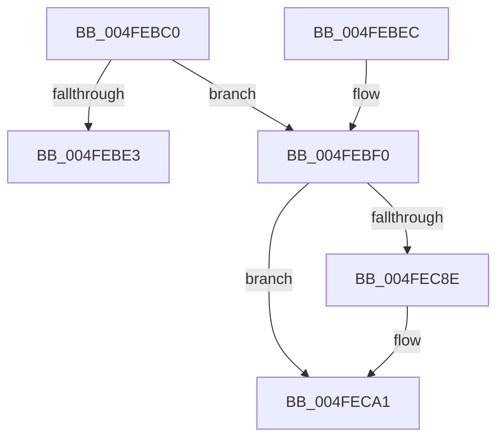

# RcConsolidateFrames

- RVA: `0x004FEBC0`–`0x004FED3A` (길이 `378` bytes)
- VA: `0x00000001404FEBC0`
- 실행 섹션: `.text`
- PDB 이름 있음: `예`; PDB Function 태그: `아니요`
- unwind 정보 RVA: `0x000C24D4`
- 디코드: `70`개 명령, `378/378` bytes 표시
- 미해석 바이트: `0` (있으면 어셈블리에 `.byte`로 보존)

> 이 문서는 커널 이미지의 기계어와 PDB 기호를 분석해 생성했습니다. 4번과 5번은 함수 원형과 자료형을 바이너리 사용 방식에서 추정한 C 해석이며 원본 소스 복구 결과는 아닙니다.

## 1. Dependencies

- 직접 호출 지점: **3**; 고유 호출 대상: **3**
- 직접 호출자로 확인된 함수: **0**
- RIP 상대 이미지 참조: **2**

### Outgoing calls
- `0x004FEBC4` → [guard_dispatch_icall](../6B/guard_dispatch_icall_function_006BAAD0.md) (function, `0x006BAAD0`)
- `0x004FEC7D` → [KeCheckStackAndTargetAddress](../43/KeCheckStackAndTargetAddress_function_0043E580.md) (function, `0x0043E580`)
- `0x004FEC99` → [KeKernelShadowStackRestoreContext](../3D/KeKernelShadowStackRestoreContext_function_003D5B30.md) (function, `0x003D5B30`)

### Direct callers
- 이 함수 시작 RVA로 연결되는 직접 call은 확인되지 않았습니다. 간접 호출은 완전히 역산할 수 없습니다.

### Static image references
- `0x004FEBE3` → RVA `0x004FE9C5` (`RcContinueExit`; read)
- `0x004FEC85` → RVA `0x01201841` (`CFGRO`; read)

## 2. Other-region calls and transfers

- 다른 실행 섹션으로 향하는 call: **0**
- 별도 외부 분기/꼬리 이동을 확인하지 못했습니다.

## 3. Assembly (complete function range)

```asm
004FEBC0  48 8B 41 20                     mov rax, qword ptr [rcx + 0x20]
004FEBC4  E8 07 BF 1B 00                  call 0x1406baad0
004FEBC9  48 89 84 24 F8 00 00 00         mov qword ptr [rsp + 0xf8], rax
004FEBD1  48 8B CC                        mov rcx, rsp
004FEBD4  8B 41 30                        mov eax, dword ptr [rcx + 0x30]
004FEBD7  25 3F FF FF FF                  and eax, 0xffffff3f
004FEBDC  3D 0F 00 10 00                  cmp eax, 0x10000f
004FEBE1  74 0D                           je 0x1404febf0
004FEBE3  48 8D 15 DB FD FF FF            lea rdx, [rip - 0x225]
004FEBEA  FF E2                           jmp rdx
004FEBEC  CC                              int3
004FEBED  CC                              int3
004FEBEE  CC                              int3
004FEBEF  CC                              int3
004FEBF0  0F 28 81 A0 01 00 00            movaps xmm0, xmmword ptr [rcx + 0x1a0]
004FEBF7  0F 28 89 B0 01 00 00            movaps xmm1, xmmword ptr [rcx + 0x1b0]
004FEBFE  0F 28 91 C0 01 00 00            movaps xmm2, xmmword ptr [rcx + 0x1c0]
004FEC05  0F 28 99 D0 01 00 00            movaps xmm3, xmmword ptr [rcx + 0x1d0]
004FEC0C  0F 28 A1 E0 01 00 00            movaps xmm4, xmmword ptr [rcx + 0x1e0]
004FEC13  0F 28 A9 F0 01 00 00            movaps xmm5, xmmword ptr [rcx + 0x1f0]
004FEC1A  0F 28 B1 00 02 00 00            movaps xmm6, xmmword ptr [rcx + 0x200]
004FEC21  0F 28 B9 10 02 00 00            movaps xmm7, xmmword ptr [rcx + 0x210]
004FEC28  44 0F 28 81 20 02 00 00         movaps xmm8, xmmword ptr [rcx + 0x220]
004FEC30  44 0F 28 89 30 02 00 00         movaps xmm9, xmmword ptr [rcx + 0x230]
004FEC38  44 0F 28 91 40 02 00 00         movaps xmm10, xmmword ptr [rcx + 0x240]
004FEC40  44 0F 28 99 50 02 00 00         movaps xmm11, xmmword ptr [rcx + 0x250]
004FEC48  44 0F 28 A1 60 02 00 00         movaps xmm12, xmmword ptr [rcx + 0x260]
004FEC50  44 0F 28 A9 70 02 00 00         movaps xmm13, xmmword ptr [rcx + 0x270]
004FEC58  44 0F 28 B1 80 02 00 00         movaps xmm14, xmmword ptr [rcx + 0x280]
004FEC60  44 0F 28 B9 90 02 00 00         movaps xmm15, xmmword ptr [rcx + 0x290]
004FEC68  0F AE 51 34                     ldmxcsr dword ptr [rcx + 0x34]
004FEC6C  48 8B F1                        mov rsi, rcx
004FEC6F  48 8B 91 98 00 00 00            mov rdx, qword ptr [rcx + 0x98]
004FEC76  48 8B 89 F8 00 00 00            mov rcx, qword ptr [rcx + 0xf8]
004FEC7D  E8 FE F8 F3 FF                  call 0x14043e580
004FEC82  48 8B CE                        mov rcx, rsi
004FEC85  F6 05 B5 2B D0 00 01            test byte ptr [rip + 0xd02bb5], 1
004FEC8C  74 13                           je 0x1404feca1
004FEC8E  48 8B F1                        mov rsi, rcx
004FEC91  F3 48 0F 1E CA                  rdsspq rdx
004FEC96  45 33 C0                        xor r8d, r8d
004FEC99  E8 92 6E ED FF                  call 0x1403d5b30
004FEC9E  48 8B CE                        mov rcx, rsi
004FECA1  66 8B 41 42                     mov ax, word ptr [rcx + 0x42]
004FECA5  66 89 44 24 20                  mov word ptr [rsp + 0x20], ax
004FECAA  48 8B 81 98 00 00 00            mov rax, qword ptr [rcx + 0x98]
004FECB1  48 89 44 24 18                  mov qword ptr [rsp + 0x18], rax
004FECB6  8B 41 44                        mov eax, dword ptr [rcx + 0x44]
004FECB9  89 44 24 10                     mov dword ptr [rsp + 0x10], eax
004FECBD  66 8B 41 38                     mov ax, word ptr [rcx + 0x38]
004FECC1  66 89 44 24 08                  mov word ptr [rsp + 8], ax
004FECC6  48 8B 81 F8 00 00 00            mov rax, qword ptr [rcx + 0xf8]
004FECCD  48 89 04 24                     mov qword ptr [rsp], rax
004FECD1  48 8B 41 78                     mov rax, qword ptr [rcx + 0x78]
004FECD5  48 8B 91 88 00 00 00            mov rdx, qword ptr [rcx + 0x88]
004FECDC  4C 8B 81 B8 00 00 00            mov r8, qword ptr [rcx + 0xb8]
004FECE3  4C 8B 89 C0 00 00 00            mov r9, qword ptr [rcx + 0xc0]
004FECEA  4C 8B 91 C8 00 00 00            mov r10, qword ptr [rcx + 0xc8]
004FECF1  4C 8B 99 D0 00 00 00            mov r11, qword ptr [rcx + 0xd0]
004FECF8  FA                              cli
004FECF9  48 8B 99 90 00 00 00            mov rbx, qword ptr [rcx + 0x90]
004FED00  48 8B B1 A8 00 00 00            mov rsi, qword ptr [rcx + 0xa8]
004FED07  48 8B B9 B0 00 00 00            mov rdi, qword ptr [rcx + 0xb0]
004FED0E  48 8B A9 A0 00 00 00            mov rbp, qword ptr [rcx + 0xa0]
004FED15  4C 8B A1 D8 00 00 00            mov r12, qword ptr [rcx + 0xd8]
004FED1C  4C 8B A9 E0 00 00 00            mov r13, qword ptr [rcx + 0xe0]
004FED23  4C 8B B1 E8 00 00 00            mov r14, qword ptr [rcx + 0xe8]
004FED2A  4C 8B B9 F0 00 00 00            mov r15, qword ptr [rcx + 0xf0]
004FED31  48 8B 89 80 00 00 00            mov rcx, qword ptr [rcx + 0x80]
004FED38  48 CF                           iretq
```

## 4. C-style interpretation (structured pseudocode)

```c
__int64 __fastcall RcConsolidateFrames(__int64 a1, __int64 a2, int a3)
{
    __int64 result;
    __int64 v_rsi;
    unsigned __int64 v_stack_p0;
    unsigned int v_stack_p10;
    unsigned __int64 v_stack_p18;
    unsigned __int16 v_stack_p20;
    unsigned __int16 v_stack_p8;
    unsigned __int64 v_stack_pF8;

    result = guard_dispatch_icall(a1, a2, a3, a4);
    v_stack_pF8 = result;
    result = (unsigned int)(((unsigned int)(*(unsigned int *)(v_rsp + 48))) & (0xFFFFFF3FULL));
    if (((unsigned int)(result)) == 0x10000FULL) goto loc_004FEBF0;
loc_004FEBF0:
    result = KeCheckStackAndTargetAddress(*(unsigned __int64 *)(v_rsp + 248), *(unsigned __int64 *)(v_rsp + 152), a3, a4);
    v_rsi = v_rsp;
    if (((*(unsigned __int8 *)(v_rip + 13642677)) & (1)) != 0) {
        v_rsi = v_rsp;
        a3 = 0;
        result = KeKernelShadowStackRestoreContext(v_rsp, *(unsigned __int64 *)(v_rsp + 152), a3, a4);
        a1 = v_rsi;
    }
    v_stack_p20 = (unsigned __int16)(*(unsigned __int16 *)(a1 + 66));
    v_stack_p18 = *(unsigned __int64 *)(a1 + 152);
    v_stack_p10 = (unsigned int)((unsigned int)(*(unsigned int *)(a1 + 68)));
    v_stack_p8 = (unsigned __int16)(*(unsigned __int16 *)(a1 + 56));
    v_stack_p0 = *(unsigned __int64 *)(a1 + 248);
    return *(unsigned __int64 *)(a1 + 120);
}
```

## 5. (Beta) C Style

```c
int64_t RcConsolidateFrames(void *Arg1, int64_t Arg2, int32_t Arg3)
{
    uint8_t *arg1 = (uint8_t *)Arg1;

    int64_t result;
    int64_t local_rsi;
    uint64_t v_stack_p0;
    uint32_t v_stack_p10;
    uint64_t v_stack_p18;
    uint16_t v_stack_p20;
    uint16_t v_stack_p8;
    uint64_t v_stack_pF8;

    result = guard_dispatch_icall(Arg1, Arg2, Arg3, a4);
    v_stack_pF8 = result;
    result = (uint32_t)(((uint32_t)(*(uint32_t *)(local_rsp + 0x30))) & (0xFFFFFF3FULL));
    if (((uint32_t)(result)) == 0x10000FULL) goto loc_004FEBF0;
loc_004FEBF0:
    result = KeCheckStackAndTargetAddress(*(uint64_t *)(local_rsp + 0xF8), *(uint64_t *)(local_rsp + 0x98), Arg3, a4);
    local_rsi = local_rsp;
    if (((*(uint8_t *)(v_rip + 0xD02BB5)) & (1)) != 0) {
        local_rsi = local_rsp;
        Arg3 = 0;
        result = KeKernelShadowStackRestoreContext(local_rsp, *(uint64_t *)(local_rsp + 0x98), Arg3, a4);
        Arg1 = local_rsi;
    }
    v_stack_p20 = (uint16_t)(*(uint16_t *)(arg1 + 0x42));
    v_stack_p18 = *(uint64_t *)(arg1 + 0x98);
    v_stack_p10 = (uint32_t)((uint32_t)(*(uint32_t *)(arg1 + 0x44)));
    v_stack_p8 = (uint16_t)(*(uint16_t *)(arg1 + 0x38));
    v_stack_p0 = *(uint64_t *)(arg1 + 0xF8);
    return *(uint64_t *)(arg1 + 0x78);
}
```

### 관측된 메모리 오프셋

구조체 형식이 확인되지 않은 접근은 인자 기준의 오프셋으로만 기록했습니다.

| 기준 인자 | 오프셋 표현 | 폭 (bit) | 접근 |
|---|---:|---:|---|
| `Arg1` | `+ 0x20` | `64` | `R` |

## 6. Execution-region graph

[열기: 2D/3D 그래프와 함수 탐색 컨트롤 패널](../../../control-panel.html?section=text&rva=0x004FEBC0&view=graph)

- 2D 그래프는 위에서 아래로 흐르고, 3D 그래프는 빈 공간을 드래그해 회전합니다. Shift+드래그는 이동, 휠은 확대·축소, 함수 노드 선택은 대상 보고서 이동입니다.

### Static fallback


