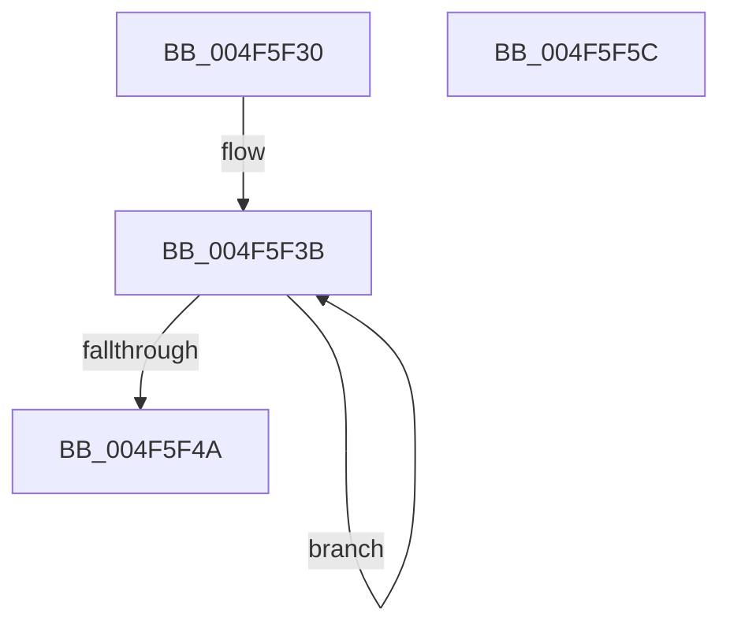

# RtlArmFeatureUsageProviderFlushNotification

- RVA: `0x004F5F30`–`0x004F5F5D` (길이 `45` bytes)
- VA: `0x00000001404F5F30`
- 실행 섹션: `.text`
- PDB 이름 있음: `예`; PDB Function 태그: `아니요`
- unwind 정보 RVA: `0x0005C788`
- 디코드: `14`개 명령, `45/45` bytes 표시
- 미해석 바이트: `0` (있으면 어셈블리에 `.byte`로 보존)

> 이 문서는 커널 이미지의 기계어와 PDB 기호를 분석해 생성했습니다. 4번과 5번은 함수 원형과 자료형을 바이너리 사용 방식에서 추정한 C 해석이며 원본 소스 복구 결과는 아닙니다.

## 1. Dependencies

- 직접 호출 지점: **1**; 고유 호출 대상: **1**
- 직접 호출자로 확인된 함수: **1**
- RIP 상대 이미지 참조: **0**

### Outgoing calls
- `0x004F5F52` → [CmFcpManagerArmFeatureUsageProviderFlushNotification](../49/CmFcpManagerArmFeatureUsageProviderFlushNotification_function_0049C978.md) (function, `0x0049C978`)

### Direct callers
- [CmInitSystem0](../../init/C5/CmInitSystem0_function_00C58E88.md) at `0x00C58F0C`

### Static image references
- 디코드된 RIP-relative 메모리 참조가 없습니다.

## 2. Other-region calls and transfers

- 다른 실행 섹션으로 향하는 call: **0**
- 별도 외부 분기/꼬리 이동을 확인하지 못했습니다.

## 3. Assembly (complete function range)

```asm
004F5F30  48 83 EC 28                     sub rsp, 0x28
004F5F34  0F 0D 49 64                     prefetchw byte ptr [rcx + 0x64]
004F5F38  8B 41 64                        mov eax, dword ptr [rcx + 0x64]
004F5F3B  44 8B C0                        mov r8d, eax
004F5F3E  41 83 C8 01                     or r8d, 1
004F5F42  F0 44 0F B1 41 64               lock cmpxchg dword ptr [rcx + 0x64], r8d
004F5F48  75 F1                           jne 0x1404f5f3b
004F5F4A  F7 D0                           not eax
004F5F4C  83 E0 01                        and eax, 1
004F5F4F  44 8B C0                        mov r8d, eax
004F5F52  E8 21 6A FA FF                  call 0x14049c978
004F5F57  48 83 C4 28                     add rsp, 0x28
004F5F5B  C3                              ret
004F5F5C  CC                              int3
```

## 4. C-style interpretation (structured pseudocode)

```c
__int64 __fastcall RtlArmFeatureUsageProviderFlushNotification(__int64 a1)
{
    __int64 result;
    __int64 v_rsp;

    v_rsp = (v_rsp) - (40);
loc_004F5F3B:
    a3 = (unsigned int)(((unsigned int)((unsigned int)((unsigned int)(*(unsigned int *)(a1 + 100))))) | (1));
    if (condition_is_not_equal) goto loc_004F5F3B;
    result = (unsigned int)(~((unsigned int)(*(unsigned int *)(a1 + 100))));
    result = (unsigned int)((result) & (1));
    result = CmFcpManagerArmFeatureUsageProviderFlushNotification(a1, a2, (unsigned int)((unsigned int)(result)), a4);
    v_rsp = (v_rsp) + (40);
    return result;
}
```

## 5. (Beta) C Style

```c
int64_t RtlArmFeatureUsageProviderFlushNotification(void *Arg1)
{
    uint8_t *arg1 = (uint8_t *)Arg1;

    int64_t result;
    int64_t local_rsp;

    local_rsp = (local_rsp) - (40);
loc_004F5F3B:
    a3 = (uint32_t)(((uint32_t)((uint32_t)((uint32_t)(*(uint32_t *)(arg1 + 0x64))))) | (1));
    if (condition_is_not_equal) goto loc_004F5F3B;
    result = (uint32_t)(~((uint32_t)(*(uint32_t *)(arg1 + 0x64))));
    result = (uint32_t)((result) & (1));
    result = CmFcpManagerArmFeatureUsageProviderFlushNotification(Arg1, a2, (uint32_t)((uint32_t)(result)), a4);
    local_rsp = (local_rsp) + (40);
    return result;
}
```

### 관측된 메모리 오프셋

구조체 형식이 확인되지 않은 접근은 인자 기준의 오프셋으로만 기록했습니다.

| 기준 인자 | 오프셋 표현 | 폭 (bit) | 접근 |
|---|---:|---:|---|
| `Arg1` | `+ 0x64` | `8` | `R` |
| `Arg1` | `+ 0x64` | `32` | `R` |

## 6. Execution-region graph

[열기: 2D/3D 그래프와 함수 탐색 컨트롤 패널](../../../control-panel.html?section=text&rva=0x004F5F30&view=graph)

- 2D 그래프는 위에서 아래로 흐르고, 3D 그래프는 빈 공간을 드래그해 회전합니다. Shift+드래그는 이동, 휠은 확대·축소, 함수 노드 선택은 대상 보고서 이동입니다.

### Static fallback


