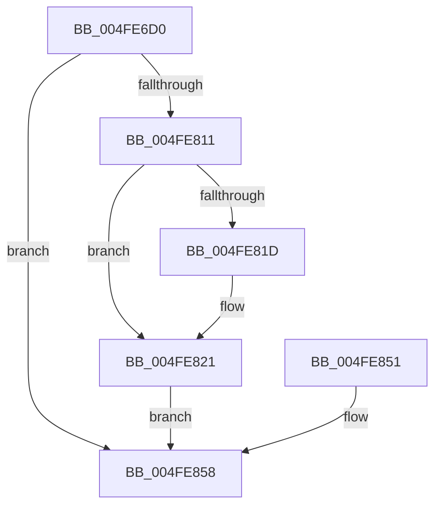

# RtlCaptureContext2

- RVA: `0x004FE6D0`–`0x004FE865` (길이 `405` bytes)
- VA: `0x00000001404FE6D0`
- 실행 섹션: `.text`
- PDB 이름 있음: `예`; PDB Function 태그: `아니요`
- unwind 정보 RVA: `0x000C24B0`
- 디코드: `73`개 명령, `405/405` bytes 표시
- 미해석 바이트: `0` (있으면 어셈블리에 `.byte`로 보존)

> 이 문서는 커널 이미지의 기계어와 PDB 기호를 분석해 생성했습니다. 4번과 5번은 함수 원형과 자료형을 바이너리 사용 방식에서 추정한 C 해석이며 원본 소스 복구 결과는 아닙니다.

## 1. Dependencies

- 직접 호출 지점: **0**; 고유 호출 대상: **0**
- 직접 호출자로 확인된 함수: **1**
- RIP 상대 이미지 참조: **0**

### Outgoing calls
- 직접 디코드된 call 명령이 없습니다.

### Direct callers
- [RtlUnwindEx](../2F/RtlUnwindEx_function_002F2830.md) at `0x002F2DF4`

### Static image references
- 디코드된 RIP-relative 메모리 참조가 없습니다.

## 2. Other-region calls and transfers

- 다른 실행 섹션으로 향하는 call: **0**
- 별도 외부 분기/꼬리 이동을 확인하지 못했습니다.

## 3. Assembly (complete function range)

```asm
004FE6D0  48 51                           push rcx
004FE6D2  9C                              pushfq
004FE6D3  48 83 EC 28                     sub rsp, 0x28
004FE6D7  48 89 41 78                     mov qword ptr [rcx + 0x78], rax
004FE6DB  48 89 89 80 00 00 00            mov qword ptr [rcx + 0x80], rcx
004FE6E2  48 89 91 88 00 00 00            mov qword ptr [rcx + 0x88], rdx
004FE6E9  4C 89 81 B8 00 00 00            mov qword ptr [rcx + 0xb8], r8
004FE6F0  4C 89 89 C0 00 00 00            mov qword ptr [rcx + 0xc0], r9
004FE6F7  4C 89 91 C8 00 00 00            mov qword ptr [rcx + 0xc8], r10
004FE6FE  4C 89 99 D0 00 00 00            mov qword ptr [rcx + 0xd0], r11
004FE705  0F 29 81 A0 01 00 00            movaps xmmword ptr [rcx + 0x1a0], xmm0
004FE70C  0F 29 89 B0 01 00 00            movaps xmmword ptr [rcx + 0x1b0], xmm1
004FE713  0F 29 91 C0 01 00 00            movaps xmmword ptr [rcx + 0x1c0], xmm2
004FE71A  0F 29 99 D0 01 00 00            movaps xmmword ptr [rcx + 0x1d0], xmm3
004FE721  0F 29 A1 E0 01 00 00            movaps xmmword ptr [rcx + 0x1e0], xmm4
004FE728  0F 29 A9 F0 01 00 00            movaps xmmword ptr [rcx + 0x1f0], xmm5
004FE72F  8C 49 38                        mov word ptr [rcx + 0x38], cs
004FE732  8C 59 3A                        mov word ptr [rcx + 0x3a], ds
004FE735  8C 41 3C                        mov word ptr [rcx + 0x3c], es
004FE738  8C 51 42                        mov word ptr [rcx + 0x42], ss
004FE73B  8C 61 3E                        mov word ptr [rcx + 0x3e], fs
004FE73E  8C 69 40                        mov word ptr [rcx + 0x40], gs
004FE741  48 89 99 90 00 00 00            mov qword ptr [rcx + 0x90], rbx
004FE748  48 89 A9 A0 00 00 00            mov qword ptr [rcx + 0xa0], rbp
004FE74F  48 89 B1 A8 00 00 00            mov qword ptr [rcx + 0xa8], rsi
004FE756  48 89 B9 B0 00 00 00            mov qword ptr [rcx + 0xb0], rdi
004FE75D  4C 89 A1 D8 00 00 00            mov qword ptr [rcx + 0xd8], r12
004FE764  4C 89 A9 E0 00 00 00            mov qword ptr [rcx + 0xe0], r13
004FE76B  4C 89 B1 E8 00 00 00            mov qword ptr [rcx + 0xe8], r14
004FE772  4C 89 B9 F0 00 00 00            mov qword ptr [rcx + 0xf0], r15
004FE779  D9 B9 00 01 00 00               fnstcw word ptr [rcx + 0x100]
004FE77F  C7 81 02 01 00 00 00 00 00 00   mov dword ptr [rcx + 0x102], 0
004FE789  0F 29 B1 00 02 00 00            movaps xmmword ptr [rcx + 0x200], xmm6
004FE790  0F 29 B9 10 02 00 00            movaps xmmword ptr [rcx + 0x210], xmm7
004FE797  44 0F 29 81 20 02 00 00         movaps xmmword ptr [rcx + 0x220], xmm8
004FE79F  44 0F 29 89 30 02 00 00         movaps xmmword ptr [rcx + 0x230], xmm9
004FE7A7  44 0F 29 91 40 02 00 00         movaps xmmword ptr [rcx + 0x240], xmm10
004FE7AF  44 0F 29 99 50 02 00 00         movaps xmmword ptr [rcx + 0x250], xmm11
004FE7B7  44 0F 29 A1 60 02 00 00         movaps xmmword ptr [rcx + 0x260], xmm12
004FE7BF  44 0F 29 A9 70 02 00 00         movaps xmmword ptr [rcx + 0x270], xmm13
004FE7C7  44 0F 29 B1 80 02 00 00         movaps xmmword ptr [rcx + 0x280], xmm14
004FE7CF  44 0F 29 B9 90 02 00 00         movaps xmmword ptr [rcx + 0x290], xmm15
004FE7D7  0F AE 99 18 01 00 00            stmxcsr dword ptr [rcx + 0x118]
004FE7DE  0F AE 59 34                     stmxcsr dword ptr [rcx + 0x34]
004FE7E2  48 8D 44 24 40                  lea rax, [rsp + 0x40]
004FE7E7  48 89 81 98 00 00 00            mov qword ptr [rcx + 0x98], rax
004FE7EE  48 8B 44 24 38                  mov rax, qword ptr [rsp + 0x38]
004FE7F3  48 89 81 F8 00 00 00            mov qword ptr [rcx + 0xf8], rax
004FE7FA  8B 44 24 28                     mov eax, dword ptr [rsp + 0x28]
004FE7FE  89 41 44                        mov dword ptr [rcx + 0x44], eax
004FE801  81 61 30 80 00 10 00            and dword ptr [rcx + 0x30], 0x100080
004FE808  81 79 30 80 00 10 00            cmp dword ptr [rcx + 0x30], 0x100080
004FE80F  75 47                           jne 0x1404fe858
004FE811  33 D2                           xor edx, edx
004FE813  F3 48 0F 1E CA                  rdsspq rdx
004FE818  48 85 D2                        test rdx, rdx
004FE81B  74 04                           je 0x1404fe821
004FE81D  48 83 C2 08                     add rdx, 8
004FE821  48 63 81 E8 04 00 00            movsxd rax, dword ptr [rcx + 0x4e8]
004FE828  48 03 C1                        add rax, rcx
004FE82B  48 05 D0 04 00 00               add rax, 0x4d0
004FE831  48 89 10                        mov qword ptr [rax], rdx
004FE834  48 8B 91 F8 00 00 00            mov rdx, qword ptr [rcx + 0xf8]
004FE83B  48 89 50 08                     mov qword ptr [rax + 8], rdx
004FE83F  48 C7 40 10 00 00 00 00         mov qword ptr [rax + 0x10], 0
004FE847  66 8B 51 38                     mov dx, word ptr [rcx + 0x38]
004FE84B  66 89 50 10                     mov word ptr [rax + 0x10], dx
004FE84F  EB 07                           jmp 0x1404fe858
004FE851  C7 41 30 00 00 00 00            mov dword ptr [rcx + 0x30], 0
004FE858  81 49 30 0F 00 10 00            or dword ptr [rcx + 0x30], 0x10000f
004FE85F  48 83 C4 30                     add rsp, 0x30
004FE863  59                              pop rcx
004FE864  C3                              ret
```

## 4. C-style interpretation (structured pseudocode)

```c
__int64 __fastcall RtlCaptureContext2(__int64 a1, __int64 a2, __int64 a3, __int64 a4)
{
    __int64 result;
    __int64 v_rsp;
    unsigned int v_stack_m10;
    unsigned __int64 v_stack_p0;
    unsigned __int64 v_stack_p8;

    v_rsp = (v_rsp) - (40);
    *(unsigned __int64 *)(a1 + 120) = result;
    *(unsigned __int64 *)(a1 + 128) = a1;
    *(unsigned __int64 *)(a1 + 136) = a2;
    *(unsigned __int64 *)(a1 + 184) = a3;
    *(unsigned __int64 *)(a1 + 192) = a4;
    *(unsigned __int64 *)(a1 + 200) = v_r10;
    *(unsigned __int64 *)(a1 + 208) = v_r11;
    *(unsigned __int64 *)(a1 + 416) = v_xmm0;
    *(unsigned __int64 *)(a1 + 432) = v_xmm1;
    *(unsigned __int64 *)(a1 + 448) = v_xmm2;
    *(unsigned __int64 *)(a1 + 464) = v_xmm3;
    *(unsigned __int64 *)(a1 + 480) = v_xmm4;
    *(unsigned __int64 *)(a1 + 496) = v_xmm5;
    *(unsigned __int16 *)(a1 + 56) = v_cs;
    *(unsigned __int16 *)(a1 + 58) = v_ds;
    *(unsigned __int16 *)(a1 + 60) = v_es;
    *(unsigned __int16 *)(a1 + 66) = v_ss;
    *(unsigned __int16 *)(a1 + 62) = v_fs;
    *(unsigned __int16 *)(a1 + 64) = v_gs;
    *(unsigned __int64 *)(a1 + 144) = v_rbx;
    *(unsigned __int64 *)(a1 + 160) = v_rbp;
    *(unsigned __int64 *)(a1 + 168) = v_rsi;
    *(unsigned __int64 *)(a1 + 176) = v_rdi;
    *(unsigned __int64 *)(a1 + 216) = v_r12;
    *(unsigned __int64 *)(a1 + 224) = v_r13;
    *(unsigned __int64 *)(a1 + 232) = v_r14;
    *(unsigned __int64 *)(a1 + 240) = v_r15;
    *(unsigned int *)(a1 + 258) = 0;
    *(unsigned __int64 *)(a1 + 512) = v_xmm6;
    *(unsigned __int64 *)(a1 + 528) = v_xmm7;
    *(unsigned __int64 *)(a1 + 544) = v_xmm8;
    *(unsigned __int64 *)(a1 + 560) = v_xmm9;
    *(unsigned __int64 *)(a1 + 576) = v_xmm10;
    *(unsigned __int64 *)(a1 + 592) = v_xmm11;
    *(unsigned __int64 *)(a1 + 608) = v_xmm12;
    *(unsigned __int64 *)(a1 + 624) = v_xmm13;
    *(unsigned __int64 *)(a1 + 640) = v_xmm14;
    *(unsigned __int64 *)(a1 + 656) = v_xmm15;
    *(unsigned __int64 *)(a1 + 152) = v_stack_p8;
    *(unsigned __int64 *)(a1 + 248) = v_stack_p0;
    *(unsigned int *)(a1 + 68) = (unsigned int)((unsigned int)(v_stack_m10));
    if ((*(unsigned int *)(a1 + 48)) != 0x100080ULL) goto loc_004FE858;
    a2 = 0;
    if (0 != 0) {
        a2 = (a2) + (8);
    }
    result = ((int)(*(unsigned int *)(a1 + 1256))) + (a1);
    result = (result) + (0x4D0ULL);
    *(unsigned __int64 *)(result) = a2;
    *(unsigned __int64 *)(result + 8) = *(unsigned __int64 *)(a1 + 248);
    *(unsigned __int64 *)(result + 16) = 0;
    *(unsigned __int16 *)(result + 16) = (unsigned __int16)(*(unsigned __int16 *)(a1 + 56));
    goto loc_004FE858;
loc_004FE858:
    v_rsp = (v_rsp) + (48);
    return result;
}
```

## 5. (Beta) C Style

```c
int64_t RtlCaptureContext2(int64_t Arg1, int64_t Arg2, int64_t Arg3, int64_t Arg4)
{
    int64_t result;
    int64_t local_rsp;
    uint32_t v_stack_m10;
    uint64_t v_stack_p0;
    uint64_t v_stack_p8;

    local_rsp = (local_rsp) - (40);
    *(uint64_t *)(Arg1 + 0x78) = result;
    *(uint64_t *)(Arg1 + 0x80) = Arg1;
    *(uint64_t *)(Arg1 + 0x88) = Arg2;
    *(uint64_t *)(Arg1 + 0xB8) = Arg3;
    *(uint64_t *)(Arg1 + 0xC0) = Arg4;
    *(uint64_t *)(Arg1 + 0xC8) = local_r10;
    *(uint64_t *)(Arg1 + 0xD0) = local_r11;
    *(uint64_t *)(Arg1 + 0x1A0) = v_xmm0;
    *(uint64_t *)(Arg1 + 0x1B0) = v_xmm1;
    *(uint64_t *)(Arg1 + 0x1C0) = v_xmm2;
    *(uint64_t *)(Arg1 + 0x1D0) = v_xmm3;
    *(uint64_t *)(Arg1 + 0x1E0) = v_xmm4;
    *(uint64_t *)(Arg1 + 0x1F0) = v_xmm5;
    *(uint16_t *)(Arg1 + 0x38) = v_cs;
    *(uint16_t *)(Arg1 + 0x3A) = v_ds;
    *(uint16_t *)(Arg1 + 0x3C) = v_es;
    *(uint16_t *)(Arg1 + 0x42) = v_ss;
    *(uint16_t *)(Arg1 + 0x3E) = v_fs;
    *(uint16_t *)(Arg1 + 0x40) = v_gs;
    *(uint64_t *)(Arg1 + 0x90) = local_rbx;
    *(uint64_t *)(Arg1 + 0xA0) = local_rbp;
    *(uint64_t *)(Arg1 + 0xA8) = local_rsi;
    *(uint64_t *)(Arg1 + 0xB0) = local_rdi;
    *(uint64_t *)(Arg1 + 0xD8) = local_r12;
    *(uint64_t *)(Arg1 + 0xE0) = local_r13;
    *(uint64_t *)(Arg1 + 0xE8) = local_r14;
    *(uint64_t *)(Arg1 + 0xF0) = local_r15;
    *(uint32_t *)(Arg1 + 0x102) = 0;
    *(uint64_t *)(Arg1 + 0x200) = v_xmm6;
    *(uint64_t *)(Arg1 + 0x210) = v_xmm7;
    *(uint64_t *)(Arg1 + 0x220) = v_xmm8;
    *(uint64_t *)(Arg1 + 0x230) = v_xmm9;
    *(uint64_t *)(Arg1 + 0x240) = v_xmm10;
    *(uint64_t *)(Arg1 + 0x250) = v_xmm11;
    *(uint64_t *)(Arg1 + 0x260) = v_xmm12;
    *(uint64_t *)(Arg1 + 0x270) = v_xmm13;
    *(uint64_t *)(Arg1 + 0x280) = v_xmm14;
    *(uint64_t *)(Arg1 + 0x290) = v_xmm15;
    *(uint64_t *)(Arg1 + 0x98) = v_stack_p8;
    *(uint64_t *)(Arg1 + 0xF8) = v_stack_p0;
    *(uint32_t *)(Arg1 + 0x44) = (uint32_t)((uint32_t)(v_stack_m10));
    if ((*(uint32_t *)(Arg1 + 0x30)) != 0x100080ULL) goto loc_004FE858;
    Arg2 = 0;
    if (0 != 0) {
        Arg2 = (Arg2) + (8);
    }
    result = ((int32_t)(*(uint32_t *)(Arg1 + 0x4E8))) + (Arg1);
    result = (result) + (0x4D0ULL);
    *(uint64_t *)(result) = Arg2;
    *(uint64_t *)(result + 0x8) = *(uint64_t *)(Arg1 + 0xF8);
    *(uint64_t *)(result + 0x10) = 0;
    *(uint16_t *)(result + 0x10) = (uint16_t)(*(uint16_t *)(Arg1 + 0x38));
    goto loc_004FE858;
loc_004FE858:
    local_rsp = (local_rsp) + (48);
    return result;
}
```

## 6. Execution-region graph

[열기: 2D/3D 그래프와 함수 탐색 컨트롤 패널](../../../control-panel.html?section=text&rva=0x004FE6D0&view=graph)

- 2D 그래프는 위에서 아래로 흐르고, 3D 그래프는 빈 공간을 드래그해 회전합니다. Shift+드래그는 이동, 휠은 확대·축소, 함수 노드 선택은 대상 보고서 이동입니다.

### Static fallback


