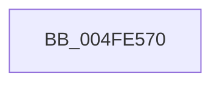

# RtlCaptureContext

- RVA: `0x004FE570`–`0x004FE6A7` (길이 `311` bytes)
- VA: `0x00000001404FE570`
- 실행 섹션: `.text`
- PDB 이름 있음: `예`; PDB Function 태그: `아니요`
- unwind 정보 RVA: `0x000C2494`
- 디코드: `51`개 명령, `311/311` bytes 표시
- 미해석 바이트: `0` (있으면 어셈블리에 `.byte`로 보존)

> 이 문서는 커널 이미지의 기계어와 PDB 기호를 분석해 생성했습니다. 4번과 5번은 함수 원형과 자료형을 바이너리 사용 방식에서 추정한 C 해석이며 원본 소스 복구 결과는 아닙니다.

## 1. Dependencies

- 직접 호출 지점: **0**; 고유 호출 대상: **0**
- 직접 호출자로 확인된 함수: **10**
- RIP 상대 이미지 참조: **0**

### Outgoing calls
- 직접 디코드된 call 명령이 없습니다.

### Direct callers
- [KeBugCheckEx](KeBugCheckEx_function_004FD660.md) at `0x004FD68A`
- [ExpSystemErrorHandler](ExpSystemErrorHandler_function_004FEDF0.md) at `0x004FEE30`
- [IopLiveDumpCollectPages](../59/IopLiveDumpCollectPages_function_0059B328.md) at `0x0059B3CF`
- [IopLiveDumpCollectPages](../59/IopLiveDumpCollectPages_function_0059B328.md) at `0x0059B3FC`
- [IopLiveDumpCorralDpc](../59/IopLiveDumpCorralDpc_function_0059B6B0.md) at `0x0059B6E7`
- [KiFreezeTargetExecution](../5C/KiFreezeTargetExecution_function_005C30A0.md) at `0x005C3193`
- [RtlAssert](../5E/RtlAssert_function_005E75E0.md) at `0x005E7611`
- [KeSaveStateForHibernate](../6B/KeSaveStateForHibernate_function_006B1A50.md) at `0x006B1A60`
- [DbgkpLkmdSnapThreadInContext](../../page/71/DbgkpLkmdSnapThreadInContext_function_00711B3C.md) at `0x00711BD4`
- [DbgkpWerCaptureLiveTriageDump](../../page/71/DbgkpWerCaptureLiveTriageDump_function_00712000.md) at `0x00712089`
- [LkmdTelCreateReport](../../page/84/LkmdTelCreateReport_function_008414CC.md) at `0x0084168F`

### Static image references
- 디코드된 RIP-relative 메모리 참조가 없습니다.

## 2. Other-region calls and transfers

- 다른 실행 섹션으로 향하는 call: **0**
- 별도 외부 분기/꼬리 이동을 확인하지 못했습니다.

## 3. Assembly (complete function range)

```asm
004FE570  48 9C                           pushfq
004FE572  48 89 41 78                     mov qword ptr [rcx + 0x78], rax
004FE576  48 89 89 80 00 00 00            mov qword ptr [rcx + 0x80], rcx
004FE57D  48 89 91 88 00 00 00            mov qword ptr [rcx + 0x88], rdx
004FE584  4C 89 81 B8 00 00 00            mov qword ptr [rcx + 0xb8], r8
004FE58B  4C 89 89 C0 00 00 00            mov qword ptr [rcx + 0xc0], r9
004FE592  4C 89 91 C8 00 00 00            mov qword ptr [rcx + 0xc8], r10
004FE599  4C 89 99 D0 00 00 00            mov qword ptr [rcx + 0xd0], r11
004FE5A0  0F 29 81 A0 01 00 00            movaps xmmword ptr [rcx + 0x1a0], xmm0
004FE5A7  0F 29 89 B0 01 00 00            movaps xmmword ptr [rcx + 0x1b0], xmm1
004FE5AE  0F 29 91 C0 01 00 00            movaps xmmword ptr [rcx + 0x1c0], xmm2
004FE5B5  0F 29 99 D0 01 00 00            movaps xmmword ptr [rcx + 0x1d0], xmm3
004FE5BC  0F 29 A1 E0 01 00 00            movaps xmmword ptr [rcx + 0x1e0], xmm4
004FE5C3  0F 29 A9 F0 01 00 00            movaps xmmword ptr [rcx + 0x1f0], xmm5
004FE5CA  8C 49 38                        mov word ptr [rcx + 0x38], cs
004FE5CD  8C 59 3A                        mov word ptr [rcx + 0x3a], ds
004FE5D0  8C 41 3C                        mov word ptr [rcx + 0x3c], es
004FE5D3  8C 51 42                        mov word ptr [rcx + 0x42], ss
004FE5D6  8C 61 3E                        mov word ptr [rcx + 0x3e], fs
004FE5D9  8C 69 40                        mov word ptr [rcx + 0x40], gs
004FE5DC  48 89 99 90 00 00 00            mov qword ptr [rcx + 0x90], rbx
004FE5E3  48 89 A9 A0 00 00 00            mov qword ptr [rcx + 0xa0], rbp
004FE5EA  48 89 B1 A8 00 00 00            mov qword ptr [rcx + 0xa8], rsi
004FE5F1  48 89 B9 B0 00 00 00            mov qword ptr [rcx + 0xb0], rdi
004FE5F8  4C 89 A1 D8 00 00 00            mov qword ptr [rcx + 0xd8], r12
004FE5FF  4C 89 A9 E0 00 00 00            mov qword ptr [rcx + 0xe0], r13
004FE606  4C 89 B1 E8 00 00 00            mov qword ptr [rcx + 0xe8], r14
004FE60D  4C 89 B9 F0 00 00 00            mov qword ptr [rcx + 0xf0], r15
004FE614  D9 B9 00 01 00 00               fnstcw word ptr [rcx + 0x100]
004FE61A  C7 81 02 01 00 00 00 00 00 00   mov dword ptr [rcx + 0x102], 0
004FE624  0F 29 B1 00 02 00 00            movaps xmmword ptr [rcx + 0x200], xmm6
004FE62B  0F 29 B9 10 02 00 00            movaps xmmword ptr [rcx + 0x210], xmm7
004FE632  44 0F 29 81 20 02 00 00         movaps xmmword ptr [rcx + 0x220], xmm8
004FE63A  44 0F 29 89 30 02 00 00         movaps xmmword ptr [rcx + 0x230], xmm9
004FE642  44 0F 29 91 40 02 00 00         movaps xmmword ptr [rcx + 0x240], xmm10
004FE64A  44 0F 29 99 50 02 00 00         movaps xmmword ptr [rcx + 0x250], xmm11
004FE652  44 0F 29 A1 60 02 00 00         movaps xmmword ptr [rcx + 0x260], xmm12
004FE65A  44 0F 29 A9 70 02 00 00         movaps xmmword ptr [rcx + 0x270], xmm13
004FE662  44 0F 29 B1 80 02 00 00         movaps xmmword ptr [rcx + 0x280], xmm14
004FE66A  44 0F 29 B9 90 02 00 00         movaps xmmword ptr [rcx + 0x290], xmm15
004FE672  0F AE 99 18 01 00 00            stmxcsr dword ptr [rcx + 0x118]
004FE679  0F AE 59 34                     stmxcsr dword ptr [rcx + 0x34]
004FE67D  48 8D 44 24 10                  lea rax, [rsp + 0x10]
004FE682  48 89 81 98 00 00 00            mov qword ptr [rcx + 0x98], rax
004FE689  48 8B 44 24 08                  mov rax, qword ptr [rsp + 8]
004FE68E  48 89 81 F8 00 00 00            mov qword ptr [rcx + 0xf8], rax
004FE695  8B 04 24                        mov eax, dword ptr [rsp]
004FE698  89 41 44                        mov dword ptr [rcx + 0x44], eax
004FE69B  C7 41 30 0F 00 10 00            mov dword ptr [rcx + 0x30], 0x10000f
004FE6A2  48 83 C4 08                     add rsp, 8
004FE6A6  C3                              ret
```

## 4. C-style interpretation (structured pseudocode)

```c
__int64 __fastcall RtlCaptureContext(__int64 a1, __int64 a2, __int64 a3, __int64 a4)
{
    __int64 v_rsp;
    unsigned int v_stack_m8;
    unsigned __int64 v_stack_p0;
    unsigned __int64 v_stack_p8;

    *(unsigned __int64 *)(a1 + 120) = result;
    *(unsigned __int64 *)(a1 + 128) = a1;
    *(unsigned __int64 *)(a1 + 136) = a2;
    *(unsigned __int64 *)(a1 + 184) = a3;
    *(unsigned __int64 *)(a1 + 192) = a4;
    *(unsigned __int64 *)(a1 + 200) = v_r10;
    *(unsigned __int64 *)(a1 + 208) = v_r11;
    *(unsigned __int64 *)(a1 + 416) = v_xmm0;
    *(unsigned __int64 *)(a1 + 432) = v_xmm1;
    *(unsigned __int64 *)(a1 + 448) = v_xmm2;
    *(unsigned __int64 *)(a1 + 464) = v_xmm3;
    *(unsigned __int64 *)(a1 + 480) = v_xmm4;
    *(unsigned __int64 *)(a1 + 496) = v_xmm5;
    *(unsigned __int16 *)(a1 + 56) = v_cs;
    *(unsigned __int16 *)(a1 + 58) = v_ds;
    *(unsigned __int16 *)(a1 + 60) = v_es;
    *(unsigned __int16 *)(a1 + 66) = v_ss;
    *(unsigned __int16 *)(a1 + 62) = v_fs;
    *(unsigned __int16 *)(a1 + 64) = v_gs;
    *(unsigned __int64 *)(a1 + 144) = v_rbx;
    *(unsigned __int64 *)(a1 + 160) = v_rbp;
    *(unsigned __int64 *)(a1 + 168) = v_rsi;
    *(unsigned __int64 *)(a1 + 176) = v_rdi;
    *(unsigned __int64 *)(a1 + 216) = v_r12;
    *(unsigned __int64 *)(a1 + 224) = v_r13;
    *(unsigned __int64 *)(a1 + 232) = v_r14;
    *(unsigned __int64 *)(a1 + 240) = v_r15;
    *(unsigned int *)(a1 + 258) = 0;
    *(unsigned __int64 *)(a1 + 512) = v_xmm6;
    *(unsigned __int64 *)(a1 + 528) = v_xmm7;
    *(unsigned __int64 *)(a1 + 544) = v_xmm8;
    *(unsigned __int64 *)(a1 + 560) = v_xmm9;
    *(unsigned __int64 *)(a1 + 576) = v_xmm10;
    *(unsigned __int64 *)(a1 + 592) = v_xmm11;
    *(unsigned __int64 *)(a1 + 608) = v_xmm12;
    *(unsigned __int64 *)(a1 + 624) = v_xmm13;
    *(unsigned __int64 *)(a1 + 640) = v_xmm14;
    *(unsigned __int64 *)(a1 + 656) = v_xmm15;
    *(unsigned __int64 *)(a1 + 152) = v_stack_p8;
    *(unsigned __int64 *)(a1 + 248) = v_stack_p0;
    *(unsigned int *)(a1 + 68) = (unsigned int)((unsigned int)(v_stack_m8));
    *(unsigned int *)(a1 + 48) = 0x10000FULL;
    v_rsp = (v_rsp) + (8);
    return (unsigned int)(v_stack_m8);
}
```

## 5. (Beta) C Style

```c
int64_t RtlCaptureContext(void *Arg1, int64_t Arg2, int64_t Arg3, int64_t Arg4)
{
    uint8_t *arg1 = (uint8_t *)Arg1;

    int64_t local_rsp;
    uint32_t v_stack_m8;
    uint64_t v_stack_p0;
    uint64_t v_stack_p8;

    *(uint64_t *)(arg1 + 0x78) = result;
    *(void **)(arg1 + 0x80) = Arg1;
    *(uint64_t *)(arg1 + 0x88) = Arg2;
    *(uint64_t *)(arg1 + 0xB8) = Arg3;
    *(uint64_t *)(arg1 + 0xC0) = Arg4;
    *(uint64_t *)(arg1 + 0xC8) = local_r10;
    *(uint64_t *)(arg1 + 0xD0) = local_r11;
    *(uint64_t *)(arg1 + 0x1A0) = v_xmm0;
    *(uint64_t *)(arg1 + 0x1B0) = v_xmm1;
    *(uint64_t *)(arg1 + 0x1C0) = v_xmm2;
    *(uint64_t *)(arg1 + 0x1D0) = v_xmm3;
    *(uint64_t *)(arg1 + 0x1E0) = v_xmm4;
    *(uint64_t *)(arg1 + 0x1F0) = v_xmm5;
    *(uint16_t *)(arg1 + 0x38) = v_cs;
    *(uint16_t *)(arg1 + 0x3A) = v_ds;
    *(uint16_t *)(arg1 + 0x3C) = v_es;
    *(uint16_t *)(arg1 + 0x42) = v_ss;
    *(uint16_t *)(arg1 + 0x3E) = v_fs;
    *(uint16_t *)(arg1 + 0x40) = v_gs;
    *(uint64_t *)(arg1 + 0x90) = local_rbx;
    *(uint64_t *)(arg1 + 0xA0) = local_rbp;
    *(uint64_t *)(arg1 + 0xA8) = local_rsi;
    *(uint64_t *)(arg1 + 0xB0) = local_rdi;
    *(uint64_t *)(arg1 + 0xD8) = local_r12;
    *(uint64_t *)(arg1 + 0xE0) = local_r13;
    *(uint64_t *)(arg1 + 0xE8) = local_r14;
    *(uint64_t *)(arg1 + 0xF0) = local_r15;
    *(uint32_t *)(arg1 + 0x102) = 0;
    *(uint64_t *)(arg1 + 0x200) = v_xmm6;
    *(uint64_t *)(arg1 + 0x210) = v_xmm7;
    *(uint64_t *)(arg1 + 0x220) = v_xmm8;
    *(uint64_t *)(arg1 + 0x230) = v_xmm9;
    *(uint64_t *)(arg1 + 0x240) = v_xmm10;
    *(uint64_t *)(arg1 + 0x250) = v_xmm11;
    *(uint64_t *)(arg1 + 0x260) = v_xmm12;
    *(uint64_t *)(arg1 + 0x270) = v_xmm13;
    *(uint64_t *)(arg1 + 0x280) = v_xmm14;
    *(uint64_t *)(arg1 + 0x290) = v_xmm15;
    *(uint64_t *)(arg1 + 0x98) = v_stack_p8;
    *(uint64_t *)(arg1 + 0xF8) = v_stack_p0;
    *(uint32_t *)(arg1 + 0x44) = (uint32_t)((uint32_t)(v_stack_m8));
    *(uint32_t *)(arg1 + 0x30) = 0x10000FULL;
    local_rsp = (local_rsp) + (8);
    return (uint32_t)(v_stack_m8);
}
```

### 관측된 메모리 오프셋

구조체 형식이 확인되지 않은 접근은 인자 기준의 오프셋으로만 기록했습니다.

| 기준 인자 | 오프셋 표현 | 폭 (bit) | 접근 |
|---|---:|---:|---|
| `Arg1` | `+ 0x30` | `32` | `W` |
| `Arg1` | `+ 0x34` | `32` | `R` |
| `Arg1` | `+ 0x38` | `16` | `W` |
| `Arg1` | `+ 0x3A` | `16` | `W` |
| `Arg1` | `+ 0x3C` | `16` | `W` |
| `Arg1` | `+ 0x3E` | `16` | `W` |
| `Arg1` | `+ 0x40` | `16` | `W` |
| `Arg1` | `+ 0x42` | `16` | `W` |
| `Arg1` | `+ 0x44` | `32` | `W` |
| `Arg1` | `+ 0x78` | `64` | `W` |
| `Arg1` | `+ 0x80` | `64` | `W` |
| `Arg1` | `+ 0x88` | `64` | `W` |
| `Arg1` | `+ 0x90` | `64` | `W` |
| `Arg1` | `+ 0x98` | `64` | `W` |
| `Arg1` | `+ 0xA0` | `64` | `W` |
| `Arg1` | `+ 0xA8` | `64` | `W` |
| `Arg1` | `+ 0xB0` | `64` | `W` |
| `Arg1` | `+ 0xB8` | `64` | `W` |
| `Arg1` | `+ 0xC0` | `64` | `W` |
| `Arg1` | `+ 0xC8` | `64` | `W` |
| `Arg1` | `+ 0xD0` | `64` | `W` |
| `Arg1` | `+ 0xD8` | `64` | `W` |
| `Arg1` | `+ 0xE0` | `64` | `W` |
| `Arg1` | `+ 0xE8` | `64` | `W` |
| `Arg1` | `+ 0xF0` | `64` | `W` |
| `Arg1` | `+ 0xF8` | `64` | `W` |
| `Arg1` | `+ 0x100` | `16` | `R` |
| `Arg1` | `+ 0x102` | `32` | `W` |
| `Arg1` | `+ 0x118` | `32` | `R` |
| `Arg1` | `+ 0x1A0` | `128` | `W` |
| `Arg1` | `+ 0x1B0` | `128` | `W` |
| `Arg1` | `+ 0x1C0` | `128` | `W` |

추가 오프셋 13개는 표에서 생략했습니다.

## 6. Execution-region graph

[열기: 2D/3D 그래프와 함수 탐색 컨트롤 패널](../../../control-panel.html?section=text&rva=0x004FE570&view=graph)

- 2D 그래프는 위에서 아래로 흐르고, 3D 그래프는 빈 공간을 드래그해 회전합니다. Shift+드래그는 이동, 휠은 확대·축소, 함수 노드 선택은 대상 보고서 이동입니다.

### Static fallback


