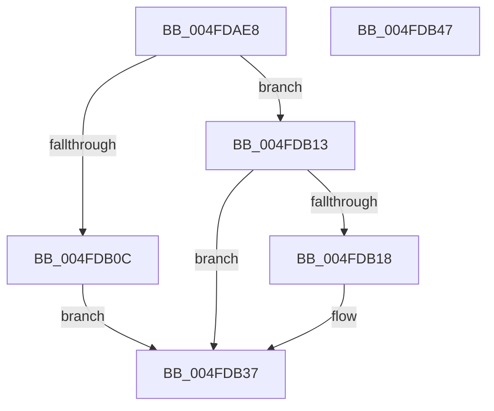

# RtlCopyFromUser

- RVA: `0x004FDAE8`–`0x004FDB48` (길이 `96` bytes)
- VA: `0x00000001404FDAE8`
- 실행 섹션: `.text`
- PDB 이름 있음: `예`; PDB Function 태그: `아니요`
- unwind 정보 RVA: `0x00060BC4`
- 디코드: `29`개 명령, `96/96` bytes 표시
- 미해석 바이트: `0` (있으면 어셈블리에 `.byte`로 보존)

> 이 문서는 커널 이미지의 기계어와 PDB 기호를 분석해 생성했습니다. 4번과 5번은 함수 원형과 자료형을 바이너리 사용 방식에서 추정한 C 해석이며 원본 소스 복구 결과는 아닙니다.

## 1. Dependencies

- 직접 호출 지점: **3**; 고유 호출 대상: **3**
- 직접 호출자로 확인된 함수: **9**
- RIP 상대 이미지 참조: **1**

### Outgoing calls
- `0x004FDB0C` → `indirect target` (indirect, 간접 대상)
- `0x004FDB24` → [ProbeForRead](../../page/9C/ProbeForRead_function_009C5130.md) (function, `0x009C5130`)
- `0x004FDB32` → [RtlCopyVolatileMemory](../6B/RtlCopyVolatileMemory_function_006BC9D0.md) (function, `0x006BC9D0`)

### Direct callers
- [PspProcessSuspendThreadParameters](../5E/PspProcessSuspendThreadParameters_function_005E3510.md) at `0x005E358B`
- [PspProcessUserCopyAttribute](../5E/PspProcessUserCopyAttribute_function_005E3610.md) at `0x005E3692`
- [PspQueryWobTicketPriority](../../page/78/PspQueryWobTicketPriority_function_007898C8.md) at `0x0078991C`
- [PspQueryWobTicketQos](../../page/78/PspQueryWobTicketQos_function_007899B0.md) at `0x00789A07`
- [ExpQueryRuntimeAttestationReport](../../page/7C/ExpQueryRuntimeAttestationReport_function_007C4EE0.md) at `0x007C4F5D`
- [PspWow64ReadOrWriteThreadCpuArea](../../page/8C/PspWow64ReadOrWriteThreadCpuArea_function_008CD404.md) at `0x008CD56D`
- [PspWow64ReadOrWriteThreadCpuArea](../../page/8C/PspWow64ReadOrWriteThreadCpuArea_function_008CD404.md) at `0x008CD5B6`
- [PspWow64ReadOrWriteThreadCpuArea](../../page/8C/PspWow64ReadOrWriteThreadCpuArea_function_008CD404.md) at `0x008CD637`
- [PspWow64ReadOrWriteThreadCpuArea](../../page/8C/PspWow64ReadOrWriteThreadCpuArea_function_008CD404.md) at `0x008CD6F2`
- [PspBuildCreateProcessContext](../../page/9E/PspBuildCreateProcessContext_function_009ED6E0.md) at `0x009EE4DF`
- [PspBuildCreateProcessContext](../../page/9E/PspBuildCreateProcessContext_function_009ED6E0.md) at `0x009EE536`
- [PspBuildCreateProcessContext](../../page/9E/PspBuildCreateProcessContext_function_009ED6E0.md) at `0x009EE630`
- [PspBuildCreateProcessContext](../../page/9E/PspBuildCreateProcessContext_function_009ED6E0.md) at `0x009EE686`
- [EtwpWriteUserEvent](../../page/AF/EtwpWriteUserEvent_function_00AF2FEC.md) at `0x00AF3D3E`
- [NtSetSystemInformation](../../page/AF/NtSetSystemInformation_function_00AF4A60.md) at `0x00AF4ED1`
- [NtSetSystemInformation](../../page/AF/NtSetSystemInformation_function_00AF4A60.md) at `0x00AF4F14`

### Static image references
- `0x004FDAF7` → RVA `0x00151780` (`.idata`; read)

## 2. Other-region calls and transfers

- 다른 실행 섹션으로 향하는 call: **1**
  - `0x004FDB24` → [ProbeForRead](../../page/9C/ProbeForRead_function_009C5130.md) (`.text` → `PAGE`)
- 별도 외부 분기/꼬리 이동을 확인하지 못했습니다.

## 3. Assembly (complete function range)

```asm
004FDAE8  48 89 5C 24 08                  mov qword ptr [rsp + 8], rbx
004FDAED  48 89 74 24 10                  mov qword ptr [rsp + 0x10], rsi
004FDAF2  57                              push rdi
004FDAF3  48 83 EC 20                     sub rsp, 0x20
004FDAF7  48 8B 05 82 3C C5 FF            mov rax, qword ptr [rip - 0x3ac37e]
004FDAFE  49 8B D8                        mov rbx, r8
004FDB01  48 8B FA                        mov rdi, rdx
004FDB04  48 8B F1                        mov rsi, rcx
004FDB07  48 85 C0                        test rax, rax
004FDB0A  74 07                           je 0x1404fdb13
004FDB0C  FF D0                           call rax
004FDB0E  0F 1F 00                        nop dword ptr [rax]
004FDB11  EB 24                           jmp 0x1404fdb37
004FDB13  48 85 DB                        test rbx, rbx
004FDB16  74 1F                           je 0x1404fdb37
004FDB18  41 B8 01 00 00 00               mov r8d, 1
004FDB1E  48 8B D3                        mov rdx, rbx
004FDB21  48 8B CF                        mov rcx, rdi
004FDB24  E8 07 76 4C 00                  call 0x1409c5130
004FDB29  4C 8B C3                        mov r8, rbx
004FDB2C  48 8B D7                        mov rdx, rdi
004FDB2F  48 8B CE                        mov rcx, rsi
004FDB32  E8 99 EE 1B 00                  call 0x1406bc9d0
004FDB37  48 8B 5C 24 30                  mov rbx, qword ptr [rsp + 0x30]
004FDB3C  48 8B 74 24 38                  mov rsi, qword ptr [rsp + 0x38]
004FDB41  48 83 C4 20                     add rsp, 0x20
004FDB45  5F                              pop rdi
004FDB46  C3                              ret
004FDB47  CC                              int3
```

## 4. C-style interpretation (structured pseudocode)

```c
__int64 __fastcall RtlCopyFromUser(__int64 a1, __int64 a2, __int64 a3)
{
    __int64 result;
    __int64 v_rsp;
    unsigned __int64 v_stack_p10;
    unsigned __int64 v_stack_p8;

    v_stack_p8 = v_rbx;
    v_stack_p10 = v_rsi;
    v_rsp = (v_rsp) - (32);
    if (*(unsigned __int64 *)(v_rip - 3851134) == 0) goto loc_004FDB13;
    result = kernel_indirect_call(a1, a2, a3, a4);
    goto loc_004FDB37;
loc_004FDB13:
    if (a3 != 0) {
        a3 = 1;
        a2 = a3;
        a1 = a2;
        result = ProbeForRead(a1, a2, a3, a4);
        a3 = a3;
        a2 = a2;
        a1 = a1;
        result = RtlCopyVolatileMemory(a1, a2, a3, a4);
    }
    v_rsp = (v_rsp) + (32);
    return result;
}
```

## 5. (Beta) C Style

```c
int64_t RtlCopyFromUser(int64_t Arg1, int64_t Arg2, int64_t Arg3)
{
    int64_t result;
    int64_t local_rsp;
    uint64_t v_stack_p10;
    uint64_t v_stack_p8;

    v_stack_p8 = local_rbx;
    v_stack_p10 = local_rsi;
    local_rsp = (local_rsp) - (32);
    if (*(uint64_t *)(v_rip - 0x3AC37E) == 0) goto loc_004FDB13;
    result = kernel_indirect_call(Arg1, Arg2, Arg3, a4);
    goto loc_004FDB37;
loc_004FDB13:
    if (Arg3 != 0) {
        Arg3 = 1;
        Arg2 = Arg3;
        Arg1 = Arg2;
        result = ProbeForRead(Arg1, Arg2, Arg3, a4);
        Arg3 = Arg3;
        Arg2 = Arg2;
        Arg1 = Arg1;
        result = RtlCopyVolatileMemory(Arg1, Arg2, Arg3, a4);
    }
    local_rsp = (local_rsp) + (32);
    return result;
}
```

## 6. Execution-region graph

[열기: 2D/3D 그래프와 함수 탐색 컨트롤 패널](../../../control-panel.html?section=text&rva=0x004FDAE8&view=graph)

- 2D 그래프는 위에서 아래로 흐르고, 3D 그래프는 빈 공간을 드래그해 회전합니다. Shift+드래그는 이동, 휠은 확대·축소, 함수 노드 선택은 대상 보고서 이동입니다.

### Static fallback


