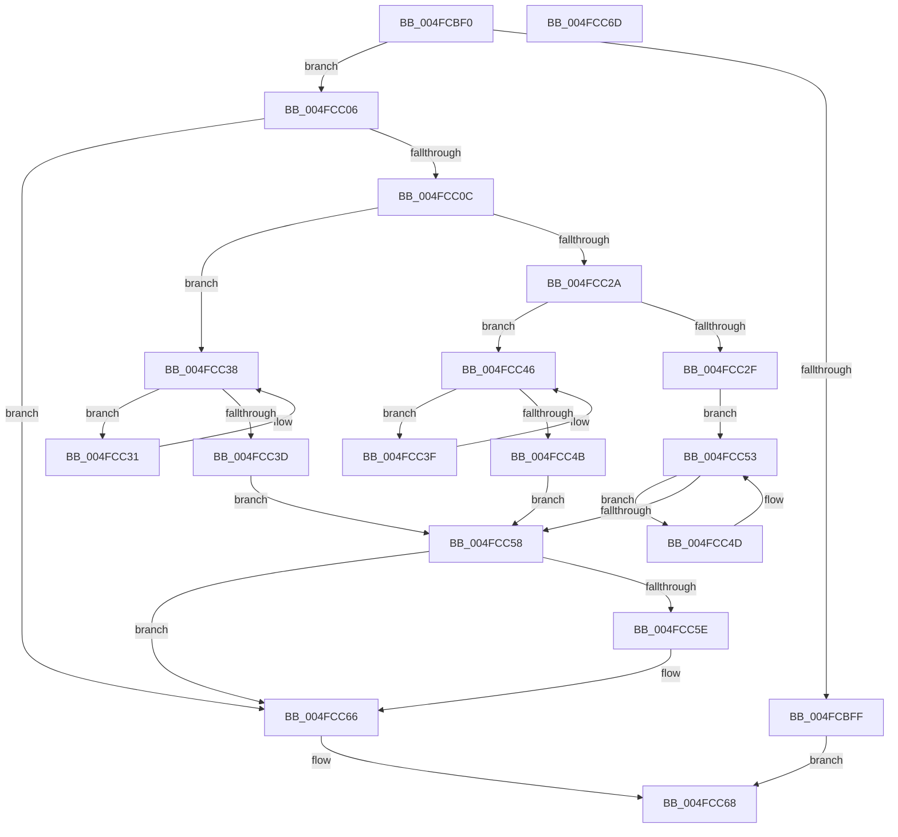

# RtlFlushNonVolatileMemory

- RVA: `0x004FCBF0`–`0x004FCC6E` (길이 `126` bytes)
- VA: `0x00000001404FCBF0`
- 실행 섹션: `.text`
- PDB 이름 있음: `예`; PDB Function 태그: `아니요`
- unwind 정보 RVA: `0x0005C788`
- 디코드: `42`개 명령, `126/126` bytes 표시
- 미해석 바이트: `0` (있으면 어셈블리에 `.byte`로 보존)

> 이 문서는 커널 이미지의 기계어와 PDB 기호를 분석해 생성했습니다. 4번과 5번은 함수 원형과 자료형을 바이너리 사용 방식에서 추정한 C 해석이며 원본 소스 복구 결과는 아닙니다.

## 1. Dependencies

- 직접 호출 지점: **1**; 고유 호출 대상: **1**
- 직접 호출자로 확인된 함수: **4**
- RIP 상대 이미지 참조: **2**

### Outgoing calls
- `0x004FCC61` → [RtlDrainNonVolatileFlush](../5E/RtlDrainNonVolatileFlush_function_005E6060.md) (function, `0x005E6060`)

### Direct callers
- [CcCopyToCacheHelper](../3C/CcCopyToCacheHelper_function_003CC290.md) at `0x003CC336`
- [RtlWriteNonVolatileMemory](../4A/RtlWriteNonVolatileMemory_function_004AF0D0.md) at `0x004AF13F`
- [RtlFillNonVolatileMemory](../5E/RtlFillNonVolatileMemory_function_005EC5E0.md) at `0x005EC666`
- [RtlFlushNonVolatileMemoryRanges](../5E/RtlFlushNonVolatileMemoryRanges_function_005EC690.md) at `0x005EC6DD`

### Static image references
- `0x004FCC0C` → RVA `0x00E0C5B0` (`.data`; read)
- `0x004FCC1F` → RVA `0x00E0C5B8` (`.data`; read)

## 2. Other-region calls and transfers

- 다른 실행 섹션으로 향하는 call: **0**
- 별도 외부 분기/꼬리 이동을 확인하지 못했습니다.

## 3. Assembly (complete function range)

```asm
004FCBF0  48 83 EC 28                     sub rsp, 0x28
004FCBF4  49 8B C0                        mov rax, r8
004FCBF7  4C 8B D1                        mov r10, rcx
004FCBFA  F6 C1 01                        test cl, 1
004FCBFD  75 07                           jne 0x1404fcc06
004FCBFF  B8 0D 00 00 C0                  mov eax, 0xc000000d
004FCC04  EB 62                           jmp 0x1404fcc68
004FCC06  41 F6 C2 02                     test r10b, 2
004FCC0A  74 5A                           je 0x1404fcc66
004FCC0C  4C 8B 05 9D F9 90 00            mov r8, qword ptr [rip + 0x90f99d]
004FCC13  49 8B C8                        mov rcx, r8
004FCC16  48 F7 D9                        neg rcx
004FCC19  48 23 CA                        and rcx, rdx
004FCC1C  48 03 D0                        add rdx, rax
004FCC1F  8B 05 93 F9 90 00               mov eax, dword ptr [rip + 0x90f993]
004FCC25  83 F8 02                        cmp eax, 2
004FCC28  74 0E                           je 0x1404fcc38
004FCC2A  83 F8 03                        cmp eax, 3
004FCC2D  74 17                           je 0x1404fcc46
004FCC2F  EB 22                           jmp 0x1404fcc53
004FCC31  66 0F AE 31                     clwb byte ptr [rcx]
004FCC35  49 03 C8                        add rcx, r8
004FCC38  48 3B CA                        cmp rcx, rdx
004FCC3B  72 F4                           jb 0x1404fcc31
004FCC3D  EB 19                           jmp 0x1404fcc58
004FCC3F  66 0F AE 39                     clflushopt byte ptr [rcx]
004FCC43  49 03 C8                        add rcx, r8
004FCC46  48 3B CA                        cmp rcx, rdx
004FCC49  72 F4                           jb 0x1404fcc3f
004FCC4B  EB 0B                           jmp 0x1404fcc58
004FCC4D  0F AE 39                        clflush byte ptr [rcx]
004FCC50  49 03 C8                        add rcx, r8
004FCC53  48 3B CA                        cmp rcx, rdx
004FCC56  72 F5                           jb 0x1404fcc4d
004FCC58  41 F6 C1 01                     test r9b, 1
004FCC5C  75 08                           jne 0x1404fcc66
004FCC5E  49 8B CA                        mov rcx, r10
004FCC61  E8 FA 93 0E 00                  call 0x1405e6060
004FCC66  33 C0                           xor eax, eax
004FCC68  48 83 C4 28                     add rsp, 0x28
004FCC6C  C3                              ret
004FCC6D  CC                              int3
```

## 4. C-style interpretation (structured pseudocode)

```c
__int64 __fastcall RtlFlushNonVolatileMemory(__int64 a1, __int64 a2, __int64 a3, unsigned __int8 a4)
{
    __int64 result;
    __int64 v_rsp;

    v_rsp = (v_rsp) - (40);
    if ((((unsigned __int8)(a1)) & (1)) != 0) goto loc_004FCC06;
    goto loc_004FCC68;
loc_004FCC06:
    if ((((unsigned __int8)(a1)) & (2)) == 0) goto loc_004FCC66;
    a1 = -(*(unsigned __int64 *)(v_rip + 9501085));
    a1 = (a1) & (a2);
    a2 = (a2) + ((unsigned int)(0xC000000DULL));
    if (((unsigned int)((unsigned int)(*(unsigned int *)(v_rip + 9501075)))) == 2) goto loc_004FCC38;
    if (((unsigned int)((unsigned int)(*(unsigned int *)(v_rip + 9501075)))) == 3) goto loc_004FCC46;
    goto loc_004FCC53;
loc_004FCC31:
    a1 = (a1) + (*(unsigned __int64 *)(v_rip + 9501085));
loc_004FCC38:
    if (a1 < a2) goto loc_004FCC31;
    goto loc_004FCC58;
loc_004FCC3F:
    a1 = (a1) + (*(unsigned __int64 *)(v_rip + 9501085));
loc_004FCC46:
    if (a1 < a2) goto loc_004FCC3F;
    goto loc_004FCC58;
loc_004FCC4D:
    a1 = (a1) + (*(unsigned __int64 *)(v_rip + 9501085));
loc_004FCC53:
    if (a1 < a2) goto loc_004FCC4D;
loc_004FCC58:
    result = (unsigned int)(*(unsigned int *)(v_rip + 9501075));
    if (((a4) & (1)) == 0) {
        a1 = a1;
        result = RtlDrainNonVolatileFlush(a1, a2, *(unsigned __int64 *)(v_rip + 9501085), a4);
    }
    result = 0;
loc_004FCC68:
    v_rsp = (v_rsp) + (40);
    return result;
}
```

## 5. (Beta) C Style

```c
int64_t RtlFlushNonVolatileMemory(int64_t Arg1, int64_t Arg2, int64_t Arg3, uint8_t Arg4)
{
    int64_t result;
    int64_t local_rsp;

    local_rsp = (local_rsp) - (40);
    if ((((uint8_t)(Arg1)) & (1)) != 0) goto loc_004FCC06;
    goto loc_004FCC68;
loc_004FCC06:
    if ((((uint8_t)(Arg1)) & (2)) == 0) goto loc_004FCC66;
    Arg1 = -(*(uint64_t *)(v_rip + 0x90F99D));
    Arg1 = (Arg1) & (Arg2);
    Arg2 = (Arg2) + ((uint32_t)(0xC000000DULL));
    if (((uint32_t)((uint32_t)(*(uint32_t *)(v_rip + 0x90F993)))) == 2) goto loc_004FCC38;
    if (((uint32_t)((uint32_t)(*(uint32_t *)(v_rip + 0x90F993)))) == 3) goto loc_004FCC46;
    goto loc_004FCC53;
loc_004FCC31:
    Arg1 = (Arg1) + (*(uint64_t *)(v_rip + 0x90F99D));
loc_004FCC38:
    if (Arg1 < Arg2) goto loc_004FCC31;
    goto loc_004FCC58;
loc_004FCC3F:
    Arg1 = (Arg1) + (*(uint64_t *)(v_rip + 0x90F99D));
loc_004FCC46:
    if (Arg1 < Arg2) goto loc_004FCC3F;
    goto loc_004FCC58;
loc_004FCC4D:
    Arg1 = (Arg1) + (*(uint64_t *)(v_rip + 0x90F99D));
loc_004FCC53:
    if (Arg1 < Arg2) goto loc_004FCC4D;
loc_004FCC58:
    result = (uint32_t)(*(uint32_t *)(v_rip + 0x90F993));
    if (((Arg4) & (1)) == 0) {
        Arg1 = Arg1;
        result = RtlDrainNonVolatileFlush(Arg1, Arg2, *(uint64_t *)(v_rip + 0x90F99D), Arg4);
    }
    result = 0;
loc_004FCC68:
    local_rsp = (local_rsp) + (40);
    return result;
}
```

## 6. Execution-region graph

[열기: 2D/3D 그래프와 함수 탐색 컨트롤 패널](../../../control-panel.html?section=text&rva=0x004FCBF0&view=graph)

- 2D 그래프는 위에서 아래로 흐르고, 3D 그래프는 빈 공간을 드래그해 회전합니다. Shift+드래그는 이동, 휠은 확대·축소, 함수 노드 선택은 대상 보고서 이동입니다.

### Static fallback


