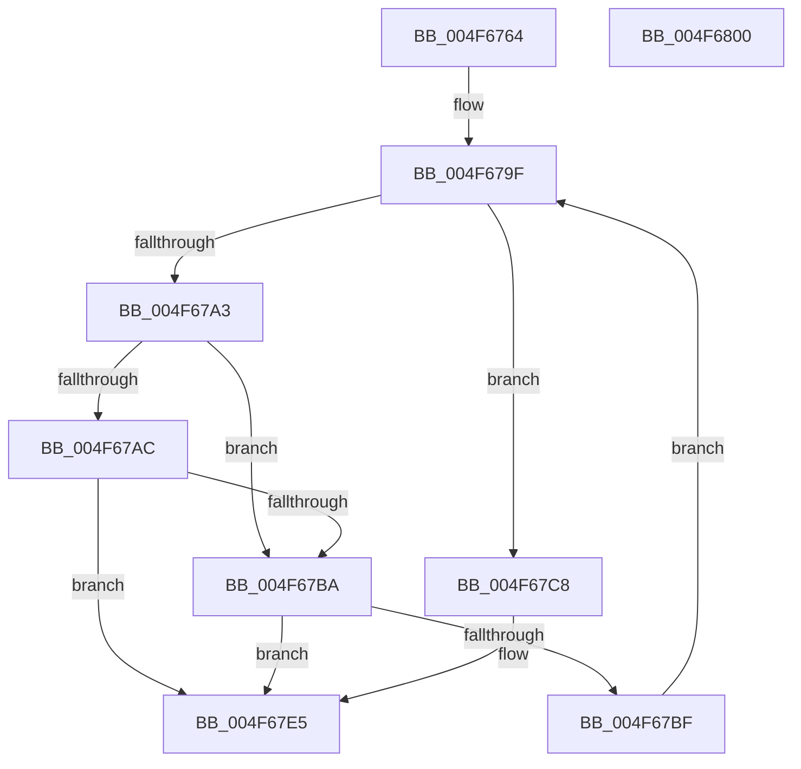

# RtlLengthCurrentClearRunBackwardEx

- RVA: `0x004F6764`–`0x004F6801` (길이 `157` bytes)
- VA: `0x00000001404F6764`
- 실행 섹션: `.text`
- PDB 이름 있음: `예`; PDB Function 태그: `아니요`
- unwind 정보 RVA: `0x00099E74`
- 디코드: `49`개 명령, `157/157` bytes 표시
- 미해석 바이트: `0` (있으면 어셈블리에 `.byte`로 보존)

> 이 문서는 커널 이미지의 기계어와 PDB 기호를 분석해 생성했습니다. 4번과 5번은 함수 원형과 자료형을 바이너리 사용 방식에서 추정한 C 해석이며 원본 소스 복구 결과는 아닙니다.

## 1. Dependencies

- 직접 호출 지점: **0**; 고유 호출 대상: **0**
- 직접 호출자로 확인된 함수: **1**
- RIP 상대 이미지 참조: **1**

### Outgoing calls
- 직접 디코드된 call 명령이 없습니다.

### Direct callers
- [RtlCSparseBitmapFindBitSetCapped](../32/RtlCSparseBitmapFindBitSetCapped_function_003274AC.md) at `0x003275B4`

### Static image references
- `0x004F6779` → RVA `0x00012C50` (`.rdata`; read)

## 2. Other-region calls and transfers

- 다른 실행 섹션으로 향하는 call: **0**
- 별도 외부 분기/꼬리 이동을 확인하지 못했습니다.

## 3. Assembly (complete function range)

```asm
004F6764  48 89 5C 24 10                  mov qword ptr [rsp + 0x10], rbx
004F6769  48 89 7C 24 18                  mov qword ptr [rsp + 0x18], rdi
004F676E  48 8B 79 08                     mov rdi, qword ptr [rcx + 8]
004F6772  48 8B C2                        mov rax, rdx
004F6775  48 C1 E8 05                     shr rax, 5
004F6779  48 8D 0D D0 C4 B1 FF            lea rcx, [rip - 0x4e3b30]
004F6780  BB 1F 00 00 00                  mov ebx, 0x1f
004F6785  4D 8B C8                        mov r9, r8
004F6788  23 D3                           and edx, ebx
004F678A  44 8B DB                        mov r11d, ebx
004F678D  44 2B DA                        sub r11d, edx
004F6790  45 33 C0                        xor r8d, r8d
004F6793  4C 8D 14 87                     lea r10, [rdi + rax*4]
004F6797  8B 04 91                        mov eax, dword ptr [rcx + rdx*4]
004F679A  41 8B 0A                        mov ecx, dword ptr [r10]
004F679D  23 C8                           and ecx, eax
004F679F  85 C9                           test ecx, ecx
004F67A1  75 25                           jne 0x1404f67c8
004F67A3  49 83 C0 20                     add r8, 0x20
004F67A7  4D 3B C1                        cmp r8, r9
004F67AA  72 0E                           jb 0x1404f67ba
004F67AC  41 8B C3                        mov eax, r11d
004F67AF  49 8B C8                        mov rcx, r8
004F67B2  48 2B C8                        sub rcx, rax
004F67B5  49 3B C9                        cmp rcx, r9
004F67B8  73 2B                           jae 0x1404f67e5
004F67BA  4C 3B D7                        cmp r10, rdi
004F67BD  74 26                           je 0x1404f67e5
004F67BF  49 83 C2 FC                     add r10, -4
004F67C3  41 8B 0A                        mov ecx, dword ptr [r10]
004F67C6  EB D7                           jmp 0x1404f679f
004F67C8  8B C1                           mov eax, ecx
004F67CA  BA FF FF FF FF                  mov edx, 0xffffffff
004F67CF  48 0F BD C8                     bsr rcx, rax
004F67D3  0F B6 C1                        movzx eax, cl
004F67D6  0F 45 D0                        cmovne edx, eax
004F67D9  48 0F BE CA                     movsx rcx, dl
004F67DD  48 2B D9                        sub rbx, rcx
004F67E0  8B CB                           mov ecx, ebx
004F67E2  4C 03 C1                        add r8, rcx
004F67E5  48 8B 5C 24 10                  mov rbx, qword ptr [rsp + 0x10]
004F67EA  48 8B 7C 24 18                  mov rdi, qword ptr [rsp + 0x18]
004F67EF  41 8B CB                        mov ecx, r11d
004F67F2  4C 2B C1                        sub r8, rcx
004F67F5  4D 3B C1                        cmp r8, r9
004F67F8  4D 0F 47 C1                     cmova r8, r9
004F67FC  49 8B C0                        mov rax, r8
004F67FF  C3                              ret
004F6800  CC                              int3
```

## 4. C-style interpretation (structured pseudocode)

```c
__int64 __fastcall RtlLengthCurrentClearRunBackwardEx(__int64 a1, __int64 a2, __int64 a3)
{
    __int64 result;
    __int64 v_r10;
    __int64 v_r11;
    __int64 v_rbx;
    unsigned __int64 v_stack_p10;
    unsigned __int64 v_stack_p18;

    v_stack_p10 = v_rbx;
    v_stack_p18 = v_rdi;
    result = (a2) >> (5);
    a2 = (unsigned int)((a2) & (31));
    v_r11 = (unsigned int)((31) - ((unsigned int)(a2)));
    a3 = 0;
    a1 = (unsigned int)(((unsigned int)(*(unsigned int *)(*(unsigned __int64 *)(a1 + 8) + result * 4))) & ((unsigned int)((unsigned int)(*(unsigned int *)(v_rip - 5126960 + a2 * 4)))));
loc_004F679F:
    if ((unsigned int)(a1) != 0) goto loc_004F67C8;
    a3 = (a3) + (32);
    if (a3 < a3) goto loc_004F67BA;
    a1 = (a3) - ((unsigned int)((unsigned int)(v_r11)));
    if (a1 >= a3) goto loc_004F67E5;
loc_004F67BA:
    if ((*(unsigned __int64 *)(a1 + 8) + result * 4) == (*(unsigned __int64 *)(a1 + 8))) goto loc_004F67E5;
    v_r10 = (*(unsigned __int64 *)(a1 + 8) + result * 4) + (-4);
    goto loc_004F679F;
loc_004F67C8:
    a2 = (unsigned int)(0xFFFFFFFFULL);
    if (condition_is_not_equal) { a2 = (unsigned int)((unsigned __int8)((unsigned int)(*(unsigned int *)(v_r10)))); }
    v_rbx = (31) - ((__int8)((unsigned __int8)(a2)));
    a3 = (a3) + ((unsigned int)((unsigned int)(v_rbx)));
loc_004F67E5:
    a3 = (a3) - ((unsigned int)((unsigned int)(v_r11)));
    if (a3 > a3) { a3 = a3; }
    return a3;
}
```

## 5. (Beta) C Style

```c
int64_t RtlLengthCurrentClearRunBackwardEx(void *Arg1, int64_t Arg2, int64_t Arg3)
{
    uint8_t *arg1 = (uint8_t *)Arg1;

    int64_t result;
    int64_t local_r10;
    int64_t local_r11;
    int64_t local_rbx;
    uint64_t v_stack_p10;
    uint64_t v_stack_p18;

    v_stack_p10 = local_rbx;
    v_stack_p18 = local_rdi;
    result = (Arg2) >> (5);
    Arg2 = (uint32_t)((Arg2) & (31));
    local_r11 = (uint32_t)((31) - ((uint32_t)(Arg2)));
    Arg3 = 0;
    Arg1 = (uint32_t)(((uint32_t)(*(uint32_t *)(*(uint64_t *)(arg1 + 0x8) + result * 4))) & ((uint32_t)((uint32_t)(*(uint32_t *)(v_rip - 0x4E3B30 + Arg2 * 4)))));
loc_004F679F:
    if ((uint32_t)(Arg1) != 0) goto loc_004F67C8;
    Arg3 = (Arg3) + (32);
    if (Arg3 < Arg3) goto loc_004F67BA;
    Arg1 = (Arg3) - ((uint32_t)((uint32_t)(local_r11)));
    if (Arg1 >= Arg3) goto loc_004F67E5;
loc_004F67BA:
    if ((*(uint64_t *)(arg1 + 0x8) + result * 4) == (*(uint64_t *)(arg1 + 0x8))) goto loc_004F67E5;
    local_r10 = (*(uint64_t *)(arg1 + 0x8) + result * 4) + (-4);
    goto loc_004F679F;
loc_004F67C8:
    Arg2 = (uint32_t)(0xFFFFFFFFULL);
    if (condition_is_not_equal) { Arg2 = (uint32_t)((uint8_t)((uint32_t)(*(uint32_t *)(local_r10)))); }
    local_rbx = (31) - ((int8_t)((uint8_t)(Arg2)));
    Arg3 = (Arg3) + ((uint32_t)((uint32_t)(local_rbx)));
loc_004F67E5:
    Arg3 = (Arg3) - ((uint32_t)((uint32_t)(local_r11)));
    if (Arg3 > Arg3) { Arg3 = Arg3; }
    return Arg3;
}
```

### 관측된 메모리 오프셋

구조체 형식이 확인되지 않은 접근은 인자 기준의 오프셋으로만 기록했습니다.

| 기준 인자 | 오프셋 표현 | 폭 (bit) | 접근 |
|---|---:|---:|---|
| `Arg1` | `+ 0x8` | `64` | `R` |

## 6. Execution-region graph

[열기: 2D/3D 그래프와 함수 탐색 컨트롤 패널](../../../control-panel.html?section=text&rva=0x004F6764&view=graph)

- 2D 그래프는 위에서 아래로 흐르고, 3D 그래프는 빈 공간을 드래그해 회전합니다. Shift+드래그는 이동, 휠은 확대·축소, 함수 노드 선택은 대상 보고서 이동입니다.

### Static fallback


