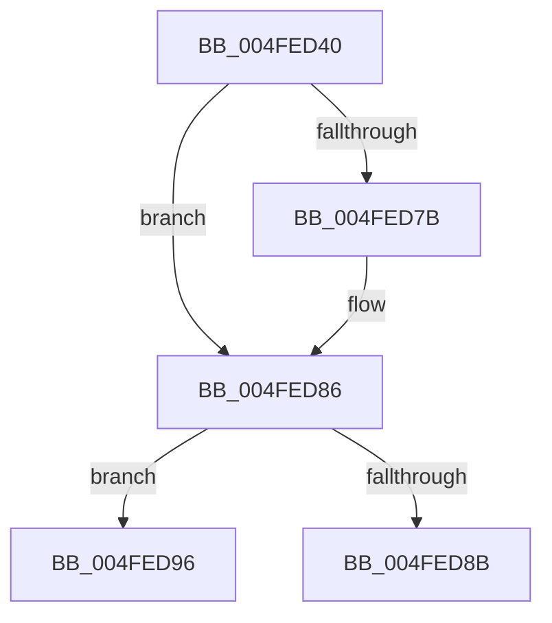

# RtlRaiseNoncontinuableException

- RVA: `0x004FED40`–`0x004FEDA1` (길이 `97` bytes)
- VA: `0x00000001404FED40`
- 실행 섹션: `.text`
- PDB 이름 있음: `예`; PDB Function 태그: `아니요`
- unwind 정보 RVA: `0x000C252C`
- 디코드: `26`개 명령, `97/97` bytes 표시
- 미해석 바이트: `0` (있으면 어셈블리에 `.byte`로 보존)

> 이 문서는 커널 이미지의 기계어와 PDB 기호를 분석해 생성했습니다. 4번과 5번은 함수 원형과 자료형을 바이너리 사용 방식에서 추정한 C 해석이며 원본 소스 복구 결과는 아닙니다.

## 1. Dependencies

- 직접 호출 지점: **1**; 고유 호출 대상: **1**
- 직접 호출자로 확인된 함수: **1**
- RIP 상대 이미지 참조: **0**

### Outgoing calls
- `0x004FED4A` → [RtlpCaptureContext](RtlpCaptureContext_function_004FE550.md) (function, `0x004FE550`)

### Direct callers
- [RtlRaiseStatus](../2F/RtlRaiseStatus_function_002F6A50.md) at `0x002F6A9A`

### Static image references
- 디코드된 RIP-relative 메모리 참조가 없습니다.

## 2. Other-region calls and transfers

- 다른 실행 섹션으로 향하는 call: **0**
- call이 아닌 외부 분기/꼬리 이동: **2**
  - `0x004FED91` → [RtlDispatchException](../2F/RtlDispatchException_function_002F22A0.md) (`tail-transfer`)
  - `0x004FED9C` → [ZwRaiseException](../6A/ZwRaiseException_function_006AFF70.md) (`tail-transfer`)

## 3. Assembly (complete function range)

```asm
004FED40  48 52                           push rdx
004FED42  51                              push rcx
004FED43  48 83 EC 28                     sub rsp, 0x28
004FED47  48 8B CA                        mov rcx, rdx
004FED4A  E8 01 F8 FF FF                  call 0x1404fe550
004FED4F  48 8B 4C 24 28                  mov rcx, qword ptr [rsp + 0x28]
004FED54  48 8B 54 24 30                  mov rdx, qword ptr [rsp + 0x30]
004FED59  48 8D 44 24 40                  lea rax, [rsp + 0x40]
004FED5E  48 89 82 98 00 00 00            mov qword ptr [rdx + 0x98], rax
004FED65  48 8B 44 24 38                  mov rax, qword ptr [rsp + 0x38]
004FED6A  48 89 82 F8 00 00 00            mov qword ptr [rdx + 0xf8], rax
004FED71  48 83 C8 FF                     or rax, 0xffffffffffffffff
004FED75  48 39 41 10                     cmp qword ptr [rcx + 0x10], rax
004FED79  75 0B                           jne 0x1404fed86
004FED7B  48 8B 82 F8 00 00 00            mov rax, qword ptr [rdx + 0xf8]
004FED82  48 89 41 10                     mov qword ptr [rcx + 0x10], rax
004FED86  45 84 C0                        test r8b, r8b
004FED89  74 0B                           je 0x1404fed96
004FED8B  48 83 C4 28                     add rsp, 0x28
004FED8F  59                              pop rcx
004FED90  5A                              pop rdx
004FED91  E9 0A 35 DF FF                  jmp 0x1402f22a0
004FED96  48 83 C4 28                     add rsp, 0x28
004FED9A  59                              pop rcx
004FED9B  5A                              pop rdx
004FED9C  E9 CF 11 1B 00                  jmp 0x1406aff70
```

## 4. C-style interpretation (structured pseudocode)

```c
__int64 __fastcall RtlRaiseNoncontinuableException(__int64 a1, __int64 a2, unsigned __int8 a3)
{
    __int64 result;
    __int64 v_rsp;
    unsigned __int64 v_stack_m10;
    unsigned __int64 v_stack_m8;
    unsigned __int64 v_stack_p0;
    unsigned __int64 v_stack_p8;

    v_rsp = (v_rsp) - (40);
    result = RtlpCaptureContext(a2, a2, a3, a4);
    *(unsigned __int64 *)(v_stack_m8 + 152) = v_stack_p8;
    *(unsigned __int64 *)(v_stack_m8 + 248) = v_stack_p0;
    result = (v_stack_p0) | (-1);
    if ((*(unsigned __int64 *)(v_stack_m10 + 16)) == result) {
        result = *(unsigned __int64 *)(v_stack_m8 + 248);
        *(unsigned __int64 *)(v_stack_m10 + 16) = result;
    }
    if (a3 == 0) goto loc_004FED96;
    v_rsp = (v_rsp) + (40);
loc_004FED96:
    v_rsp = (v_rsp) + (40);
}
```

## 5. (Beta) C Style

```c
int64_t RtlRaiseNoncontinuableException(int64_t Arg1, int64_t Arg2, uint8_t Arg3)
{
    int64_t result;
    int64_t local_rsp;
    uint64_t v_stack_m10;
    uint64_t v_stack_m8;
    uint64_t v_stack_p0;
    uint64_t v_stack_p8;

    local_rsp = (local_rsp) - (40);
    result = RtlpCaptureContext(Arg2, Arg2, Arg3, a4);
    *(uint64_t *)(v_stack_m8 + 0x98) = v_stack_p8;
    *(uint64_t *)(v_stack_m8 + 0xF8) = v_stack_p0;
    result = (v_stack_p0) | (-1);
    if ((*(uint64_t *)(v_stack_m10 + 0x10)) == result) {
        result = *(uint64_t *)(v_stack_m8 + 0xF8);
        *(uint64_t *)(v_stack_m10 + 0x10) = result;
    }
    if (Arg3 == 0) goto loc_004FED96;
    local_rsp = (local_rsp) + (40);
loc_004FED96:
    local_rsp = (local_rsp) + (40);
}
```

## 6. Execution-region graph

[열기: 2D/3D 그래프와 함수 탐색 컨트롤 패널](../../../control-panel.html?section=text&rva=0x004FED40&view=graph)

- 2D 그래프는 위에서 아래로 흐르고, 3D 그래프는 빈 공간을 드래그해 회전합니다. Shift+드래그는 이동, 휠은 확대·축소, 함수 노드 선택은 대상 보고서 이동입니다.

### Static fallback


