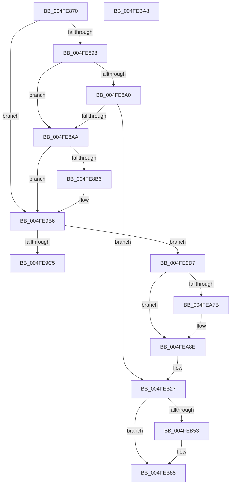

# RtlRestoreContext

- RVA: `0x004FE870`–`0x004FEBAC` (길이 `828` bytes)
- VA: `0x00000001404FE870`
- 실행 섹션: `.text`
- PDB 이름 있음: `예`; PDB Function 태그: `아니요`
- unwind 정보 RVA: `0x000C24C0`
- 디코드: `171`개 명령, `828/828` bytes 표시
- 미해석 바이트: `0` (있으면 어셈블리에 `.byte`로 보존)

> 이 문서는 커널 이미지의 기계어와 PDB 기호를 분석해 생성했습니다. 4번과 5번은 함수 원형과 자료형을 바이너리 사용 방식에서 추정한 C 해석이며 원본 소스 복구 결과는 아닙니다.

## 1. Dependencies

- 직접 호출 지점: **4**; 고유 호출 대상: **4**
- 직접 호출자로 확인된 함수: **1**
- RIP 상대 이미지 참조: **2**

### Outgoing calls
- `0x004FE881` → [KasanWrapperRtlRestoreContext](../45/KasanWrapperRtlRestoreContext_function_00450EA0.md) (function, `0x00450EA0`)
- `0x004FE9C7` → [ZwContinue](../6A/ZwContinue_function_006AD930.md) (function, `0x006AD930`)
- `0x004FEA67` → [KeCheckStackAndTargetAddress](../43/KeCheckStackAndTargetAddress_function_0043E580.md) (function, `0x0043E580`)
- `0x004FEA86` → [KeKernelShadowStackRestoreContext](../3D/KeKernelShadowStackRestoreContext_function_003D5B30.md) (function, `0x003D5B30`)

### Direct callers
- [RtlUnwindEx](../2F/RtlUnwindEx_function_002F2830.md) at `0x002F2BAD`

### Static image references
- `0x004FEA72` → RVA `0x01201841` (`CFGRO`; read)
- `0x004FEB9F` → RVA `0x004FEBC0` (`RcConsolidateFrames`; read)

## 2. Other-region calls and transfers

- 다른 실행 섹션으로 향하는 call: **0**
- 별도 외부 분기/꼬리 이동을 확인하지 못했습니다.

## 3. Assembly (complete function range)

```asm
004FE870  48 55                           push rbp
004FE872  56                              push rsi
004FE873  57                              push rdi
004FE874  48 83 EC 30                     sub rsp, 0x30
004FE878  48 8B EC                        mov rbp, rsp
004FE87B  48 8B F1                        mov rsi, rcx
004FE87E  48 8B FA                        mov rdi, rdx
004FE881  E8 1A 26 F5 FF                  call 0x140450ea0
004FE886  48 8B D7                        mov rdx, rdi
004FE889  48 8B CE                        mov rcx, rsi
004FE88C  4C 8B CA                        mov r9, rdx
004FE88F  48 85 D2                        test rdx, rdx
004FE892  0F 84 1E 01 00 00               je 0x1404fe9b6
004FE898  81 3A 29 00 00 80               cmp dword ptr [rdx], 0x80000029
004FE89E  75 0A                           jne 0x1404fe8aa
004FE8A0  83 7A 18 01                     cmp dword ptr [rdx + 0x18], 1
004FE8A4  0F 83 7D 02 00 00               jae 0x1404feb27
004FE8AA  81 3A 26 00 00 80               cmp dword ptr [rdx], 0x80000026
004FE8B0  0F 85 00 01 00 00               jne 0x1404fe9b6
004FE8B6  48 8B 42 20                     mov rax, qword ptr [rdx + 0x20]
004FE8BA  4C 8B 40 08                     mov r8, qword ptr [rax + 8]
004FE8BE  4C 89 81 90 00 00 00            mov qword ptr [rcx + 0x90], r8
004FE8C5  4C 8B 40 10                     mov r8, qword ptr [rax + 0x10]
004FE8C9  4C 89 81 98 00 00 00            mov qword ptr [rcx + 0x98], r8
004FE8D0  4C 8B 40 18                     mov r8, qword ptr [rax + 0x18]
004FE8D4  4C 89 81 A0 00 00 00            mov qword ptr [rcx + 0xa0], r8
004FE8DB  4C 8B 40 20                     mov r8, qword ptr [rax + 0x20]
004FE8DF  4C 89 81 A8 00 00 00            mov qword ptr [rcx + 0xa8], r8
004FE8E6  4C 8B 40 28                     mov r8, qword ptr [rax + 0x28]
004FE8EA  4C 89 81 B0 00 00 00            mov qword ptr [rcx + 0xb0], r8
004FE8F1  4C 8B 40 30                     mov r8, qword ptr [rax + 0x30]
004FE8F5  4C 89 81 D8 00 00 00            mov qword ptr [rcx + 0xd8], r8
004FE8FC  4C 8B 40 38                     mov r8, qword ptr [rax + 0x38]
004FE900  4C 89 81 E0 00 00 00            mov qword ptr [rcx + 0xe0], r8
004FE907  4C 8B 40 40                     mov r8, qword ptr [rax + 0x40]
004FE90B  4C 89 81 E8 00 00 00            mov qword ptr [rcx + 0xe8], r8
004FE912  4C 8B 40 48                     mov r8, qword ptr [rax + 0x48]
004FE916  4C 89 81 F0 00 00 00            mov qword ptr [rcx + 0xf0], r8
004FE91D  4C 8B 40 50                     mov r8, qword ptr [rax + 0x50]
004FE921  4C 89 81 F8 00 00 00            mov qword ptr [rcx + 0xf8], r8
004FE928  44 8B 40 58                     mov r8d, dword ptr [rax + 0x58]
004FE92C  44 89 41 34                     mov dword ptr [rcx + 0x34], r8d
004FE930  0F 28 40 60                     movaps xmm0, xmmword ptr [rax + 0x60]
004FE934  0F 29 81 00 02 00 00            movaps xmmword ptr [rcx + 0x200], xmm0
004FE93B  0F 28 40 70                     movaps xmm0, xmmword ptr [rax + 0x70]
004FE93F  0F 29 81 10 02 00 00            movaps xmmword ptr [rcx + 0x210], xmm0
004FE946  0F 28 80 80 00 00 00            movaps xmm0, xmmword ptr [rax + 0x80]
004FE94D  0F 29 81 20 02 00 00            movaps xmmword ptr [rcx + 0x220], xmm0
004FE954  0F 28 80 90 00 00 00            movaps xmm0, xmmword ptr [rax + 0x90]
004FE95B  0F 29 81 30 02 00 00            movaps xmmword ptr [rcx + 0x230], xmm0
004FE962  0F 28 80 A0 00 00 00            movaps xmm0, xmmword ptr [rax + 0xa0]
004FE969  0F 29 81 40 02 00 00            movaps xmmword ptr [rcx + 0x240], xmm0
004FE970  0F 28 80 B0 00 00 00            movaps xmm0, xmmword ptr [rax + 0xb0]
004FE977  0F 29 81 50 02 00 00            movaps xmmword ptr [rcx + 0x250], xmm0
004FE97E  0F 28 80 C0 00 00 00            movaps xmm0, xmmword ptr [rax + 0xc0]
004FE985  0F 29 81 60 02 00 00            movaps xmmword ptr [rcx + 0x260], xmm0
004FE98C  0F 28 80 D0 00 00 00            movaps xmm0, xmmword ptr [rax + 0xd0]
004FE993  0F 29 81 70 02 00 00            movaps xmmword ptr [rcx + 0x270], xmm0
004FE99A  0F 28 80 E0 00 00 00            movaps xmm0, xmmword ptr [rax + 0xe0]
004FE9A1  0F 29 81 80 02 00 00            movaps xmmword ptr [rcx + 0x280], xmm0
004FE9A8  0F 28 80 F0 00 00 00            movaps xmm0, xmmword ptr [rax + 0xf0]
004FE9AF  0F 29 81 90 02 00 00            movaps xmmword ptr [rcx + 0x290], xmm0
004FE9B6  8B 41 30                        mov eax, dword ptr [rcx + 0x30]
004FE9B9  25 3F FF FF FF                  and eax, 0xffffff3f
004FE9BE  3D 0F 00 10 00                  cmp eax, 0x10000f
004FE9C3  74 12                           je 0x1404fe9d7
004FE9C5  33 D2                           xor edx, edx
004FE9C7  E8 64 EF 1A 00                  call 0x1406ad930
004FE9CC  48 8B E5                        mov rsp, rbp
004FE9CF  48 83 C4 30                     add rsp, 0x30
004FE9D3  5F                              pop rdi
004FE9D4  5E                              pop rsi
004FE9D5  5D                              pop rbp
004FE9D6  C3                              ret
004FE9D7  0F 28 81 A0 01 00 00            movaps xmm0, xmmword ptr [rcx + 0x1a0]
004FE9DE  0F 28 89 B0 01 00 00            movaps xmm1, xmmword ptr [rcx + 0x1b0]
004FE9E5  0F 28 91 C0 01 00 00            movaps xmm2, xmmword ptr [rcx + 0x1c0]
004FE9EC  0F 28 99 D0 01 00 00            movaps xmm3, xmmword ptr [rcx + 0x1d0]
004FE9F3  0F 28 A1 E0 01 00 00            movaps xmm4, xmmword ptr [rcx + 0x1e0]
004FE9FA  0F 28 A9 F0 01 00 00            movaps xmm5, xmmword ptr [rcx + 0x1f0]
004FEA01  0F 28 B1 00 02 00 00            movaps xmm6, xmmword ptr [rcx + 0x200]
004FEA08  0F 28 B9 10 02 00 00            movaps xmm7, xmmword ptr [rcx + 0x210]
004FEA0F  44 0F 28 81 20 02 00 00         movaps xmm8, xmmword ptr [rcx + 0x220]
004FEA17  44 0F 28 89 30 02 00 00         movaps xmm9, xmmword ptr [rcx + 0x230]
004FEA1F  44 0F 28 91 40 02 00 00         movaps xmm10, xmmword ptr [rcx + 0x240]
004FEA27  44 0F 28 99 50 02 00 00         movaps xmm11, xmmword ptr [rcx + 0x250]
004FEA2F  44 0F 28 A1 60 02 00 00         movaps xmm12, xmmword ptr [rcx + 0x260]
004FEA37  44 0F 28 A9 70 02 00 00         movaps xmm13, xmmword ptr [rcx + 0x270]
004FEA3F  44 0F 28 B1 80 02 00 00         movaps xmm14, xmmword ptr [rcx + 0x280]
004FEA47  44 0F 28 B9 90 02 00 00         movaps xmm15, xmmword ptr [rcx + 0x290]
004FEA4F  0F AE 51 34                     ldmxcsr dword ptr [rcx + 0x34]
004FEA53  48 8B F1                        mov rsi, rcx
004FEA56  49 8B F9                        mov rdi, r9
004FEA59  48 8B 91 98 00 00 00            mov rdx, qword ptr [rcx + 0x98]
004FEA60  48 8B 89 F8 00 00 00            mov rcx, qword ptr [rcx + 0xf8]
004FEA67  E8 14 FB F3 FF                  call 0x14043e580
004FEA6C  4C 8B CF                        mov r9, rdi
004FEA6F  48 8B CE                        mov rcx, rsi
004FEA72  F6 05 C8 2D D0 00 01            test byte ptr [rip + 0xd02dc8], 1
004FEA79  74 13                           je 0x1404fea8e
004FEA7B  48 8B F1                        mov rsi, rcx
004FEA7E  F3 48 0F 1E CA                  rdsspq rdx
004FEA83  4D 8B C1                        mov r8, r9
004FEA86  E8 A5 70 ED FF                  call 0x1403d5b30
004FEA8B  48 8B CE                        mov rcx, rsi
004FEA8E  66 8B 41 42                     mov ax, word ptr [rcx + 0x42]
004FEA92  66 89 44 24 20                  mov word ptr [rsp + 0x20], ax
004FEA97  48 8B 81 98 00 00 00            mov rax, qword ptr [rcx + 0x98]
004FEA9E  48 89 44 24 18                  mov qword ptr [rsp + 0x18], rax
004FEAA3  8B 41 44                        mov eax, dword ptr [rcx + 0x44]
004FEAA6  89 44 24 10                     mov dword ptr [rsp + 0x10], eax
004FEAAA  66 8B 41 38                     mov ax, word ptr [rcx + 0x38]
004FEAAE  66 89 44 24 08                  mov word ptr [rsp + 8], ax
004FEAB3  48 8B 81 F8 00 00 00            mov rax, qword ptr [rcx + 0xf8]
004FEABA  48 89 04 24                     mov qword ptr [rsp], rax
004FEABE  48 8B 41 78                     mov rax, qword ptr [rcx + 0x78]
004FEAC2  48 8B 91 88 00 00 00            mov rdx, qword ptr [rcx + 0x88]
004FEAC9  4C 8B 81 B8 00 00 00            mov r8, qword ptr [rcx + 0xb8]
004FEAD0  4C 8B 89 C0 00 00 00            mov r9, qword ptr [rcx + 0xc0]
004FEAD7  4C 8B 91 C8 00 00 00            mov r10, qword ptr [rcx + 0xc8]
004FEADE  4C 8B 99 D0 00 00 00            mov r11, qword ptr [rcx + 0xd0]
004FEAE5  FA                              cli
004FEAE6  48 8B 99 90 00 00 00            mov rbx, qword ptr [rcx + 0x90]
004FEAED  48 8B B1 A8 00 00 00            mov rsi, qword ptr [rcx + 0xa8]
004FEAF4  48 8B B9 B0 00 00 00            mov rdi, qword ptr [rcx + 0xb0]
004FEAFB  48 8B A9 A0 00 00 00            mov rbp, qword ptr [rcx + 0xa0]
004FEB02  4C 8B A1 D8 00 00 00            mov r12, qword ptr [rcx + 0xd8]
004FEB09  4C 8B A9 E0 00 00 00            mov r13, qword ptr [rcx + 0xe0]
004FEB10  4C 8B B1 E8 00 00 00            mov r14, qword ptr [rcx + 0xe8]
004FEB17  4C 8B B9 F0 00 00 00            mov r15, qword ptr [rcx + 0xf0]
004FEB1E  48 8B 89 80 00 00 00            mov rcx, qword ptr [rcx + 0x80]
004FEB25  48 CF                           iretq
004FEB27  48 83 EC 30                     sub rsp, 0x30
004FEB2B  4C 8B C4                        mov r8, rsp
004FEB2E  48 81 EC F0 04 00 00            sub rsp, 0x4f0
004FEB35  48 8B F1                        mov rsi, rcx
004FEB38  48 8B FC                        mov rdi, rsp
004FEB3B  B9 9A 00 00 00                  mov ecx, 0x9a
004FEB40  F3 48 A5                        rep movsq qword ptr [rdi], qword ptr [rsi]
004FEB43  8B 44 24 30                     mov eax, dword ptr [rsp + 0x30]
004FEB47  25 80 00 10 00                  and eax, 0x100080
004FEB4C  3D 80 00 10 00                  cmp eax, 0x100080
004FEB51  75 32                           jne 0x1404feb85
004FEB53  48 8B C6                        mov rax, rsi
004FEB56  48 2B C7                        sub rax, rdi
004FEB59  8B 4E 18                        mov ecx, dword ptr [rsi + 0x18]
004FEB5C  03 C8                           add ecx, eax
004FEB5E  89 4F 18                        mov dword ptr [rdi + 0x18], ecx
004FEB61  8B 4E 1C                        mov ecx, dword ptr [rsi + 0x1c]
004FEB64  89 4F 1C                        mov dword ptr [rdi + 0x1c], ecx
004FEB67  8B 4E 08                        mov ecx, dword ptr [rsi + 8]
004FEB6A  89 4F 08                        mov dword ptr [rdi + 8], ecx
004FEB6D  8B 4E 0C                        mov ecx, dword ptr [rsi + 0xc]
004FEB70  89 4F 0C                        mov dword ptr [rdi + 0xc], ecx
004FEB73  33 C9                           xor ecx, ecx
004FEB75  81 E9 D0 04 00 00               sub ecx, 0x4d0
004FEB7B  89 0F                           mov dword ptr [rdi], ecx
004FEB7D  8B 4E 04                        mov ecx, dword ptr [rsi + 4]
004FEB80  03 C8                           add ecx, eax
004FEB82  89 4F 04                        mov dword ptr [rdi + 4], ecx
004FEB85  48 8B 84 24 98 00 00 00         mov rax, qword ptr [rsp + 0x98]
004FEB8D  49 89 40 18                     mov qword ptr [r8 + 0x18], rax
004FEB91  48 8B 84 24 F8 00 00 00         mov rax, qword ptr [rsp + 0xf8]
004FEB99  49 89 00                        mov qword ptr [r8], rax
004FEB9C  48 8B CA                        mov rcx, rdx
004FEB9F  48 8D 15 1A 00 00 00            lea rdx, [rip + 0x1a]
004FEBA6  FF E2                           jmp rdx
004FEBA8  CC                              int3
004FEBA9  CC                              int3
004FEBAA  CC                              int3
004FEBAB  CC                              int3
```

## 4. C-style interpretation (structured pseudocode)

```c
__int64 __fastcall RtlRestoreContext(__int64 a1, __int64 a2)
{
    __int64 result;
    __int64 v_rsi;
    __int64 v_rsp;
    unsigned __int64 v_stack_m428;
    unsigned __int64 v_stack_m488;
    unsigned int v_stack_m4F0;
    unsigned __int64 v_stack_p0;
    unsigned int v_stack_p10;
    unsigned __int64 v_stack_p18;
    unsigned __int16 v_stack_p20;
    unsigned __int16 v_stack_p8;

    v_rsp = (v_rsp) - (48);
    result = KasanWrapperRtlRestoreContext(a1, a2, a3, a4);
    if (a2 == 0) goto loc_004FE9B6;
    if ((*(unsigned int *)(a2)) != 0x80000029ULL) goto loc_004FE8AA;
    if ((*(unsigned int *)(a2 + 24)) >= 1) goto loc_004FEB27;
loc_004FE8AA:
    if ((*(unsigned int *)(a2)) == 0x80000026ULL) {
        result = *(unsigned __int64 *)(a2 + 32);
        a3 = *(unsigned __int64 *)(result + 8);
        *(unsigned __int64 *)(a1 + 144) = a3;
        a3 = *(unsigned __int64 *)(result + 16);
        *(unsigned __int64 *)(a1 + 152) = a3;
        a3 = *(unsigned __int64 *)(result + 24);
        *(unsigned __int64 *)(a1 + 160) = a3;
        a3 = *(unsigned __int64 *)(result + 32);
        *(unsigned __int64 *)(a1 + 168) = a3;
        a3 = *(unsigned __int64 *)(result + 40);
        *(unsigned __int64 *)(a1 + 176) = a3;
        a3 = *(unsigned __int64 *)(result + 48);
        *(unsigned __int64 *)(a1 + 216) = a3;
        a3 = *(unsigned __int64 *)(result + 56);
        *(unsigned __int64 *)(a1 + 224) = a3;
        a3 = *(unsigned __int64 *)(result + 64);
        *(unsigned __int64 *)(a1 + 232) = a3;
        a3 = *(unsigned __int64 *)(result + 72);
        *(unsigned __int64 *)(a1 + 240) = a3;
        a3 = *(unsigned __int64 *)(result + 80);
        *(unsigned __int64 *)(a1 + 248) = a3;
        a3 = *(unsigned int *)(result + 88);
        *(unsigned int *)(a1 + 52) = (unsigned int)(a3);
        *(unsigned __int64 *)(a1 + 512) = v_xmm0;
        *(unsigned __int64 *)(a1 + 528) = v_xmm0;
        *(unsigned __int64 *)(a1 + 544) = v_xmm0;
        *(unsigned __int64 *)(a1 + 560) = v_xmm0;
        *(unsigned __int64 *)(a1 + 576) = v_xmm0;
        *(unsigned __int64 *)(a1 + 592) = v_xmm0;
        *(unsigned __int64 *)(a1 + 608) = v_xmm0;
        *(unsigned __int64 *)(a1 + 624) = v_xmm0;
        *(unsigned __int64 *)(a1 + 640) = v_xmm0;
        *(unsigned __int64 *)(a1 + 656) = v_xmm0;
    }
    result = (unsigned int)(((unsigned int)(*(unsigned int *)(a1 + 48))) & (0xFFFFFF3FULL));
    if (((unsigned int)(result)) == 0x10000FULL) goto loc_004FE9D7;
    a2 = 0;
    result = ZwContinue(a1, a2, a3, a2);
    v_rsp = (v_rsp) + (48);
    return result;
loc_004FE9D7:
    result = KeCheckStackAndTargetAddress(*(unsigned __int64 *)(a1 + 248), *(unsigned __int64 *)(a1 + 152), a3, a2);
    v_rsi = a1;
    if (((*(unsigned __int8 *)(v_rip + 13643208)) & (1)) != 0) {
        v_rsi = a1;
        a3 = 0;
        result = KeKernelShadowStackRestoreContext(a1, *(unsigned __int64 *)(a1 + 152), a3, 0);
        a1 = v_rsi;
    }
    v_stack_p20 = (unsigned __int16)(*(unsigned __int16 *)(a1 + 66));
    v_stack_p18 = *(unsigned __int64 *)(a1 + 152);
    v_stack_p10 = (unsigned int)((unsigned int)(*(unsigned int *)(a1 + 68)));
    v_stack_p8 = (unsigned __int16)(*(unsigned __int16 *)(a1 + 56));
    v_stack_p0 = *(unsigned __int64 *)(a1 + 248);
loc_004FEB27:
    v_rsp = (v_rsp) - (48);
    v_rsp = (v_rsp) - (0x4F0ULL);
    result = (unsigned int)(((unsigned int)(v_stack_m4F0)) & (0x100080ULL));
    if (((unsigned int)(result)) == 0x100080ULL) {
        result = *(unsigned __int64 *)(a1 + 128);
        result = (result) - (v_rsp);
        a1 = *(unsigned int *)(*(unsigned __int64 *)(a1 + 128) + 24);
        a1 = (unsigned int)((a1) + ((unsigned int)(result)));
        *(unsigned int *)(v_rsp + 24) = (unsigned int)(a1);
        a1 = *(unsigned int *)(*(unsigned __int64 *)(a1 + 128) + 28);
        *(unsigned int *)(v_rsp + 28) = (unsigned int)(a1);
        a1 = *(unsigned int *)(*(unsigned __int64 *)(a1 + 128) + 8);
        *(unsigned int *)(v_rsp + 8) = (unsigned int)(a1);
        a1 = *(unsigned int *)(*(unsigned __int64 *)(a1 + 128) + 12);
        *(unsigned int *)(v_rsp + 12) = (unsigned int)(a1);
        a1 = 0;
        a1 = (unsigned int)((a1) - (0x4D0ULL));
        *(unsigned int *)(v_rsp) = (unsigned int)(a1);
        a1 = *(unsigned int *)(*(unsigned __int64 *)(a1 + 128) + 4);
        a1 = (unsigned int)((a1) + ((unsigned int)(result)));
        *(unsigned int *)(v_rsp + 4) = (unsigned int)(a1);
    }
    *(unsigned __int64 *)(v_rsp + 24) = v_stack_m488;
    *(unsigned __int64 *)(v_rsp) = v_stack_m428;
}
```

## 5. (Beta) C Style

```c
int64_t RtlRestoreContext(void *Arg1, int64_t Arg2)
{
    uint8_t *arg1 = (uint8_t *)Arg1;

    int64_t result;
    int64_t local_rsi;
    int64_t local_rsp;
    uint64_t v_stack_m428;
    uint64_t v_stack_m488;
    uint32_t v_stack_m4F0;
    uint64_t v_stack_p0;
    uint32_t v_stack_p10;
    uint64_t v_stack_p18;
    uint16_t v_stack_p20;
    uint16_t v_stack_p8;

    local_rsp = (local_rsp) - (48);
    result = KasanWrapperRtlRestoreContext(Arg1, Arg2, a3, a4);
    if (Arg2 == 0) goto loc_004FE9B6;
    if ((*(uint32_t *)(Arg2)) != 0x80000029ULL) goto loc_004FE8AA;
    if ((*(uint32_t *)(Arg2 + 0x18)) >= 1) goto loc_004FEB27;
loc_004FE8AA:
    if ((*(uint32_t *)(Arg2)) == 0x80000026ULL) {
        result = *(uint64_t *)(Arg2 + 0x20);
        a3 = *(uint64_t *)(result + 0x8);
        *(uint64_t *)(arg1 + 0x90) = a3;
        a3 = *(uint64_t *)(result + 0x10);
        *(uint64_t *)(arg1 + 0x98) = a3;
        a3 = *(uint64_t *)(result + 0x18);
        *(uint64_t *)(arg1 + 0xA0) = a3;
        a3 = *(uint64_t *)(result + 0x20);
        *(uint64_t *)(arg1 + 0xA8) = a3;
        a3 = *(uint64_t *)(result + 0x28);
        *(uint64_t *)(arg1 + 0xB0) = a3;
        a3 = *(uint64_t *)(result + 0x30);
        *(uint64_t *)(arg1 + 0xD8) = a3;
        a3 = *(uint64_t *)(result + 0x38);
        *(uint64_t *)(arg1 + 0xE0) = a3;
        a3 = *(uint64_t *)(result + 0x40);
        *(uint64_t *)(arg1 + 0xE8) = a3;
        a3 = *(uint64_t *)(result + 0x48);
        *(uint64_t *)(arg1 + 0xF0) = a3;
        a3 = *(uint64_t *)(result + 0x50);
        *(uint64_t *)(arg1 + 0xF8) = a3;
        a3 = *(uint32_t *)(result + 0x58);
        *(uint32_t *)(arg1 + 0x34) = (uint32_t)(a3);
        *(uint64_t *)(arg1 + 0x200) = v_xmm0;
        *(uint64_t *)(arg1 + 0x210) = v_xmm0;
        *(uint64_t *)(arg1 + 0x220) = v_xmm0;
        *(uint64_t *)(arg1 + 0x230) = v_xmm0;
        *(uint64_t *)(arg1 + 0x240) = v_xmm0;
        *(uint64_t *)(arg1 + 0x250) = v_xmm0;
        *(uint64_t *)(arg1 + 0x260) = v_xmm0;
        *(uint64_t *)(arg1 + 0x270) = v_xmm0;
        *(uint64_t *)(arg1 + 0x280) = v_xmm0;
        *(uint64_t *)(arg1 + 0x290) = v_xmm0;
    }
    result = (uint32_t)(((uint32_t)(*(uint32_t *)(arg1 + 0x30))) & (0xFFFFFF3FULL));
    if (((uint32_t)(result)) == 0x10000FULL) goto loc_004FE9D7;
    Arg2 = 0;
    result = ZwContinue(Arg1, Arg2, a3, Arg2);
    local_rsp = (local_rsp) + (48);
    return result;
loc_004FE9D7:
    result = KeCheckStackAndTargetAddress(*(uint64_t *)(arg1 + 0xF8), *(uint64_t *)(arg1 + 0x98), a3, Arg2);
    local_rsi = Arg1;
    if (((*(uint8_t *)(v_rip + 0xD02DC8)) & (1)) != 0) {
        local_rsi = Arg1;
        a3 = 0;
        result = KeKernelShadowStackRestoreContext(Arg1, *(uint64_t *)(arg1 + 0x98), a3, 0);
        Arg1 = local_rsi;
    }
    v_stack_p20 = (uint16_t)(*(uint16_t *)(arg1 + 0x42));
    v_stack_p18 = *(uint64_t *)(arg1 + 0x98);
    v_stack_p10 = (uint32_t)((uint32_t)(*(uint32_t *)(arg1 + 0x44)));
    v_stack_p8 = (uint16_t)(*(uint16_t *)(arg1 + 0x38));
    v_stack_p0 = *(uint64_t *)(arg1 + 0xF8);
loc_004FEB27:
    local_rsp = (local_rsp) - (48);
    local_rsp = (local_rsp) - (0x4F0ULL);
    result = (uint32_t)(((uint32_t)(v_stack_m4F0)) & (0x100080ULL));
    if (((uint32_t)(result)) == 0x100080ULL) {
        result = *(uint64_t *)(arg1 + 0x80);
        result = (result) - (local_rsp);
        Arg1 = *(uint32_t *)(*(uint64_t *)(arg1 + 0x80) + 0x18);
        Arg1 = (uint32_t)((Arg1) + ((uint32_t)(result)));
        *(uint32_t *)(local_rsp + 0x18) = (uint32_t)(Arg1);
        Arg1 = *(uint32_t *)(*(uint64_t *)(arg1 + 0x80) + 0x1C);
        *(uint32_t *)(local_rsp + 0x1C) = (uint32_t)(Arg1);
        Arg1 = *(uint32_t *)(*(uint64_t *)(arg1 + 0x80) + 0x8);
        *(uint32_t *)(local_rsp + 0x8) = (uint32_t)(Arg1);
        Arg1 = *(uint32_t *)(*(uint64_t *)(arg1 + 0x80) + 0xC);
        *(uint32_t *)(local_rsp + 0xC) = (uint32_t)(Arg1);
        Arg1 = 0;
        Arg1 = (uint32_t)((Arg1) - (0x4D0ULL));
        *(uint32_t *)(local_rsp) = (uint32_t)(Arg1);
        Arg1 = *(uint32_t *)(*(uint64_t *)(arg1 + 0x80) + 0x4);
        Arg1 = (uint32_t)((Arg1) + ((uint32_t)(result)));
        *(uint32_t *)(local_rsp + 0x4) = (uint32_t)(Arg1);
    }
    *(uint64_t *)(local_rsp + 0x18) = v_stack_m488;
    *(uint64_t *)(local_rsp) = v_stack_m428;
}
```

### 관측된 메모리 오프셋

구조체 형식이 확인되지 않은 접근은 인자 기준의 오프셋으로만 기록했습니다.

| 기준 인자 | 오프셋 표현 | 폭 (bit) | 접근 |
|---|---:|---:|---|
| `Arg1` | `+ 0x30` | `32` | `R` |
| `Arg1` | `+ 0x34` | `32` | `R` |
| `Arg1` | `+ 0x34` | `32` | `W` |
| `Arg1` | `+ 0x38` | `16` | `R` |
| `Arg1` | `+ 0x42` | `16` | `R` |
| `Arg1` | `+ 0x44` | `32` | `R` |
| `Arg1` | `+ 0x78` | `64` | `R` |
| `Arg1` | `+ 0x80` | `64` | `R` |
| `Arg1` | `+ 0x88` | `64` | `R` |
| `Arg1` | `+ 0x90` | `64` | `R` |
| `Arg1` | `+ 0x90` | `64` | `W` |
| `Arg1` | `+ 0x98` | `64` | `R` |
| `Arg1` | `+ 0x98` | `64` | `W` |
| `Arg1` | `+ 0xA0` | `64` | `R` |
| `Arg1` | `+ 0xA0` | `64` | `W` |
| `Arg1` | `+ 0xA8` | `64` | `R` |
| `Arg1` | `+ 0xA8` | `64` | `W` |
| `Arg1` | `+ 0xB0` | `64` | `R` |
| `Arg1` | `+ 0xB0` | `64` | `W` |
| `Arg1` | `+ 0xB8` | `64` | `R` |
| `Arg1` | `+ 0xC0` | `64` | `R` |
| `Arg1` | `+ 0xC8` | `64` | `R` |
| `Arg1` | `+ 0xD0` | `64` | `R` |
| `Arg1` | `+ 0xD8` | `64` | `R` |
| `Arg1` | `+ 0xD8` | `64` | `W` |
| `Arg1` | `+ 0xE0` | `64` | `R` |
| `Arg1` | `+ 0xE0` | `64` | `W` |
| `Arg1` | `+ 0xE8` | `64` | `R` |
| `Arg1` | `+ 0xE8` | `64` | `W` |
| `Arg1` | `+ 0xF0` | `64` | `R` |
| `Arg1` | `+ 0xF0` | `64` | `W` |
| `Arg1` | `+ 0xF8` | `64` | `R` |

추가 오프셋 27개는 표에서 생략했습니다.

## 6. Execution-region graph

[열기: 2D/3D 그래프와 함수 탐색 컨트롤 패널](../../../control-panel.html?section=text&rva=0x004FE870&view=graph)

- 2D 그래프는 위에서 아래로 흐르고, 3D 그래프는 빈 공간을 드래그해 회전합니다. Shift+드래그는 이동, 휠은 확대·축소, 함수 노드 선택은 대상 보고서 이동입니다.

### Static fallback


