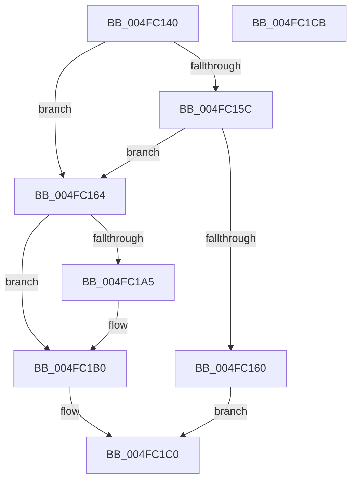

# RtlpComputeFraction

- RVA: `0x004FC140`–`0x004FC1CC` (길이 `140` bytes)
- VA: `0x00000001404FC140`
- 실행 섹션: `.text`
- PDB 이름 있음: `예`; PDB Function 태그: `아니요`
- unwind 정보 RVA: `0x0005CAAC`
- 디코드: `48`개 명령, `140/140` bytes 표시
- 미해석 바이트: `0` (있으면 어셈블리에 `.byte`로 보존)

> 이 문서는 커널 이미지의 기계어와 PDB 기호를 분석해 생성했습니다. 4번과 5번은 함수 원형과 자료형을 바이너리 사용 방식에서 추정한 C 해석이며 원본 소스 복구 결과는 아닙니다.

## 1. Dependencies

- 직접 호출 지점: **2**; 고유 호출 대상: **1**
- 직접 호출자로 확인된 함수: **3**
- RIP 상대 이미지 참조: **0**

### Outgoing calls
- `0x004FC164` → [RtlpCountLeadingZeroes64](../5E/RtlpCountLeadingZeroes64_function_005EECD8.md) (function, `0x005EECD8`)
- `0x004FC181` → [RtlpCountLeadingZeroes64](../5E/RtlpCountLeadingZeroes64_function_005EECD8.md) (function, `0x005EECD8`)

### Direct callers
- [RtlGenerateQpcToIncrementConstants](../4B/RtlGenerateQpcToIncrementConstants_function_004BCB20.md) at `0x004BCB3A`
- [KiInitializeProcessorCycleAccumulation](../5B/KiInitializeProcessorCycleAccumulation_function_005B2014.md) at `0x005B2042`
- [KiSetupTimeIncrement](../5B/KiSetupTimeIncrement_function_005B2244.md) at `0x005B22D3`

### Static image references
- 디코드된 RIP-relative 메모리 참조가 없습니다.

## 2. Other-region calls and transfers

- 다른 실행 섹션으로 향하는 call: **0**
- 별도 외부 분기/꼬리 이동을 확인하지 못했습니다.

## 3. Assembly (complete function range)

```asm
004FC140  48 89 5C 24 08                  mov qword ptr [rsp + 8], rbx
004FC145  57                              push rdi
004FC146  48 83 EC 20                     sub rsp, 0x20
004FC14A  44 8B CA                        mov r9d, edx
004FC14D  4D 8B D8                        mov r11, r8
004FC150  4C 8B C1                        mov r8, rcx
004FC153  41 C6 03 00                     mov byte ptr [r11], 0
004FC157  48 85 C9                        test rcx, rcx
004FC15A  75 08                           jne 0x1404fc164
004FC15C  85 D2                           test edx, edx
004FC15E  74 04                           je 0x1404fc164
004FC160  33 C0                           xor eax, eax
004FC162  EB 5C                           jmp 0x1404fc1c0
004FC164  E8 6F 2B 0F 00                  call 0x1405eecd8
004FC169  8A C8                           mov cl, al
004FC16B  8A D8                           mov bl, al
004FC16D  49 D3 E0                        shl r8, cl
004FC170  33 D2                           xor edx, edx
004FC172  49 8B C0                        mov rax, r8
004FC175  49 F7 F1                        div r9
004FC178  48 8B C8                        mov rcx, rax
004FC17B  4C 8B C2                        mov r8, rdx
004FC17E  4C 8B D0                        mov r10, rax
004FC181  E8 52 2B 0F 00                  call 0x1405eecd8
004FC186  0F B6 F8                        movzx edi, al
004FC189  33 D2                           xor edx, edx
004FC18B  8B CF                           mov ecx, edi
004FC18D  49 D3 E0                        shl r8, cl
004FC190  49 8B C0                        mov rax, r8
004FC193  49 D3 E2                        shl r10, cl
004FC196  49 F7 F1                        div r9
004FC199  4C 03 D0                        add r10, rax
004FC19C  48 8D 04 12                     lea rax, [rdx + rdx]
004FC1A0  49 3B C1                        cmp rax, r9
004FC1A3  76 0B                           jbe 0x1404fc1b0
004FC1A5  49 8D 4A 01                     lea rcx, [r10 + 1]
004FC1A9  49 3B CA                        cmp rcx, r10
004FC1AC  4C 0F 47 D1                     cmova r10, rcx
004FC1B0  B9 40 00 00 00                  mov ecx, 0x40
004FC1B5  49 8B C2                        mov rax, r10
004FC1B8  2A CB                           sub cl, bl
004FC1BA  40 2A CF                        sub cl, dil
004FC1BD  41 88 0B                        mov byte ptr [r11], cl
004FC1C0  48 8B 5C 24 30                  mov rbx, qword ptr [rsp + 0x30]
004FC1C5  48 83 C4 20                     add rsp, 0x20
004FC1C9  5F                              pop rdi
004FC1CA  C3                              ret
004FC1CB  CC                              int3
```

## 4. C-style interpretation (structured pseudocode)

```c
__int64 __fastcall RtlpComputeFraction(__int64 a1, int a2, __int64 a3)
{
    __int64 result;
    __int64 v_r10;
    __int64 v_rsp;
    unsigned __int64 v_stack_p8;

    v_stack_p8 = v_rbx;
    v_rsp = (v_rsp) - (32);
    *(unsigned __int8 *)(a3) = 0;
    if (a1 != 0) goto loc_004FC164;
    if (a2 == 0) goto loc_004FC164;
    result = 0;
    goto loc_004FC1C0;
loc_004FC164:
    result = RtlpCountLeadingZeroes64(a1, a2, a1, (unsigned int)(a2));
    a3 = (a1) << ((unsigned __int8)((unsigned __int8)(result)));
    a2 = 0;
    result = RtlpCountLeadingZeroes64(a3, a2, 0, (unsigned int)(a2));
    a2 = 0;
    a3 = (0) << ((unsigned __int8)((unsigned int)((unsigned int)((unsigned __int8)(result)))));
    v_r10 = (a3) << ((unsigned __int8)((unsigned int)((unsigned int)((unsigned __int8)(result)))));
    v_r10 = (v_r10) + (a3);
    if ((a2 + a2 * 1) >= = ((unsigned int)(a2))) {
        a1 = v_r10 + 1;
        if (a1 > v_r10) { v_r10 = a1; }
    }
    a1 = (unsigned __int8)((64) - ((unsigned __int8)((unsigned __int8)(result))));
    a1 = (unsigned __int8)((a1) - ((unsigned __int8)((unsigned __int8)(result))));
    *(unsigned __int8 *)(a3) = (unsigned __int8)(a1);
loc_004FC1C0:
    v_rsp = (v_rsp) + (32);
    return v_r10;
}
```

## 5. (Beta) C Style

```c
int64_t RtlpComputeFraction(int64_t Arg1, int32_t Arg2, void *Arg3)
{
    uint8_t *arg3 = (uint8_t *)Arg3;

    int64_t result;
    int64_t local_r10;
    int64_t local_rsp;
    uint64_t v_stack_p8;

    v_stack_p8 = local_rbx;
    local_rsp = (local_rsp) - (32);
    *(uint8_t *)(arg3) = 0;
    if (Arg1 != 0) goto loc_004FC164;
    if (Arg2 == 0) goto loc_004FC164;
    result = 0;
    goto loc_004FC1C0;
loc_004FC164:
    result = RtlpCountLeadingZeroes64(Arg1, Arg2, Arg1, (uint32_t)(Arg2));
    Arg3 = (Arg1) << ((uint8_t)((uint8_t)(result)));
    Arg2 = 0;
    result = RtlpCountLeadingZeroes64(Arg3, Arg2, 0, (uint32_t)(Arg2));
    Arg2 = 0;
    Arg3 = (0) << ((uint8_t)((uint32_t)((uint32_t)((uint8_t)(result)))));
    local_r10 = (Arg3) << ((uint8_t)((uint32_t)((uint32_t)((uint8_t)(result)))));
    local_r10 = (local_r10) + (Arg3);
    if ((Arg2 + Arg2 * 1) >= = ((uint32_t)(Arg2))) {
        Arg1 = local_r10 + 1;
        if (Arg1 > local_r10) { local_r10 = Arg1; }
    }
    Arg1 = (uint8_t)((64) - ((uint8_t)((uint8_t)(result))));
    Arg1 = (uint8_t)((Arg1) - ((uint8_t)((uint8_t)(result))));
    *(uint8_t *)(arg3) = (uint8_t)(Arg1);
loc_004FC1C0:
    local_rsp = (local_rsp) + (32);
    return local_r10;
}
```

### 관측된 메모리 오프셋

구조체 형식이 확인되지 않은 접근은 인자 기준의 오프셋으로만 기록했습니다.

| 기준 인자 | 오프셋 표현 | 폭 (bit) | 접근 |
|---|---:|---:|---|
| `Arg3` | `+ 0x0` | `8` | `W` |

## 6. Execution-region graph

[열기: 2D/3D 그래프와 함수 탐색 컨트롤 패널](../../../control-panel.html?section=text&rva=0x004FC140&view=graph)

- 2D 그래프는 위에서 아래로 흐르고, 3D 그래프는 빈 공간을 드래그해 회전합니다. Shift+드래그는 이동, 휠은 확대·축소, 함수 노드 선택은 대상 보고서 이동입니다.

### Static fallback


