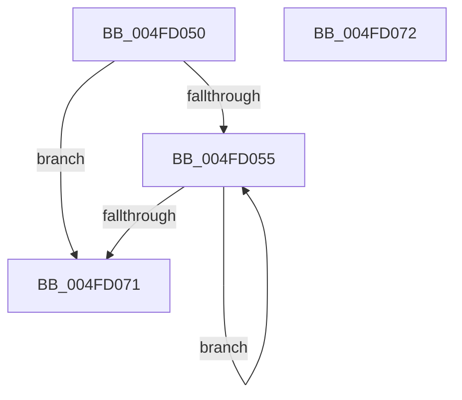

# RtlpFcConvertFeatureConfigurationsInternalToExternal

- RVA: `0x004FD050`–`0x004FD073` (길이 `35` bytes)
- VA: `0x00000001404FD050`
- 실행 섹션: `.text`
- PDB 이름 있음: `예`; PDB Function 태그: `아니요`
- unwind 정보 RVA: `0x000DB714`
- 디코드: `12`개 명령, `35/35` bytes 표시
- 미해석 바이트: `0` (있으면 어셈블리에 `.byte`로 보존)

> 이 문서는 커널 이미지의 기계어와 PDB 기호를 분석해 생성했습니다. 4번과 5번은 함수 원형과 자료형을 바이너리 사용 방식에서 추정한 C 해석이며 원본 소스 복구 결과는 아닙니다.

## 1. Dependencies

- 직접 호출 지점: **0**; 고유 호출 대상: **0**
- 직접 호출자로 확인된 함수: **2**
- RIP 상대 이미지 참조: **0**

### Outgoing calls
- 직접 디코드된 call 명령이 없습니다.

### Direct callers
- [RtlQueryFeatureConfigurationFromBuffers](../5E/RtlQueryFeatureConfigurationFromBuffers_function_005E7414.md) at `0x005E74D3`
- [RtlQueryAllFeatureConfigurations](../../page/78/RtlQueryAllFeatureConfigurations_function_0078F510.md) at `0x0078F5A5`

### Static image references
- 디코드된 RIP-relative 메모리 참조가 없습니다.

## 2. Other-region calls and transfers

- 다른 실행 섹션으로 향하는 call: **0**
- 별도 외부 분기/꼬리 이동을 확인하지 못했습니다.

## 3. Assembly (complete function range)

```asm
004FD050  4D 85 C0                        test r8, r8
004FD053  74 1C                           je 0x1404fd071
004FD055  F2 0F 10 01                     movsd xmm0, qword ptr [rcx]
004FD059  48 8D 49 10                     lea rcx, [rcx + 0x10]
004FD05D  F2 0F 11 02                     movsd qword ptr [rdx], xmm0
004FD061  48 8D 52 0C                     lea rdx, [rdx + 0xc]
004FD065  8B 41 F8                        mov eax, dword ptr [rcx - 8]
004FD068  89 42 FC                        mov dword ptr [rdx - 4], eax
004FD06B  49 83 E8 01                     sub r8, 1
004FD06F  75 E4                           jne 0x1404fd055
004FD071  C3                              ret
004FD072  CC                              int3
```

## 4. C-style interpretation (structured pseudocode)

```c
__int64 __fastcall RtlpFcConvertFeatureConfigurationsInternalToExternal(__int64 a1, __int64 a2, __int64 a3)
{
    if (a3 == 0) goto loc_004FD071;
loc_004FD055:
    *(unsigned __int64 *)(a2) = v_xmm0;
    *(unsigned int *)(a2 + 12 - 4) = (unsigned int)((unsigned int)(*(unsigned int *)(a1 + 16 - 8)));
    a3 = (a3) - (1);
    if (condition_is_not_equal) goto loc_004FD055;
loc_004FD071:
    return (unsigned int)(*(unsigned int *)(a1 + 16 - 8));
}
```

## 5. (Beta) C Style

```c
int64_t RtlpFcConvertFeatureConfigurationsInternalToExternal(void *Arg1, void *Arg2, int64_t Arg3)
{
    uint8_t *arg1 = (uint8_t *)Arg1;
    uint8_t *arg2 = (uint8_t *)Arg2;

    if (Arg3 == 0) goto loc_004FD071;
loc_004FD055:
    *(uint64_t *)(arg2) = v_xmm0;
    *(uint32_t *)(arg2 + 0xC - 0x4) = (uint32_t)((uint32_t)(*(uint32_t *)(arg1 + 0x10 - 0x8)));
    Arg3 = (Arg3) - (1);
    if (condition_is_not_equal) goto loc_004FD055;
loc_004FD071:
    return (uint32_t)(*(uint32_t *)(arg1 + 0x10 - 0x8));
}
```

### 관측된 메모리 오프셋

구조체 형식이 확인되지 않은 접근은 인자 기준의 오프셋으로만 기록했습니다.

| 기준 인자 | 오프셋 표현 | 폭 (bit) | 접근 |
|---|---:|---:|---|
| `Arg1` | `- 0x8` | `32` | `R` |
| `Arg1` | `+ 0x0` | `64` | `R` |
| `Arg1` | `+ 0x10` | `64` | `R` |
| `Arg2` | `- 0x4` | `32` | `W` |
| `Arg2` | `+ 0x0` | `64` | `W` |
| `Arg2` | `+ 0xC` | `64` | `R` |

## 6. Execution-region graph

[열기: 2D/3D 그래프와 함수 탐색 컨트롤 패널](../../../control-panel.html?section=text&rva=0x004FD050&view=graph)

- 2D 그래프는 위에서 아래로 흐르고, 3D 그래프는 빈 공간을 드래그해 회전합니다. Shift+드래그는 이동, 휠은 확대·축소, 함수 노드 선택은 대상 보고서 이동입니다.

### Static fallback


