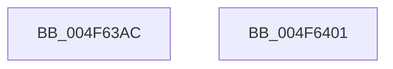

# RtlpHpEnvTlsSetValue

- RVA: `0x004F63AC`–`0x004F6402` (길이 `86` bytes)
- VA: `0x00000001404F63AC`
- 실행 섹션: `.text`
- PDB 이름 있음: `예`; PDB Function 태그: `아니요`
- unwind 정보 RVA: `0x000DB714`
- 디코드: `22`개 명령, `86/86` bytes 표시
- 미해석 바이트: `0` (있으면 어셈블리에 `.byte`로 보존)

> 이 문서는 커널 이미지의 기계어와 PDB 기호를 분석해 생성했습니다. 4번과 5번은 함수 원형과 자료형을 바이너리 사용 방식에서 추정한 C 해석이며 원본 소스 복구 결과는 아닙니다.

## 1. Dependencies

- 직접 호출 지점: **0**; 고유 호출 대상: **0**
- 직접 호출자로 확인된 함수: **4**
- RIP 상대 이미지 참조: **0**

### Outgoing calls
- 직접 디코드된 call 명령이 없습니다.

### Direct callers
- [RtlpHpLfhBucketUpdateAffinityMapping](../4D/RtlpHpLfhBucketUpdateAffinityMapping_function_004D0008.md) at `0x004D00F4`
- [RtlpHpLfhBucketUpdateAffinityMapping](../4D/RtlpHpLfhBucketUpdateAffinityMapping_function_004D0008.md) at `0x004D0134`
- [RtlpHpLfhBucketUpdateAffinityMapping](../4D/RtlpHpLfhBucketUpdateAffinityMapping_function_004D0008.md) at `0x004D0222`
- [RtlpHpLfhBucketUpdateAffinityMapping](../4D/RtlpHpLfhBucketUpdateAffinityMapping_function_004D0008.md) at `0x004D0255`
- [RtlpHpLfhThreadDataInitializeSet](RtlpHpLfhThreadDataInitializeSet_function_004F6334.md) at `0x004F6396`
- [RtlpHpLfhPrivateSlotCreate](../60/RtlpHpLfhPrivateSlotCreate_function_00604D50.md) at `0x00604E59`
- [sub_006DE040](../6D/Unknown_function_006DE040.md) at `0x006DE0EC`

### Static image references
- 디코드된 RIP-relative 메모리 참조가 없습니다.

## 2. Other-region calls and transfers

- 다른 실행 섹션으로 향하는 call: **0**
- 별도 외부 분기/꼬리 이동을 확인하지 못했습니다.

## 3. Assembly (complete function range)

```asm
004F63AC  65 4C 8B 14 25 20 00 00 00      mov r10, qword ptr gs:[0x20]
004F63B5  44 8B C9                        mov r9d, ecx
004F63B8  8B C1                           mov eax, ecx
004F63BA  41 B8 01 00 00 00               mov r8d, 1
004F63C0  48 C1 E8 04                     shr rax, 4
004F63C4  4C 8B DA                        mov r11, rdx
004F63C7  41 C1 E9 0D                     shr r9d, 0xd
004F63CB  25 FF 01 00 00                  and eax, 0x1ff
004F63D0  41 81 E1 FF FF 03 00            and r9d, 0x3ffff
004F63D7  41 0F BD C9                     bsr ecx, r9d
004F63DB  41 D3 E0                        shl r8d, cl
004F63DE  83 C1 FE                        add ecx, -2
004F63E1  89 4C 24 08                     mov dword ptr [rsp + 8], ecx
004F63E5  45 33 C1                        xor r8d, r9d
004F63E8  8B D1                           mov edx, ecx
004F63EA  49 8B 8A B0 8B 00 00            mov rcx, qword ptr [r10 + 0x8bb0]
004F63F1  48 8B 0C D1                     mov rcx, qword ptr [rcx + rdx*8]
004F63F5  4A 8B 4C C1 08                  mov rcx, qword ptr [rcx + r8*8 + 8]
004F63FA  4C 89 1C C1                     mov qword ptr [rcx + rax*8], r11
004F63FE  33 C0                           xor eax, eax
004F6400  C3                              ret
004F6401  CC                              int3
```

## 4. C-style interpretation (structured pseudocode)

```c
__int64 __fastcall RtlpHpEnvTlsSetValue(int a1, __int64 a2)
{
    __int64 result;
    unsigned int v_stack_p8;

    result = ((unsigned int)(a1)) >> (4);
    a4 = (unsigned int)(((unsigned int)(a1)) >> (13));
    result = (unsigned int)((result) & (511));
    a4 = (unsigned int)((a4) & (0x3FFFFULL));
    a3 = (unsigned int)((1) << ((unsigned __int8)(a1)));
    a1 = (unsigned int)((a1) + (-2));
    v_stack_p8 = a1;
    a3 = (unsigned int)((a3) ^ ((unsigned int)(a4)));
    *(unsigned __int64 *)(*(unsigned __int64 *)(*(unsigned __int64 *)(*(unsigned __int64 *)(*(unsigned __int64 *)(gs_base + (0 + 32)) + 35760) + (unsigned int)(a1) * 8) + a3 * 8 + 8) + result * 8) = a2;
    result = 0;
    return result;
}
```

## 5. (Beta) C Style

```c
int64_t RtlpHpEnvTlsSetValue(int32_t Arg1, int64_t Arg2)
{
    int64_t result;
    uint32_t v_stack_p8;

    result = ((uint32_t)(Arg1)) >> (4);
    a4 = (uint32_t)(((uint32_t)(Arg1)) >> (13));
    result = (uint32_t)((result) & (511));
    a4 = (uint32_t)((a4) & (0x3FFFFULL));
    a3 = (uint32_t)((1) << ((uint8_t)(Arg1)));
    Arg1 = (uint32_t)((Arg1) + (-2));
    v_stack_p8 = Arg1;
    a3 = (uint32_t)((a3) ^ ((uint32_t)(a4)));
    *(uint64_t *)(*(uint64_t *)(*(uint64_t *)(*(uint64_t *)(*(uint64_t *)(gs_base + (0 + 0x20)) + 0x8BB0) + (uint32_t)(Arg1) * 8) + a3 * 8 + 0x8) + result * 8) = Arg2;
    result = 0;
    return result;
}
```

## 6. Execution-region graph

[열기: 2D/3D 그래프와 함수 탐색 컨트롤 패널](../../../control-panel.html?section=text&rva=0x004F63AC&view=graph)

- 2D 그래프는 위에서 아래로 흐르고, 3D 그래프는 빈 공간을 드래그해 회전합니다. Shift+드래그는 이동, 휠은 확대·축소, 함수 노드 선택은 대상 보고서 이동입니다.

### Static fallback


