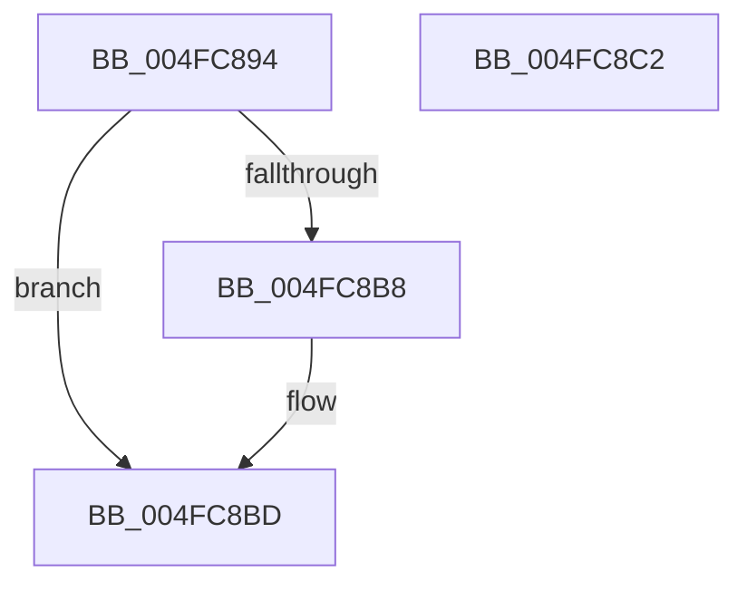

# RtlpHpLfhBucketCheckAndUpdate

- RVA: `0x004FC894`–`0x004FC8C3` (길이 `47` bytes)
- VA: `0x00000001404FC894`
- 실행 섹션: `.text`
- PDB 이름 있음: `예`; PDB Function 태그: `아니요`
- unwind 정보 RVA: `0x0005C788`
- 디코드: `13`개 명령, `47/47` bytes 표시
- 미해석 바이트: `0` (있으면 어셈블리에 `.byte`로 보존)

> 이 문서는 커널 이미지의 기계어와 PDB 기호를 분석해 생성했습니다. 4번과 5번은 함수 원형과 자료형을 바이너리 사용 방식에서 추정한 C 해석이며 원본 소스 복구 결과는 아닙니다.

## 1. Dependencies

- 직접 호출 지점: **1**; 고유 호출 대상: **1**
- 직접 호출자로 확인된 함수: **4**
- RIP 상대 이미지 참조: **0**

### Outgoing calls
- `0x004FC8B8` → [RtlpHpLfhBucketUpdateStats](../4D/RtlpHpLfhBucketUpdateStats_function_004D0320.md) (function, `0x004D0320`)

### Direct callers
- [sub_002E9C01](../2E/Unknown_function_002E9C01.md) at `0x002E9C18`
- [RtlpHpAllocateHeapSlow](../2E/RtlpHpAllocateHeapSlow_function_002E9DEC.md) at `0x002E9EF6`
- [RtlpHpMetadataAlloc](../2E/RtlpHpMetadataAlloc_function_002EC180.md) at `0x002EC470`
- [ExAllocateHeapPool](../35/ExAllocateHeapPool_function_0035BA30.md) at `0x0035D930`
- [ExAllocateHeapPool](../35/ExAllocateHeapPool_function_0035BA30.md) at `0x0035D971`

### Static image references
- 디코드된 RIP-relative 메모리 참조가 없습니다.

## 2. Other-region calls and transfers

- 다른 실행 섹션으로 향하는 call: **0**
- 별도 외부 분기/꼬리 이동을 확인하지 못했습니다.

## 3. Assembly (complete function range)

```asm
004FC894  48 83 EC 28                     sub rsp, 0x28
004FC898  8B C2                           mov eax, edx
004FC89A  41 B8 01 00 00 00               mov r8d, 1
004FC8A0  4C 8B 8C C1 C0 01 00 00         mov r9, qword ptr [rcx + rax*8 + 0x1c0]
004FC8A8  41 8D 40 FF                     lea eax, [r8 - 1]
004FC8AC  45 84 C8                        test r8b, r9b
004FC8AF  49 0F 44 C1                     cmove rax, r9
004FC8B3  48 85 C0                        test rax, rax
004FC8B6  75 05                           jne 0x1404fc8bd
004FC8B8  E8 63 3A FD FF                  call 0x1404d0320
004FC8BD  48 83 C4 28                     add rsp, 0x28
004FC8C1  C3                              ret
004FC8C2  CC                              int3
```

## 4. C-style interpretation (structured pseudocode)

```c
__int64 __fastcall RtlpHpLfhBucketCheckAndUpdate(__int64 a1, int a2)
{
    __int64 result;
    __int64 v_rsp;

    v_rsp = (v_rsp) - (40);
    result = 1 - 1;
    if (((1) & ((unsigned __int8)(*(unsigned __int64 *)(a1 + (unsigned int)(a2) * 8 + 448)))) == 0) { result = *(unsigned __int64 *)(a1 + (unsigned int)(a2) * 8 + 448); }
    if (result == 0) {
        result = RtlpHpLfhBucketUpdateStats(a1, a2, 1, *(unsigned __int64 *)(a1 + (unsigned int)(a2) * 8 + 448));
    }
    v_rsp = (v_rsp) + (40);
    return result;
}
```

## 5. (Beta) C Style

```c
int64_t RtlpHpLfhBucketCheckAndUpdate(void *Arg1, int32_t Arg2)
{
    uint8_t *arg1 = (uint8_t *)Arg1;

    int64_t result;
    int64_t local_rsp;

    local_rsp = (local_rsp) - (40);
    result = 1 - 1;
    if (((1) & ((uint8_t)(*(uint64_t *)(arg1 + (uint32_t)(Arg2) * 8 + 0x1C0)))) == 0) { result = *(uint64_t *)(arg1 + (uint32_t)(Arg2) * 8 + 0x1C0); }
    if (result == 0) {
        result = RtlpHpLfhBucketUpdateStats(Arg1, Arg2, 1, *(uint64_t *)(arg1 + (uint32_t)(Arg2) * 8 + 0x1C0));
    }
    local_rsp = (local_rsp) + (40);
    return result;
}
```

### 관측된 메모리 오프셋

구조체 형식이 확인되지 않은 접근은 인자 기준의 오프셋으로만 기록했습니다.

| 기준 인자 | 오프셋 표현 | 폭 (bit) | 접근 |
|---|---:|---:|---|
| `Arg1` | `+ 0x1C0 + rax*8` | `64` | `R` |

## 6. Execution-region graph

[열기: 2D/3D 그래프와 함수 탐색 컨트롤 패널](../../../control-panel.html?section=text&rva=0x004FC894&view=graph)

- 2D 그래프는 위에서 아래로 흐르고, 3D 그래프는 빈 공간을 드래그해 회전합니다. Shift+드래그는 이동, 휠은 확대·축소, 함수 노드 선택은 대상 보고서 이동입니다.

### Static fallback


