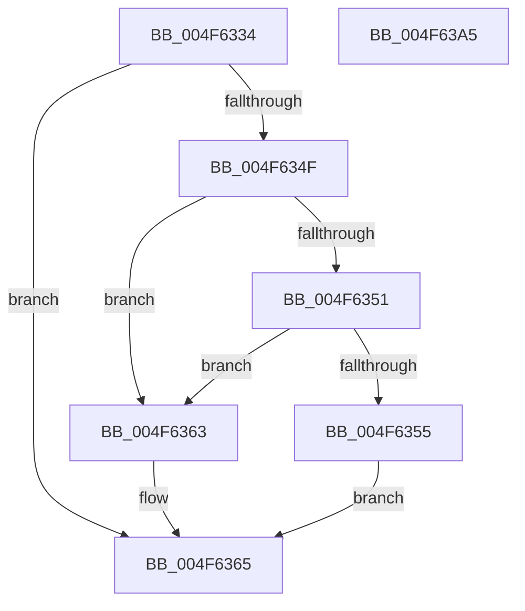

# RtlpHpLfhThreadDataInitializeSet

- RVA: `0x004F6334`–`0x004F63A6` (길이 `114` bytes)
- VA: `0x00000001404F6334`
- 실행 섹션: `.text`
- PDB 이름 있음: `예`; PDB Function 태그: `아니요`
- unwind 정보 RVA: `0x0005C788`
- 디코드: `32`개 명령, `114/114` bytes 표시
- 미해석 바이트: `0` (있으면 어셈블리에 `.byte`로 보존)

> 이 문서는 커널 이미지의 기계어와 PDB 기호를 분석해 생성했습니다. 4번과 5번은 함수 원형과 자료형을 바이너리 사용 방식에서 추정한 C 해석이며 원본 소스 복구 결과는 아닙니다.

## 1. Dependencies

- 직접 호출 지점: **1**; 고유 호출 대상: **1**
- 직접 호출자로 확인된 함수: **11**
- RIP 상대 이미지 참조: **0**

### Outgoing calls
- `0x004F6396` → [RtlpHpEnvTlsSetValue](RtlpHpEnvTlsSetValue_function_004F63AC.md) (function, `0x004F63AC`)

### Direct callers
- [RtlpHpLfhSlotAllocateSlow](../2E/RtlpHpLfhSlotAllocateSlow_function_002E8FBC.md) at `0x002E96F4`
- [sub_002E9C01](../2E/Unknown_function_002E9C01.md) at `0x002E9DC3`
- [RtlpHpAllocateHeapSlow](../2E/RtlpHpAllocateHeapSlow_function_002E9DEC.md) at `0x002E9ECE`
- [RtlpHpMetadataAlloc](../2E/RtlpHpMetadataAlloc_function_002EC180.md) at `0x002EC481`
- [RtlpHpLfhContextFree](../35/RtlpHpLfhContextFree_function_0035B2A0.md) at `0x0035B52F`
- [ExAllocateHeapPool](../35/ExAllocateHeapPool_function_0035BA30.md) at `0x0035E8B6`
- [ExAllocateHeapPool](../35/ExAllocateHeapPool_function_0035BA30.md) at `0x0035E94E`
- [ExAllocateHeapPool](../35/ExAllocateHeapPool_function_0035BA30.md) at `0x0035E9D1`
- [ExAllocateHeapPool](../35/ExAllocateHeapPool_function_0035BA30.md) at `0x0035E9E5`
- [sub_0035FA7A](../35/Unknown_function_0035FA7A.md) at `0x0035FAD0`
- [sub_00360968](../36/Unknown_function_00360968.md) at `0x00360FDF`
- [RtlpHpLfhBucketUpdateAffinityMapping](../4D/RtlpHpLfhBucketUpdateAffinityMapping_function_004D0008.md) at `0x004D0088`
- [RtlpHpLfhPrivateSlotListCompact](../60/RtlpHpLfhPrivateSlotListCompact_function_00604F1C.md) at `0x00604F54`
- [sub_00B8371E](../../poolcode/B8/Unknown_function_00B8371E.md) at `0x00B83D99`

### Static image references
- 디코드된 RIP-relative 메모리 참조가 없습니다.

## 2. Other-region calls and transfers

- 다른 실행 섹션으로 향하는 call: **0**
- 별도 외부 분기/꼬리 이동을 확인하지 못했습니다.

## 3. Assembly (complete function range)

```asm
004F6334  48 83 EC 28                     sub rsp, 0x28
004F6338  65 48 8B 04 25 20 00 00 00      mov rax, qword ptr gs:[0x20]
004F6341  8B 50 24                        mov edx, dword ptr [rax + 0x24]
004F6344  0F B6 41 40                     movzx eax, byte ptr [rcx + 0x40]
004F6348  83 E2 3F                        and edx, 0x3f
004F634B  3B D0                           cmp edx, eax
004F634D  72 16                           jb 0x1404f6365
004F634F  74 12                           je 0x1404f6363
004F6351  3C 01                           cmp al, 1
004F6353  74 0E                           je 0x1404f6363
004F6355  2B D0                           sub edx, eax
004F6357  48 8B 41 38                     mov rax, qword ptr [rcx + 0x38]
004F635B  FF CA                           dec edx
004F635D  0F B6 14 02                     movzx edx, byte ptr [rdx + rax]
004F6361  EB 02                           jmp 0x1404f6365
004F6363  33 D2                           xor edx, edx
004F6365  48 83 64 24 30 00               and qword ptr [rsp + 0x30], 0
004F636B  8B C2                           mov eax, edx
004F636D  8B 49 4C                        mov ecx, dword ptr [rcx + 0x4c]
004F6370  48 C1 E0 08                     shl rax, 8
004F6374  48 05 C0 05 00 00               add rax, 0x5c0
004F637A  88 54 24 34                     mov byte ptr [rsp + 0x34], dl
004F637E  48 C1 E8 06                     shr rax, 6
004F6382  66 89 44 24 30                  mov word ptr [rsp + 0x30], ax
004F6387  B8 03 00 00 00                  mov eax, 3
004F638C  66 89 44 24 32                  mov word ptr [rsp + 0x32], ax
004F6391  48 8B 54 24 30                  mov rdx, qword ptr [rsp + 0x30]
004F6396  E8 11 00 00 00                  call 0x1404f63ac
004F639B  48 8B 44 24 30                  mov rax, qword ptr [rsp + 0x30]
004F63A0  48 83 C4 28                     add rsp, 0x28
004F63A4  C3                              ret
004F63A5  CC                              int3
```

## 4. C-style interpretation (structured pseudocode)

```c
__int64 __fastcall RtlpHpLfhThreadDataInitializeSet(__int64 a1)
{
    __int64 result;
    __int64 v_rsp;
    unsigned __int64 v_stack_p8;
    unsigned __int16 v_stack_pA;
    unsigned __int8 v_stack_pC;

    v_rsp = (v_rsp) - (40);
    a2 = (unsigned int)(((unsigned int)(*(unsigned int *)(*(unsigned __int64 *)(gs_base + (0 + 32)) + 36))) & (63));
    if (((unsigned int)(a2)) < ((unsigned int)(*(unsigned __int8 *)(a1 + 64)))) goto loc_004F6365;
    if (((unsigned int)(a2)) == ((unsigned int)(*(unsigned __int8 *)(a1 + 64)))) goto loc_004F6363;
    if (((unsigned __int8)(*(unsigned __int8 *)(a1 + 64))) == 1) goto loc_004F6363;
    a2 = (unsigned int)((a2) - ((unsigned int)(*(unsigned __int8 *)(a1 + 64))));
    a2 = (unsigned int)((a2) - 1);
    goto loc_004F6365;
loc_004F6363:
    a2 = 0;
loc_004F6365:
    result = (0) << (8);
    result = (result) + (0x5C0ULL);
    v_stack_pC = 0;
    result = (result) >> (6);
    v_stack_p8 = (unsigned __int16)(result);
    v_stack_pA = 3;
    result = RtlpHpEnvTlsSetValue((unsigned int)(*(unsigned int *)(a1 + 76)), v_stack_p8, a3, a4);
    v_rsp = (v_rsp) + (40);
    return v_stack_p8;
}
```

## 5. (Beta) C Style

```c
int64_t RtlpHpLfhThreadDataInitializeSet(void *Arg1)
{
    uint8_t *arg1 = (uint8_t *)Arg1;

    int64_t result;
    int64_t local_rsp;
    uint64_t v_stack_p8;
    uint16_t v_stack_pA;
    uint8_t v_stack_pC;

    local_rsp = (local_rsp) - (40);
    a2 = (uint32_t)(((uint32_t)(*(uint32_t *)(*(uint64_t *)(gs_base + (0 + 0x20)) + 0x24))) & (63));
    if (((uint32_t)(a2)) < ((uint32_t)(*(uint8_t *)(arg1 + 0x40)))) goto loc_004F6365;
    if (((uint32_t)(a2)) == ((uint32_t)(*(uint8_t *)(arg1 + 0x40)))) goto loc_004F6363;
    if (((uint8_t)(*(uint8_t *)(arg1 + 0x40))) == 1) goto loc_004F6363;
    a2 = (uint32_t)((a2) - ((uint32_t)(*(uint8_t *)(arg1 + 0x40))));
    a2 = (uint32_t)((a2) - 1);
    goto loc_004F6365;
loc_004F6363:
    a2 = 0;
loc_004F6365:
    result = (0) << (8);
    result = (result) + (0x5C0ULL);
    v_stack_pC = 0;
    result = (result) >> (6);
    v_stack_p8 = (uint16_t)(result);
    v_stack_pA = 3;
    result = RtlpHpEnvTlsSetValue((uint32_t)(*(uint32_t *)(arg1 + 0x4C)), v_stack_p8, a3, a4);
    local_rsp = (local_rsp) + (40);
    return v_stack_p8;
}
```

### 관측된 메모리 오프셋

구조체 형식이 확인되지 않은 접근은 인자 기준의 오프셋으로만 기록했습니다.

| 기준 인자 | 오프셋 표현 | 폭 (bit) | 접근 |
|---|---:|---:|---|
| `Arg1` | `+ 0x38` | `64` | `R` |
| `Arg1` | `+ 0x40` | `8` | `R` |
| `Arg1` | `+ 0x4C` | `32` | `R` |

## 6. Execution-region graph

[열기: 2D/3D 그래프와 함수 탐색 컨트롤 패널](../../../control-panel.html?section=text&rva=0x004F6334&view=graph)

- 2D 그래프는 위에서 아래로 흐르고, 3D 그래프는 빈 공간을 드래그해 회전합니다. Shift+드래그는 이동, 휠은 확대·축소, 함수 노드 선택은 대상 보고서 이동입니다.

### Static fallback


