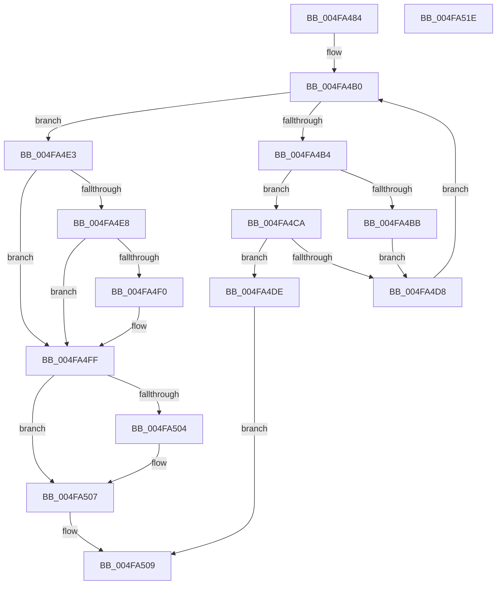

# RtlpHpVaMgrCtxAllocatorFind

- RVA: `0x004FA484`–`0x004FA51F` (길이 `155` bytes)
- VA: `0x00000001404FA484`
- 실행 섹션: `.text`
- PDB 이름 있음: `예`; PDB Function 태그: `아니요`
- unwind 정보 RVA: `0x0005C954`
- 디코드: `48`개 명령, `155/155` bytes 표시
- 미해석 바이트: `0` (있으면 어셈블리에 `.byte`로 보존)

> 이 문서는 커널 이미지의 기계어와 PDB 기호를 분석해 생성했습니다. 4번과 5번은 함수 원형과 자료형을 바이너리 사용 방식에서 추정한 C 해석이며 원본 소스 복구 결과는 아닙니다.

## 1. Dependencies

- 직접 호출 지점: **1**; 고유 호출 대상: **1**
- 직접 호출자로 확인된 함수: **2**
- RIP 상대 이미지 참조: **0**

### Outgoing calls
- `0x004FA4CF` → [RtlpHpVaMgrCtxAllocatorCompare](../60/RtlpHpVaMgrCtxAllocatorCompare_function_00603B6C.md) (function, `0x00603B6C`)

### Direct callers
- [RtlpHpVaMgrCtxAlloc](../2E/RtlpHpVaMgrCtxAlloc_function_002EDA80.md) at `0x002EDB00`
- [RtlpHpVaMgrCtxAllocatorReference](../60/RtlpHpVaMgrCtxAllocatorReference_function_00603BC0.md) at `0x00603C3D`

### Static image references
- 디코드된 RIP-relative 메모리 참조가 없습니다.

## 2. Other-region calls and transfers

- 다른 실행 섹션으로 향하는 call: **0**
- 별도 외부 분기/꼬리 이동을 확인하지 못했습니다.

## 3. Assembly (complete function range)

```asm
004FA484  48 89 5C 24 08                  mov qword ptr [rsp + 8], rbx
004FA489  48 89 6C 24 10                  mov qword ptr [rsp + 0x10], rbp
004FA48E  48 89 74 24 18                  mov qword ptr [rsp + 0x18], rsi
004FA493  57                              push rdi
004FA494  48 83 EC 20                     sub rsp, 0x20
004FA498  8B 99 6C 08 00 00               mov ebx, dword ptr [rcx + 0x86c]
004FA49E  4C 8D 99 70 08 00 00            lea r11, [rcx + 0x870]
004FA4A5  45 33 D2                        xor r10d, r10d
004FA4A8  49 8B F9                        mov rdi, r9
004FA4AB  33 F6                           xor esi, esi
004FA4AD  48 8B E9                        mov rbp, rcx
004FA4B0  3B F3                           cmp esi, ebx
004FA4B2  73 2F                           jae 0x1404fa4e3
004FA4B4  49 83 7B 18 00                  cmp qword ptr [r11 + 0x18], 0
004FA4B9  75 0F                           jne 0x1404fa4ca
004FA4BB  4D 85 D2                        test r10, r10
004FA4BE  49 8B C3                        mov rax, r11
004FA4C1  49 0F 45 C2                     cmovne rax, r10
004FA4C5  4C 8B D0                        mov r10, rax
004FA4C8  EB 0E                           jmp 0x1404fa4d8
004FA4CA  49 8B CB                        mov rcx, r11
004FA4CD  FF C6                           inc esi
004FA4CF  E8 98 96 10 00                  call 0x140603b6c
004FA4D4  85 C0                           test eax, eax
004FA4D6  75 06                           jne 0x1404fa4de
004FA4D8  49 83 C3 30                     add r11, 0x30
004FA4DC  EB D2                           jmp 0x1404fa4b0
004FA4DE  49 8B C3                        mov rax, r11
004FA4E1  EB 26                           jmp 0x1404fa509
004FA4E3  4D 85 D2                        test r10, r10
004FA4E6  75 17                           jne 0x1404fa4ff
004FA4E8  81 FB FF 00 00 00               cmp ebx, 0xff
004FA4EE  73 0F                           jae 0x1404fa4ff
004FA4F0  48 8D 43 2D                     lea rax, [rbx + 0x2d]
004FA4F4  4C 8D 14 40                     lea r10, [rax + rax*2]
004FA4F8  49 C1 E2 04                     shl r10, 4
004FA4FC  4C 03 D5                        add r10, rbp
004FA4FF  48 85 FF                        test rdi, rdi
004FA502  74 03                           je 0x1404fa507
004FA504  4C 89 17                        mov qword ptr [rdi], r10
004FA507  33 C0                           xor eax, eax
004FA509  48 8B 5C 24 30                  mov rbx, qword ptr [rsp + 0x30]
004FA50E  48 8B 6C 24 38                  mov rbp, qword ptr [rsp + 0x38]
004FA513  48 8B 74 24 40                  mov rsi, qword ptr [rsp + 0x40]
004FA518  48 83 C4 20                     add rsp, 0x20
004FA51C  5F                              pop rdi
004FA51D  C3                              ret
004FA51E  CC                              int3
```

## 4. C-style interpretation (structured pseudocode)

```c
__int64 __fastcall RtlpHpVaMgrCtxAllocatorFind(__int64 a1, __int64 a2, __int64 a3, __int64 a4)
{
    __int64 result;
    __int64 v_r10;
    __int64 v_r11;
    __int64 v_rsi;
    __int64 v_rsp;
    unsigned __int64 v_stack_p10;
    unsigned __int64 v_stack_p18;
    unsigned __int64 v_stack_p8;

    v_stack_p8 = v_rbx;
    v_stack_p10 = v_rbp;
    v_stack_p18 = v_rsi;
    v_rsp = (v_rsp) - (32);
    v_r10 = 0;
    v_rsi = 0;
loc_004FA4B0:
    if (0 >= ((unsigned int)((unsigned int)(*(unsigned int *)(a1 + 2156))))) goto loc_004FA4E3;
    if ((*(unsigned __int64 *)(a1 + 2160 + 24)) != 0) goto loc_004FA4CA;
    result = a1 + 2160;
    if (0 != 0) { result = 0; }
    goto loc_004FA4D8;
loc_004FA4CA:
    v_rsi = (unsigned int)((v_rsi) + 1);
    result = RtlpHpVaMgrCtxAllocatorCompare(a1 + 2160, a2, a3, a4);
    if ((unsigned int)(result) != 0) goto loc_004FA4DE;
loc_004FA4D8:
    v_r11 = (a1 + 2160) + (48);
    goto loc_004FA4B0;
loc_004FA4DE:
    goto loc_004FA509;
loc_004FA4E3:
    if (result != 0) goto loc_004FA4FF;
    result = v_r11;
    v_r10 = result;
    if (((unsigned int)((unsigned int)(*(unsigned int *)(a1 + 2156)))) < 255) {
        result = (unsigned int)(*(unsigned int *)(a1 + 2156)) + 45;
        v_r10 = result + result * 2;
        v_r10 = (v_r10) << (4);
        v_r10 = (v_r10) + (a1);
    }
    if (a4 != 0) {
        *(unsigned __int64 *)(a4) = v_r10;
    }
    result = 0;
loc_004FA509:
    v_rsp = (v_rsp) + (32);
    return result;
}
```

## 5. (Beta) C Style

```c
int64_t RtlpHpVaMgrCtxAllocatorFind(void *Arg1, int64_t Arg2, int64_t Arg3, int64_t Arg4)
{
    uint8_t *arg1 = (uint8_t *)Arg1;

    int64_t result;
    int64_t local_r10;
    int64_t local_r11;
    int64_t local_rsi;
    int64_t local_rsp;
    uint64_t v_stack_p10;
    uint64_t v_stack_p18;
    uint64_t v_stack_p8;

    v_stack_p8 = local_rbx;
    v_stack_p10 = local_rbp;
    v_stack_p18 = local_rsi;
    local_rsp = (local_rsp) - (32);
    local_r10 = 0;
    local_rsi = 0;
loc_004FA4B0:
    if (0 >= ((uint32_t)((uint32_t)(*(uint32_t *)(arg1 + 0x86C))))) goto loc_004FA4E3;
    if ((*(uint64_t *)(arg1 + 0x870 + 0x18)) != 0) goto loc_004FA4CA;
    result = Arg1 + 2160;
    if (0 != 0) { result = 0; }
    goto loc_004FA4D8;
loc_004FA4CA:
    local_rsi = (uint32_t)((local_rsi) + 1);
    result = RtlpHpVaMgrCtxAllocatorCompare(Arg1 + 2160, Arg2, Arg3, Arg4);
    if ((uint32_t)(result) != 0) goto loc_004FA4DE;
loc_004FA4D8:
    local_r11 = (Arg1 + 2160) + (48);
    goto loc_004FA4B0;
loc_004FA4DE:
    goto loc_004FA509;
loc_004FA4E3:
    if (result != 0) goto loc_004FA4FF;
    result = local_r11;
    local_r10 = result;
    if (((uint32_t)((uint32_t)(*(uint32_t *)(arg1 + 0x86C)))) < 255) {
        result = (uint32_t)(*(uint32_t *)(arg1 + 0x86C)) + 45;
        local_r10 = result + result * 2;
        local_r10 = (local_r10) << (4);
        local_r10 = (local_r10) + (Arg1);
    }
    if (Arg4 != 0) {
        *(uint64_t *)(Arg4) = local_r10;
    }
    result = 0;
loc_004FA509:
    local_rsp = (local_rsp) + (32);
    return result;
}
```

### 관측된 메모리 오프셋

구조체 형식이 확인되지 않은 접근은 인자 기준의 오프셋으로만 기록했습니다.

| 기준 인자 | 오프셋 표현 | 폭 (bit) | 접근 |
|---|---:|---:|---|
| `Arg1` | `+ 0x86C` | `32` | `R` |
| `Arg1` | `+ 0x870` | `64` | `R` |

## 6. Execution-region graph

[열기: 2D/3D 그래프와 함수 탐색 컨트롤 패널](../../../control-panel.html?section=text&rva=0x004FA484&view=graph)

- 2D 그래프는 위에서 아래로 흐르고, 3D 그래프는 빈 공간을 드래그해 회전합니다. Shift+드래그는 이동, 휠은 확대·축소, 함수 노드 선택은 대상 보고서 이동입니다.

### Static fallback


