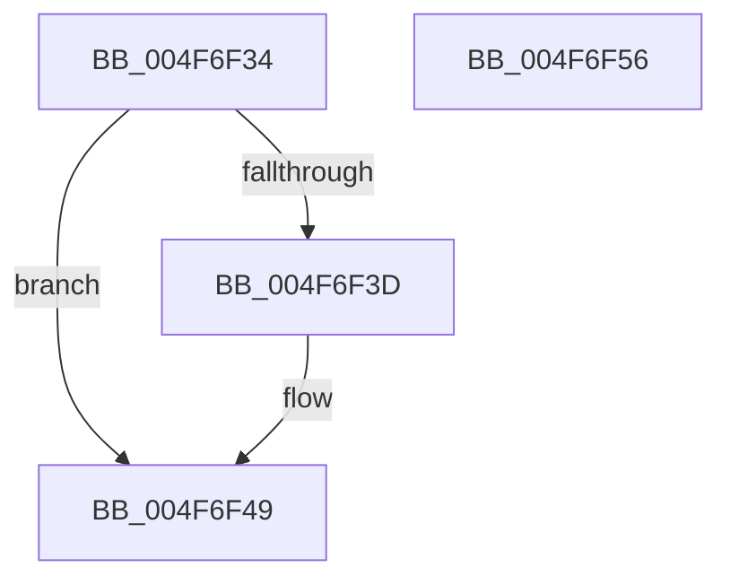

# RtlpHpVsCalculateAffinitySlotCount

- RVA: `0x004F6F34`–`0x004F6F57` (길이 `35` bytes)
- VA: `0x00000001404F6F34`
- 실행 섹션: `.text`
- PDB 이름 있음: `예`; PDB Function 태그: `아니요`
- unwind 정보 RVA: `0x000DB714`
- 디코드: `14`개 명령, `35/35` bytes 표시
- 미해석 바이트: `0` (있으면 어셈블리에 `.byte`로 보존)

> 이 문서는 커널 이미지의 기계어와 PDB 기호를 분석해 생성했습니다. 4번과 5번은 함수 원형과 자료형을 바이너리 사용 방식에서 추정한 C 해석이며 원본 소스 복구 결과는 아닙니다.

## 1. Dependencies

- 직접 호출 지점: **0**; 고유 호출 대상: **0**
- 직접 호출자로 확인된 함수: **2**
- RIP 상대 이미지 참조: **0**

### Outgoing calls
- 직접 디코드된 call 명령이 없습니다.

### Direct callers
- [RtlpHpVsContextInitialize](../4D/RtlpHpVsContextInitialize_function_004D4030.md) at `0x004D40FE`
- [RtlpHpHeapAllocate](../60/RtlpHpHeapAllocate_function_00602D98.md) at `0x00602DC9`

### Static image references
- 디코드된 RIP-relative 메모리 참조가 없습니다.

## 2. Other-region calls and transfers

- 다른 실행 섹션으로 향하는 call: **0**
- 별도 외부 분기/꼬리 이동을 확인하지 못했습니다.

## 3. Assembly (complete function range)

```asm
004F6F34  8D 41 FF                        lea eax, [rcx - 1]
004F6F37  8B D1                           mov edx, ecx
004F6F39  85 C1                           test ecx, eax
004F6F3B  74 0C                           je 0x1404f6f49
004F6F3D  0F BD C9                        bsr ecx, ecx
004F6F40  BA 01 00 00 00                  mov edx, 1
004F6F45  FF C1                           inc ecx
004F6F47  D3 E2                           shl edx, cl
004F6F49  B8 40 00 00 00                  mov eax, 0x40
004F6F4E  3B D0                           cmp edx, eax
004F6F50  0F 47 D0                        cmova edx, eax
004F6F53  8B C2                           mov eax, edx
004F6F55  C3                              ret
004F6F56  CC                              int3
```

## 4. C-style interpretation (structured pseudocode)

```c
__int64 __fastcall RtlpHpVsCalculateAffinitySlotCount(__int64 a1)
{
    if ((((unsigned int)(a1)) & ((unsigned int)(a1 - 1))) != 0) {
        a2 = 1;
        a1 = (unsigned int)((a1) + 1);
        a2 = (unsigned int)((a2) << ((unsigned __int8)(a1)));
    }
    if (((unsigned int)(a2)) > 64) { a2 = 64; }
    return (unsigned int)((unsigned int)(a2));
}
```

## 5. (Beta) C Style

```c
int64_t RtlpHpVsCalculateAffinitySlotCount(void *Arg1)
{
    uint8_t *arg1 = (uint8_t *)Arg1;

    if ((((uint32_t)(Arg1)) & ((uint32_t)(Arg1 - 1))) != 0) {
        a2 = 1;
        Arg1 = (uint32_t)((Arg1) + 1);
        a2 = (uint32_t)((a2) << ((uint8_t)(Arg1)));
    }
    if (((uint32_t)(a2)) > 64) { a2 = 64; }
    return (uint32_t)((uint32_t)(a2));
}
```

### 관측된 메모리 오프셋

구조체 형식이 확인되지 않은 접근은 인자 기준의 오프셋으로만 기록했습니다.

| 기준 인자 | 오프셋 표현 | 폭 (bit) | 접근 |
|---|---:|---:|---|
| `Arg1` | `- 0x1` | `32` | `R` |

## 6. Execution-region graph

[열기: 2D/3D 그래프와 함수 탐색 컨트롤 패널](../../../control-panel.html?section=text&rva=0x004F6F34&view=graph)

- 2D 그래프는 위에서 아래로 흐르고, 3D 그래프는 빈 공간을 드래그해 회전합니다. Shift+드래그는 이동, 휠은 확대·축소, 함수 노드 선택은 대상 보고서 이동입니다.

### Static fallback


