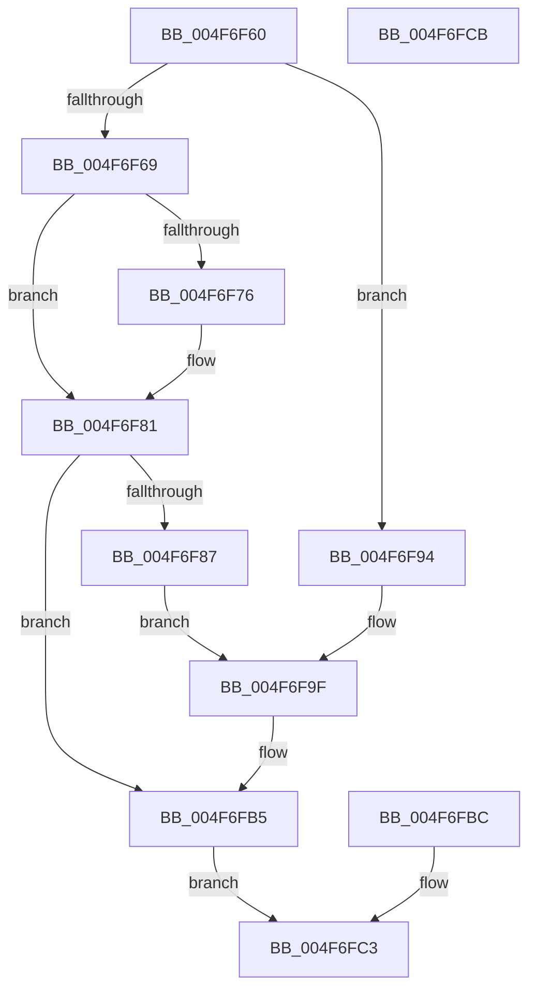

# RtlpProbeUserBufferSafe

- RVA: `0x004F6F60`–`0x004F6FCC` (길이 `108` bytes)
- VA: `0x00000001404F6F60`
- 실행 섹션: `.text`
- PDB 이름 있음: `예`; PDB Function 태그: `아니요`
- unwind 정보 RVA: `0x000BF49C`
- 디코드: `32`개 명령, `108/108` bytes 표시
- 미해석 바이트: `0` (있으면 어셈블리에 `.byte`로 보존)

> 이 문서는 커널 이미지의 기계어와 PDB 기호를 분석해 생성했습니다. 4번과 5번은 함수 원형과 자료형을 바이너리 사용 방식에서 추정한 C 해석이며 원본 소스 복구 결과는 아닙니다.

## 1. Dependencies

- 직접 호출 지점: **1**; 고유 호출 대상: **1**
- 직접 호출자로 확인된 함수: **2**
- RIP 상대 이미지 참조: **0**

### Outgoing calls
- `0x004F6FAE` → [RtlpLogHeapFailure](../35/RtlpLogHeapFailure_function_0035B7BC.md) (function, `0x0035B7BC`)

### Direct callers
- [RtlpFreeNTHeapInternal](../48/RtlpFreeNTHeapInternal_function_00487FDC.md) at `0x00488039`
- [RtlpSizeHeapInternal](../5E/RtlpSizeHeapInternal_function_005EBAD0.md) at `0x005EBB30`

### Static image references
- 디코드된 RIP-relative 메모리 참조가 없습니다.

## 2. Other-region calls and transfers

- 다른 실행 섹션으로 향하는 call: **0**
- 별도 외부 분기/꼬리 이동을 확인하지 못했습니다.

## 3. Assembly (complete function range)

```asm
004F6F60  48 83 EC 48                     sub rsp, 0x48
004F6F64  F6 C2 0F                        test dl, 0xf
004F6F67  75 2B                           jne 0x1404f6f94
004F6F69  48 83 C2 F0                     add rdx, -0x10
004F6F6D  0F 0D 0A                        prefetchw byte ptr [rdx]
004F6F70  80 7A 0F 05                     cmp byte ptr [rdx + 0xf], 5
004F6F74  75 0B                           jne 0x1404f6f81
004F6F76  0F B6 42 0E                     movzx eax, byte ptr [rdx + 0xe]
004F6F7A  48 C1 E0 04                     shl rax, 4
004F6F7E  48 2B D0                        sub rdx, rax
004F6F81  F6 42 0F 3F                     test byte ptr [rdx + 0xf], 0x3f
004F6F85  75 2E                           jne 0x1404f6fb5
004F6F87  4C 8B C2                        mov r8, rdx
004F6F8A  48 8B D1                        mov rdx, rcx
004F6F8D  B9 08 00 00 00                  mov ecx, 8
004F6F92  EB 0B                           jmp 0x1404f6f9f
004F6F94  4C 8B C2                        mov r8, rdx
004F6F97  48 8B D1                        mov rdx, rcx
004F6F9A  B9 09 00 00 00                  mov ecx, 9
004F6F9F  48 83 64 24 28 00               and qword ptr [rsp + 0x28], 0
004F6FA5  48 83 64 24 20 00               and qword ptr [rsp + 0x20], 0
004F6FAB  45 33 C9                        xor r9d, r9d
004F6FAE  E8 09 48 E6 FF                  call 0x14035b7bc
004F6FB3  33 D2                           xor edx, edx
004F6FB5  48 89 54 24 30                  mov qword ptr [rsp + 0x30], rdx
004F6FBA  EB 07                           jmp 0x1404f6fc3
004F6FBC  33 D2                           xor edx, edx
004F6FBE  48 89 54 24 30                  mov qword ptr [rsp + 0x30], rdx
004F6FC3  48 8B C2                        mov rax, rdx
004F6FC6  48 83 C4 48                     add rsp, 0x48
004F6FCA  C3                              ret
004F6FCB  CC                              int3
```

## 4. C-style interpretation (structured pseudocode)

```c
__int64 __fastcall RtlpProbeUserBufferSafe(__int64 a1, __int64 a2, __int64 a3, int a4)
{
    __int64 result;
    __int64 v_rsp;
    unsigned __int64 v_stack_m18;
    unsigned __int64 v_stack_m20;
    unsigned __int64 v_stack_m28;

    v_rsp = (v_rsp) - (72);
    if ((((unsigned __int8)(a2)) & (15)) != 0) goto loc_004F6F94;
    a2 = (a2) + (-16);
    if ((*(unsigned __int8 *)(a2 + 15)) == 5) {
        result = *(unsigned __int8 *)(a2 + 14);
        result = (result) << (4);
        a2 = (a2) - (result);
    }
    if (((*(unsigned __int8 *)(a2 + 15)) & (63)) != 0) goto loc_004F6FB5;
    goto loc_004F6F9F;
loc_004F6F94:
loc_004F6F9F:
    a4 = 0;
    result = RtlpLogHeapFailure(9, 8, a1, a4);
    a2 = 0;
loc_004F6FB5:
    v_stack_m18 = 0;
    goto loc_004F6FC3;
loc_004F6FC3:
    v_rsp = (v_rsp) + (72);
    return 0;
}
```

## 5. (Beta) C Style

```c
int64_t RtlpProbeUserBufferSafe(int64_t Arg1, int64_t Arg2, int64_t Arg3, int32_t Arg4)
{
    int64_t result;
    int64_t local_rsp;
    uint64_t v_stack_m18;
    uint64_t v_stack_m20;
    uint64_t v_stack_m28;

    local_rsp = (local_rsp) - (72);
    if ((((uint8_t)(Arg2)) & (15)) != 0) goto loc_004F6F94;
    Arg2 = (Arg2) + (-16);
    if ((*(uint8_t *)(Arg2 + 0xF)) == 5) {
        result = *(uint8_t *)(Arg2 + 0xE);
        result = (result) << (4);
        Arg2 = (Arg2) - (result);
    }
    if (((*(uint8_t *)(Arg2 + 0xF)) & (63)) != 0) goto loc_004F6FB5;
    goto loc_004F6F9F;
loc_004F6F94:
loc_004F6F9F:
    Arg4 = 0;
    result = RtlpLogHeapFailure(9, 8, Arg1, Arg4);
    Arg2 = 0;
loc_004F6FB5:
    v_stack_m18 = 0;
    goto loc_004F6FC3;
loc_004F6FC3:
    local_rsp = (local_rsp) + (72);
    return 0;
}
```

## 6. Execution-region graph

[열기: 2D/3D 그래프와 함수 탐색 컨트롤 패널](../../../control-panel.html?section=text&rva=0x004F6F60&view=graph)

- 2D 그래프는 위에서 아래로 흐르고, 3D 그래프는 빈 공간을 드래그해 회전합니다. Shift+드래그는 이동, 휠은 확대·축소, 함수 노드 선택은 대상 보고서 이동입니다.

### Static fallback


