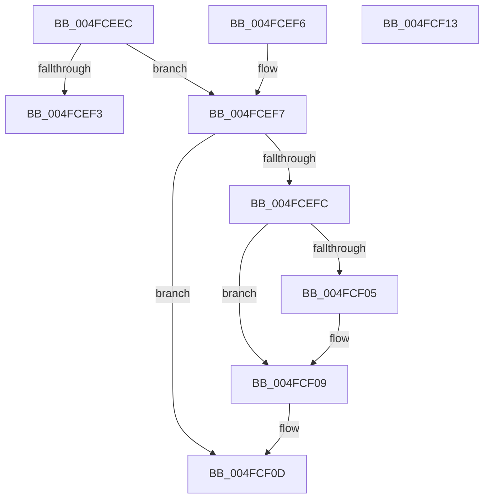

# ST_STORE&lt;SM_TRAITS&gt;::StDeviceIoIsFailed

- RVA: `0x004FCEEC`–`0x004FCF14` (길이 `40` bytes)
- VA: `0x00000001404FCEEC`
- 실행 섹션: `.text`
- PDB 이름 있음: `예`; PDB Function 태그: `아니요`
- unwind 정보 RVA: `0x000DB714`
- 디코드: `17`개 명령, `40/40` bytes 표시
- 미해석 바이트: `0` (있으면 어셈블리에 `.byte`로 보존)

> 이 문서는 커널 이미지의 기계어와 PDB 기호를 분석해 생성했습니다. 4번과 5번은 함수 원형과 자료형을 바이너리 사용 방식에서 추정한 C 해석이며 원본 소스 복구 결과는 아닙니다.

## 1. Dependencies

- 직접 호출 지점: **0**; 고유 호출 대상: **0**
- 직접 호출자로 확인된 함수: **1**
- RIP 상대 이미지 참조: **0**

### Outgoing calls
- 직접 디코드된 call 명령이 없습니다.

### Direct callers
- [ST_STORE&lt;SM_TRAITS&gt;::StDmDeviceIoCompletion](../4B/ST_STORE_SM_TRAITS_StDmDeviceIoCompletion_function_004BBB70.md) at `0x004BBBF7`

### Static image references
- 디코드된 RIP-relative 메모리 참조가 없습니다.

## 2. Other-region calls and transfers

- 다른 실행 섹션으로 향하는 call: **0**
- 별도 외부 분기/꼬리 이동을 확인하지 못했습니다.

## 3. Assembly (complete function range)

```asm
004FCEEC  8B 41 14                        mov eax, dword ptr [rcx + 0x14]
004FCEEF  A8 01                           test al, 1
004FCEF1  75 04                           jne 0x1404fcef7
004FCEF3  33 C0                           xor eax, eax
004FCEF5  C3                              ret
004FCEF6  CC                              int3
004FCEF7  48 85 D2                        test rdx, rdx
004FCEFA  74 11                           je 0x1404fcf0d
004FCEFC  48 8B 41 08                     mov rax, qword ptr [rcx + 8]
004FCF00  48 85 C0                        test rax, rax
004FCF03  74 04                           je 0x1404fcf09
004FCF05  48 8D 48 04                     lea rcx, [rax + 4]
004FCF09  8B 09                           mov ecx, dword ptr [rcx]
004FCF0B  89 0A                           mov dword ptr [rdx], ecx
004FCF0D  B8 01 00 00 00                  mov eax, 1
004FCF12  C3                              ret
004FCF13  CC                              int3
```

## 4. C-style interpretation (structured pseudocode)

```c
__int64 __fastcall ST_STORE_SM_TRAITS___StDeviceIoIsFailed(__int64 a1, __int64 a2)
{
    __int64 result;

    if ((((unsigned __int8)((unsigned int)(*(unsigned int *)(a1 + 20)))) & (1)) != 0) goto loc_004FCEF7;
    result = 0;
    return result;
loc_004FCEF7:
    if (a2 == 0) goto loc_004FCF0D;
    if (*(unsigned __int64 *)(a1 + 8) != 0) {
        a1 = *(unsigned __int64 *)(a1 + 8) + 4;
    }
    *(unsigned int *)(a2) = (unsigned int)((unsigned int)(*(unsigned int *)(a1)));
loc_004FCF0D:
    return 1;
}
```

## 5. (Beta) C Style

```c
int64_t ST_STORE_SM_TRAITS___StDeviceIoIsFailed(void *Arg1, int64_t Arg2)
{
    uint8_t *arg1 = (uint8_t *)Arg1;

    int64_t result;

    if ((((uint8_t)((uint32_t)(*(uint32_t *)(arg1 + 0x14)))) & (1)) != 0) goto loc_004FCEF7;
    result = 0;
    return result;
loc_004FCEF7:
    if (Arg2 == 0) goto loc_004FCF0D;
    if (*(uint64_t *)(arg1 + 0x8) != 0) {
        Arg1 = *(uint64_t *)(arg1 + 0x8) + 4;
    }
    *(uint32_t *)(Arg2) = (uint32_t)((uint32_t)(*(uint32_t *)(arg1)));
loc_004FCF0D:
    return 1;
}
```

### 관측된 메모리 오프셋

구조체 형식이 확인되지 않은 접근은 인자 기준의 오프셋으로만 기록했습니다.

| 기준 인자 | 오프셋 표현 | 폭 (bit) | 접근 |
|---|---:|---:|---|
| `Arg1` | `+ 0x8` | `64` | `R` |
| `Arg1` | `+ 0x14` | `32` | `R` |

## 6. Execution-region graph

[열기: 2D/3D 그래프와 함수 탐색 컨트롤 패널](../../../control-panel.html?section=text&rva=0x004FCEEC&view=graph)

- 2D 그래프는 위에서 아래로 흐르고, 3D 그래프는 빈 공간을 드래그해 회전합니다. Shift+드래그는 이동, 휠은 확대·축소, 함수 노드 선택은 대상 보고서 이동입니다.

### Static fallback


