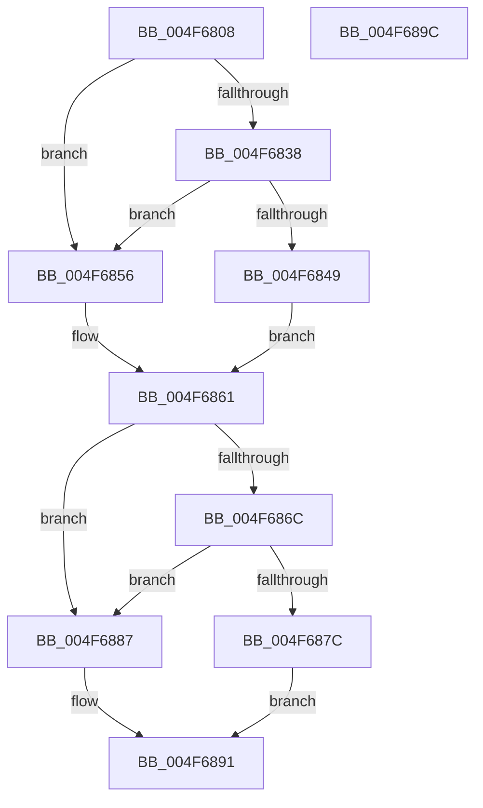

# ST_STORE&lt;SM_TRAITS&gt;::StDeviceWorkItemCleanup

- RVA: `0x004F6808`–`0x004F689D` (길이 `149` bytes)
- VA: `0x00000001404F6808`
- 실행 섹션: `.text`
- PDB 이름 있음: `예`; PDB Function 태그: `아니요`
- unwind 정보 RVA: `0x0005CAAC`
- 디코드: `41`개 명령, `149/149` bytes 표시
- 미해석 바이트: `0` (있으면 어셈블리에 `.byte`로 보존)

> 이 문서는 커널 이미지의 기계어와 PDB 기호를 분석해 생성했습니다. 4번과 5번은 함수 원형과 자료형을 바이너리 사용 방식에서 추정한 C 해석이며 원본 소스 복구 결과는 아닙니다.

## 1. Dependencies

- 직접 호출 지점: **3**; 고유 호출 대상: **2**
- 직접 호출자로 확인된 함수: **1**
- RIP 상대 이미지 참조: **0**

### Outgoing calls
- `0x004F6826` → [ST_STORE<SM_TRAITS>::StRegionReadDereference](ST_STORE_SM_TRAITS_StRegionReadDereference_function_004F68A4.md) (function, `0x004F68A4`)
- `0x004F685C` → [ExFreePoolWithTag](../../poolcode/B8/ExFreePoolWithTag_function_00B82870.md) (function, `0x00B82870`)
- `0x004F688C` → [ExFreePoolWithTag](../../poolcode/B8/ExFreePoolWithTag_function_00B82870.md) (function, `0x00B82870`)

### Direct callers
- [ST_STORE&lt;SM_TRAITS&gt;::StDmDeviceIoCompletion](../4B/ST_STORE_SM_TRAITS_StDmDeviceIoCompletion_function_004BBB70.md) at `0x004BBE1B`

### Static image references
- 디코드된 RIP-relative 메모리 참조가 없습니다.

## 2. Other-region calls and transfers

- 다른 실행 섹션으로 향하는 call: **2**
  - `0x004F685C` → [ExFreePoolWithTag](../../poolcode/B8/ExFreePoolWithTag_function_00B82870.md) (`.text` → `POOLCODE`)
  - `0x004F688C` → [ExFreePoolWithTag](../../poolcode/B8/ExFreePoolWithTag_function_00B82870.md) (`.text` → `POOLCODE`)
- 별도 외부 분기/꼬리 이동을 확인하지 못했습니다.

## 3. Assembly (complete function range)

```asm
004F6808  48 89 5C 24 08                  mov qword ptr [rsp + 8], rbx
004F680D  57                              push rdi
004F680E  48 83 EC 20                     sub rsp, 0x20
004F6812  48 8B FA                        mov rdi, rdx
004F6815  48 8B D9                        mov rbx, rcx
004F6818  8B 89 2C 03 00 00               mov ecx, dword ptr [rcx + 0x32c]
004F681E  8B 52 18                        mov edx, dword ptr [rdx + 0x18]
004F6821  D3 EA                           shr edx, cl
004F6823  48 8B CB                        mov rcx, rbx
004F6826  E8 79 00 00 00                  call 0x1404f68a4
004F682B  44 8B 83 80 08 00 00            mov r8d, dword ptr [rbx + 0x880]
004F6832  41 F6 C0 01                     test r8b, 1
004F6836  74 1E                           je 0x1404f6856
004F6838  48 8B 47 10                     mov rax, qword ptr [rdi + 0x10]
004F683C  48 83 C8 01                     or rax, 1
004F6840  48 3B 83 80 08 00 00            cmp rax, qword ptr [rbx + 0x880]
004F6847  75 0D                           jne 0x1404f6856
004F6849  41 83 E0 FE                     and r8d, 0xfffffffe
004F684D  44 89 83 80 08 00 00            mov dword ptr [rbx + 0x880], r8d
004F6854  EB 0B                           jmp 0x1404f6861
004F6856  48 8B 4F 10                     mov rcx, qword ptr [rdi + 0x10]
004F685A  33 D2                           xor edx, edx
004F685C  E8 0F C0 68 00                  call 0x140b82870
004F6861  8B 8B 88 08 00 00               mov ecx, dword ptr [rbx + 0x888]
004F6867  F6 C1 01                        test cl, 1
004F686A  74 1B                           je 0x1404f6887
004F686C  48 8B C7                        mov rax, rdi
004F686F  48 83 C8 01                     or rax, 1
004F6873  48 3B 83 88 08 00 00            cmp rax, qword ptr [rbx + 0x888]
004F687A  75 0B                           jne 0x1404f6887
004F687C  83 E1 FE                        and ecx, 0xfffffffe
004F687F  89 8B 88 08 00 00               mov dword ptr [rbx + 0x888], ecx
004F6885  EB 0A                           jmp 0x1404f6891
004F6887  33 D2                           xor edx, edx
004F6889  48 8B CF                        mov rcx, rdi
004F688C  E8 DF BF 68 00                  call 0x140b82870
004F6891  48 8B 5C 24 30                  mov rbx, qword ptr [rsp + 0x30]
004F6896  48 83 C4 20                     add rsp, 0x20
004F689A  5F                              pop rdi
004F689B  C3                              ret
004F689C  CC                              int3
```

## 4. C-style interpretation (structured pseudocode)

```c
__int64 __fastcall ST_STORE_SM_TRAITS___StDeviceWorkItemCleanup(__int64 a1, __int64 a2)
{
    __int64 result;
    __int64 v_rsp;
    unsigned __int64 v_stack_p8;

    v_stack_p8 = v_rbx;
    v_rsp = (v_rsp) - (32);
    a2 = (unsigned int)(((unsigned int)(*(unsigned int *)(a2 + 24))) >> ((unsigned __int8)((unsigned int)(*(unsigned int *)(a1 + 812)))));
    result = ST_STORE_SM_TRAITS___StRegionReadDereference(a1, a2, a3, a4);
    if ((((unsigned __int8)((unsigned int)(*(unsigned int *)(a1 + 2176)))) & (1)) == 0) goto loc_004F6856;
    result = (*(unsigned __int64 *)(a2 + 16)) | (1);
    if (result != (*(unsigned __int64 *)(a1 + 2176))) goto loc_004F6856;
    a3 = (unsigned int)(((unsigned int)(*(unsigned int *)(a1 + 2176))) & (0xFFFFFFFEULL));
    *(unsigned int *)(a1 + 2176) = (unsigned int)(a3);
    goto loc_004F6861;
loc_004F6856:
    a2 = 0;
    result = ExFreePoolWithTag(*(unsigned __int64 *)(a2 + 16), a2, a3, a4);
loc_004F6861:
    if ((((unsigned __int8)((unsigned int)(*(unsigned int *)(a1 + 2184)))) & (1)) == 0) goto loc_004F6887;
    result = (0) | (1);
    if (result != (*(unsigned __int64 *)(a1 + 2184))) goto loc_004F6887;
    a1 = (unsigned int)(((unsigned int)(*(unsigned int *)(a1 + 2184))) & (0xFFFFFFFEULL));
    *(unsigned int *)(a1 + 2184) = (unsigned int)(a1);
    goto loc_004F6891;
loc_004F6887:
    a2 = 0;
    result = ExFreePoolWithTag(0, a2, a3, a4);
loc_004F6891:
    v_rsp = (v_rsp) + (32);
    return result;
}
```

## 5. (Beta) C Style

```c
int64_t ST_STORE_SM_TRAITS___StDeviceWorkItemCleanup(void *Arg1, void *Arg2)
{
    uint8_t *arg1 = (uint8_t *)Arg1;
    uint8_t *arg2 = (uint8_t *)Arg2;

    int64_t result;
    int64_t local_rsp;
    uint64_t v_stack_p8;

    v_stack_p8 = local_rbx;
    local_rsp = (local_rsp) - (32);
    Arg2 = (uint32_t)(((uint32_t)(*(uint32_t *)(arg2 + 0x18))) >> ((uint8_t)((uint32_t)(*(uint32_t *)(arg1 + 0x32C)))));
    result = ST_STORE_SM_TRAITS___StRegionReadDereference(Arg1, Arg2, a3, a4);
    if ((((uint8_t)((uint32_t)(*(uint32_t *)(arg1 + 0x880)))) & (1)) == 0) goto loc_004F6856;
    result = (*(uint64_t *)(arg2 + 0x10)) | (1);
    if (result != (*(uint64_t *)(arg1 + 0x880))) goto loc_004F6856;
    a3 = (uint32_t)(((uint32_t)(*(uint32_t *)(arg1 + 0x880))) & (0xFFFFFFFEULL));
    *(uint32_t *)(arg1 + 0x880) = (uint32_t)(a3);
    goto loc_004F6861;
loc_004F6856:
    Arg2 = 0;
    result = ExFreePoolWithTag(*(uint64_t *)(arg2 + 0x10), Arg2, a3, a4);
loc_004F6861:
    if ((((uint8_t)((uint32_t)(*(uint32_t *)(arg1 + 0x888)))) & (1)) == 0) goto loc_004F6887;
    result = (0) | (1);
    if (result != (*(uint64_t *)(arg1 + 0x888))) goto loc_004F6887;
    Arg1 = (uint32_t)(((uint32_t)(*(uint32_t *)(arg1 + 0x888))) & (0xFFFFFFFEULL));
    *(uint32_t *)(arg1 + 0x888) = (uint32_t)(Arg1);
    goto loc_004F6891;
loc_004F6887:
    Arg2 = 0;
    result = ExFreePoolWithTag(0, Arg2, a3, a4);
loc_004F6891:
    local_rsp = (local_rsp) + (32);
    return result;
}
```

### 관측된 메모리 오프셋

구조체 형식이 확인되지 않은 접근은 인자 기준의 오프셋으로만 기록했습니다.

| 기준 인자 | 오프셋 표현 | 폭 (bit) | 접근 |
|---|---:|---:|---|
| `Arg1` | `+ 0x32C` | `32` | `R` |
| `Arg1` | `+ 0x880` | `32` | `R` |
| `Arg1` | `+ 0x880` | `32` | `W` |
| `Arg1` | `+ 0x880` | `64` | `R` |
| `Arg1` | `+ 0x888` | `32` | `R` |
| `Arg1` | `+ 0x888` | `32` | `W` |
| `Arg1` | `+ 0x888` | `64` | `R` |
| `Arg2` | `+ 0x10` | `64` | `R` |
| `Arg2` | `+ 0x18` | `32` | `R` |

## 6. Execution-region graph

[열기: 2D/3D 그래프와 함수 탐색 컨트롤 패널](../../../control-panel.html?section=text&rva=0x004F6808&view=graph)

- 2D 그래프는 위에서 아래로 흐르고, 3D 그래프는 빈 공간을 드래그해 회전합니다. Shift+드래그는 이동, 휠은 확대·축소, 함수 노드 선택은 대상 보고서 이동입니다.

### Static fallback


