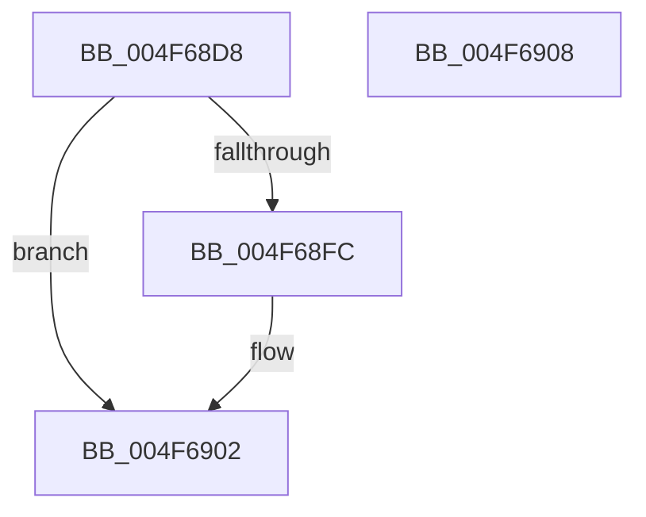

# ST_STORE&lt;SM_TRAITS&gt;::StDmpHashBytes

- RVA: `0x004F68D8`–`0x004F6909` (길이 `49` bytes)
- VA: `0x00000001404F68D8`
- 실행 섹션: `.text`
- PDB 이름 있음: `예`; PDB Function 태그: `아니요`
- unwind 정보 RVA: `0x0005CF00`
- 디코드: `15`개 명령, `49/49` bytes 표시
- 미해석 바이트: `0` (있으면 어셈블리에 `.byte`로 보존)

> 이 문서는 커널 이미지의 기계어와 PDB 기호를 분석해 생성했습니다. 4번과 5번은 함수 원형과 자료형을 바이너리 사용 방식에서 추정한 C 해석이며 원본 소스 복구 결과는 아닙니다.

## 1. Dependencies

- 직접 호출 지점: **1**; 고유 호출 대상: **1**
- 직접 호출자로 확인된 함수: **3**
- RIP 상대 이미지 참조: **0**

### Outgoing calls
- `0x004F68F3` → [SmStoreHashCompressedData](SmStoreHashCompressedData_function_004F6910.md) (function, `0x004F6910`)

### Direct callers
- [ST_STORE&lt;SM_TRAITS&gt;::StDmpSinglePageAdd](../20/ST_STORE_SM_TRAITS_StDmpSinglePageAdd_function_0020502C.md) at `0x002052FE`
- [ST_STORE&lt;SM_TRAITS&gt;::StDmSinglePageCopy](../31/ST_STORE_SM_TRAITS_StDmSinglePageCopy_function_00317F44.md) at `0x0031802A`
- [ST_STORE&lt;SM_TRAITS&gt;::StDmFixSingleBitCorruption](../60/ST_STORE_SM_TRAITS_StDmFixSingleBitCorruption_function_0060D760.md) at `0x0060D7CE`

### Static image references
- 디코드된 RIP-relative 메모리 참조가 없습니다.

## 2. Other-region calls and transfers

- 다른 실행 섹션으로 향하는 call: **0**
- 별도 외부 분기/꼬리 이동을 확인하지 못했습니다.

## 3. Assembly (complete function range)

```asm
004F68D8  40 53                           push rbx
004F68DA  48 83 EC 20                     sub rsp, 0x20
004F68DE  48 8B 89 20 03 00 00            mov rcx, qword ptr [rcx + 0x320]
004F68E5  49 8B D9                        mov rbx, r9
004F68E8  48 83 64 24 30 00               and qword ptr [rsp + 0x30], 0
004F68EE  4C 8D 4C 24 30                  lea r9, [rsp + 0x30]
004F68F3  E8 18 00 00 00                  call 0x1404f6910
004F68F8  85 C0                           test eax, eax
004F68FA  78 06                           js 0x1404f6902
004F68FC  8B 4C 24 30                     mov ecx, dword ptr [rsp + 0x30]
004F6900  89 0B                           mov dword ptr [rbx], ecx
004F6902  48 83 C4 20                     add rsp, 0x20
004F6906  5B                              pop rbx
004F6907  C3                              ret
004F6908  CC                              int3
```

## 4. C-style interpretation (structured pseudocode)

```c
__int64 __fastcall ST_STORE_SM_TRAITS___StDmpHashBytes(__int64 a1, __int64 a2, __int64 a3, __int64 a4)
{
    __int64 result;
    __int64 v_rsp;
    unsigned __int64 v_stack_p8;

    v_rsp = (v_rsp) - (32);
    result = SmStoreHashCompressedData(*(unsigned __int64 *)(a1 + 800), a2, a3, v_stack_p8);
    if (!(sign_flag)) {
        a1 = v_stack_p8;
        *(unsigned int *)(a4) = (unsigned int)(a1);
    }
    v_rsp = (v_rsp) + (32);
    return result;
}
```

## 5. (Beta) C Style

```c
int64_t ST_STORE_SM_TRAITS___StDmpHashBytes(void *Arg1, int64_t Arg2, int64_t Arg3, void *Arg4)
{
    uint8_t *arg1 = (uint8_t *)Arg1;
    uint8_t *arg4 = (uint8_t *)Arg4;

    int64_t result;
    int64_t local_rsp;
    uint64_t v_stack_p8;

    local_rsp = (local_rsp) - (32);
    result = SmStoreHashCompressedData(*(uint64_t *)(arg1 + 0x320), Arg2, Arg3, v_stack_p8);
    if (!(sign_flag)) {
        Arg1 = v_stack_p8;
        *(uint32_t *)(arg4) = (uint32_t)(Arg1);
    }
    local_rsp = (local_rsp) + (32);
    return result;
}
```

### 관측된 메모리 오프셋

구조체 형식이 확인되지 않은 접근은 인자 기준의 오프셋으로만 기록했습니다.

| 기준 인자 | 오프셋 표현 | 폭 (bit) | 접근 |
|---|---:|---:|---|
| `Arg1` | `+ 0x320` | `64` | `R` |
| `Arg4` | `+ 0x0` | `32` | `W` |

## 6. Execution-region graph

[열기: 2D/3D 그래프와 함수 탐색 컨트롤 패널](../../../control-panel.html?section=text&rva=0x004F68D8&view=graph)

- 2D 그래프는 위에서 아래로 흐르고, 3D 그래프는 빈 공간을 드래그해 회전합니다. Shift+드래그는 이동, 휠은 확대·축소, 함수 노드 선택은 대상 보고서 이동입니다.

### Static fallback


