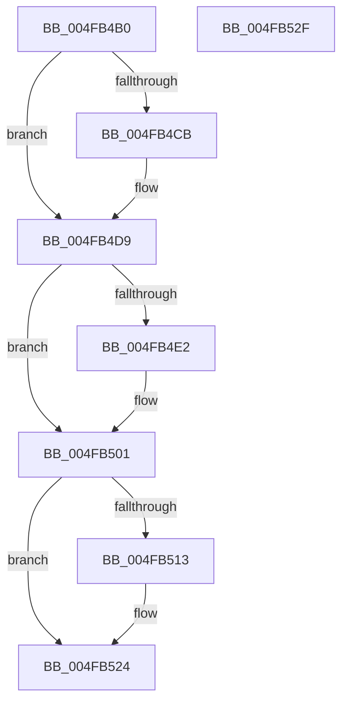

# ST_STORE&lt;SM_TRAITS&gt;::StEmptyStore

- RVA: `0x004FB4B0`–`0x004FB530` (길이 `128` bytes)
- VA: `0x00000001404FB4B0`
- 실행 섹션: `.text`
- PDB 이름 있음: `예`; PDB Function 태그: `아니요`
- unwind 정보 RVA: `0x0005CAAC`
- 디코드: `34`개 명령, `128/128` bytes 표시
- 미해석 바이트: `0` (있으면 어셈블리에 `.byte`로 보존)

> 이 문서는 커널 이미지의 기계어와 PDB 기호를 분석해 생성했습니다. 4번과 5번은 함수 원형과 자료형을 바이너리 사용 방식에서 추정한 C 해석이며 원본 소스 복구 결과는 아닙니다.

## 1. Dependencies

- 직접 호출 지점: **5**; 고유 호출 대상: **4**
- 직접 호출자로 확인된 함수: **2**
- RIP 상대 이미지 참조: **0**

### Outgoing calls
- `0x004FB4C1` → [SmEtwEnabled](../3A/SmEtwEnabled_function_003AF2D0.md) (function, `0x003AF2D0`)
- `0x004FB4D4` → [SmEtwLogStoreStateChange](../60/SmEtwLogStoreStateChange_function_0060F650.md) (function, `0x0060F650`)
- `0x004FB4FC` → [ST_STORE<SM_TRAITS>::StLazyWorkMgrQueueWork](../41/ST_STORE_SM_TRAITS_StLazyWorkMgrQueueWork_function_00411800.md) (function, `0x00411800`)
- `0x004FB50A` → [ST_STORE<SM_TRAITS>::StDmCleanup](../3A/ST_STORE_SM_TRAITS_StDmCleanup_function_003AF8D4.md) (function, `0x003AF8D4`)
- `0x004FB51F` → [ST_STORE<SM_TRAITS>::StDmCleanup](../3A/ST_STORE_SM_TRAITS_StDmCleanup_function_003AF8D4.md) (function, `0x003AF8D4`)

### Direct callers
- [sub_00206312](../20/Unknown_function_00206312.md) at `0x00206335`
- [sub_00206312](../20/Unknown_function_00206312.md) at `0x00206344`
- [sub_0020634E](../20/Unknown_function_0020634E.md) at `0x00206525`

### Static image references
- 디코드된 RIP-relative 메모리 참조가 없습니다.

## 2. Other-region calls and transfers

- 다른 실행 섹션으로 향하는 call: **0**
- 별도 외부 분기/꼬리 이동을 확인하지 못했습니다.

## 3. Assembly (complete function range)

```asm
004FB4B0  48 89 5C 24 08                  mov qword ptr [rsp + 8], rbx
004FB4B5  57                              push rdi
004FB4B6  48 83 EC 20                     sub rsp, 0x20
004FB4BA  48 8B D9                        mov rbx, rcx
004FB4BD  8B FA                           mov edi, edx
004FB4BF  33 C9                           xor ecx, ecx
004FB4C1  E8 0A 3E EB FF                  call 0x1403af2d0
004FB4C6  48 85 C0                        test rax, rax
004FB4C9  74 0E                           je 0x1404fb4d9
004FB4CB  44 8B CF                        mov r9d, edi
004FB4CE  4C 8B C3                        mov r8, rbx
004FB4D1  48 8B C8                        mov rcx, rax
004FB4D4  E8 77 41 11 00                  call 0x14060f650
004FB4D9  83 BB 60 19 00 00 00            cmp dword ptr [rbx + 0x1960], 0
004FB4E0  74 1F                           je 0x1404fb501
004FB4E2  83 A3 60 19 00 00 00            and dword ptr [rbx + 0x1960], 0
004FB4E9  41 83 C8 FF                     or r8d, 0xffffffff
004FB4ED  48 8B 8B 40 09 00 00            mov rcx, qword ptr [rbx + 0x940]
004FB4F4  45 8B C8                        mov r9d, r8d
004FB4F7  BA 06 00 00 00                  mov edx, 6
004FB4FC  E8 FF 62 F1 FF                  call 0x140411800
004FB501  48 8D 4B 50                     lea rcx, [rbx + 0x50]
004FB505  BA 01 00 00 00                  mov edx, 1
004FB50A  E8 C5 43 EB FF                  call 0x1403af8d4
004FB50F  85 FF                           test edi, edi
004FB511  74 11                           je 0x1404fb524
004FB513  48 8D 8B 60 09 00 00            lea rcx, [rbx + 0x960]
004FB51A  BA 01 00 00 00                  mov edx, 1
004FB51F  E8 B0 43 EB FF                  call 0x1403af8d4
004FB524  48 8B 5C 24 30                  mov rbx, qword ptr [rsp + 0x30]
004FB529  48 83 C4 20                     add rsp, 0x20
004FB52D  5F                              pop rdi
004FB52E  C3                              ret
004FB52F  CC                              int3
```

## 4. C-style interpretation (structured pseudocode)

```c
__int64 __fastcall ST_STORE_SM_TRAITS___StEmptyStore(__int64 a1, int a2)
{
    __int64 result;
    __int64 v_rsp;
    unsigned __int64 v_stack_p8;

    v_stack_p8 = v_rbx;
    v_rsp = (v_rsp) - (32);
    a1 = 0;
    result = SmEtwEnabled(a1, a2, a3, a4);
    if (result != 0) {
        a4 = (unsigned int)((unsigned int)(a2));
        a3 = 0;
        a1 = result;
        result = SmEtwLogStoreStateChange(a1, a2, a3, a4);
    }
    if ((*(unsigned int *)(a1 + 6496)) != 0) {
        a3 = (unsigned int)((a3) | (0xFFFFFFFFULL));
        a1 = *(unsigned __int64 *)(a1 + 2368);
        a4 = (unsigned int)(a3);
        a2 = 6;
        result = ST_STORE_SM_TRAITS___StLazyWorkMgrQueueWork(a1, a2, a3, a4);
    }
    result = ST_STORE_SM_TRAITS___StDmCleanup(a1 + 80, 1, a3, a4);
    if ((unsigned int)((unsigned int)(a2)) != 0) {
        a1 = a1 + 2400;
        a2 = 1;
        result = ST_STORE_SM_TRAITS___StDmCleanup(a1, a2, a3, a4);
    }
    v_rsp = (v_rsp) + (32);
    return result;
}
```

## 5. (Beta) C Style

```c
int64_t ST_STORE_SM_TRAITS___StEmptyStore(void *Arg1, int32_t Arg2)
{
    uint8_t *arg1 = (uint8_t *)Arg1;

    int64_t result;
    int64_t local_rsp;
    uint64_t v_stack_p8;

    v_stack_p8 = local_rbx;
    local_rsp = (local_rsp) - (32);
    Arg1 = 0;
    result = SmEtwEnabled(Arg1, Arg2, a3, a4);
    if (result != 0) {
        a4 = (uint32_t)((uint32_t)(Arg2));
        a3 = 0;
        Arg1 = result;
        result = SmEtwLogStoreStateChange(Arg1, Arg2, a3, a4);
    }
    if ((*(uint32_t *)(arg1 + 0x1960)) != 0) {
        a3 = (uint32_t)((a3) | (0xFFFFFFFFULL));
        Arg1 = *(uint64_t *)(arg1 + 0x940);
        a4 = (uint32_t)(a3);
        Arg2 = 6;
        result = ST_STORE_SM_TRAITS___StLazyWorkMgrQueueWork(Arg1, Arg2, a3, a4);
    }
    result = ST_STORE_SM_TRAITS___StDmCleanup(Arg1 + 80, 1, a3, a4);
    if ((uint32_t)((uint32_t)(Arg2)) != 0) {
        Arg1 = Arg1 + 2400;
        Arg2 = 1;
        result = ST_STORE_SM_TRAITS___StDmCleanup(Arg1, Arg2, a3, a4);
    }
    local_rsp = (local_rsp) + (32);
    return result;
}
```

### 관측된 메모리 오프셋

구조체 형식이 확인되지 않은 접근은 인자 기준의 오프셋으로만 기록했습니다.

| 기준 인자 | 오프셋 표현 | 폭 (bit) | 접근 |
|---|---:|---:|---|
| `Arg1` | `+ 0x50` | `64` | `R` |
| `Arg1` | `+ 0x940` | `64` | `R` |
| `Arg1` | `+ 0x960` | `64` | `R` |
| `Arg1` | `+ 0x1960` | `32` | `R` |
| `Arg1` | `+ 0x1960` | `32` | `R/W` |

## 6. Execution-region graph

[열기: 2D/3D 그래프와 함수 탐색 컨트롤 패널](../../../control-panel.html?section=text&rva=0x004FB4B0&view=graph)

- 2D 그래프는 위에서 아래로 흐르고, 3D 그래프는 빈 공간을 드래그해 회전합니다. Shift+드래그는 이동, 휠은 확대·축소, 함수 노드 선택은 대상 보고서 이동입니다.

### Static fallback


