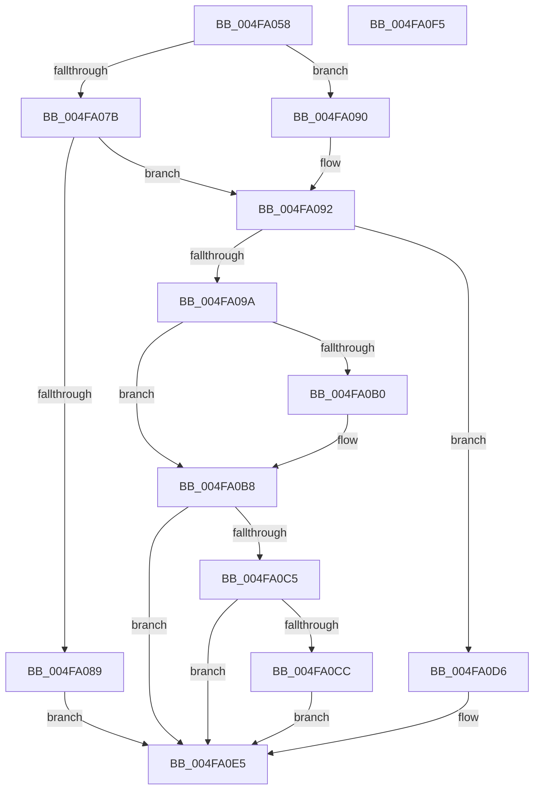

# ST_STORE&lt;SM_TRAITS&gt;::StGetStats

- RVA: `0x004FA058`–`0x004FA0F6` (길이 `158` bytes)
- VA: `0x00000001404FA058`
- 실행 섹션: `.text`
- PDB 이름 있음: `예`; PDB Function 태그: `아니요`
- unwind 정보 RVA: `0x000B6464`
- 디코드: `49`개 명령, `158/158` bytes 표시
- 미해석 바이트: `0` (있으면 어셈블리에 `.byte`로 보존)

> 이 문서는 커널 이미지의 기계어와 PDB 기호를 분석해 생성했습니다. 4번과 5번은 함수 원형과 자료형을 바이너리 사용 방식에서 추정한 C 해석이며 원본 소스 복구 결과는 아닙니다.

## 1. Dependencies

- 직접 호출 지점: **6**; 고유 호출 대상: **4**
- 직접 호출자로 확인된 함수: **1**
- RIP 상대 이미지 참조: **0**

### Outgoing calls
- `0x004FA07F` → [SmMapPage](../31/SmMapPage_function_003187A0.md) (function, `0x003187A0`)
- `0x004FA09E` → [ST_STORE<SM_TRAITS>::StDmEtwRegionRundown](../60/ST_STORE_SM_TRAITS_StDmEtwRegionRundown_function_0060D6B0.md) (function, `0x0060D6B0`)
- `0x004FA0B3` → [ST_STORE<SM_TRAITS>::StDmEtwRegionRundown](../60/ST_STORE_SM_TRAITS_StDmEtwRegionRundown_function_0060D6B0.md) (function, `0x0060D6B0`)
- `0x004FA0BC` → [ST_STORE<SM_TRAITS>::StDmEtwPageRundown](../60/ST_STORE_SM_TRAITS_StDmEtwPageRundown_function_0060D544.md) (function, `0x0060D544`)
- `0x004FA0CF` → [ST_STORE<SM_TRAITS>::StDmEtwPageRundown](../60/ST_STORE_SM_TRAITS_StDmEtwPageRundown_function_0060D544.md) (function, `0x0060D544`)
- `0x004FA0E0` → [ST_STORE<SM_TRAITS>::StGetStatsWorker](../43/ST_STORE_SM_TRAITS_StGetStatsWorker_function_00433C80.md) (function, `0x00433C80`)

### Direct callers
- [sub_002061A0](../20/Unknown_function_002061A0.md) at `0x002062AC`

### Static image references
- 디코드된 RIP-relative 메모리 참조가 없습니다.

## 2. Other-region calls and transfers

- 다른 실행 섹션으로 향하는 call: **0**
- 별도 외부 분기/꼬리 이동을 확인하지 못했습니다.

## 3. Assembly (complete function range)

```asm
004FA058  48 8B C4                        mov rax, rsp
004FA05B  48 89 58 08                     mov qword ptr [rax + 8], rbx
004FA05F  48 89 70 18                     mov qword ptr [rax + 0x18], rsi
004FA063  57                              push rdi
004FA064  48 83 EC 20                     sub rsp, 0x20
004FA068  83 60 10 00                     and dword ptr [rax + 0x10], 0
004FA06C  48 8B D9                        mov rbx, rcx
004FA06F  48 8B 4A 10                     mov rcx, qword ptr [rdx + 0x10]
004FA073  48 8B FA                        mov rdi, rdx
004FA076  48 85 C9                        test rcx, rcx
004FA079  74 15                           je 0x1404fa090
004FA07B  48 8D 50 10                     lea rdx, [rax + 0x10]
004FA07F  E8 1C E7 E1 FF                  call 0x1403187a0
004FA084  48 85 C0                        test rax, rax
004FA087  75 09                           jne 0x1404fa092
004FA089  B8 9A 00 00 C0                  mov eax, 0xc000009a
004FA08E  EB 55                           jmp 0x1404fa0e5
004FA090  33 C0                           xor eax, eax
004FA092  8B 57 08                        mov edx, dword ptr [rdi + 8]
004FA095  83 FA FF                        cmp edx, -1
004FA098  75 3C                           jne 0x1404fa0d6
004FA09A  48 8D 4B 50                     lea rcx, [rbx + 0x50]
004FA09E  E8 0D 36 11 00                  call 0x14060d6b0
004FA0A3  8B 03                           mov eax, dword ptr [rbx]
004FA0A5  48 8D BB 60 09 00 00            lea rdi, [rbx + 0x960]
004FA0AC  3C 01                           cmp al, 1
004FA0AE  75 08                           jne 0x1404fa0b8
004FA0B0  48 8B CF                        mov rcx, rdi
004FA0B3  E8 F8 35 11 00                  call 0x14060d6b0
004FA0B8  48 8D 4B 50                     lea rcx, [rbx + 0x50]
004FA0BC  E8 83 34 11 00                  call 0x14060d544
004FA0C1  85 C0                           test eax, eax
004FA0C3  78 20                           js 0x1404fa0e5
004FA0C5  8B 13                           mov edx, dword ptr [rbx]
004FA0C7  80 FA 01                        cmp dl, 1
004FA0CA  75 19                           jne 0x1404fa0e5
004FA0CC  48 8B CF                        mov rcx, rdi
004FA0CF  E8 70 34 11 00                  call 0x14060d544
004FA0D4  EB 0F                           jmp 0x1404fa0e5
004FA0D6  4C 8D 4F 0C                     lea r9, [rdi + 0xc]
004FA0DA  4C 8B C0                        mov r8, rax
004FA0DD  48 8B CB                        mov rcx, rbx
004FA0E0  E8 9B 9B F3 FF                  call 0x140433c80
004FA0E5  48 8B 5C 24 30                  mov rbx, qword ptr [rsp + 0x30]
004FA0EA  48 8B 74 24 40                  mov rsi, qword ptr [rsp + 0x40]
004FA0EF  48 83 C4 20                     add rsp, 0x20
004FA0F3  5F                              pop rdi
004FA0F4  C3                              ret
004FA0F5  CC                              int3
```

## 4. C-style interpretation (structured pseudocode)

```c
__int64 __fastcall ST_STORE_SM_TRAITS___StGetStats(__int64 a1, __int64 a2)
{
    __int64 result;
    __int64 v_rsp;
    unsigned __int64 v_stack_p18;
    unsigned __int64 v_stack_p8;

    *(unsigned __int64 *)(v_rsp + 8) = v_rbx;
    *(unsigned __int64 *)(v_rsp + 24) = v_rsi;
    v_rsp = (v_rsp) - (32);
    if (*(unsigned __int64 *)(a2 + 16) == 0) goto loc_004FA090;
    result = SmMapPage(*(unsigned __int64 *)(a2 + 16), v_rsp + 16, a3, a4);
    if (result != 0) goto loc_004FA092;
    goto loc_004FA0E5;
loc_004FA090:
    result = 0;
loc_004FA092:
    if (((unsigned int)((unsigned int)(*(unsigned int *)(a2 + 8)))) != -1) goto loc_004FA0D6;
    result = ST_STORE_SM_TRAITS___StDmEtwRegionRundown(a1 + 80, (unsigned int)(*(unsigned int *)(a2 + 8)), a3, a4);
    result = (unsigned int)(*(unsigned int *)(a1));
    if (((unsigned __int8)((unsigned int)(*(unsigned int *)(a1)))) == 1) {
        a1 = a1 + 2400;
        result = ST_STORE_SM_TRAITS___StDmEtwRegionRundown(a1, (unsigned int)(*(unsigned int *)(a2 + 8)), a3, a4);
    }
    result = ST_STORE_SM_TRAITS___StDmEtwPageRundown(a1 + 80, (unsigned int)(*(unsigned int *)(a2 + 8)), a3, a4);
    if (sign_flag) goto loc_004FA0E5;
    if (((unsigned __int8)((unsigned int)(*(unsigned int *)(a1)))) != 1) goto loc_004FA0E5;
    result = ST_STORE_SM_TRAITS___StDmEtwPageRundown(a1 + 2400, (unsigned int)(*(unsigned int *)(a1)), a3, a4);
    goto loc_004FA0E5;
loc_004FA0D6:
    result = ST_STORE_SM_TRAITS___StGetStatsWorker(a1, (unsigned int)(*(unsigned int *)(a1)), result, a1 + 2400 + 12);
loc_004FA0E5:
    v_rsp = (v_rsp) + (32);
    return result;
}
```

## 5. (Beta) C Style

```c
int64_t ST_STORE_SM_TRAITS___StGetStats(void *Arg1, void *Arg2)
{
    uint8_t *arg1 = (uint8_t *)Arg1;
    uint8_t *arg2 = (uint8_t *)Arg2;

    int64_t result;
    int64_t local_rsp;
    uint64_t v_stack_p18;
    uint64_t v_stack_p8;

    *(uint64_t *)(local_rsp + 0x8) = local_rbx;
    *(uint64_t *)(local_rsp + 0x18) = local_rsi;
    local_rsp = (local_rsp) - (32);
    if (*(uint64_t *)(arg2 + 0x10) == 0) goto loc_004FA090;
    result = SmMapPage(*(uint64_t *)(arg2 + 0x10), local_rsp + 16, a3, a4);
    if (result != 0) goto loc_004FA092;
    goto loc_004FA0E5;
loc_004FA090:
    result = 0;
loc_004FA092:
    if (((uint32_t)((uint32_t)(*(uint32_t *)(arg2 + 0x8)))) != -1) goto loc_004FA0D6;
    result = ST_STORE_SM_TRAITS___StDmEtwRegionRundown(Arg1 + 80, (uint32_t)(*(uint32_t *)(arg2 + 0x8)), a3, a4);
    result = (uint32_t)(*(uint32_t *)(arg1));
    if (((uint8_t)((uint32_t)(*(uint32_t *)(arg1)))) == 1) {
        Arg1 = Arg1 + 2400;
        result = ST_STORE_SM_TRAITS___StDmEtwRegionRundown(Arg1, (uint32_t)(*(uint32_t *)(arg2 + 0x8)), a3, a4);
    }
    result = ST_STORE_SM_TRAITS___StDmEtwPageRundown(Arg1 + 80, (uint32_t)(*(uint32_t *)(arg2 + 0x8)), a3, a4);
    if (sign_flag) goto loc_004FA0E5;
    if (((uint8_t)((uint32_t)(*(uint32_t *)(arg1)))) != 1) goto loc_004FA0E5;
    result = ST_STORE_SM_TRAITS___StDmEtwPageRundown(Arg1 + 2400, (uint32_t)(*(uint32_t *)(arg1)), a3, a4);
    goto loc_004FA0E5;
loc_004FA0D6:
    result = ST_STORE_SM_TRAITS___StGetStatsWorker(Arg1, (uint32_t)(*(uint32_t *)(arg1)), result, Arg1 + 2400 + 12);
loc_004FA0E5:
    local_rsp = (local_rsp) + (32);
    return result;
}
```

### 관측된 메모리 오프셋

구조체 형식이 확인되지 않은 접근은 인자 기준의 오프셋으로만 기록했습니다.

| 기준 인자 | 오프셋 표현 | 폭 (bit) | 접근 |
|---|---:|---:|---|
| `Arg1` | `+ 0x0` | `32` | `R` |
| `Arg1` | `+ 0x50` | `64` | `R` |
| `Arg1` | `+ 0x960` | `64` | `R` |
| `Arg2` | `+ 0x8` | `32` | `R` |
| `Arg2` | `+ 0xC` | `64` | `R` |
| `Arg2` | `+ 0x10` | `64` | `R` |

## 6. Execution-region graph

[열기: 2D/3D 그래프와 함수 탐색 컨트롤 패널](../../../control-panel.html?section=text&rva=0x004FA058&view=graph)

- 2D 그래프는 위에서 아래로 흐르고, 3D 그래프는 빈 공간을 드래그해 회전합니다. Shift+드래그는 이동, 휠은 확대·축소, 함수 노드 선택은 대상 보고서 이동입니다.

### Static fallback


