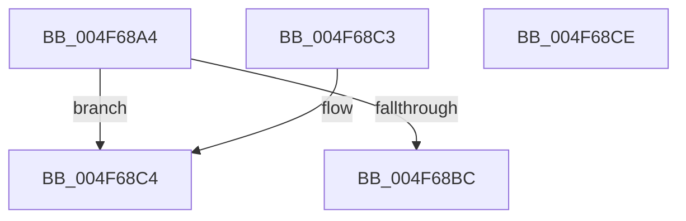

# ST_STORE&lt;SM_TRAITS&gt;::StRegionReadDereference

- RVA: `0x004F68A4`–`0x004F68CF` (길이 `43` bytes)
- VA: `0x00000001404F68A4`
- 실행 섹션: `.text`
- PDB 이름 있음: `예`; PDB Function 태그: `아니요`
- unwind 정보 RVA: `0x000DB714`
- 디코드: `14`개 명령, `43/43` bytes 표시
- 미해석 바이트: `0` (있으면 어셈블리에 `.byte`로 보존)

> 이 문서는 커널 이미지의 기계어와 PDB 기호를 분석해 생성했습니다. 4번과 5번은 함수 원형과 자료형을 바이너리 사용 방식에서 추정한 C 해석이며 원본 소스 복구 결과는 아닙니다.

## 1. Dependencies

- 직접 호출 지점: **0**; 고유 호출 대상: **0**
- 직접 호출자로 확인된 함수: **3**
- RIP 상대 이미지 참조: **0**

### Outgoing calls
- 직접 디코드된 call 명령이 없습니다.

### Direct callers
- [ST_STORE&lt;SM_TRAITS&gt;::StDmDeviceIoCompletion](../4B/ST_STORE_SM_TRAITS_StDmDeviceIoCompletion_function_004BBB70.md) at `0x004BBCD8`
- [ST_STORE&lt;SM_TRAITS&gt;::StDeviceWorkItemCleanup](ST_STORE_SM_TRAITS_StDeviceWorkItemCleanup_function_004F6808.md) at `0x004F6826`
- [ST_STORE&lt;SM_TRAITS&gt;::StDeviceIoBuild](../60/ST_STORE_SM_TRAITS_StDeviceIoBuild_function_0060CDEC.md) at `0x0060CFA4`

### Static image references
- 디코드된 RIP-relative 메모리 참조가 없습니다.

## 2. Other-region calls and transfers

- 다른 실행 섹션으로 향하는 call: **0**
- 별도 외부 분기/꼬리 이동을 확인하지 못했습니다.

## 3. Assembly (complete function range)

```asm
004F68A4  4C 8B 81 80 05 00 00            mov r8, qword ptr [rcx + 0x580]
004F68AB  8B C2                           mov eax, edx
004F68AD  48 8B 91 78 05 00 00            mov rdx, qword ptr [rcx + 0x578]
004F68B4  42 8A 0C 00                     mov cl, byte ptr [rax + r8]
004F68B8  84 C9                           test cl, cl
004F68BA  74 08                           je 0x1404f68c4
004F68BC  FE C9                           dec cl
004F68BE  42 88 0C 00                     mov byte ptr [rax + r8], cl
004F68C2  C3                              ret
004F68C3  CC                              int3
004F68C4  B9 FF BF 00 00                  mov ecx, 0xbfff
004F68C9  66 21 0C 42                     and word ptr [rdx + rax*2], cx
004F68CD  C3                              ret
004F68CE  CC                              int3
```

## 4. C-style interpretation (structured pseudocode)

```c
__int64 __fastcall ST_STORE_SM_TRAITS___StRegionReadDereference(__int64 a1, int a2)
{
    if ((unsigned __int8)(*(unsigned __int8 *)((unsigned int)(a2) + *(unsigned __int64 *)(a1 + 1408) * 1)) == 0) goto loc_004F68C4;
    a1 = (unsigned __int8)((*(unsigned __int8 *)((unsigned int)(a2) + *(unsigned __int64 *)(a1 + 1408) * 1)) - 1);
    *(unsigned __int8 *)((unsigned int)(a2) + *(unsigned __int64 *)(a1 + 1408) * 1) = (unsigned __int8)(a1);
    return (unsigned int)(a2);
loc_004F68C4:
    return (unsigned int)(a2);
}
```

## 5. (Beta) C Style

```c
int64_t ST_STORE_SM_TRAITS___StRegionReadDereference(void *Arg1, void *Arg2)
{
    uint8_t *arg1 = (uint8_t *)Arg1;
    uint8_t *arg2 = (uint8_t *)Arg2;

    if ((uint8_t)(*(uint8_t *)((uint32_t)(arg2) + *(uint64_t *)(arg1 + 0x580) * 1)) == 0) goto loc_004F68C4;
    Arg1 = (uint8_t)((*(uint8_t *)((uint32_t)(arg2) + *(uint64_t *)(arg1 + 0x580) * 1)) - 1);
    *(uint8_t *)((uint32_t)(arg2) + *(uint64_t *)(arg1 + 0x580) * 1) = (uint8_t)(Arg1);
    return (uint32_t)(Arg2);
loc_004F68C4:
    return (uint32_t)(Arg2);
}
```

### 관측된 메모리 오프셋

구조체 형식이 확인되지 않은 접근은 인자 기준의 오프셋으로만 기록했습니다.

| 기준 인자 | 오프셋 표현 | 폭 (bit) | 접근 |
|---|---:|---:|---|
| `Arg1` | `+ 0x578` | `64` | `R` |
| `Arg1` | `+ 0x580` | `64` | `R` |
| `Arg2` | `+ 0x0 + r8*1` | `8` | `R` |
| `Arg2` | `+ 0x0 + r8*1` | `8` | `W` |

## 6. Execution-region graph

[열기: 2D/3D 그래프와 함수 탐색 컨트롤 패널](../../../control-panel.html?section=text&rva=0x004F68A4&view=graph)

- 2D 그래프는 위에서 아래로 흐르고, 3D 그래프는 빈 공간을 드래그해 회전합니다. Shift+드래그는 이동, 휠은 확대·축소, 함수 노드 선택은 대상 보고서 이동입니다.

### Static fallback


