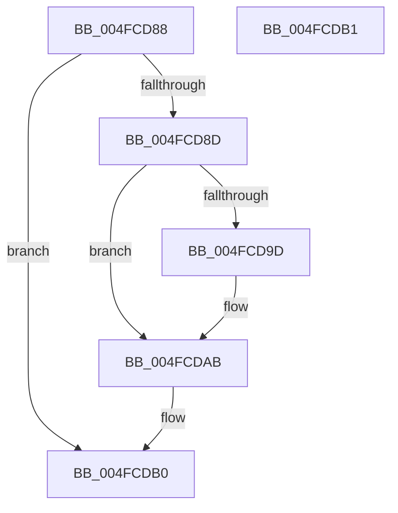

# SafeFree

- RVA: `0x004FCD88`–`0x004FCDB2` (길이 `42` bytes)
- VA: `0x00000001404FCD88`
- 실행 섹션: `.text`
- PDB 이름 있음: `예`; PDB Function 태그: `예`
- unwind 정보 RVA: `0x000805BC`
- 디코드: `15`개 명령, `42/42` bytes 표시
- 미해석 바이트: `0` (있으면 어셈블리에 `.byte`로 보존)

> 이 문서는 커널 이미지의 기계어와 PDB 기호를 분석해 생성했습니다. 4번과 5번은 함수 원형과 자료형을 바이너리 사용 방식에서 추정한 C 해석이며 원본 소스 복구 결과는 아닙니다.

## 1. Dependencies

- 직접 호출 지점: **1**; 고유 호출 대상: **1**
- 직접 호출자로 확인된 함수: **1**
- RIP 상대 이미지 참조: **0**

### Outgoing calls
- `0x004FCDA2` → [ExFreePoolWithTag](../../poolcode/B8/ExFreePoolWithTag_function_00B82870.md) (function, `0x00B82870`)

### Direct callers
- [FsepPropagateGovernedFeatureEffectiveState](../../page/83/FsepPropagateGovernedFeatureEffectiveState_function_0083A89C.md) at `0x0083AC8B`

### Static image references
- 디코드된 RIP-relative 메모리 참조가 없습니다.

## 2. Other-region calls and transfers

- 다른 실행 섹션으로 향하는 call: **1**
  - `0x004FCDA2` → [ExFreePoolWithTag](../../poolcode/B8/ExFreePoolWithTag_function_00B82870.md) (`.text` → `POOLCODE`)
- 별도 외부 분기/꼬리 이동을 확인하지 못했습니다.

## 3. Assembly (complete function range)

```asm
004FCD88  48 85 C9                        test rcx, rcx
004FCD8B  74 23                           je 0x1404fcdb0
004FCD8D  53                              push rbx
004FCD8E  48 83 EC 20                     sub rsp, 0x20
004FCD92  48 8B D9                        mov rbx, rcx
004FCD95  48 8B 09                        mov rcx, qword ptr [rcx]
004FCD98  48 85 C9                        test rcx, rcx
004FCD9B  74 0E                           je 0x1404fcdab
004FCD9D  BA 46 63 50 6C                  mov edx, 0x6c506346
004FCDA2  E8 C9 5A 68 00                  call 0x140b82870
004FCDA7  48 83 23 00                     and qword ptr [rbx], 0
004FCDAB  48 83 C4 20                     add rsp, 0x20
004FCDAF  5B                              pop rbx
004FCDB0  C3                              ret
004FCDB1  CC                              int3
```

## 4. C-style interpretation (structured pseudocode)

```c
__int64 __fastcall SafeFree(__int64 a1)
{
    __int64 result;
    __int64 v_rsp;

    if (a1 == 0) goto loc_004FCDB0;
    v_rsp = (v_rsp) - (32);
    if (*(unsigned __int64 *)(a1) != 0) {
        a2 = 0x6C506346ULL;
        result = ExFreePoolWithTag(*(unsigned __int64 *)(a1), a2, a3, a4);
    }
    v_rsp = (v_rsp) + (32);
loc_004FCDB0:
    return result;
}
```

## 5. (Beta) C Style

```c
int64_t SafeFree(int64_t Arg1)
{
    int64_t result;
    int64_t local_rsp;

    if (Arg1 == 0) goto loc_004FCDB0;
    local_rsp = (local_rsp) - (32);
    if (*(uint64_t *)(Arg1) != 0) {
        a2 = 0x6C506346ULL;
        result = ExFreePoolWithTag(*(uint64_t *)(Arg1), a2, a3, a4);
    }
    local_rsp = (local_rsp) + (32);
loc_004FCDB0:
    return result;
}
```

## 6. Execution-region graph

[열기: 2D/3D 그래프와 함수 탐색 컨트롤 패널](../../../control-panel.html?section=text&rva=0x004FCD88&view=graph)

- 2D 그래프는 위에서 아래로 흐르고, 3D 그래프는 빈 공간을 드래그해 회전합니다. Shift+드래그는 이동, 휠은 확대·축소, 함수 노드 선택은 대상 보고서 이동입니다.

### Static fallback


