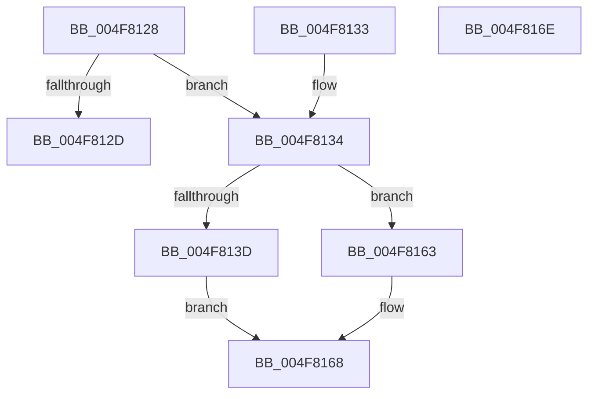

# SecureDump_GetSecureDumpSettings

- RVA: `0x004F8128`–`0x004F816F` (길이 `71` bytes)
- VA: `0x00000001404F8128`
- 실행 섹션: `.text`
- PDB 이름 있음: `예`; PDB Function 태그: `아니요`
- unwind 정보 RVA: `0x000DB714`
- 디코드: `22`개 명령, `71/71` bytes 표시
- 미해석 바이트: `0` (있으면 어셈블리에 `.byte`로 보존)

> 이 문서는 커널 이미지의 기계어와 PDB 기호를 분석해 생성했습니다. 4번과 5번은 함수 원형과 자료형을 바이너리 사용 방식에서 추정한 C 해석이며 원본 소스 복구 결과는 아닙니다.

## 1. Dependencies

- 직접 호출 지점: **0**; 고유 호출 대상: **0**
- 직접 호출자로 확인된 함수: **3**
- RIP 상대 이미지 참조: **5**

### Outgoing calls
- 직접 디코드된 call 명령이 없습니다.

### Direct callers
- [IoCaptureLiveDump](../4E/IoCaptureLiveDump_function_004E085C.md) at `0x004E0D47`
- [IoProvisionCrashDumpKey](../59/IoProvisionCrashDumpKey_function_00592BF0.md) at `0x00592C25`
- [IopInitializeCrashDump](../../page/71/IopInitializeCrashDump_function_0071A270.md) at `0x0071A30F`

### Static image references
- `0x004F8134` → RVA `0x00E661B0` (`.data`; read)
- `0x004F813D` → RVA `0x00E661B4` (`.data`; read)
- `0x004F8145` → RVA `0x00E661E4` (`.data`; read)
- `0x004F814E` → RVA `0x00E661F8` (`.data`; read)
- `0x004F815B` → RVA `0x00E66200` (`.data`; read)

## 2. Other-region calls and transfers

- 다른 실행 섹션으로 향하는 call: **0**
- 별도 외부 분기/꼬리 이동을 확인하지 못했습니다.

## 3. Assembly (complete function range)

```asm
004F8128  48 85 C9                        test rcx, rcx
004F812B  75 07                           jne 0x1404f8134
004F812D  B8 0D 00 00 C0                  mov eax, 0xc000000d
004F8132  C3                              ret
004F8133  CC                              int3
004F8134  83 3D 75 E0 96 00 02            cmp dword ptr [rip + 0x96e075], 2
004F813B  75 26                           jne 0x1404f8163
004F813D  8A 05 71 E0 96 00               mov al, byte ptr [rip + 0x96e071]
004F8143  88 01                           mov byte ptr [rcx], al
004F8145  8B 05 99 E0 96 00               mov eax, dword ptr [rip + 0x96e099]
004F814B  89 41 04                        mov dword ptr [rcx + 4], eax
004F814E  83 3D A3 E0 96 00 01            cmp dword ptr [rip + 0x96e0a3], 1
004F8155  0F 94 C0                        sete al
004F8158  88 41 01                        mov byte ptr [rcx + 1], al
004F815B  8B 05 9F E0 96 00               mov eax, dword ptr [rip + 0x96e09f]
004F8161  EB 05                           jmp 0x1404f8168
004F8163  33 C0                           xor eax, eax
004F8165  48 89 01                        mov qword ptr [rcx], rax
004F8168  89 41 08                        mov dword ptr [rcx + 8], eax
004F816B  33 C0                           xor eax, eax
004F816D  C3                              ret
004F816E  CC                              int3
```

## 4. C-style interpretation (structured pseudocode)

```c
__int64 __fastcall SecureDump_GetSecureDumpSettings(__int64 a1)
{
    __int64 result;

    if (a1 != 0) goto loc_004F8134;
    return (unsigned int)(0xC000000DULL);
loc_004F8134:
    if ((*(unsigned int *)(v_rip + 9887861)) != 2) goto loc_004F8163;
    *(unsigned __int8 *)(a1) = (unsigned __int8)(*(unsigned __int8 *)(v_rip + 9887857));
    *(unsigned int *)(a1 + 4) = (unsigned int)((unsigned int)(*(unsigned int *)(v_rip + 9887897)));
    result = ((*(unsigned int *)(v_rip + 9887907)) == 1) ? 1 : 0;
    *(unsigned __int8 *)(a1 + 1) = (unsigned __int8)(result);
    goto loc_004F8168;
loc_004F8163:
    result = 0;
    *(unsigned __int64 *)(a1) = 0;
loc_004F8168:
    *(unsigned int *)(a1 + 8) = 0;
    result = 0;
    return result;
}
```

## 5. (Beta) C Style

```c
int64_t SecureDump_GetSecureDumpSettings(int64_t Arg1)
{
    int64_t result;

    if (Arg1 != 0) goto loc_004F8134;
    return (uint32_t)(0xC000000DULL);
loc_004F8134:
    if ((*(uint32_t *)(v_rip + 0x96E075)) != 2) goto loc_004F8163;
    *(uint8_t *)(Arg1) = (uint8_t)(*(uint8_t *)(v_rip + 0x96E071));
    *(uint32_t *)(Arg1 + 0x4) = (uint32_t)((uint32_t)(*(uint32_t *)(v_rip + 0x96E099)));
    result = ((*(uint32_t *)(v_rip + 0x96E0A3)) == 1) ? 1 : 0;
    *(uint8_t *)(Arg1 + 0x1) = (uint8_t)(result);
    goto loc_004F8168;
loc_004F8163:
    result = 0;
    *(uint64_t *)(Arg1) = 0;
loc_004F8168:
    *(uint32_t *)(Arg1 + 0x8) = 0;
    result = 0;
    return result;
}
```

## 6. Execution-region graph

[열기: 2D/3D 그래프와 함수 탐색 컨트롤 패널](../../../control-panel.html?section=text&rva=0x004F8128&view=graph)

- 2D 그래프는 위에서 아래로 흐르고, 3D 그래프는 빈 공간을 드래그해 회전합니다. Shift+드래그는 이동, 휠은 확대·축소, 함수 노드 선택은 대상 보고서 이동입니다.

### Static fallback


