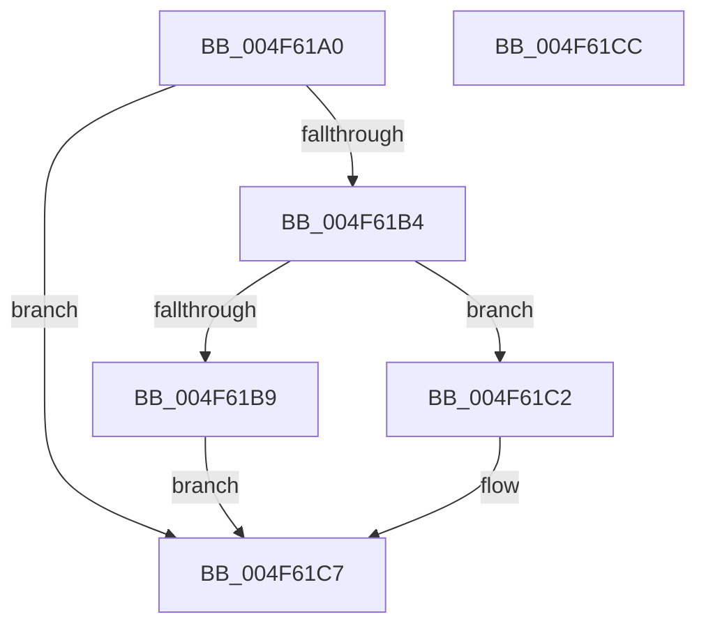

# SepRmDereferenceCapTable

- RVA: `0x004F61A0`–`0x004F61CD` (길이 `45` bytes)
- VA: `0x00000001404F61A0`
- 실행 섹션: `.text`
- PDB 이름 있음: `예`; PDB Function 태그: `아니요`
- unwind 정보 RVA: `0x0005C788`
- 디코드: `14`개 명령, `45/45` bytes 표시
- 미해석 바이트: `0` (있으면 어셈블리에 `.byte`로 보존)

> 이 문서는 커널 이미지의 기계어와 PDB 기호를 분석해 생성했습니다. 4번과 5번은 함수 원형과 자료형을 바이너리 사용 방식에서 추정한 C 해석이며 원본 소스 복구 결과는 아닙니다.

## 1. Dependencies

- 직접 호출 지점: **1**; 고유 호출 대상: **1**
- 직접 호출자로 확인된 함수: **3**
- RIP 상대 이미지 참조: **0**

### Outgoing calls
- `0x004F61C2` → [SepRmDestroyCapTable](../../page/7A/SepRmDestroyCapTable_function_007A4894.md) (function, `0x007A4894`)

### Direct callers
- [SepRmReferenceFindCap](../3A/SepRmReferenceFindCap_function_003A58EC.md) at `0x003A597A`
- [SepRmDereferenceCap](../4B/SepRmDereferenceCap_function_004B1E9C.md) at `0x004B1EA9`
- [SepRmCapUpdateWrkr](../../page/7A/SepRmCapUpdateWrkr_function_007A46D0.md) at `0x007A479C`
- [SepRmCapUpdateWrkr](../../page/7A/SepRmCapUpdateWrkr_function_007A46D0.md) at `0x007A47F4`

### Static image references
- 디코드된 RIP-relative 메모리 참조가 없습니다.

## 2. Other-region calls and transfers

- 다른 실행 섹션으로 향하는 call: **1**
  - `0x004F61C2` → [SepRmDestroyCapTable](../../page/7A/SepRmDestroyCapTable_function_007A4894.md) (`.text` → `PAGE`)
- 별도 외부 분기/꼬리 이동을 확인하지 못했습니다.

## 3. Assembly (complete function range)

```asm
004F61A0  48 83 EC 28                     sub rsp, 0x28
004F61A4  48 83 C8 FF                     or rax, 0xffffffffffffffff
004F61A8  F0 48 0F C1 41 28               lock xadd qword ptr [rcx + 0x28], rax
004F61AE  48 83 E8 01                     sub rax, 1
004F61B2  7F 13                           jg 0x1404f61c7
004F61B4  48 85 C0                        test rax, rax
004F61B7  74 09                           je 0x1404f61c2
004F61B9  B9 0E 00 00 00                  mov ecx, 0xe
004F61BE  CD 29                           int 0x29
004F61C0  EB 05                           jmp 0x1404f61c7
004F61C2  E8 CD E6 2A 00                  call 0x1407a4894
004F61C7  48 83 C4 28                     add rsp, 0x28
004F61CB  C3                              ret
004F61CC  CC                              int3
```

## 4. C-style interpretation (structured pseudocode)

```c
__int64 __fastcall SepRmDereferenceCapTable(__int64 a1)
{
    __int64 result;
    __int64 v_rsp;

    v_rsp = (v_rsp) - (40);
    result = (result) | (-1);
    result = (result) - (1);
    if (condition_is_greater) goto loc_004F61C7;
    if (result == 0) goto loc_004F61C2;
    goto loc_004F61C7;
loc_004F61C2:
    result = SepRmDestroyCapTable(14, a2, a3, a4);
loc_004F61C7:
    v_rsp = (v_rsp) + (40);
    return result;
}
```

## 5. (Beta) C Style

```c
int64_t SepRmDereferenceCapTable(void *Arg1)
{
    uint8_t *arg1 = (uint8_t *)Arg1;

    int64_t result;
    int64_t local_rsp;

    local_rsp = (local_rsp) - (40);
    result = (result) | (-1);
    result = (result) - (1);
    if (condition_is_greater) goto loc_004F61C7;
    if (result == 0) goto loc_004F61C2;
    goto loc_004F61C7;
loc_004F61C2:
    result = SepRmDestroyCapTable(14, a2, a3, a4);
loc_004F61C7:
    local_rsp = (local_rsp) + (40);
    return result;
}
```

### 관측된 메모리 오프셋

구조체 형식이 확인되지 않은 접근은 인자 기준의 오프셋으로만 기록했습니다.

| 기준 인자 | 오프셋 표현 | 폭 (bit) | 접근 |
|---|---:|---:|---|
| `Arg1` | `+ 0x28` | `64` | `R/W` |

## 6. Execution-region graph

[열기: 2D/3D 그래프와 함수 탐색 컨트롤 패널](../../../control-panel.html?section=text&rva=0x004F61A0&view=graph)

- 2D 그래프는 위에서 아래로 흐르고, 3D 그래프는 빈 공간을 드래그해 회전합니다. Shift+드래그는 이동, 휠은 확대·축소, 함수 노드 선택은 대상 보고서 이동입니다.

### Static fallback


