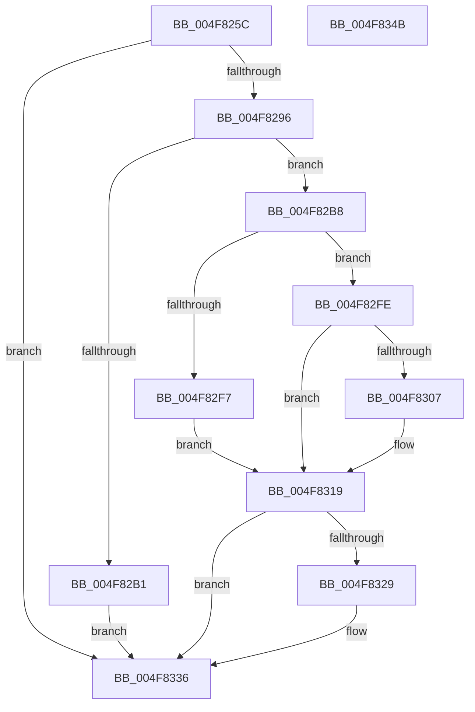

# SepValidateAndCopyGlobalEntry

- RVA: `0x004F825C`–`0x004F834C` (길이 `240` bytes)
- VA: `0x00000001404F825C`
- 실행 섹션: `.text`
- PDB 이름 있음: `예`; PDB Function 태그: `아니요`
- unwind 정보 RVA: `0x000BF738`
- 디코드: `71`개 명령, `240/240` bytes 표시
- 미해석 바이트: `0` (있으면 어셈블리에 `.byte`로 보존)

> 이 문서는 커널 이미지의 기계어와 PDB 기호를 분석해 생성했습니다. 4번과 5번은 함수 원형과 자료형을 바이너리 사용 방식에서 추정한 C 해석이며 원본 소스 복구 결과는 아닙니다.

## 1. Dependencies

- 직접 호출 지점: **7**; 고유 호출 대상: **7**
- 직접 호출자로 확인된 함수: **1**
- RIP 상대 이미지 참조: **0**

### Outgoing calls
- `0x004F8287` → [SepGetProcUniqueLuidAndIndexFromAttributeInfo](../30/SepGetProcUniqueLuidAndIndexFromAttributeInfo_function_00300A78.md) (function, `0x00300A78`)
- `0x004F82A4` → [ExAllocatePool2](../../poolcode/B8/ExAllocatePool2_function_00B820F0.md) (function, `0x00B820F0`)
- `0x004F82D9` → [SepGetSingletonEntryFromIndexNumber](../2F/SepGetSingletonEntryFromIndexNumber_function_002F095C.md) (function, `0x002F095C`)
- `0x004F82E4` → [ExAcquireSpinLockShared](../24/ExAcquireSpinLockShared_function_0024DCE0.md) (function, `0x0024DCE0`)
- `0x004F830D` → [AuthzBasepDuplicateSecurityAttributes](../30/AuthzBasepDuplicateSecurityAttributes_function_003023C0.md) (function, `0x003023C0`)
- `0x004F831F` → [ExReleaseSpinLockShared](../2F/ExReleaseSpinLockShared_function_002F0EF0.md) (function, `0x002F0EF0`)
- `0x004F8331` → [ExFreePoolWithTag](../../poolcode/B8/ExFreePoolWithTag_function_00B82870.md) (function, `0x00B82870`)

### Direct callers
- [AuthzBasepEvaluateAceCondition](../2F/AuthzBasepEvaluateAceCondition_function_002FEBD0.md) at `0x002FF436`

### Static image references
- 디코드된 RIP-relative 메모리 참조가 없습니다.

## 2. Other-region calls and transfers

- 다른 실행 섹션으로 향하는 call: **2**
  - `0x004F82A4` → [ExAllocatePool2](../../poolcode/B8/ExAllocatePool2_function_00B820F0.md) (`.text` → `POOLCODE`)
  - `0x004F8331` → [ExFreePoolWithTag](../../poolcode/B8/ExFreePoolWithTag_function_00B82870.md) (`.text` → `POOLCODE`)
- 별도 외부 분기/꼬리 이동을 확인하지 못했습니다.

## 3. Assembly (complete function range)

```asm
004F825C  48 8B C4                        mov rax, rsp
004F825F  48 89 58 08                     mov qword ptr [rax + 8], rbx
004F8263  48 89 68 20                     mov qword ptr [rax + 0x20], rbp
004F8267  56                              push rsi
004F8268  57                              push rdi
004F8269  41 56                           push r14
004F826B  48 83 EC 20                     sub rsp, 0x20
004F826F  48 83 22 00                     and qword ptr [rdx], 0
004F8273  4C 8D 40 18                     lea r8, [rax + 0x18]
004F8277  83 60 10 00                     and dword ptr [rax + 0x10], 0
004F827B  4C 8B F2                        mov r14, rdx
004F827E  48 83 60 18 00                  and qword ptr [rax + 0x18], 0
004F8283  48 8D 50 10                     lea rdx, [rax + 0x10]
004F8287  E8 EC 87 E0 FF                  call 0x140300a78
004F828C  8B F8                           mov edi, eax
004F828E  85 C0                           test eax, eax
004F8290  0F 88 A0 00 00 00               js 0x1404f8336
004F8296  BA 30 00 00 00                  mov edx, 0x30
004F829B  41 B8 53 65 41 74               mov r8d, 0x74416553
004F82A1  8D 4A 10                        lea ecx, [rdx + 0x10]
004F82A4  E8 47 9E 68 00                  call 0x140b820f0
004F82A9  48 8B D8                        mov rbx, rax
004F82AC  48 85 C0                        test rax, rax
004F82AF  75 07                           jne 0x1404f82b8
004F82B1  BF 17 00 00 C0                  mov edi, 0xc0000017
004F82B6  EB 7E                           jmp 0x1404f8336
004F82B8  83 20 00                        and dword ptr [rax], 0
004F82BB  83 60 18 00                     and dword ptr [rax + 0x18], 0
004F82BF  48 83 C0 08                     add rax, 8
004F82C3  8B 4C 24 48                     mov ecx, dword ptr [rsp + 0x48]
004F82C7  48 89 40 08                     mov qword ptr [rax + 8], rax
004F82CB  48 89 00                        mov qword ptr [rax], rax
004F82CE  48 8D 43 20                     lea rax, [rbx + 0x20]
004F82D2  48 89 40 08                     mov qword ptr [rax + 8], rax
004F82D6  48 89 00                        mov qword ptr [rax], rax
004F82D9  E8 7E 86 DF FF                  call 0x1402f095c
004F82DE  48 8B C8                        mov rcx, rax
004F82E1  48 8B F0                        mov rsi, rax
004F82E4  E8 F7 59 D5 FF                  call 0x14024dce0
004F82E9  40 8A E8                        mov bpl, al
004F82EC  48 8B 44 24 50                  mov rax, qword ptr [rsp + 0x50]
004F82F1  48 39 46 08                     cmp qword ptr [rsi + 8], rax
004F82F5  74 07                           je 0x1404f82fe
004F82F7  BF 25 02 00 C0                  mov edi, 0xc0000225
004F82FC  EB 1B                           jmp 0x1404f8319
004F82FE  48 8B 4E 10                     mov rcx, qword ptr [rsi + 0x10]
004F8302  48 85 C9                        test rcx, rcx
004F8305  74 12                           je 0x1404f8319
004F8307  45 33 C0                        xor r8d, r8d
004F830A  48 8B D3                        mov rdx, rbx
004F830D  E8 AE A0 E0 FF                  call 0x1403023c0
004F8312  49 89 1E                        mov qword ptr [r14], rbx
004F8315  8B F8                           mov edi, eax
004F8317  33 DB                           xor ebx, ebx
004F8319  40 8A D5                        mov dl, bpl
004F831C  48 8B CE                        mov rcx, rsi
004F831F  E8 CC 8B DF FF                  call 0x1402f0ef0
004F8324  48 85 DB                        test rbx, rbx
004F8327  74 0D                           je 0x1404f8336
004F8329  BA 53 65 41 74                  mov edx, 0x74416553
004F832E  48 8B CB                        mov rcx, rbx
004F8331  E8 3A A5 68 00                  call 0x140b82870
004F8336  48 8B 5C 24 40                  mov rbx, qword ptr [rsp + 0x40]
004F833B  8B C7                           mov eax, edi
004F833D  48 8B 6C 24 58                  mov rbp, qword ptr [rsp + 0x58]
004F8342  48 83 C4 20                     add rsp, 0x20
004F8346  41 5E                           pop r14
004F8348  5F                              pop rdi
004F8349  5E                              pop rsi
004F834A  C3                              ret
004F834B  CC                              int3
```

## 4. C-style interpretation (structured pseudocode)

```c
__int64 __fastcall SepValidateAndCopyGlobalEntry(__int64 a1, __int64 a2)
{
    __int64 result;
    __int64 v_rbx;
    __int64 v_rdi;
    __int64 v_rsp;
    unsigned int v_stack_p10;
    unsigned __int64 v_stack_p18;
    unsigned __int64 v_stack_p20;
    unsigned __int64 v_stack_p8;

    *(unsigned __int64 *)(v_rsp + 8) = v_rbx;
    *(unsigned __int64 *)(v_rsp + 32) = v_rbp;
    v_rsp = (v_rsp) - (32);
    result = SepGetProcUniqueLuidAndIndexFromAttributeInfo(a1, v_rsp + 16, v_rsp + 24, a4);
    if (sign_flag) goto loc_004F8336;
    result = ExAllocatePool2(48 + 16, 48, (unsigned int)(0x74416553ULL), a4);
    if (result != 0) goto loc_004F82B8;
    goto loc_004F8336;
loc_004F82B8:
    result = (result) + (8);
    *(unsigned __int64 *)(result + 8) = result;
    *(unsigned __int64 *)(result) = result;
    *(unsigned __int64 *)(result + 32 + 8) = result + 32;
    *(unsigned __int64 *)(result + 32) = result + 32;
    result = SepGetSingletonEntryFromIndexNumber((unsigned int)(v_stack_p10), 48, (unsigned int)(0x74416553ULL), a4);
    result = ExAcquireSpinLockShared(result, 48, (unsigned int)(0x74416553ULL), a4);
    if ((*(unsigned __int64 *)(result + 8)) == v_stack_p18) goto loc_004F82FE;
    goto loc_004F8319;
loc_004F82FE:
    result = v_stack_p18;
    v_rbx = result;
    v_rdi = (unsigned int)(0xC0000225ULL);
    if (*(unsigned __int64 *)(result + 16) != 0) {
        a3 = 0;
        a2 = result;
        result = AuthzBasepDuplicateSecurityAttributes(*(unsigned __int64 *)(result + 16), a2, a3, a4);
        *(unsigned __int64 *)(a2) = result;
        v_rdi = (unsigned int)(result);
        v_rbx = 0;
    }
    result = ExReleaseSpinLockShared(result, (unsigned __int8)((unsigned __int8)(result)), a3, a4);
    if (0 != 0) {
        a2 = 0x74416553ULL;
        a1 = 0;
        result = ExFreePoolWithTag(a1, a2, a3, a4);
    }
    v_rsp = (v_rsp) + (32);
    return (unsigned int)((unsigned int)(v_rdi));
}
```

## 5. (Beta) C Style

```c
int64_t SepValidateAndCopyGlobalEntry(int64_t Arg1, void *Arg2)
{
    uint8_t *arg2 = (uint8_t *)Arg2;

    int64_t result;
    int64_t local_rbx;
    int64_t local_rdi;
    int64_t local_rsp;
    uint32_t v_stack_p10;
    uint64_t v_stack_p18;
    uint64_t v_stack_p20;
    uint64_t v_stack_p8;

    *(uint64_t *)(local_rsp + 0x8) = local_rbx;
    *(uint64_t *)(local_rsp + 0x20) = local_rbp;
    local_rsp = (local_rsp) - (32);
    result = SepGetProcUniqueLuidAndIndexFromAttributeInfo(Arg1, local_rsp + 16, local_rsp + 24, a4);
    if (sign_flag) goto loc_004F8336;
    result = ExAllocatePool2(48 + 16, 48, (uint32_t)(0x74416553ULL), a4);
    if (result != 0) goto loc_004F82B8;
    goto loc_004F8336;
loc_004F82B8:
    result = (result) + (8);
    *(uint64_t *)(result + 0x8) = result;
    *(uint64_t *)(result) = result;
    *(uint64_t *)(result + 0x20 + 0x8) = result + 32;
    *(uint64_t *)(result + 0x20) = result + 32;
    result = SepGetSingletonEntryFromIndexNumber((uint32_t)(v_stack_p10), 48, (uint32_t)(0x74416553ULL), a4);
    result = ExAcquireSpinLockShared(result, 48, (uint32_t)(0x74416553ULL), a4);
    if ((*(uint64_t *)(result + 0x8)) == v_stack_p18) goto loc_004F82FE;
    goto loc_004F8319;
loc_004F82FE:
    result = v_stack_p18;
    local_rbx = result;
    local_rdi = (uint32_t)(0xC0000225ULL);
    if (*(uint64_t *)(result + 0x10) != 0) {
        a3 = 0;
        Arg2 = result;
        result = AuthzBasepDuplicateSecurityAttributes(*(uint64_t *)(result + 0x10), Arg2, a3, a4);
        *(uint64_t *)(arg2) = result;
        local_rdi = (uint32_t)(result);
        local_rbx = 0;
    }
    result = ExReleaseSpinLockShared(result, (uint8_t)((uint8_t)(result)), a3, a4);
    if (0 != 0) {
        Arg2 = 0x74416553ULL;
        Arg1 = 0;
        result = ExFreePoolWithTag(Arg1, Arg2, a3, a4);
    }
    local_rsp = (local_rsp) + (32);
    return (uint32_t)((uint32_t)(local_rdi));
}
```

### 관측된 메모리 오프셋

구조체 형식이 확인되지 않은 접근은 인자 기준의 오프셋으로만 기록했습니다.

| 기준 인자 | 오프셋 표현 | 폭 (bit) | 접근 |
|---|---:|---:|---|
| `Arg2` | `+ 0x0` | `64` | `R/W` |
| `Arg2` | `+ 0x0` | `64` | `W` |

## 6. Execution-region graph

[열기: 2D/3D 그래프와 함수 탐색 컨트롤 패널](../../../control-panel.html?section=text&rva=0x004F825C&view=graph)

- 2D 그래프는 위에서 아래로 흐르고, 3D 그래프는 빈 공간을 드래그해 회전합니다. Shift+드래그는 이동, 휠은 확대·축소, 함수 노드 선택은 대상 보고서 이동입니다.

### Static fallback


