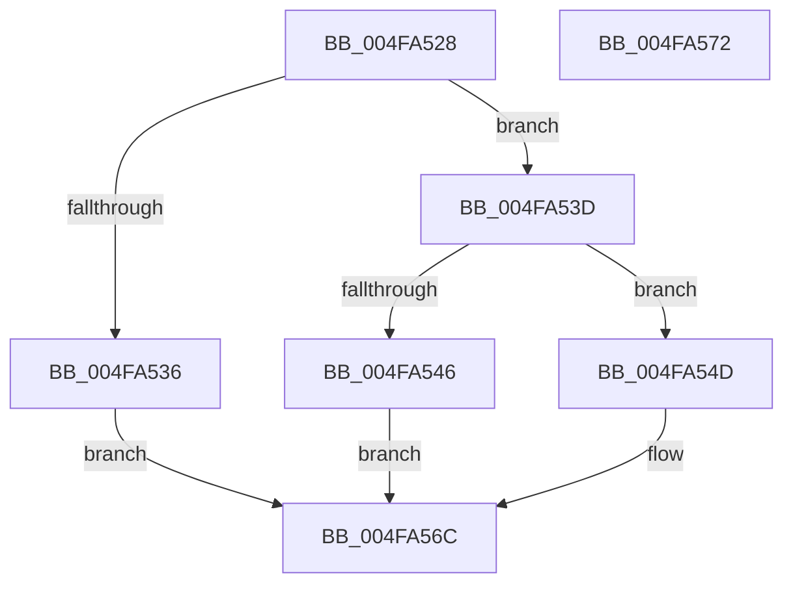

# SepValidateCAPID

- RVA: `0x004FA528`–`0x004FA573` (길이 `75` bytes)
- VA: `0x00000001404FA528`
- 실행 섹션: `.text`
- PDB 이름 있음: `예`; PDB Function 태그: `아니요`
- unwind 정보 RVA: `0x0005CF00`
- 디코드: `23`개 명령, `75/75` bytes 표시
- 미해석 바이트: `0` (있으면 어셈블리에 `.byte`로 보존)

> 이 문서는 커널 이미지의 기계어와 PDB 기호를 분석해 생성했습니다. 4번과 5번은 함수 원형과 자료형을 바이너리 사용 방식에서 추정한 C 해석이며 원본 소스 복구 결과는 아닙니다.

## 1. Dependencies

- 직접 호출 지점: **2**; 고유 호출 대상: **2**
- 직접 호출자로 확인된 함수: **1**
- RIP 상대 이미지 참조: **1**

### Outgoing calls
- `0x004FA53D` → [RtlValidSid](../../page/92/RtlValidSid_function_00929710.md) (function, `0x00929710`)
- `0x004FA55E` → [memcmp](../6C/memcmp_function_006C6B10.md) (function, `0x006C6B10`)

### Direct callers
- [SeRmReferenceFindCapName](../4D/SeRmReferenceFindCapName_function_004DDBA4.md) at `0x004DDBDD`

### Static image references
- `0x004FA557` → RVA `0x00037D14` (`.rdata`; read)

## 2. Other-region calls and transfers

- 다른 실행 섹션으로 향하는 call: **1**
  - `0x004FA53D` → [RtlValidSid](../../page/92/RtlValidSid_function_00929710.md) (`.text` → `PAGE`)
- 별도 외부 분기/꼬리 이동을 확인하지 못했습니다.

## 3. Assembly (complete function range)

```asm
004FA528  40 53                           push rbx
004FA52A  48 83 EC 20                     sub rsp, 0x20
004FA52E  48 8B D9                        mov rbx, rcx
004FA531  48 85 C9                        test rcx, rcx
004FA534  75 07                           jne 0x1404fa53d
004FA536  B8 0D 00 00 C0                  mov eax, 0xc000000d
004FA53B  EB 2F                           jmp 0x1404fa56c
004FA53D  E8 CE F1 42 00                  call 0x140929710
004FA542  84 C0                           test al, al
004FA544  75 07                           jne 0x1404fa54d
004FA546  B8 78 00 00 C0                  mov eax, 0xc0000078
004FA54B  EB 1F                           jmp 0x1404fa56c
004FA54D  48 8D 4B 02                     lea rcx, [rbx + 2]
004FA551  41 B8 06 00 00 00               mov r8d, 6
004FA557  48 8D 15 B6 D7 B3 FF            lea rdx, [rip - 0x4c284a]
004FA55E  E8 AD C5 1C 00                  call 0x1406c6b10
004FA563  F7 D8                           neg eax
004FA565  1B C0                           sbb eax, eax
004FA567  25 84 00 00 C0                  and eax, 0xc0000084
004FA56C  48 83 C4 20                     add rsp, 0x20
004FA570  5B                              pop rbx
004FA571  C3                              ret
004FA572  CC                              int3
```

## 4. C-style interpretation (structured pseudocode)

```c
__int64 __fastcall SepValidateCAPID(__int64 a1)
{
    __int64 result;
    __int64 v_rsp;

    v_rsp = (v_rsp) - (32);
    if (a1 != 0) goto loc_004FA53D;
    goto loc_004FA56C;
loc_004FA53D:
    result = RtlValidSid(a1, a2, a3, a4);
    if ((unsigned __int8)(result) != 0) goto loc_004FA54D;
    goto loc_004FA56C;
loc_004FA54D:
    result = memcmp(a1 + 2, v_rip - 4991050, 6, a4);
    result = (unsigned int)(-(result));
    result = (unsigned int)((result) & (0xC0000084ULL));
loc_004FA56C:
    v_rsp = (v_rsp) + (32);
    return result;
}
```

## 5. (Beta) C Style

```c
int64_t SepValidateCAPID(void *Arg1)
{
    uint8_t *arg1 = (uint8_t *)Arg1;

    int64_t result;
    int64_t local_rsp;

    local_rsp = (local_rsp) - (32);
    if (Arg1 != NULL) goto loc_004FA53D;
    goto loc_004FA56C;
loc_004FA53D:
    result = RtlValidSid(Arg1, a2, a3, a4);
    if ((uint8_t)(result) != 0) goto loc_004FA54D;
    goto loc_004FA56C;
loc_004FA54D:
    result = memcmp(Arg1 + 2, v_rip - 4991050, 6, a4);
    result = (uint32_t)(-(result));
    result = (uint32_t)((result) & (0xC0000084ULL));
loc_004FA56C:
    local_rsp = (local_rsp) + (32);
    return result;
}
```

### 관측된 메모리 오프셋

구조체 형식이 확인되지 않은 접근은 인자 기준의 오프셋으로만 기록했습니다.

| 기준 인자 | 오프셋 표현 | 폭 (bit) | 접근 |
|---|---:|---:|---|
| `Arg1` | `+ 0x2` | `64` | `R` |

## 6. Execution-region graph

[열기: 2D/3D 그래프와 함수 탐색 컨트롤 패널](../../../control-panel.html?section=text&rva=0x004FA528&view=graph)

- 2D 그래프는 위에서 아래로 흐르고, 3D 그래프는 빈 공간을 드래그해 회전합니다. Shift+드래그는 이동, 휠은 확대·축소, 함수 노드 선택은 대상 보고서 이동입니다.

### Static fallback


