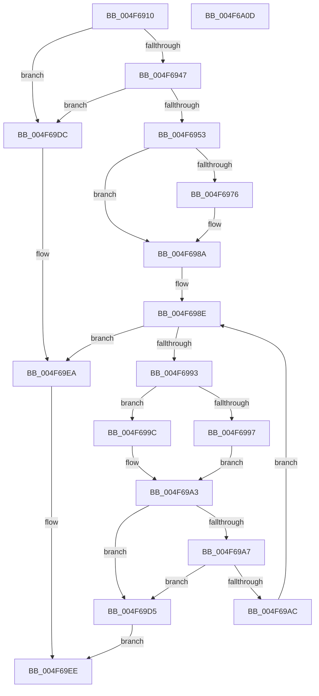

# SmStoreHashCompressedData

- RVA: `0x004F6910`–`0x004F6A0E` (길이 `254` bytes)
- VA: `0x00000001404F6910`
- 실행 섹션: `.text`
- PDB 이름 있음: `예`; PDB Function 태그: `아니요`
- unwind 정보 RVA: `0x0005D79C`
- 디코드: `80`개 명령, `254/254` bytes 표시
- 미해석 바이트: `0` (있으면 어셈블리에 `.byte`로 보존)

> 이 문서는 커널 이미지의 기계어와 PDB 기호를 분석해 생성했습니다. 4번과 5번은 함수 원형과 자료형을 바이너리 사용 방식에서 추정한 C 해석이며 원본 소스 복구 결과는 아닙니다.

## 1. Dependencies

- 직접 호출 지점: **3**; 고유 호출 대상: **1**
- 직접 호출자로 확인된 함수: **1**
- RIP 상대 이미지 참조: **0**

### Outgoing calls
- `0x004F697C` → [wyhash](../26/wyhash_function_00269FE4.md) (function, `0x00269FE4`)
- `0x004F69B8` → [wyhash](../26/wyhash_function_00269FE4.md) (function, `0x00269FE4`)
- `0x004F69E5` → [wyhash](../26/wyhash_function_00269FE4.md) (function, `0x00269FE4`)

### Direct callers
- [ST_STORE&lt;SM_TRAITS&gt;::StDmpHashBytes](ST_STORE_SM_TRAITS_StDmpHashBytes_function_004F68D8.md) at `0x004F68F3`

### Static image references
- 디코드된 RIP-relative 메모리 참조가 없습니다.

## 2. Other-region calls and transfers

- 다른 실행 섹션으로 향하는 call: **0**
- 별도 외부 분기/꼬리 이동을 확인하지 못했습니다.

## 3. Assembly (complete function range)

```asm
004F6910  48 89 5C 24 10                  mov qword ptr [rsp + 0x10], rbx
004F6915  48 89 6C 24 18                  mov qword ptr [rsp + 0x18], rbp
004F691A  48 89 74 24 20                  mov qword ptr [rsp + 0x20], rsi
004F691F  57                              push rdi
004F6920  41 54                           push r12
004F6922  41 55                           push r13
004F6924  41 56                           push r14
004F6926  41 57                           push r15
004F6928  48 83 EC 20                     sub rsp, 0x20
004F692C  33 FF                           xor edi, edi
004F692E  41 8B F0                        mov esi, r8d
004F6931  4C 8B E2                        mov r12, rdx
004F6934  4D 8B E9                        mov r13, r9
004F6937  8B 91 C0 12 00 00               mov edx, dword ptr [rcx + 0x12c0]
004F693D  8B C7                           mov eax, edi
004F693F  85 D2                           test edx, edx
004F6941  0F 84 95 00 00 00               je 0x1404f69dc
004F6947  81 FE 00 10 00 00               cmp esi, 0x1000
004F694D  0F 84 89 00 00 00               je 0x1404f69dc
004F6953  83 FA 02                        cmp edx, 2
004F6956  44 8B F7                        mov r14d, edi
004F6959  41 0F 94 C6                     sete r14b
004F695D  41 FF C6                        inc r14d
004F6960  41 8D 4E FF                     lea ecx, [r14 - 1]
004F6964  8D 1C 09                        lea ebx, [rcx + rcx]
004F6967  8B D3                           mov edx, ebx
004F6969  4E 8D 0C 23                     lea r9, [rbx + r12]
004F696D  4C 89 4C 24 50                  mov qword ptr [rsp + 0x50], r9
004F6972  85 DB                           test ebx, ebx
004F6974  74 14                           je 0x1404f698a
004F6976  45 33 C0                        xor r8d, r8d
004F6979  49 8B CC                        mov rcx, r12
004F697C  E8 63 36 D7 FF                  call 0x140269fe4
004F6981  4C 8B 4C 24 50                  mov r9, qword ptr [rsp + 0x50]
004F6986  41 8D 4E FF                     lea ecx, [r14 - 1]
004F698A  2B F3                           sub esi, ebx
004F698C  8B EF                           mov ebp, edi
004F698E  41 3B EE                        cmp ebp, r14d
004F6991  73 57                           jae 0x1404f69ea
004F6993  3B E9                           cmp ebp, ecx
004F6995  75 05                           jne 0x1404f699c
004F6997  44 8B FE                        mov r15d, esi
004F699A  EB 07                           jmp 0x1404f69a3
004F699C  8B CD                           mov ecx, ebp
004F699E  45 0F B7 3C 4C                  movzx r15d, word ptr [r12 + rcx*2]
004F69A3  85 F6                           test esi, esi
004F69A5  74 2E                           je 0x1404f69d5
004F69A7  44 3B FE                        cmp r15d, esi
004F69AA  77 29                           ja 0x1404f69d5
004F69AC  4C 8B C0                        mov r8, rax
004F69AF  41 8B D7                        mov edx, r15d
004F69B2  49 8B C9                        mov rcx, r9
004F69B5  41 8B DF                        mov ebx, r15d
004F69B8  E8 27 36 D7 FF                  call 0x140269fe4
004F69BD  4C 8B 4C 24 50                  mov r9, qword ptr [rsp + 0x50]
004F69C2  41 8D 4E FF                     lea ecx, [r14 - 1]
004F69C6  4C 03 CB                        add r9, rbx
004F69C9  41 2B F7                        sub esi, r15d
004F69CC  4C 89 4C 24 50                  mov qword ptr [rsp + 0x50], r9
004F69D1  FF C5                           inc ebp
004F69D3  EB B9                           jmp 0x1404f698e
004F69D5  BF 02 01 00 C0                  mov edi, 0xc0000102
004F69DA  EB 12                           jmp 0x1404f69ee
004F69DC  48 8B D6                        mov rdx, rsi
004F69DF  45 33 C0                        xor r8d, r8d
004F69E2  49 8B CC                        mov rcx, r12
004F69E5  E8 FA 35 D7 FF                  call 0x140269fe4
004F69EA  49 89 45 00                     mov qword ptr [r13], rax
004F69EE  48 8B 5C 24 58                  mov rbx, qword ptr [rsp + 0x58]
004F69F3  8B C7                           mov eax, edi
004F69F5  48 8B 6C 24 60                  mov rbp, qword ptr [rsp + 0x60]
004F69FA  48 8B 74 24 68                  mov rsi, qword ptr [rsp + 0x68]
004F69FF  48 83 C4 20                     add rsp, 0x20
004F6A03  41 5F                           pop r15
004F6A05  41 5E                           pop r14
004F6A07  41 5D                           pop r13
004F6A09  41 5C                           pop r12
004F6A0B  5F                              pop rdi
004F6A0C  C3                              ret
004F6A0D  CC                              int3
```

## 4. C-style interpretation (structured pseudocode)

```c
__int64 __fastcall SmStoreHashCompressedData(__int64 a1, __int64 a2, int a3, __int64 a4)
{
    __int64 result;
    __int64 v_r14;
    __int64 v_rbp;
    __int64 v_rdi;
    __int64 v_rsi;
    __int64 v_rsp;
    unsigned __int64 v_stack_p10;
    unsigned __int64 v_stack_p18;
    unsigned __int64 v_stack_p20;
    unsigned __int64 v_stack_p8;

    v_stack_p10 = v_rbx;
    v_stack_p18 = v_rbp;
    v_stack_p20 = v_rsi;
    v_rsp = (v_rsp) - (32);
    v_rdi = 0;
    if ((unsigned int)((unsigned int)(*(unsigned int *)(a1 + 4800))) == 0) goto loc_004F69DC;
    if (((unsigned int)((unsigned int)(a3))) == 0x1000ULL) goto loc_004F69DC;
    v_r14 = (((unsigned int)((unsigned int)(*(unsigned int *)(a1 + 4800)))) == 2) ? 1 : 0;
    v_r14 = (unsigned int)((v_r14) + 1);
    v_stack_p8 = v_r14 - 1 + v_r14 - 1 * 1 + a2 * 1;
    result = 0;
    if ((unsigned int)(v_r14 - 1 + v_r14 - 1 * 1) != 0) {
        a3 = 0;
        a1 = a2;
        result = wyhash(a1, (unsigned int)((unsigned int)(v_r14 - 1 + v_r14 - 1 * 1)), a3, v_r14 - 1 + v_r14 - 1 * 1 + a2 * 1);
        a4 = v_stack_p8;
        a1 = v_r14 - 1;
    }
    v_rsi = (unsigned int)(((unsigned int)(a3)) - ((unsigned int)(v_r14 - 1 + v_r14 - 1 * 1)));
loc_004F698E:
    if (0 >= ((unsigned int)(v_r14))) goto loc_004F69EA;
    if (0 != ((unsigned int)(a1))) goto loc_004F699C;
    goto loc_004F69A3;
loc_004F699C:
loc_004F69A3:
    if ((unsigned int)(v_rsi) == 0) goto loc_004F69D5;
    if (((unsigned int)(*(unsigned __int16 *)(a2 + 0 * 2))) > ((unsigned int)(v_rsi))) goto loc_004F69D5;
    result = wyhash(a4, (unsigned int)((unsigned int)(*(unsigned __int16 *)(a2 + 0 * 2))), result, a4);
    a4 = (v_stack_p8) + ((unsigned int)((unsigned int)(*(unsigned __int16 *)(a2 + 0 * 2))));
    v_rsi = (unsigned int)((v_rsi) - ((unsigned int)(*(unsigned __int16 *)(a2 + 0 * 2))));
    v_stack_p8 = a4;
    v_rbp = (unsigned int)((0) + 1);
    goto loc_004F698E;
loc_004F69D5:
    goto loc_004F69EE;
loc_004F69DC:
    a3 = 0;
    result = wyhash(a2, v_rsi, a3, a4);
loc_004F69EA:
    *(unsigned __int64 *)(a4) = result;
loc_004F69EE:
    v_rsp = (v_rsp) + (32);
    return (unsigned int)((unsigned int)((unsigned int)(0xC0000102ULL)));
}
```

## 5. (Beta) C Style

```c
int64_t SmStoreHashCompressedData(void *Arg1, void *Arg2, int32_t Arg3, void *Arg4)
{
    uint8_t *arg1 = (uint8_t *)Arg1;
    uint8_t *arg2 = (uint8_t *)Arg2;
    uint8_t *arg4 = (uint8_t *)Arg4;

    int64_t result;
    int64_t local_r14;
    int64_t local_rbp;
    int64_t local_rdi;
    int64_t local_rsi;
    int64_t local_rsp;
    uint64_t v_stack_p10;
    uint64_t v_stack_p18;
    uint64_t v_stack_p20;
    uint64_t v_stack_p8;

    v_stack_p10 = local_rbx;
    v_stack_p18 = local_rbp;
    v_stack_p20 = local_rsi;
    local_rsp = (local_rsp) - (32);
    local_rdi = 0;
    if ((uint32_t)((uint32_t)(*(uint32_t *)(arg1 + 0x12C0))) == 0) goto loc_004F69DC;
    if (((uint32_t)((uint32_t)(Arg3))) == 0x1000ULL) goto loc_004F69DC;
    local_r14 = (((uint32_t)((uint32_t)(*(uint32_t *)(arg1 + 0x12C0)))) == 2) ? 1 : 0;
    local_r14 = (uint32_t)((local_r14) + 1);
    v_stack_p8 = local_r14 - 1 + local_r14 - 1 * 1 + Arg2 * 1;
    result = 0;
    if ((uint32_t)(local_r14 - 1 + local_r14 - 1 * 1) != 0) {
        Arg3 = 0;
        Arg1 = Arg2;
        result = wyhash(Arg1, (uint32_t)((uint32_t)(local_r14 - 1 + local_r14 - 1 * 1)), Arg3, local_r14 - 1 + local_r14 - 1 * 1 + Arg2 * 1);
        Arg4 = v_stack_p8;
        Arg1 = local_r14 - 1;
    }
    local_rsi = (uint32_t)(((uint32_t)(Arg3)) - ((uint32_t)(local_r14 - 1 + local_r14 - 1 * 1)));
loc_004F698E:
    if (0 >= ((uint32_t)(local_r14))) goto loc_004F69EA;
    if (0 != ((uint32_t)(Arg1))) goto loc_004F699C;
    goto loc_004F69A3;
loc_004F699C:
loc_004F69A3:
    if ((uint32_t)(local_rsi) == 0) goto loc_004F69D5;
    if (((uint32_t)(*(uint16_t *)(arg2 + 0x0 * 2))) > ((uint32_t)(local_rsi))) goto loc_004F69D5;
    result = wyhash(Arg4, (uint32_t)((uint32_t)(*(uint16_t *)(arg2 + 0x0 * 2))), result, Arg4);
    Arg4 = (v_stack_p8) + ((uint32_t)((uint32_t)(*(uint16_t *)(arg2 + 0x0 * 2))));
    local_rsi = (uint32_t)((local_rsi) - ((uint32_t)(*(uint16_t *)(arg2 + 0x0 * 2))));
    v_stack_p8 = Arg4;
    local_rbp = (uint32_t)((0) + 1);
    goto loc_004F698E;
loc_004F69D5:
    goto loc_004F69EE;
loc_004F69DC:
    Arg3 = 0;
    result = wyhash(Arg2, local_rsi, Arg3, Arg4);
loc_004F69EA:
    *(uint64_t *)(arg4) = result;
loc_004F69EE:
    local_rsp = (local_rsp) + (32);
    return (uint32_t)((uint32_t)((uint32_t)(0xC0000102ULL)));
}
```

### 관측된 메모리 오프셋

구조체 형식이 확인되지 않은 접근은 인자 기준의 오프셋으로만 기록했습니다.

| 기준 인자 | 오프셋 표현 | 폭 (bit) | 접근 |
|---|---:|---:|---|
| `Arg1` | `+ 0x12C0` | `32` | `R` |
| `Arg2` | `+ 0x0 + rcx*2` | `16` | `R` |
| `Arg4` | `+ 0x0` | `64` | `W` |

## 6. Execution-region graph

[열기: 2D/3D 그래프와 함수 탐색 컨트롤 패널](../../../control-panel.html?section=text&rva=0x004F6910&view=graph)

- 2D 그래프는 위에서 아래로 흐르고, 3D 그래프는 빈 공간을 드래그해 회전합니다. Shift+드래그는 이동, 휠은 확대·축소, 함수 노드 선택은 대상 보고서 이동입니다.

### Static fallback


