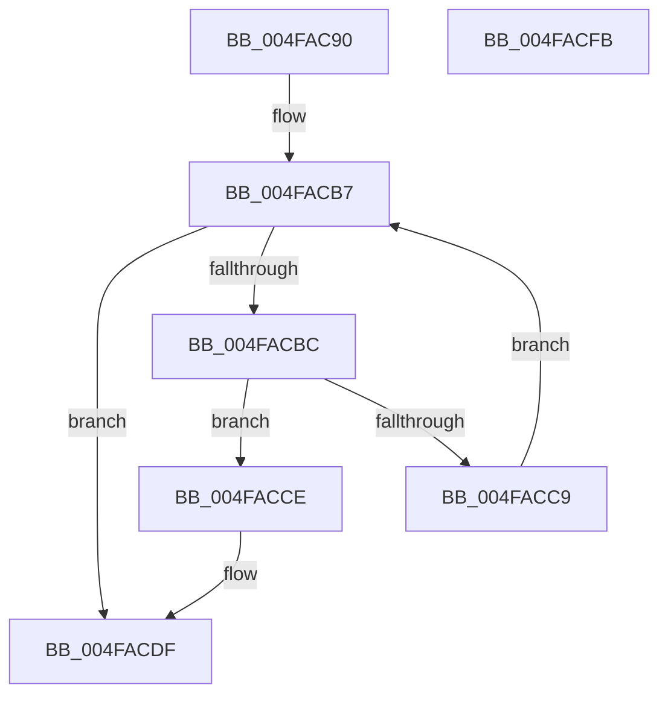

# SmpFpReleaseResource

- RVA: `0x004FAC90`–`0x004FACFC` (길이 `108` bytes)
- VA: `0x00000001404FAC90`
- 실행 섹션: `.text`
- PDB 이름 있음: `예`; PDB Function 태그: `아니요`
- unwind 정보 RVA: `0x00060BC4`
- 디코드: `33`개 명령, `108/108` bytes 표시
- 미해석 바이트: `0` (있으면 어셈블리에 `.byte`로 보존)

> 이 문서는 커널 이미지의 기계어와 PDB 기호를 분석해 생성했습니다. 4번과 5번은 함수 원형과 자료형을 바이너리 사용 방식에서 추정한 C 해석이며 원본 소스 복구 결과는 아닙니다.

## 1. Dependencies

- 직접 호출 지점: **2**; 고유 호출 대상: **2**
- 직접 호출자로 확인된 함수: **10**
- RIP 상대 이미지 참조: **0**

### Outgoing calls
- `0x004FACA8` → [ExAcquireSpinLockExclusive](../24/ExAcquireSpinLockExclusive_function_00248690.md) (function, `0x00248690`)
- `0x004FACE4` → [ExReleaseSpinLockExclusive](../2C/ExReleaseSpinLockExclusive_function_002C0EF0.md) (function, `0x002C0EF0`)

### Direct callers
- [SMKM_STORE&lt;SM_TRAITS&gt;::SmStReadThread](../20/SMKM_STORE_SM_TRAITS_SmStReadThread_function_00203230.md) at `0x0020340F`
- [sub_002055DD](../20/Unknown_function_002055DD.md) at `0x002057A6`
- [sub_002055DD](../20/Unknown_function_002055DD.md) at `0x002057DB`
- [sub_002055DD](../20/Unknown_function_002055DD.md) at `0x0020581C`
- [SMKM_STORE_MGR&lt;SM_TRAITS&gt;::SmIoCtxWorkItemComplete](../20/SMKM_STORE_MGR_SM_TRAITS_SmIoCtxWorkItemComplete_function_00205850.md) at `0x00205AAB`
- [sub_003178C4](../31/Unknown_function_003178C4.md) at `0x003178CF`
- [sub_00317914](../31/Unknown_function_00317914.md) at `0x00317938`
- [SMKM_STORE_MGR&lt;SM_TRAITS&gt;::SmWorkItemFreeResource](../31/SMKM_STORE_MGR_SM_TRAITS_SmWorkItemFreeResource_function_003179B4.md) at `0x00317A0A`
- [SmKmUnlockMdl](../37/SmKmUnlockMdl_function_00372A44.md) at `0x00372AB5`
- [SmKmStoreHelperCommandProcess](../3C/SmKmStoreHelperCommandProcess_function_003C3AA4.md) at `0x003C3CB9`
- [SMKM_STORE&lt;SM_TRAITS&gt;::SmStUnmapPhysicalRegion](../3E/SMKM_STORE_SM_TRAITS_SmStUnmapPhysicalRegion_function_003E76E0.md) at `0x003E7771`
- [SmFpFree](../43/SmFpFree_function_00436350.md) at `0x004363F8`

### Static image references
- 디코드된 RIP-relative 메모리 참조가 없습니다.

## 2. Other-region calls and transfers

- 다른 실행 섹션으로 향하는 call: **0**
- 별도 외부 분기/꼬리 이동을 확인하지 못했습니다.

## 3. Assembly (complete function range)

```asm
004FAC90  48 89 5C 24 08                  mov qword ptr [rsp + 8], rbx
004FAC95  48 89 74 24 10                  mov qword ptr [rsp + 0x10], rsi
004FAC9A  57                              push rdi
004FAC9B  48 83 EC 20                     sub rsp, 0x20
004FAC9F  49 8B F0                        mov rsi, r8
004FACA2  48 63 DA                        movsxd rbx, edx
004FACA5  48 8B F9                        mov rdi, rcx
004FACA8  E8 E3 D9 D4 FF                  call 0x140248690
004FACAD  48 8B 54 DF 28                  mov rdx, qword ptr [rdi + rbx*8 + 0x28]
004FACB2  4C 8B CB                        mov r9, rbx
004FACB5  33 DB                           xor ebx, ebx
004FACB7  48 85 D2                        test rdx, rdx
004FACBA  74 23                           je 0x1404facdf
004FACBC  48 8B 4A 08                     mov rcx, qword ptr [rdx + 8]
004FACC0  48 83 E1 F8                     and rcx, 0xfffffffffffffff8
004FACC4  48 3B CE                        cmp rcx, rsi
004FACC7  74 05                           je 0x1404facce
004FACC9  48 8B 12                        mov rdx, qword ptr [rdx]
004FACCC  EB E9                           jmp 0x1404facb7
004FACCE  83 62 08 FE                     and dword ptr [rdx + 8], 0xfffffffe
004FACD2  BB 01 00 00 00                  mov ebx, 1
004FACD7  41 FE 4C 39 58                  dec byte ptr [r9 + rdi + 0x58]
004FACDC  FE 4F 5E                        dec byte ptr [rdi + 0x5e]
004FACDF  8A D0                           mov dl, al
004FACE1  48 8B CF                        mov rcx, rdi
004FACE4  E8 07 62 DC FF                  call 0x1402c0ef0
004FACE9  48 8B 74 24 38                  mov rsi, qword ptr [rsp + 0x38]
004FACEE  8B C3                           mov eax, ebx
004FACF0  48 8B 5C 24 30                  mov rbx, qword ptr [rsp + 0x30]
004FACF5  48 83 C4 20                     add rsp, 0x20
004FACF9  5F                              pop rdi
004FACFA  C3                              ret
004FACFB  CC                              int3
```

## 4. C-style interpretation (structured pseudocode)

```c
__int64 __fastcall SmpFpReleaseResource(__int64 a1, int a2, __int64 a3)
{
    __int64 result;
    __int64 v_rbx;
    __int64 v_rsp;
    unsigned __int64 v_stack_p10;
    unsigned __int64 v_stack_p8;

    v_stack_p8 = v_rbx;
    v_stack_p10 = v_rsi;
    v_rsp = (v_rsp) - (32);
    result = ExAcquireSpinLockExclusive(a1, a2, a3, a4);
    v_rbx = 0;
loc_004FACB7:
    if (*(unsigned __int64 *)(a1 + (int)(a2) * 8 + 40) == 0) goto loc_004FACDF;
    a1 = (*(unsigned __int64 *)(*(unsigned __int64 *)(a1 + (int)(a2) * 8 + 40) + 8)) & (-8);
    if (a1 == a3) goto loc_004FACCE;
    goto loc_004FACB7;
loc_004FACCE:
loc_004FACDF:
    result = ExReleaseSpinLockExclusive(a1, (unsigned __int8)(result), a3, (int)(a2));
    v_rsp = (v_rsp) + (32);
    return 1;
}
```

## 5. (Beta) C Style

```c
int64_t SmpFpReleaseResource(void *Arg1, void *Arg2, int64_t Arg3)
{
    uint8_t *arg1 = (uint8_t *)Arg1;
    uint8_t *arg2 = (uint8_t *)Arg2;

    int64_t result;
    int64_t local_rbx;
    int64_t local_rsp;
    uint64_t v_stack_p10;
    uint64_t v_stack_p8;

    v_stack_p8 = local_rbx;
    v_stack_p10 = local_rsi;
    local_rsp = (local_rsp) - (32);
    result = ExAcquireSpinLockExclusive(Arg1, Arg2, Arg3, a4);
    local_rbx = 0;
loc_004FACB7:
    if (*(uint64_t *)(arg1 + (int32_t)(arg2) * 8 + 0x28) == 0) goto loc_004FACDF;
    Arg1 = (*(uint64_t *)(*(uint64_t *)(arg1 + (int32_t)(arg2) * 8 + 0x28) + 0x8)) & (-8);
    if (Arg1 == Arg3) goto loc_004FACCE;
    goto loc_004FACB7;
loc_004FACCE:
loc_004FACDF:
    result = ExReleaseSpinLockExclusive(Arg1, (uint8_t)(result), Arg3, (int32_t)(Arg2));
    local_rsp = (local_rsp) + (32);
    return 1;
}
```

### 관측된 메모리 오프셋

구조체 형식이 확인되지 않은 접근은 인자 기준의 오프셋으로만 기록했습니다.

| 기준 인자 | 오프셋 표현 | 폭 (bit) | 접근 |
|---|---:|---:|---|
| `Arg1` | `+ 0x28 + rbx*8` | `64` | `R` |
| `Arg1` | `+ 0x5E` | `8` | `R/W` |
| `Arg2` | `+ 0x58 + rdi*1` | `8` | `R/W` |

## 6. Execution-region graph

[열기: 2D/3D 그래프와 함수 탐색 컨트롤 패널](../../../control-panel.html?section=text&rva=0x004FAC90&view=graph)

- 2D 그래프는 위에서 아래로 흐르고, 3D 그래프는 빈 공간을 드래그해 회전합니다. Shift+드래그는 이동, 휠은 확대·축소, 함수 노드 선택은 대상 보고서 이동입니다.

### Static fallback


