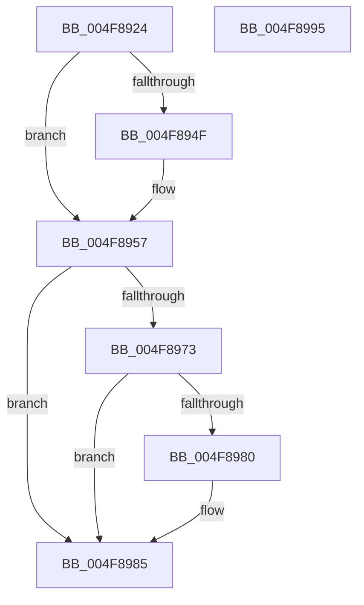

# UNLOCK_ADDRESS_SPACE_SHARED_UNORDERED

- RVA: `0x004F8924`–`0x004F8996` (길이 `114` bytes)
- VA: `0x00000001404F8924`
- 실행 섹션: `.text`
- PDB 이름 있음: `예`; PDB Function 태그: `아니요`
- unwind 정보 RVA: `0x0005FD94`
- 디코드: `31`개 명령, `114/114` bytes 표시
- 미해석 바이트: `0` (있으면 어셈블리에 `.byte`로 보존)

> 이 문서는 커널 이미지의 기계어와 PDB 기호를 분석해 생성했습니다. 4번과 5번은 함수 원형과 자료형을 바이너리 사용 방식에서 추정한 C 해석이며 원본 소스 복구 결과는 아닙니다.

## 1. Dependencies

- 직접 호출 지점: **3**; 고유 호출 대상: **3**
- 직접 호출자로 확인된 함수: **1**
- RIP 상대 이미지 참조: **0**

### Outgoing calls
- `0x004F8952` → [ExfReleasePushLockShared](../26/ExfReleasePushLockShared_function_00263440.md) (function, `0x00263440`)
- `0x004F895A` → [KeAbPostRelease](../2E/KeAbPostRelease_function_002E1600.md) (function, `0x002E1600`)
- `0x004F8980` → [KiCheckForKernelApcDelivery](../2E/KiCheckForKernelApcDelivery_function_002E2C80.md) (function, `0x002E2C80`)

### Direct callers
- [MiLockVadRange](../../page/87/MiLockVadRange_function_0087F670.md) at `0x0087F905`

### Static image references
- 디코드된 RIP-relative 메모리 참조가 없습니다.

## 2. Other-region calls and transfers

- 다른 실행 섹션으로 향하는 call: **0**
- 별도 외부 분기/꼬리 이동을 확인하지 못했습니다.

## 3. Assembly (complete function range)

```asm
004F8924  48 89 5C 24 10                  mov qword ptr [rsp + 0x10], rbx
004F8929  48 89 74 24 18                  mov qword ptr [rsp + 0x18], rsi
004F892E  57                              push rdi
004F892F  48 83 EC 20                     sub rsp, 0x20
004F8933  8B B1 A8 05 00 00               mov esi, dword ptr [rcx + 0x5a8]
004F8939  48 8D BA 58 02 00 00            lea rdi, [rdx + 0x258]
004F8940  48 8B D9                        mov rbx, rcx
004F8943  33 C9                           xor ecx, ecx
004F8945  8D 41 11                        lea eax, [rcx + 0x11]
004F8948  F0 48 0F B1 0F                  lock cmpxchg qword ptr [rdi], rcx
004F894D  74 08                           je 0x1404f8957
004F894F  48 8B CF                        mov rcx, rdi
004F8952  E8 E9 AA D6 FF                  call 0x140263440
004F8957  48 8B CF                        mov rcx, rdi
004F895A  E8 A1 8C DE FF                  call 0x1402e1600
004F895F  83 E6 FD                        and esi, 0xfffffffd
004F8962  89 B3 A8 05 00 00               mov dword ptr [rbx + 0x5a8], esi
004F8968  90                              nop
004F8969  66 83 83 E6 01 00 00 01         add word ptr [rbx + 0x1e6], 1
004F8971  75 12                           jne 0x1404f8985
004F8973  48 8D 83 98 00 00 00            lea rax, [rbx + 0x98]
004F897A  90                              nop
004F897B  48 39 00                        cmp qword ptr [rax], rax
004F897E  74 05                           je 0x1404f8985
004F8980  E8 FB A2 DE FF                  call 0x1402e2c80
004F8985  48 8B 5C 24 38                  mov rbx, qword ptr [rsp + 0x38]
004F898A  48 8B 74 24 40                  mov rsi, qword ptr [rsp + 0x40]
004F898F  48 83 C4 20                     add rsp, 0x20
004F8993  5F                              pop rdi
004F8994  C3                              ret
004F8995  CC                              int3
```

## 4. C-style interpretation (structured pseudocode)

```c
__int64 __fastcall UNLOCK_ADDRESS_SPACE_SHARED_UNORDERED(__int64 a1, __int64 a2)
{
    __int64 result;
    __int64 v_rsi;
    __int64 v_rsp;
    unsigned __int64 v_stack_p10;
    unsigned __int64 v_stack_p18;

    v_stack_p10 = v_rbx;
    v_stack_p18 = v_rsi;
    v_rsp = (v_rsp) - (32);
    a1 = 0;
    result = a1 + 17;
    if (!(condition_is_equal)) {
        a1 = a2 + 600;
        result = ExfReleasePushLockShared(a1, a2, a3, a4);
    }
    result = KeAbPostRelease(a2 + 600, a2, a3, a4);
    v_rsi = (unsigned int)(((unsigned int)(*(unsigned int *)(a1 + 1448))) & (0xFFFFFFFDULL));
    *(unsigned int *)(a1 + 1448) = (unsigned int)(v_rsi);
    if (condition_is_not_equal) goto loc_004F8985;
    result = a1 + 152;
    if ((*(unsigned __int64 *)(a1 + 152)) != (a1 + 152)) {
        result = KiCheckForKernelApcDelivery(a2 + 600, a2, a3, a4);
    }
    v_rsp = (v_rsp) + (32);
    return result;
}
```

## 5. (Beta) C Style

```c
int64_t UNLOCK_ADDRESS_SPACE_SHARED_UNORDERED(void *Arg1, void *Arg2)
{
    uint8_t *arg1 = (uint8_t *)Arg1;
    uint8_t *arg2 = (uint8_t *)Arg2;

    int64_t result;
    int64_t local_rsi;
    int64_t local_rsp;
    uint64_t v_stack_p10;
    uint64_t v_stack_p18;

    v_stack_p10 = local_rbx;
    v_stack_p18 = local_rsi;
    local_rsp = (local_rsp) - (32);
    Arg1 = 0;
    result = Arg1 + 17;
    if (!(condition_is_equal)) {
        Arg1 = Arg2 + 600;
        result = ExfReleasePushLockShared(Arg1, Arg2, a3, a4);
    }
    result = KeAbPostRelease(Arg2 + 600, Arg2, a3, a4);
    local_rsi = (uint32_t)(((uint32_t)(*(uint32_t *)(arg1 + 0x5A8))) & (0xFFFFFFFDULL));
    *(uint32_t *)(arg1 + 0x5A8) = (uint32_t)(local_rsi);
    if (condition_is_not_equal) goto loc_004F8985;
    result = Arg1 + 152;
    if ((*(uint64_t *)(arg1 + 0x98)) != (Arg1 + 152)) {
        result = KiCheckForKernelApcDelivery(Arg2 + 600, Arg2, a3, a4);
    }
    local_rsp = (local_rsp) + (32);
    return result;
}
```

### 관측된 메모리 오프셋

구조체 형식이 확인되지 않은 접근은 인자 기준의 오프셋으로만 기록했습니다.

| 기준 인자 | 오프셋 표현 | 폭 (bit) | 접근 |
|---|---:|---:|---|
| `Arg1` | `+ 0x0` | `64` | `R` |
| `Arg1` | `+ 0x98` | `64` | `R` |
| `Arg1` | `+ 0x1E6` | `16` | `R/W` |
| `Arg1` | `+ 0x5A8` | `32` | `R` |
| `Arg1` | `+ 0x5A8` | `32` | `W` |
| `Arg2` | `+ 0x0` | `64` | `R` |
| `Arg2` | `+ 0x258` | `64` | `R` |

## 6. Execution-region graph

[열기: 2D/3D 그래프와 함수 탐색 컨트롤 패널](../../../control-panel.html?section=text&rva=0x004F8924&view=graph)

- 2D 그래프는 위에서 아래로 흐르고, 3D 그래프는 빈 공간을 드래그해 회전합니다. Shift+드래그는 이동, 휠은 확대·축소, 함수 노드 선택은 대상 보고서 이동입니다.

### Static fallback


