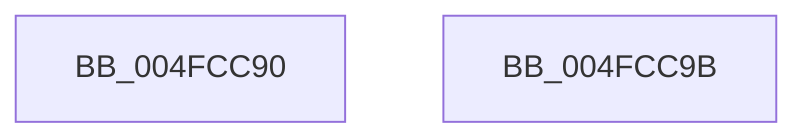

# VfIsKernelVerificationOn

- RVA: `0x004FCC90`–`0x004FCC9C` (길이 `12` bytes)
- VA: `0x00000001404FCC90`
- 실행 섹션: `.text`
- PDB 이름 있음: `예`; PDB Function 태그: `아니요`
- unwind 정보 RVA: `0x000DB714`
- 디코드: `4`개 명령, `12/12` bytes 표시
- 미해석 바이트: `0` (있으면 어셈블리에 `.byte`로 보존)

> 이 문서는 커널 이미지의 기계어와 PDB 기호를 분석해 생성했습니다. 4번과 5번은 함수 원형과 자료형을 바이너리 사용 방식에서 추정한 C 해석이며 원본 소스 복구 결과는 아닙니다.

## 1. Dependencies

- 직접 호출 지점: **0**; 고유 호출 대상: **0**
- 직접 호출자로 확인된 함수: **16**
- RIP 상대 이미지 참조: **1**

### Outgoing calls
- 직접 디코드된 call 명령이 없습니다.

### Direct callers
- [VfPtIoAllocateMdl_Exit](../../pagevrfy/B9/VfPtIoAllocateMdl_Exit_function_00B9C1C0.md) at `0x00B9C1C9`
- [VfPtMmAllocateContiguousMemoryEx_Exit](../../pagevrfy/B9/VfPtMmAllocateContiguousMemoryEx_Exit_function_00B9C210.md) at `0x00B9C219`
- [VfPtMmAllocateContiguousMemorySpecifyCacheNode_Exit](../../pagevrfy/B9/VfPtMmAllocateContiguousMemorySpecifyCacheNode_Exit_function_00B9C250.md) at `0x00B9C259`
- [VfPtMmAllocateContiguousMemory_Exit](../../pagevrfy/B9/VfPtMmAllocateContiguousMemory_Exit_function_00B9C290.md) at `0x00B9C299`
- [VfPtMmAllocateMappingAddressEx_Exit](../../pagevrfy/B9/VfPtMmAllocateMappingAddressEx_Exit_function_00B9C2D0.md) at `0x00B9C2D9`
- [VfPtMmAllocateMappingAddress_Exit](../../pagevrfy/B9/VfPtMmAllocateMappingAddress_Exit_function_00B9C310.md) at `0x00B9C319`
- [VfPtMmAllocateNodePagesForMdlEx_Exit](../../pagevrfy/B9/VfPtMmAllocateNodePagesForMdlEx_Exit_function_00B9C350.md) at `0x00B9C359`
- [VfPtMmAllocateNonCachedMemory_Exit](../../pagevrfy/B9/VfPtMmAllocateNonCachedMemory_Exit_function_00B9C390.md) at `0x00B9C399`
- [VfPtMmAllocatePagesForMdlEx_Exit](../../pagevrfy/B9/VfPtMmAllocatePagesForMdlEx_Exit_function_00B9C3D0.md) at `0x00B9C3D9`
- [VfPtMmAllocatePagesForMdl_Exit](../../pagevrfy/B9/VfPtMmAllocatePagesForMdl_Exit_function_00B9C410.md) at `0x00B9C419`
- [VfPtMmCreateMdl_Exit](../../pagevrfy/B9/VfPtMmCreateMdl_Exit_function_00B9C450.md) at `0x00B9C459`
- [VfPtMmFreeContiguousMemory_Entry](../../pagevrfy/B9/VfPtMmFreeContiguousMemory_Entry_function_00B9C490.md) at `0x00B9C499`
- [VfPtMmFreeMappingAddress_Entry](../../pagevrfy/B9/VfPtMmFreeMappingAddress_Entry_function_00B9C4D0.md) at `0x00B9C4D9`
- [VfPtMmFreeNonCachedMemory_Entry](../../pagevrfy/B9/VfPtMmFreeNonCachedMemory_Entry_function_00B9C510.md) at `0x00B9C519`
- [VerifierExFreePool](../../pagevrfy/BA/VerifierExFreePool_function_00BA1800.md) at `0x00BA1809`
- [VerifierExFreePoolWithTag](../../pagevrfy/BA/VerifierExFreePoolWithTag_function_00BA1880.md) at `0x00BA188F`

### Static image references
- `0x004FCC90` → RVA `0x00F04ABC` (`.data`; read)

## 2. Other-region calls and transfers

- 다른 실행 섹션으로 향하는 call: **0**
- 별도 외부 분기/꼬리 이동을 확인하지 못했습니다.

## 3. Assembly (complete function range)

```asm
004FCC90  83 3D 25 7E A0 00 01            cmp dword ptr [rip + 0xa07e25], 1
004FCC97  0F 94 C0                        sete al
004FCC9A  C3                              ret
004FCC9B  CC                              int3
```

## 4. C-style interpretation (structured pseudocode)

```c
__int64 __fastcall VfIsKernelVerificationOn(void)
{
    __int64 result;

    result = ((*(unsigned int *)(v_rip + 10518053)) == 1) ? 1 : 0;
    return result;
}
```

## 5. (Beta) C Style

```c
void VfIsKernelVerificationOn(void)
{
    int64_t result;

    result = ((*(uint32_t *)(v_rip + 0xA07E25)) == 1) ? 1 : 0;
    return result;
}
```

## 6. Execution-region graph

[열기: 2D/3D 그래프와 함수 탐색 컨트롤 패널](../../../control-panel.html?section=text&rva=0x004FCC90&view=graph)

- 2D 그래프는 위에서 아래로 흐르고, 3D 그래프는 빈 공간을 드래그해 회전합니다. Shift+드래그는 이동, 휠은 확대·축소, 함수 노드 선택은 대상 보고서 이동입니다.

### Static fallback


