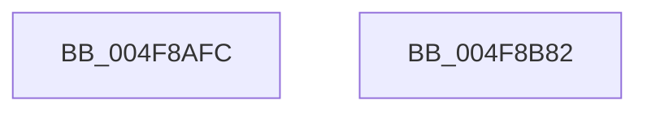

# VslExemptSecurePteRange

- RVA: `0x004F8AFC`–`0x004F8B83` (길이 `135` bytes)
- VA: `0x00000001404F8AFC`
- 실행 섹션: `.text`
- PDB 이름 있음: `예`; PDB Function 태그: `아니요`
- unwind 정보 RVA: `0x000AFF04`
- 디코드: `32`개 명령, `135/135` bytes 표시
- 미해석 바이트: `0` (있으면 어셈블리에 `.byte`로 보존)

> 이 문서는 커널 이미지의 기계어와 PDB 기호를 분석해 생성했습니다. 4번과 5번은 함수 원형과 자료형을 바이너리 사용 방식에서 추정한 C 해석이며 원본 소스 복구 결과는 아닙니다.

## 1. Dependencies

- 직접 호출 지점: **3**; 고유 호출 대상: **3**
- 직접 호출자로 확인된 함수: **1**
- RIP 상대 이미지 참조: **1**

### Outgoing calls
- `0x004F8B35` → [memset](../6C/memset_function_006C6C40.md) (function, `0x006C6C40`)
- `0x004F8B58` → [VslpEnterIumSecureMode](../23/VslpEnterIumSecureMode_function_00235E50.md) (function, `0x00235E50`)
- `0x004F8B68` → [_security_check_cookie](../6A/_security_check_cookie_function_006AC640.md) (function, `0x006AC640`)

### Direct callers
- [MiAdjustSecureDriverStateForIatCapture](../4B/MiAdjustSecureDriverStateForIatCapture_function_004BE864.md) at `0x004BE8DC`

### Static image references
- `0x004F8B0E` → RVA `0x00E0A740` (`.data`; read)

## 2. Other-region calls and transfers

- 다른 실행 섹션으로 향하는 call: **0**
- 별도 외부 분기/꼬리 이동을 확인하지 못했습니다.

## 3. Assembly (complete function range)

```asm
004F8AFC  48 89 5C 24 08                  mov qword ptr [rsp + 8], rbx
004F8B01  48 89 74 24 10                  mov qword ptr [rsp + 0x10], rsi
004F8B06  57                              push rdi
004F8B07  48 81 EC A0 00 00 00            sub rsp, 0xa0
004F8B0E  48 8B 05 2B 1C 91 00            mov rax, qword ptr [rip + 0x911c2b]
004F8B15  48 33 C4                        xor rax, rsp
004F8B18  48 89 84 24 90 00 00 00         mov qword ptr [rsp + 0x90], rax
004F8B20  48 8B FA                        mov rdi, rdx
004F8B23  41 0F B6 F0                     movzx esi, r8b
004F8B27  33 D2                           xor edx, edx
004F8B29  48 8B D9                        mov rbx, rcx
004F8B2C  48 8D 4C 24 20                  lea rcx, [rsp + 0x20]
004F8B31  44 8D 42 68                     lea r8d, [rdx + 0x68]
004F8B35  E8 06 E1 1C 00                  call 0x1406c6c40
004F8B3A  BA 04 01 00 00                  mov edx, 0x104
004F8B3F  48 89 5C 24 28                  mov qword ptr [rsp + 0x28], rbx
004F8B44  4C 8D 4C 24 20                  lea r9, [rsp + 0x20]
004F8B49  48 89 7C 24 30                  mov qword ptr [rsp + 0x30], rdi
004F8B4E  45 33 C0                        xor r8d, r8d
004F8B51  48 89 74 24 38                  mov qword ptr [rsp + 0x38], rsi
004F8B56  B1 02                           mov cl, 2
004F8B58  E8 F3 D2 D3 FF                  call 0x140235e50
004F8B5D  48 8B 8C 24 90 00 00 00         mov rcx, qword ptr [rsp + 0x90]
004F8B65  48 33 CC                        xor rcx, rsp
004F8B68  E8 D3 3A 1B 00                  call 0x1406ac640
004F8B6D  4C 8D 9C 24 A0 00 00 00         lea r11, [rsp + 0xa0]
004F8B75  49 8B 5B 10                     mov rbx, qword ptr [r11 + 0x10]
004F8B79  49 8B 73 18                     mov rsi, qword ptr [r11 + 0x18]
004F8B7D  49 8B E3                        mov rsp, r11
004F8B80  5F                              pop rdi
004F8B81  C3                              ret
004F8B82  CC                              int3
```

## 4. C-style interpretation (structured pseudocode)

```c
__int64 __fastcall VslExemptSecurePteRange(__int64 a1, __int64 a2, unsigned __int8 a3)
{
    __int64 result;
    __int64 v_rsp;
    unsigned __int64 v_stack_m18;
    unsigned __int64 v_stack_m70;
    unsigned __int64 v_stack_m78;
    unsigned __int64 v_stack_m8;
    unsigned __int64 v_stack_m80;
    unsigned __int64 v_stack_m88;
    unsigned __int64 v_stack_p10;
    unsigned __int64 v_stack_p8;

    v_stack_p8 = v_rbx;
    v_stack_p10 = v_rsi;
    v_rsp = (v_rsp) - (160);
    result = (*(unsigned __int64 *)(v_rip + 9509931)) ^ (v_rsp);
    v_stack_m18 = result;
    a2 = 0;
    result = memset(v_stack_m88, a2, a2 + 104, a4);
    v_stack_m80 = a1;
    v_stack_m78 = 0;
    a3 = 0;
    v_stack_m70 = 0;
    result = VslpEnterIumSecureMode(2, 260, a3, v_stack_m88);
    a1 = (v_stack_m18) ^ (v_rsp);
    result = _security_check_cookie(a1, 260, a3, v_stack_m88);
    return result;
}
```

## 5. (Beta) C Style

```c
int64_t VslExemptSecurePteRange(int64_t Arg1, int64_t Arg2, uint8_t Arg3)
{
    int64_t result;
    int64_t local_rsp;
    uint64_t v_stack_m18;
    uint64_t v_stack_m70;
    uint64_t v_stack_m78;
    uint64_t v_stack_m8;
    uint64_t v_stack_m80;
    uint64_t v_stack_m88;
    uint64_t v_stack_p10;
    uint64_t v_stack_p8;

    v_stack_p8 = local_rbx;
    v_stack_p10 = local_rsi;
    local_rsp = (local_rsp) - (160);
    result = (*(uint64_t *)(v_rip + 0x911C2B)) ^ (local_rsp);
    v_stack_m18 = result;
    Arg2 = 0;
    result = memset(v_stack_m88, Arg2, Arg2 + 104, a4);
    v_stack_m80 = Arg1;
    v_stack_m78 = 0;
    Arg3 = 0;
    v_stack_m70 = 0;
    result = VslpEnterIumSecureMode(2, 260, Arg3, v_stack_m88);
    Arg1 = (v_stack_m18) ^ (local_rsp);
    result = _security_check_cookie(Arg1, 260, Arg3, v_stack_m88);
    return result;
}
```

## 6. Execution-region graph

[열기: 2D/3D 그래프와 함수 탐색 컨트롤 패널](../../../control-panel.html?section=text&rva=0x004F8AFC&view=graph)

- 2D 그래프는 위에서 아래로 흐르고, 3D 그래프는 빈 공간을 드래그해 회전합니다. Shift+드래그는 이동, 휠은 확대·축소, 함수 노드 선택은 대상 보고서 이동입니다.

### Static fallback


