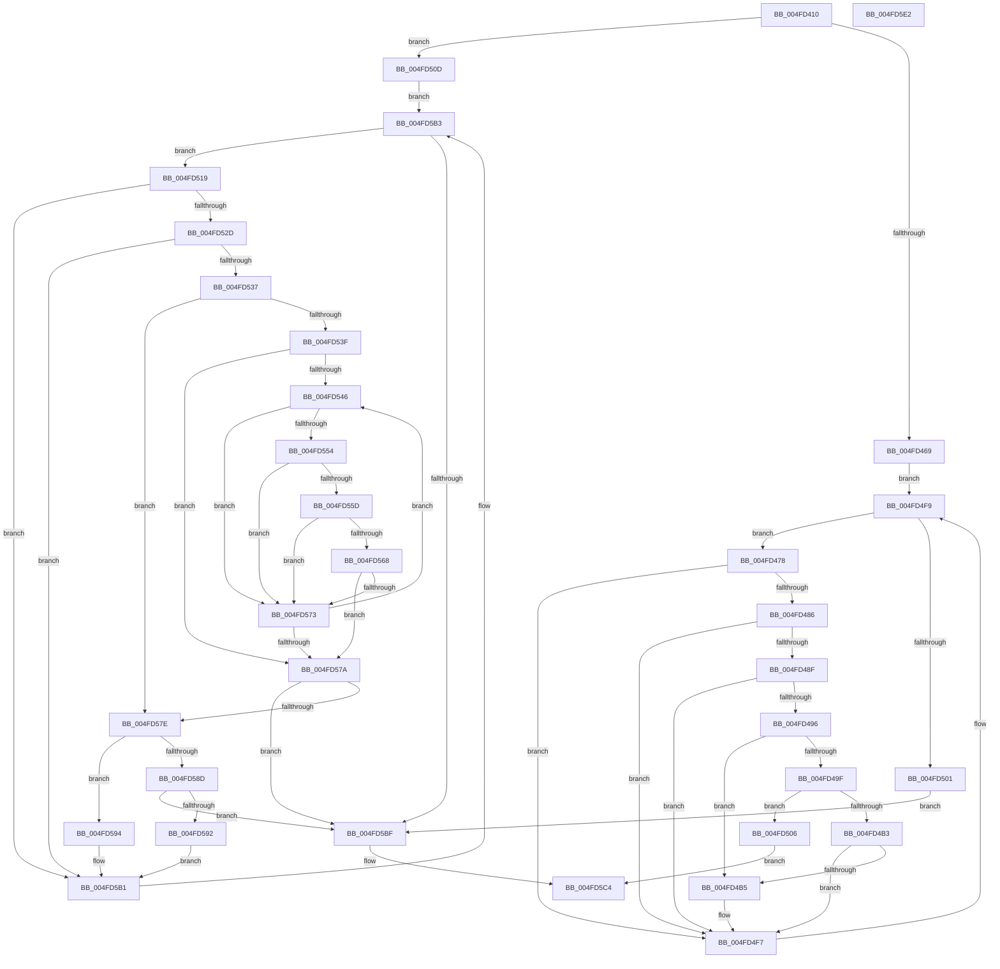

# _C_specific_handler

- RVA: `0x004FD410`–`0x004FD5E3` (길이 `467` bytes)
- VA: `0x00000001404FD410`
- 실행 섹션: `.text`
- PDB 이름 있음: `예`; PDB Function 태그: `아니요`
- unwind 정보 RVA: `0x000AC264`
- 디코드: `142`개 명령, `467/467` bytes 표시
- 미해석 바이트: `0` (있으면 어셈블리에 `.byte`로 보존)

> 이 문서는 커널 이미지의 기계어와 PDB 기호를 분석해 생성했습니다. 4번과 5번은 함수 원형과 자료형을 바이너리 사용 방식에서 추정한 C 해석이며 원본 소스 복구 결과는 아닙니다.

## 1. Dependencies

- 직접 호출 지점: **6**; 고유 호출 대상: **5**
- 직접 호출자로 확인된 함수: **1**
- RIP 상대 이미지 참조: **0**

### Outgoing calls
- `0x004FD446` → [KeCheckStackAndTargetAddress](../43/KeCheckStackAndTargetAddress_function_0043E580.md) (function, `0x0043E580`)
- `0x004FD4AA` → `indirect target` (indirect, 간접 대상)
- `0x004FD4C5` → [NLG_Notify](NLG_Notify_function_004FF910.md) (function, `0x004FF910`)
- `0x004FD4ED` → [RtlUnwindEx](../2F/RtlUnwindEx_function_002F2830.md) (function, `0x002F2830`)
- `0x004FD4F2` → [_NLG_Return2](_NLG_Return2_function_004FF940.md) (function, `0x004FF940`)
- `0x004FD5AC` → `indirect target` (indirect, 간접 대상)

### Direct callers
- [_GSHandlerCheck_SEH](../6A/_GSHandlerCheck_SEH_function_006AC5A4.md) at `0x006AC609`

### Static image references
- 디코드된 RIP-relative 메모리 참조가 없습니다.

## 2. Other-region calls and transfers

- 다른 실행 섹션으로 향하는 call: **0**
- 별도 외부 분기/꼬리 이동을 확인하지 못했습니다.

## 3. Assembly (complete function range)

```asm
004FD410  48 89 5C 24 08                  mov qword ptr [rsp + 8], rbx
004FD415  48 89 6C 24 10                  mov qword ptr [rsp + 0x10], rbp
004FD41A  48 89 74 24 18                  mov qword ptr [rsp + 0x18], rsi
004FD41F  57                              push rdi
004FD420  41 54                           push r12
004FD422  41 55                           push r13
004FD424  41 56                           push r14
004FD426  41 57                           push r15
004FD428  48 83 EC 40                     sub rsp, 0x40
004FD42C  4C 8B E2                        mov r12, rdx
004FD42F  4C 8B E9                        mov r13, rcx
004FD432  49 8B 90 98 00 00 00            mov rdx, qword ptr [r8 + 0x98]
004FD439  4D 8B F1                        mov r14, r9
004FD43C  49 8B 88 F8 00 00 00            mov rcx, qword ptr [r8 + 0xf8]
004FD443  49 8B F0                        mov rsi, r8
004FD446  E8 35 11 F4 FF                  call 0x14043e580
004FD44B  4D 8B 7E 08                     mov r15, qword ptr [r14 + 8]
004FD44F  49 8B 2E                        mov rbp, qword ptr [r14]
004FD452  41 8B 45 04                     mov eax, dword ptr [r13 + 4]
004FD456  49 2B EF                        sub rbp, r15
004FD459  49 8B 5E 38                     mov rbx, qword ptr [r14 + 0x38]
004FD45D  41 8B 7E 48                     mov edi, dword ptr [r14 + 0x48]
004FD461  A8 66                           test al, 0x66
004FD463  0F 85 A4 00 00 00               jne 0x1404fd50d
004FD469  4C 89 6C 24 30                  mov qword ptr [rsp + 0x30], r13
004FD46E  48 89 74 24 38                  mov qword ptr [rsp + 0x38], rsi
004FD473  E9 81 00 00 00                  jmp 0x1404fd4f9
004FD478  8B F7                           mov esi, edi
004FD47A  48 03 F6                        add rsi, rsi
004FD47D  8B 44 F3 04                     mov eax, dword ptr [rbx + rsi*8 + 4]
004FD481  48 3B E8                        cmp rbp, rax
004FD484  72 71                           jb 0x1404fd4f7
004FD486  8B 44 F3 08                     mov eax, dword ptr [rbx + rsi*8 + 8]
004FD48A  48 3B E8                        cmp rbp, rax
004FD48D  73 68                           jae 0x1404fd4f7
004FD48F  83 7C F3 10 00                  cmp dword ptr [rbx + rsi*8 + 0x10], 0
004FD494  74 61                           je 0x1404fd4f7
004FD496  8B 44 F3 0C                     mov eax, dword ptr [rbx + rsi*8 + 0xc]
004FD49A  83 F8 01                        cmp eax, 1
004FD49D  74 16                           je 0x1404fd4b5
004FD49F  49 03 C7                        add rax, r15
004FD4A2  48 8D 4C 24 30                  lea rcx, [rsp + 0x30]
004FD4A7  49 8B D4                        mov rdx, r12
004FD4AA  FF D0                           call rax
004FD4AC  0F 1F 00                        nop dword ptr [rax]
004FD4AF  85 C0                           test eax, eax
004FD4B1  78 53                           js 0x1404fd506
004FD4B3  7E 42                           jle 0x1404fd4f7
004FD4B5  8B 4C F3 10                     mov ecx, dword ptr [rbx + rsi*8 + 0x10]
004FD4B9  41 B8 01 00 00 00               mov r8d, 1
004FD4BF  49 03 CF                        add rcx, r15
004FD4C2  49 8B D4                        mov rdx, r12
004FD4C5  E8 46 24 00 00                  call 0x1404ff910
004FD4CA  49 8B 46 40                     mov rax, qword ptr [r14 + 0x40]
004FD4CE  4D 8B C5                        mov r8, r13
004FD4D1  8B 54 F3 10                     mov edx, dword ptr [rbx + rsi*8 + 0x10]
004FD4D5  49 8B CC                        mov rcx, r12
004FD4D8  4D 63 4D 00                     movsxd r9, dword ptr [r13]
004FD4DC  49 03 D7                        add rdx, r15
004FD4DF  48 89 44 24 28                  mov qword ptr [rsp + 0x28], rax
004FD4E4  49 8B 46 28                     mov rax, qword ptr [r14 + 0x28]
004FD4E8  48 89 44 24 20                  mov qword ptr [rsp + 0x20], rax
004FD4ED  E8 3E 53 DF FF                  call 0x1402f2830
004FD4F2  E8 49 24 00 00                  call 0x1404ff940
004FD4F7  FF C7                           inc edi
004FD4F9  3B 3B                           cmp edi, dword ptr [rbx]
004FD4FB  0F 82 77 FF FF FF               jb 0x1404fd478
004FD501  E9 B9 00 00 00                  jmp 0x1404fd5bf
004FD506  33 C0                           xor eax, eax
004FD508  E9 B7 00 00 00                  jmp 0x1404fd5c4
004FD50D  49 8B 76 20                     mov rsi, qword ptr [r14 + 0x20]
004FD511  49 2B F7                        sub rsi, r15
004FD514  E9 9A 00 00 00                  jmp 0x1404fd5b3
004FD519  44 8B CF                        mov r9d, edi
004FD51C  4D 03 C9                        add r9, r9
004FD51F  42 8B 44 CB 04                  mov eax, dword ptr [rbx + r9*8 + 4]
004FD524  48 3B E8                        cmp rbp, rax
004FD527  0F 82 84 00 00 00               jb 0x1404fd5b1
004FD52D  42 8B 44 CB 08                  mov eax, dword ptr [rbx + r9*8 + 8]
004FD532  48 3B E8                        cmp rbp, rax
004FD535  73 7A                           jae 0x1404fd5b1
004FD537  41 8B 45 04                     mov eax, dword ptr [r13 + 4]
004FD53B  A8 20                           test al, 0x20
004FD53D  74 3F                           je 0x1404fd57e
004FD53F  33 C9                           xor ecx, ecx
004FD541  45 85 C0                        test r8d, r8d
004FD544  74 34                           je 0x1404fd57a
004FD546  8B D1                           mov edx, ecx
004FD548  48 03 D2                        add rdx, rdx
004FD54B  8B 44 D3 04                     mov eax, dword ptr [rbx + rdx*8 + 4]
004FD54F  48 3B F0                        cmp rsi, rax
004FD552  72 1F                           jb 0x1404fd573
004FD554  8B 44 D3 08                     mov eax, dword ptr [rbx + rdx*8 + 8]
004FD558  48 3B F0                        cmp rsi, rax
004FD55B  73 16                           jae 0x1404fd573
004FD55D  42 8B 44 CB 10                  mov eax, dword ptr [rbx + r9*8 + 0x10]
004FD562  39 44 D3 10                     cmp dword ptr [rbx + rdx*8 + 0x10], eax
004FD566  75 0B                           jne 0x1404fd573
004FD568  42 8B 44 CB 0C                  mov eax, dword ptr [rbx + r9*8 + 0xc]
004FD56D  39 44 D3 0C                     cmp dword ptr [rbx + rdx*8 + 0xc], eax
004FD571  74 07                           je 0x1404fd57a
004FD573  FF C1                           inc ecx
004FD575  41 3B C8                        cmp ecx, r8d
004FD578  72 CC                           jb 0x1404fd546
004FD57A  3B 0B                           cmp ecx, dword ptr [rbx]
004FD57C  75 41                           jne 0x1404fd5bf
004FD57E  8B C7                           mov eax, edi
004FD580  48 FF C0                        inc rax
004FD583  48 03 C0                        add rax, rax
004FD586  8B 0C C3                        mov ecx, dword ptr [rbx + rax*8]
004FD589  85 C9                           test ecx, ecx
004FD58B  74 07                           je 0x1404fd594
004FD58D  48 3B F1                        cmp rsi, rcx
004FD590  74 2D                           je 0x1404fd5bf
004FD592  EB 1D                           jmp 0x1404fd5b1
004FD594  8D 47 01                        lea eax, [rdi + 1]
004FD597  49 8B D4                        mov rdx, r12
004FD59A  41 89 46 48                     mov dword ptr [r14 + 0x48], eax
004FD59E  B1 01                           mov cl, 1
004FD5A0  8B C7                           mov eax, edi
004FD5A2  48 03 C0                        add rax, rax
004FD5A5  8B 44 C3 0C                     mov eax, dword ptr [rbx + rax*8 + 0xc]
004FD5A9  49 03 C7                        add rax, r15
004FD5AC  FF D0                           call rax
004FD5AE  0F 1F 00                        nop dword ptr [rax]
004FD5B1  FF C7                           inc edi
004FD5B3  44 8B 03                        mov r8d, dword ptr [rbx]
004FD5B6  41 3B F8                        cmp edi, r8d
004FD5B9  0F 82 5A FF FF FF               jb 0x1404fd519
004FD5BF  B8 01 00 00 00                  mov eax, 1
004FD5C4  4C 8D 5C 24 40                  lea r11, [rsp + 0x40]
004FD5C9  49 8B 5B 30                     mov rbx, qword ptr [r11 + 0x30]
004FD5CD  49 8B 6B 38                     mov rbp, qword ptr [r11 + 0x38]
004FD5D1  49 8B 73 40                     mov rsi, qword ptr [r11 + 0x40]
004FD5D5  49 8B E3                        mov rsp, r11
004FD5D8  41 5F                           pop r15
004FD5DA  41 5E                           pop r14
004FD5DC  41 5D                           pop r13
004FD5DE  41 5C                           pop r12
004FD5E0  5F                              pop rdi
004FD5E1  C3                              ret
004FD5E2  CC                              int3
```

## 4. C-style interpretation (structured pseudocode)

```c
__int64 __fastcall _C_specific_handler(__int64 a1, __int64 a2, __int64 a3, __int64 a4)
{
    __int64 result;
    __int64 v_rbp;
    __int64 v_rdi;
    __int64 v_rsi;
    __int64 v_rsp;
    unsigned __int64 v_stack_m28;
    unsigned __int64 v_stack_m30;
    unsigned __int64 v_stack_m38;
    unsigned __int64 v_stack_m40;
    unsigned __int64 v_stack_m48;
    unsigned __int64 v_stack_p10;
    unsigned __int64 v_stack_p18;
    unsigned __int64 v_stack_p8;

    v_stack_p8 = v_rbx;
    v_stack_p10 = v_rbp;
    v_stack_p18 = v_rsi;
    v_rsp = (v_rsp) - (64);
    result = KeCheckStackAndTargetAddress(*(unsigned __int64 *)(a3 + 248), *(unsigned __int64 *)(a3 + 152), a3, a4);
    v_rbp = (*(unsigned __int64 *)(a4)) - (*(unsigned __int64 *)(a4 + 8));
    if ((((unsigned __int8)((unsigned int)(*(unsigned int *)(a1 + 4)))) & (102)) != 0) goto loc_004FD50D;
    v_stack_m38 = a1;
    v_stack_m30 = a3;
    goto loc_004FD4F9;
loc_004FD478:
    v_rsi = ((unsigned int)((unsigned int)((unsigned int)(*(unsigned int *)(a4 + 72))))) + ((unsigned int)((unsigned int)((unsigned int)(*(unsigned int *)(a4 + 72)))));
    if (v_rbp < ((unsigned int)(*(unsigned int *)(*(unsigned __int64 *)(a4 + 56) + v_rsi * 8 + 4)))) goto loc_004FD4F7;
    if (v_rbp >= ((unsigned int)(*(unsigned int *)(*(unsigned __int64 *)(a4 + 56) + v_rsi * 8 + 8)))) goto loc_004FD4F7;
    if ((*(unsigned int *)(*(unsigned __int64 *)(a4 + 56) + v_rsi * 8 + 16)) == 0) goto loc_004FD4F7;
    if (((unsigned int)((unsigned int)(*(unsigned int *)(*(unsigned __int64 *)(a4 + 56) + v_rsi * 8 + 12)))) == 1) goto loc_004FD4B5;
    result = ((unsigned int)(*(unsigned int *)(*(unsigned __int64 *)(a4 + 56) + v_rsi * 8 + 12))) + (*(unsigned __int64 *)(a4 + 8));
    result = kernel_indirect_call(v_stack_m38, a2, a3, a4);
    if (sign_flag) goto loc_004FD506;
    if (!(condition_is_less_or_equal)) {
        a1 = *(unsigned int *)(*(unsigned __int64 *)(a4 + 56) + v_rsi * 8 + 16);
        a3 = 1;
        a1 = (a1) + (*(unsigned __int64 *)(a4 + 8));
        a2 = a2;
        result = NLG_Notify(a1, a2, a3, a4);
        result = *(unsigned __int64 *)(a4 + 64);
        a3 = a1;
        a2 = *(unsigned int *)(*(unsigned __int64 *)(a4 + 56) + v_rsi * 8 + 16);
        a1 = a2;
        a4 = (int)(*(unsigned int *)(a1));
        a2 = (a2) + (*(unsigned __int64 *)(a4 + 8));
        v_stack_m40 = result;
        result = *(unsigned __int64 *)(a4 + 40);
        v_stack_m48 = result;
        result = RtlUnwindEx(a1, a2, a3, a4);
        result = _NLG_Return2(a1, a2, a3, a4);
    }
    v_rdi = (unsigned int)(((unsigned int)(*(unsigned int *)(a4 + 72))) + 1);
loc_004FD4F9:
    if (((unsigned int)(v_rdi)) < (*(unsigned int *)(*(unsigned __int64 *)(a4 + 56)))) goto loc_004FD478;
    goto loc_004FD5BF;
loc_004FD506:
    result = 0;
    goto loc_004FD5C4;
loc_004FD50D:
    v_rsi = (*(unsigned __int64 *)(a4 + 32)) - (*(unsigned __int64 *)(a4 + 8));
    goto loc_004FD5B3;
loc_004FD519:
    a4 = ((unsigned int)((unsigned int)(v_rdi))) + ((unsigned int)((unsigned int)(v_rdi)));
    if (v_rbp < ((unsigned int)(*(unsigned int *)(*(unsigned __int64 *)(a4 + 56) + a4 * 8 + 4)))) goto loc_004FD5B1;
    if (v_rbp >= ((unsigned int)(*(unsigned int *)(*(unsigned __int64 *)(a4 + 56) + a4 * 8 + 8)))) goto loc_004FD5B1;
    if ((((unsigned __int8)((unsigned int)(*(unsigned int *)(a1 + 4)))) & (32)) == 0) goto loc_004FD57E;
    a1 = 0;
    if ((unsigned int)(a3) == 0) goto loc_004FD57A;
loc_004FD546:
    a2 = (0) + (0);
    if (v_rsi < ((unsigned int)(*(unsigned int *)(*(unsigned __int64 *)(a4 + 56) + a2 * 8 + 4)))) goto loc_004FD573;
    if (v_rsi >= ((unsigned int)(*(unsigned int *)(*(unsigned __int64 *)(a4 + 56) + a2 * 8 + 8)))) goto loc_004FD573;
    if ((*(unsigned int *)(*(unsigned __int64 *)(a4 + 56) + a2 * 8 + 16)) != ((unsigned int)((unsigned int)(*(unsigned int *)(*(unsigned __int64 *)(a4 + 56) + a4 * 8 + 16))))) goto loc_004FD573;
    if ((*(unsigned int *)(*(unsigned __int64 *)(a4 + 56) + a2 * 8 + 12)) == ((unsigned int)((unsigned int)(*(unsigned int *)(*(unsigned __int64 *)(a4 + 56) + a4 * 8 + 12))))) goto loc_004FD57A;
loc_004FD573:
    a1 = (unsigned int)((a1) + 1);
    if (((unsigned int)(a1)) < ((unsigned int)(a3))) goto loc_004FD546;
loc_004FD57A:
    if (((unsigned int)(a1)) != (*(unsigned int *)(*(unsigned __int64 *)(a4 + 56)))) goto loc_004FD5BF;
loc_004FD57E:
    result = ((unsigned int)((unsigned int)(v_rdi))) + 1;
    result = (result) + (result);
    if ((unsigned int)((unsigned int)(*(unsigned int *)(*(unsigned __int64 *)(a4 + 56) + result * 8))) == 0) goto loc_004FD594;
    if (v_rsi == ((unsigned int)(*(unsigned int *)(*(unsigned __int64 *)(a4 + 56) + result * 8)))) goto loc_004FD5BF;
    goto loc_004FD5B1;
loc_004FD594:
    *(unsigned int *)(a4 + 72) = (unsigned int)(v_rdi + 1);
    result = ((unsigned int)((unsigned int)(v_rdi))) + ((unsigned int)((unsigned int)(v_rdi)));
    result = ((unsigned int)(*(unsigned int *)(*(unsigned __int64 *)(a4 + 56) + result * 8 + 12))) + (*(unsigned __int64 *)(a4 + 8));
    result = kernel_indirect_call(1, a2, a3, a4);
loc_004FD5B1:
    v_rdi = (unsigned int)((v_rdi) + 1);
loc_004FD5B3:
    if (((unsigned int)(v_rdi)) < ((unsigned int)((unsigned int)(*(unsigned int *)(*(unsigned __int64 *)(a4 + 56)))))) goto loc_004FD519;
loc_004FD5BF:
loc_004FD5C4:
    return 1;
}
```

## 5. (Beta) C Style

```c
int64_t _C_specific_handler(void *Arg1, int64_t Arg2, void *Arg3, void *Arg4)
{
    uint8_t *arg1 = (uint8_t *)Arg1;
    uint8_t *arg3 = (uint8_t *)Arg3;
    uint8_t *arg4 = (uint8_t *)Arg4;

    int64_t result;
    int64_t local_rbp;
    int64_t local_rdi;
    int64_t local_rsi;
    int64_t local_rsp;
    uint64_t v_stack_m28;
    uint64_t v_stack_m30;
    uint64_t v_stack_m38;
    uint64_t v_stack_m40;
    uint64_t v_stack_m48;
    uint64_t v_stack_p10;
    uint64_t v_stack_p18;
    uint64_t v_stack_p8;

    v_stack_p8 = local_rbx;
    v_stack_p10 = local_rbp;
    v_stack_p18 = local_rsi;
    local_rsp = (local_rsp) - (64);
    result = KeCheckStackAndTargetAddress(*(uint64_t *)(arg3 + 0xF8), *(uint64_t *)(arg3 + 0x98), Arg3, Arg4);
    local_rbp = (*(uint64_t *)(arg4)) - (*(uint64_t *)(arg4 + 0x8));
    if ((((uint8_t)((uint32_t)(*(uint32_t *)(arg1 + 0x4)))) & (102)) != 0) goto loc_004FD50D;
    v_stack_m38 = Arg1;
    v_stack_m30 = Arg3;
    goto loc_004FD4F9;
loc_004FD478:
    local_rsi = ((uint32_t)((uint32_t)((uint32_t)(*(uint32_t *)(arg4 + 0x48))))) + ((uint32_t)((uint32_t)((uint32_t)(*(uint32_t *)(arg4 + 0x48)))));
    if (local_rbp < ((uint32_t)(*(uint32_t *)(*(uint64_t *)(arg4 + 0x38) + local_rsi * 8 + 0x4)))) goto loc_004FD4F7;
    if (local_rbp >= ((uint32_t)(*(uint32_t *)(*(uint64_t *)(arg4 + 0x38) + local_rsi * 8 + 0x8)))) goto loc_004FD4F7;
    if ((*(uint32_t *)(*(uint64_t *)(arg4 + 0x38) + local_rsi * 8 + 0x10)) == 0) goto loc_004FD4F7;
    if (((uint32_t)((uint32_t)(*(uint32_t *)(*(uint64_t *)(arg4 + 0x38) + local_rsi * 8 + 0xC)))) == 1) goto loc_004FD4B5;
    result = ((uint32_t)(*(uint32_t *)(*(uint64_t *)(arg4 + 0x38) + local_rsi * 8 + 0xC))) + (*(uint64_t *)(arg4 + 0x8));
    result = kernel_indirect_call(v_stack_m38, Arg2, Arg3, Arg4);
    if (sign_flag) goto loc_004FD506;
    if (!(condition_is_less_or_equal)) {
        Arg1 = *(uint32_t *)(*(uint64_t *)(arg4 + 0x38) + local_rsi * 8 + 0x10);
        Arg3 = 1;
        Arg1 = (Arg1) + (*(uint64_t *)(arg4 + 0x8));
        Arg2 = Arg2;
        result = NLG_Notify(Arg1, Arg2, Arg3, Arg4);
        result = *(uint64_t *)(arg4 + 0x40);
        Arg3 = Arg1;
        Arg2 = *(uint32_t *)(*(uint64_t *)(arg4 + 0x38) + local_rsi * 8 + 0x10);
        Arg1 = Arg2;
        Arg4 = (int32_t)(*(uint32_t *)(arg1));
        Arg2 = (Arg2) + (*(uint64_t *)(arg4 + 0x8));
        v_stack_m40 = result;
        result = *(uint64_t *)(arg4 + 0x28);
        v_stack_m48 = result;
        result = RtlUnwindEx(Arg1, Arg2, Arg3, Arg4);
        result = _NLG_Return2(Arg1, Arg2, Arg3, Arg4);
    }
    local_rdi = (uint32_t)(((uint32_t)(*(uint32_t *)(arg4 + 0x48))) + 1);
loc_004FD4F9:
    if (((uint32_t)(local_rdi)) < (*(uint32_t *)(*(uint64_t *)(arg4 + 0x38)))) goto loc_004FD478;
    goto loc_004FD5BF;
loc_004FD506:
    result = 0;
    goto loc_004FD5C4;
loc_004FD50D:
    local_rsi = (*(uint64_t *)(arg4 + 0x20)) - (*(uint64_t *)(arg4 + 0x8));
    goto loc_004FD5B3;
loc_004FD519:
    Arg4 = ((uint32_t)((uint32_t)(local_rdi))) + ((uint32_t)((uint32_t)(local_rdi)));
    if (local_rbp < ((uint32_t)(*(uint32_t *)(*(uint64_t *)(arg4 + 0x38) + arg4 * 8 + 0x4)))) goto loc_004FD5B1;
    if (local_rbp >= ((uint32_t)(*(uint32_t *)(*(uint64_t *)(arg4 + 0x38) + arg4 * 8 + 0x8)))) goto loc_004FD5B1;
    if ((((uint8_t)((uint32_t)(*(uint32_t *)(arg1 + 0x4)))) & (32)) == 0) goto loc_004FD57E;
    Arg1 = 0;
    if ((uint32_t)(Arg3) == 0) goto loc_004FD57A;
loc_004FD546:
    Arg2 = (0) + (0);
    if (local_rsi < ((uint32_t)(*(uint32_t *)(*(uint64_t *)(arg4 + 0x38) + Arg2 * 8 + 0x4)))) goto loc_004FD573;
    if (local_rsi >= ((uint32_t)(*(uint32_t *)(*(uint64_t *)(arg4 + 0x38) + Arg2 * 8 + 0x8)))) goto loc_004FD573;
    if ((*(uint32_t *)(*(uint64_t *)(arg4 + 0x38) + Arg2 * 8 + 0x10)) != ((uint32_t)((uint32_t)(*(uint32_t *)(*(uint64_t *)(arg4 + 0x38) + arg4 * 8 + 0x10))))) goto loc_004FD573;
    if ((*(uint32_t *)(*(uint64_t *)(arg4 + 0x38) + Arg2 * 8 + 0xC)) == ((uint32_t)((uint32_t)(*(uint32_t *)(*(uint64_t *)(arg4 + 0x38) + arg4 * 8 + 0xC))))) goto loc_004FD57A;
loc_004FD573:
    Arg1 = (uint32_t)((Arg1) + 1);
    if (((uint32_t)(Arg1)) < ((uint32_t)(Arg3))) goto loc_004FD546;
loc_004FD57A:
    if (((uint32_t)(Arg1)) != (*(uint32_t *)(*(uint64_t *)(arg4 + 0x38)))) goto loc_004FD5BF;
loc_004FD57E:
    result = ((uint32_t)((uint32_t)(local_rdi))) + 1;
    result = (result) + (result);
    if ((uint32_t)((uint32_t)(*(uint32_t *)(*(uint64_t *)(arg4 + 0x38) + result * 8))) == 0) goto loc_004FD594;
    if (local_rsi == ((uint32_t)(*(uint32_t *)(*(uint64_t *)(arg4 + 0x38) + result * 8)))) goto loc_004FD5BF;
    goto loc_004FD5B1;
loc_004FD594:
    *(uint32_t *)(arg4 + 0x48) = (uint32_t)(local_rdi + 1);
    result = ((uint32_t)((uint32_t)(local_rdi))) + ((uint32_t)((uint32_t)(local_rdi)));
    result = ((uint32_t)(*(uint32_t *)(*(uint64_t *)(arg4 + 0x38) + result * 8 + 0xC))) + (*(uint64_t *)(arg4 + 0x8));
    result = kernel_indirect_call(1, Arg2, Arg3, Arg4);
loc_004FD5B1:
    local_rdi = (uint32_t)((local_rdi) + 1);
loc_004FD5B3:
    if (((uint32_t)(local_rdi)) < ((uint32_t)((uint32_t)(*(uint32_t *)(*(uint64_t *)(arg4 + 0x38)))))) goto loc_004FD519;
loc_004FD5BF:
loc_004FD5C4:
    return 1;
}
```

### 관측된 메모리 오프셋

구조체 형식이 확인되지 않은 접근은 인자 기준의 오프셋으로만 기록했습니다.

| 기준 인자 | 오프셋 표현 | 폭 (bit) | 접근 |
|---|---:|---:|---|
| `Arg1` | `+ 0x0` | `32` | `R` |
| `Arg1` | `+ 0x4` | `32` | `R` |
| `Arg3` | `+ 0x98` | `64` | `R` |
| `Arg3` | `+ 0xF8` | `64` | `R` |
| `Arg4` | `+ 0x0` | `64` | `R` |
| `Arg4` | `+ 0x8` | `64` | `R` |
| `Arg4` | `+ 0x20` | `64` | `R` |
| `Arg4` | `+ 0x28` | `64` | `R` |
| `Arg4` | `+ 0x38` | `64` | `R` |
| `Arg4` | `+ 0x40` | `64` | `R` |
| `Arg4` | `+ 0x48` | `32` | `R` |
| `Arg4` | `+ 0x48` | `32` | `W` |

## 6. Execution-region graph

[열기: 2D/3D 그래프와 함수 탐색 컨트롤 패널](../../../control-panel.html?section=text&rva=0x004FD410&view=graph)

- 2D 그래프는 위에서 아래로 흐르고, 3D 그래프는 빈 공간을 드래그해 회전합니다. Shift+드래그는 이동, 휠은 확대·축소, 함수 노드 선택은 대상 보고서 이동입니다.

### Static fallback


