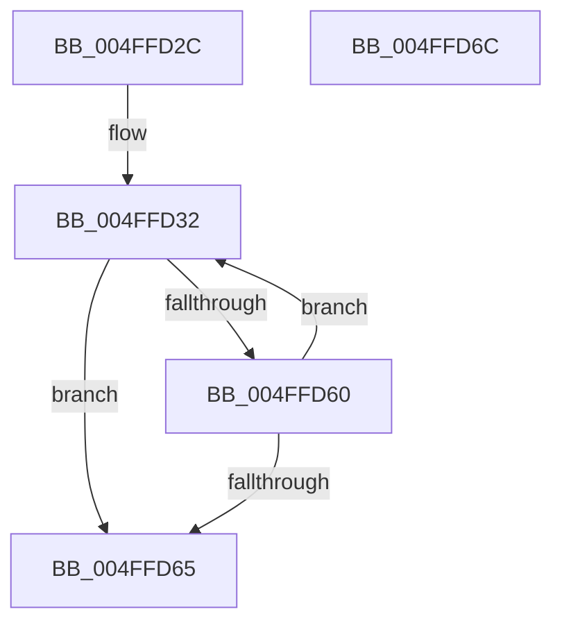

# _ascii_stricmp

- RVA: `0x004FFD2C`–`0x004FFD6D` (길이 `65` bytes)
- VA: `0x00000001404FFD2C`
- 실행 섹션: `.text`
- PDB 이름 있음: `예`; PDB Function 태그: `아니요`
- unwind 정보 RVA: `0x000DB714`
- 디코드: `22`개 명령, `65/65` bytes 표시
- 미해석 바이트: `0` (있으면 어셈블리에 `.byte`로 보존)

> 이 문서는 커널 이미지의 기계어와 PDB 기호를 분석해 생성했습니다. 4번과 5번은 함수 원형과 자료형을 바이너리 사용 방식에서 추정한 C 해석이며 원본 소스 복구 결과는 아닙니다.

## 1. Dependencies

- 직접 호출 지점: **0**; 고유 호출 대상: **0**
- 직접 호출자로 확인된 함수: **1**
- RIP 상대 이미지 참조: **0**

### Outgoing calls
- 직접 디코드된 call 명령이 없습니다.

### Direct callers
- [stricmp](stricmp_function_004FFD80.md) at `0x004FFD84`

### Static image references
- 디코드된 RIP-relative 메모리 참조가 없습니다.

## 2. Other-region calls and transfers

- 다른 실행 섹션으로 향하는 call: **0**
- 별도 외부 분기/꼬리 이동을 확인하지 못했습니다.

## 3. Assembly (complete function range)

```asm
004FFD2C  4C 8B D2                        mov r10, rdx
004FFD2F  4C 8B D9                        mov r11, rcx
004FFD32  45 0F B6 03                     movzx r8d, byte ptr [r11]
004FFD36  49 FF C3                        inc r11
004FFD39  41 0F B6 12                     movzx edx, byte ptr [r10]
004FFD3D  41 8D 40 BF                     lea eax, [r8 - 0x41]
004FFD41  83 F8 19                        cmp eax, 0x19
004FFD44  45 8D 48 20                     lea r9d, [r8 + 0x20]
004FFD48  8D 4A BF                        lea ecx, [rdx - 0x41]
004FFD4B  45 0F 47 C8                     cmova r9d, r8d
004FFD4F  8D 42 20                        lea eax, [rdx + 0x20]
004FFD52  49 FF C2                        inc r10
004FFD55  83 F9 19                        cmp ecx, 0x19
004FFD58  0F 47 C2                        cmova eax, edx
004FFD5B  45 85 C9                        test r9d, r9d
004FFD5E  74 05                           je 0x1404ffd65
004FFD60  44 3B C8                        cmp r9d, eax
004FFD63  74 CD                           je 0x1404ffd32
004FFD65  44 2B C8                        sub r9d, eax
004FFD68  41 8B C1                        mov eax, r9d
004FFD6B  C3                              ret
004FFD6C  CC                              int3
```

## 4. C-style interpretation (structured pseudocode)

```c
__int64 __fastcall _ascii_stricmp(__int64 a1, __int64 a2)
{
    __int64 result;
    __int64 v_r10;
    __int64 v_r11;

loc_004FFD32:
    v_r11 = (a1) + 1;
    a4 = *(unsigned __int8 *)(a1) + 32;
    if (((unsigned int)(*(unsigned __int8 *)(a1) - 65)) > 25) { a4 = (unsigned int)(*(unsigned __int8 *)(a1)); }
    v_r10 = (a2) + 1;
    result = *(unsigned __int8 *)(a2) + 32;
    if (((unsigned int)(*(unsigned __int8 *)(a2) - 65)) > 25) { result = (unsigned int)(*(unsigned __int8 *)(a2)); }
    if ((unsigned int)(a4) == 0) goto loc_004FFD65;
    if (((unsigned int)(a4)) == ((unsigned int)(result))) goto loc_004FFD32;
loc_004FFD65:
    a4 = (unsigned int)((a4) - ((unsigned int)(result)));
    return (unsigned int)((unsigned int)(a4));
}
```

## 5. (Beta) C Style

```c
int64_t _ascii_stricmp(int64_t Arg1, int64_t Arg2)
{
    int64_t result;
    int64_t local_r10;
    int64_t local_r11;

loc_004FFD32:
    local_r11 = (Arg1) + 1;
    a4 = *(uint8_t *)(Arg1) + 32;
    if (((uint32_t)(*(uint8_t *)(Arg1) - 65)) > 25) { a4 = (uint32_t)(*(uint8_t *)(Arg1)); }
    local_r10 = (Arg2) + 1;
    result = *(uint8_t *)(Arg2) + 32;
    if (((uint32_t)(*(uint8_t *)(Arg2) - 65)) > 25) { result = (uint32_t)(*(uint8_t *)(Arg2)); }
    if ((uint32_t)(a4) == 0) goto loc_004FFD65;
    if (((uint32_t)(a4)) == ((uint32_t)(result))) goto loc_004FFD32;
loc_004FFD65:
    a4 = (uint32_t)((a4) - ((uint32_t)(result)));
    return (uint32_t)((uint32_t)(a4));
}
```

## 6. Execution-region graph

[열기: 2D/3D 그래프와 함수 탐색 컨트롤 패널](../../../control-panel.html?section=text&rva=0x004FFD2C&view=graph)

- 2D 그래프는 위에서 아래로 흐르고, 3D 그래프는 빈 공간을 드래그해 회전합니다. Shift+드래그는 이동, 휠은 확대·축소, 함수 노드 선택은 대상 보고서 이동입니다.

### Static fallback


