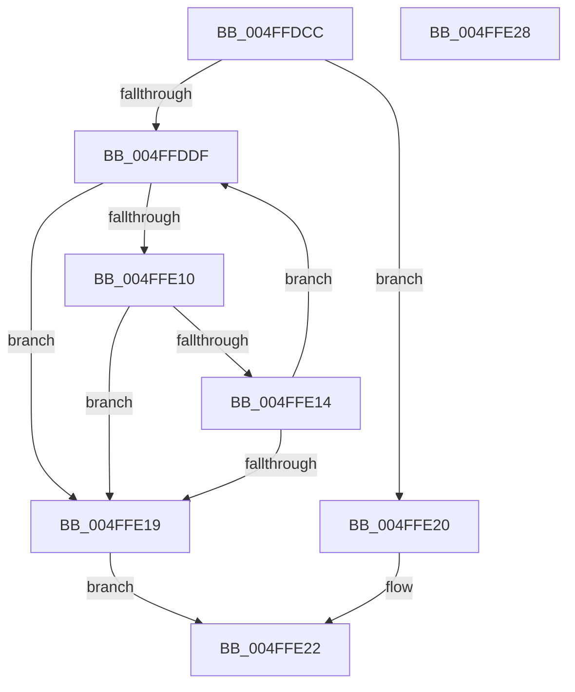

# _ascii_strnicmp

- RVA: `0x004FFDCC`–`0x004FFE29` (길이 `93` bytes)
- VA: `0x00000001404FFDCC`
- 실행 섹션: `.text`
- PDB 이름 있음: `예`; PDB Function 태그: `아니요`
- unwind 정보 RVA: `0x00071750`
- 디코드: `31`개 명령, `93/93` bytes 표시
- 미해석 바이트: `0` (있으면 어셈블리에 `.byte`로 보존)

> 이 문서는 커널 이미지의 기계어와 PDB 기호를 분석해 생성했습니다. 4번과 5번은 함수 원형과 자료형을 바이너리 사용 방식에서 추정한 C 해석이며 원본 소스 복구 결과는 아닙니다.

## 1. Dependencies

- 직접 호출 지점: **0**; 고유 호출 대상: **0**
- 직접 호출자로 확인된 함수: **1**
- RIP 상대 이미지 참조: **0**

### Outgoing calls
- 직접 디코드된 call 명령이 없습니다.

### Direct callers
- [strnicmp](strnicmp_function_004FFE30.md) at `0x004FFE34`

### Static image references
- 디코드된 RIP-relative 메모리 참조가 없습니다.

## 2. Other-region calls and transfers

- 다른 실행 섹션으로 향하는 call: **0**
- 별도 외부 분기/꼬리 이동을 확인하지 못했습니다.

## 3. Assembly (complete function range)

```asm
004FFDCC  48 89 5C 24 08                  mov qword ptr [rsp + 8], rbx
004FFDD1  4D 8B D0                        mov r10, r8
004FFDD4  4C 8B DA                        mov r11, rdx
004FFDD7  48 8B D9                        mov rbx, rcx
004FFDDA  4D 85 C0                        test r8, r8
004FFDDD  74 41                           je 0x1404ffe20
004FFDDF  44 0F B6 0B                     movzx r9d, byte ptr [rbx]
004FFDE3  48 FF C3                        inc rbx
004FFDE6  41 0F B6 0B                     movzx ecx, byte ptr [r11]
004FFDEA  41 8D 41 BF                     lea eax, [r9 - 0x41]
004FFDEE  83 F8 19                        cmp eax, 0x19
004FFDF1  41 8D 51 20                     lea edx, [r9 + 0x20]
004FFDF5  8D 41 BF                        lea eax, [rcx - 0x41]
004FFDF8  41 0F 47 D1                     cmova edx, r9d
004FFDFC  44 8D 41 20                     lea r8d, [rcx + 0x20]
004FFE00  49 FF C3                        inc r11
004FFE03  83 F8 19                        cmp eax, 0x19
004FFE06  44 0F 47 C1                     cmova r8d, ecx
004FFE0A  49 83 EA 01                     sub r10, 1
004FFE0E  74 09                           je 0x1404ffe19
004FFE10  85 D2                           test edx, edx
004FFE12  74 05                           je 0x1404ffe19
004FFE14  41 3B D0                        cmp edx, r8d
004FFE17  74 C6                           je 0x1404ffddf
004FFE19  41 2B D0                        sub edx, r8d
004FFE1C  8B C2                           mov eax, edx
004FFE1E  EB 02                           jmp 0x1404ffe22
004FFE20  33 C0                           xor eax, eax
004FFE22  48 8B 5C 24 08                  mov rbx, qword ptr [rsp + 8]
004FFE27  C3                              ret
004FFE28  CC                              int3
```

## 4. C-style interpretation (structured pseudocode)

```c
__int64 __fastcall _ascii_strnicmp(__int64 a1, __int64 a2, __int64 a3)
{
    __int64 result;
    __int64 v_r10;
    __int64 v_r11;
    __int64 v_rbx;
    unsigned __int64 v_stack_p8;

    v_stack_p8 = v_rbx;
    if (a3 == 0) goto loc_004FFE20;
loc_004FFDDF:
    v_rbx = (a1) + 1;
    a2 = *(unsigned __int8 *)(a1) + 32;
    if (((unsigned int)(*(unsigned __int8 *)(a1) - 65)) > 25) { a2 = (unsigned int)(*(unsigned __int8 *)(a1)); }
    v_r11 = (a2) + 1;
    a3 = *(unsigned __int8 *)(a2) + 32;
    if (((unsigned int)(*(unsigned __int8 *)(a2) - 65)) > 25) { a3 = (unsigned int)(*(unsigned __int8 *)(a2)); }
    v_r10 = (a3) - (1);
    if (condition_is_equal) goto loc_004FFE19;
    if ((unsigned int)(a2) == 0) goto loc_004FFE19;
    if (((unsigned int)(a2)) == ((unsigned int)(a3))) goto loc_004FFDDF;
loc_004FFE19:
    a2 = (unsigned int)((a2) - ((unsigned int)(a3)));
    goto loc_004FFE22;
loc_004FFE20:
    result = 0;
loc_004FFE22:
    return result;
}
```

## 5. (Beta) C Style

```c
int64_t _ascii_strnicmp(int64_t Arg1, int64_t Arg2, int64_t Arg3)
{
    int64_t result;
    int64_t local_r10;
    int64_t local_r11;
    int64_t local_rbx;
    uint64_t v_stack_p8;

    v_stack_p8 = local_rbx;
    if (Arg3 == 0) goto loc_004FFE20;
loc_004FFDDF:
    local_rbx = (Arg1) + 1;
    Arg2 = *(uint8_t *)(Arg1) + 32;
    if (((uint32_t)(*(uint8_t *)(Arg1) - 65)) > 25) { Arg2 = (uint32_t)(*(uint8_t *)(Arg1)); }
    local_r11 = (Arg2) + 1;
    Arg3 = *(uint8_t *)(Arg2) + 32;
    if (((uint32_t)(*(uint8_t *)(Arg2) - 65)) > 25) { Arg3 = (uint32_t)(*(uint8_t *)(Arg2)); }
    local_r10 = (Arg3) - (1);
    if (condition_is_equal) goto loc_004FFE19;
    if ((uint32_t)(Arg2) == 0) goto loc_004FFE19;
    if (((uint32_t)(Arg2)) == ((uint32_t)(Arg3))) goto loc_004FFDDF;
loc_004FFE19:
    Arg2 = (uint32_t)((Arg2) - ((uint32_t)(Arg3)));
    goto loc_004FFE22;
loc_004FFE20:
    result = 0;
loc_004FFE22:
    return result;
}
```

## 6. Execution-region graph

[열기: 2D/3D 그래프와 함수 탐색 컨트롤 패널](../../../control-panel.html?section=text&rva=0x004FFDCC&view=graph)

- 2D 그래프는 위에서 아래로 흐르고, 3D 그래프는 빈 공간을 드래그해 회전합니다. Shift+드래그는 이동, 휠은 확대·축소, 함수 노드 선택은 대상 보고서 이동입니다.

### Static fallback


