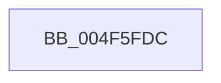

# _report_rangecheckfailure

- RVA: `0x004F5FDC`–`0x004F6004` (길이 `40` bytes)
- VA: `0x00000001404F5FDC`
- 실행 섹션: `.text`
- PDB 이름 있음: `예`; PDB Function 태그: `아니요`
- unwind 정보 RVA: `0x000622F0`
- 디코드: `8`개 명령, `40/40` bytes 표시
- 미해석 바이트: `0` (있으면 어셈블리에 `.byte`로 보존)

> 이 문서는 커널 이미지의 기계어와 PDB 기호를 분석해 생성했습니다. 4번과 5번은 함수 원형과 자료형을 바이너리 사용 방식에서 추정한 C 해석이며 원본 소스 복구 결과는 아닙니다.

## 1. Dependencies

- 직접 호출 지점: **1**; 고유 호출 대상: **1**
- 직접 호출자로 확인된 함수: **23**
- RIP 상대 이미지 참조: **2**

### Outgoing calls
- `0x004F5FFE` → [KeBugCheckEx](KeBugCheckEx_function_004FD660.md) (function, `0x004FD660`)

### Direct callers
- [sub_0020D8DF](../20/Unknown_function_0020D8DF.md) at `0x0020DC03`
- [AuthzBasepEvaluateAceCondition](../2F/AuthzBasepEvaluateAceCondition_function_002FEBD0.md) at `0x002FF9AB`
- [strtok_s](../50/strtok_s_function_00506240.md) at `0x00506396`
- [PopDetermineBucketFrequencies](../5C/PopDetermineBucketFrequencies_function_005CEBF8.md) at `0x005CED2E`
- [LdrpGetResourceFileName](../5E/LdrpGetResourceFileName_function_005E5B28.md) at `0x005E5C80`
- [inflate_table](../60/inflate_table_function_00600664.md) at `0x006006E1`
- [PiDevCfgSplitDriverConfigurationId](../../page/73/PiDevCfgSplitDriverConfigurationId_function_00736568.md) at `0x0073679D`
- [RtlUnicodeStringToInt64](../../page/78/RtlUnicodeStringToInt64_function_0078F7E0.md) at `0x0078F8E6`
- [WdipSemLoadNextEndEvent](../../page/7A/WdipSemLoadNextEndEvent_function_007AFAD0.md) at `0x007AFDD1`
- [WdipSemLoadNextScenario](../../page/7A/WdipSemLoadNextScenario_function_007AFDE0.md) at `0x007B02CC`
- [WheaRegChangeNotifyCallback](../../page/7D/WheaRegChangeNotifyCallback_function_007D8A50.md) at `0x007D8BD8`
- [CmGetDeviceChildren](../../page/9D/CmGetDeviceChildren_function_009D08DC.md) at `0x009D0C74`
- [LocalGetStringForControl](../../page/A5/LocalGetStringForControl_function_00A55674.md) at `0x00A557A6`
- [SepParseElamCertResources](../../page/AA/SepParseElamCertResources_function_00AAC43C.md) at `0x00AAC813`
- [RtlCultureNameToLCID](../../page/AA/RtlCultureNameToLCID_function_00AACEF0.md) at `0x00AACFA1`
- [KdInitSystem](../../pagekd/B8/KdInitSystem_function_00B85E30.md) at `0x00B864B7`
- [VfUtilPrintCheckinString](../../pagevrfy/B9/VfUtilPrintCheckinString_function_00B934D4.md) at `0x00B936E9`
- [HdlspPutWideString](../../pagehdls/BB/HdlspPutWideString_function_00BBE468.md) at `0x00BBE4F9`
- [InitLoadDebuggerSymbols](../../init/C1/InitLoadDebuggerSymbols_function_00C1BEB0.md) at `0x00C1BF62`
- [KsepMatchInitBiosInfo](../../init/C3/KsepMatchInitBiosInfo_function_00C3BCB0.md) at `0x00C3BEE2`
- [CmSelectQualifiedInstallLanguage](../../init/C5/CmSelectQualifiedInstallLanguage_function_00C58F58.md) at `0x00C5949F`
- [CmpInitializeMachineDependentConfiguration](../../init/C5/CmpInitializeMachineDependentConfiguration_function_00C5A02C.md) at `0x00C5A0F1`
- [CmpSetupConfigurationTree](../../init/C5/CmpSetupConfigurationTree_function_00C5B624.md) at `0x00C5B684`

### Static image references
- `0x004F5FEB` → RVA `0x00E0A750` (`.data`; read)
- `0x004F5FF7` → RVA `0x00E0A740` (`.data`; read)

## 2. Other-region calls and transfers

- 다른 실행 섹션으로 향하는 call: **0**
- 별도 외부 분기/꼬리 이동을 확인하지 못했습니다.

## 3. Assembly (complete function range)

```asm
004F5FDC  48 83 EC 38                     sub rsp, 0x38
004F5FE0  48 83 64 24 20 00               and qword ptr [rsp + 0x20], 0
004F5FE6  BA 08 00 00 00                  mov edx, 8
004F5FEB  4C 8B 0D 5E 47 91 00            mov r9, qword ptr [rip + 0x91475e]
004F5FF2  B9 F7 00 00 00                  mov ecx, 0xf7
004F5FF7  4C 8B 05 42 47 91 00            mov r8, qword ptr [rip + 0x914742]
004F5FFE  E8 5D 76 00 00                  call 0x1404fd660
004F6003  CC                              int3
```

## 4. C-style interpretation (structured pseudocode)

```c
__int64 __fastcall _report_rangecheckfailure(void)
{
    __int64 result;
    __int64 v_rsp;
    unsigned __int64 v_stack_m18;

    v_rsp = (v_rsp) - (56);
    result = KeBugCheckEx(247, 8, *(unsigned __int64 *)(v_rip + 9520962), *(unsigned __int64 *)(v_rip + 9520990));
    return result;
}
```

## 5. (Beta) C Style

```c
void _report_rangecheckfailure(void)
{
    int64_t result;
    int64_t local_rsp;
    uint64_t v_stack_m18;

    local_rsp = (local_rsp) - (56);
    result = KeBugCheckEx(247, 8, *(uint64_t *)(v_rip + 0x914742), *(uint64_t *)(v_rip + 0x91475E));
    return result;
}
```

## 6. Execution-region graph

[열기: 2D/3D 그래프와 함수 탐색 컨트롤 패널](../../../control-panel.html?section=text&rva=0x004F5FDC&view=graph)

- 2D 그래프는 위에서 아래로 흐르고, 3D 그래프는 빈 공간을 드래그해 회전합니다. Shift+드래그는 이동, 휠은 확대·축소, 함수 노드 선택은 대상 보고서 이동입니다.

### Static fallback


