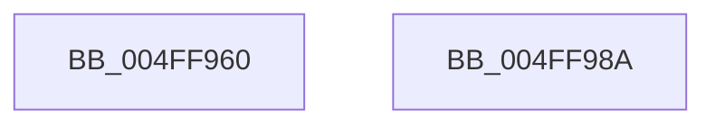

# finite

- RVA: `0x004FF960`–`0x004FF98B` (길이 `43` bytes)
- VA: `0x00000001404FF960`
- 실행 섹션: `.text`
- PDB 이름 있음: `예`; PDB Function 태그: `아니요`
- unwind 정보 RVA: `0x000DB714`
- 디코드: `9`개 명령, `43/43` bytes 표시
- 미해석 바이트: `0` (있으면 어셈블리에 `.byte`로 보존)

> 이 문서는 커널 이미지의 기계어와 PDB 기호를 분석해 생성했습니다. 4번과 5번은 함수 원형과 자료형을 바이너리 사용 방식에서 추정한 C 해석이며 원본 소스 복구 결과는 아닙니다.

## 1. Dependencies

- 직접 호출 지점: **0**; 고유 호출 대상: **0**
- 직접 호출자로 확인된 함수: **0**
- RIP 상대 이미지 참조: **0**

### Outgoing calls
- 직접 디코드된 call 명령이 없습니다.

### Direct callers
- 이 함수 시작 RVA로 연결되는 직접 call은 확인되지 않았습니다. 간접 호출은 완전히 역산할 수 없습니다.

### Static image references
- 디코드된 RIP-relative 메모리 참조가 없습니다.

## 2. Other-region calls and transfers

- 다른 실행 섹션으로 향하는 call: **0**
- 별도 외부 분기/꼬리 이동을 확인하지 못했습니다.

## 3. Assembly (complete function range)

```asm
004FF960  48 B9 FF FF FF FF FF FF FF 7F   movabs rcx, 0x7fffffffffffffff
004FF96A  F2 0F 11 44 24 08               movsd qword ptr [rsp + 8], xmm0
004FF970  48 8B 44 24 08                  mov rax, qword ptr [rsp + 8]
004FF975  48 23 C1                        and rax, rcx
004FF978  48 B9 00 00 00 00 00 00 F0 7F   movabs rcx, 0x7ff0000000000000
004FF982  48 2B C1                        sub rax, rcx
004FF985  48 C1 E8 3F                     shr rax, 0x3f
004FF989  C3                              ret
004FF98A  CC                              int3
```

## 4. C-style interpretation (structured pseudocode)

```c
__int64 __fastcall finite(void)
{
    __int64 result;
    unsigned __int64 v_stack_p8;

    v_stack_p8 = v_xmm0;
    result = (v_stack_p8) & (a1);
    result = (result) - (a1);
    result = (result) >> (63);
    return result;
}
```

## 5. (Beta) C Style

```c
void finite(void)
{
    int64_t result;
    uint64_t v_stack_p8;

    v_stack_p8 = v_xmm0;
    result = (v_stack_p8) & (a1);
    result = (result) - (a1);
    result = (result) >> (63);
    return result;
}
```

## 6. Execution-region graph

[열기: 2D/3D 그래프와 함수 탐색 컨트롤 패널](../../../control-panel.html?section=text&rva=0x004FF960&view=graph)

- 2D 그래프는 위에서 아래로 흐르고, 3D 그래프는 빈 공간을 드래그해 회전합니다. Shift+드래그는 이동, 휠은 확대·축소, 함수 노드 선택은 대상 보고서 이동입니다.

### Static fallback


