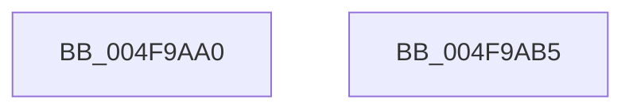

# gsl::details::terminate

- RVA: `0x004F9AA0`–`0x004F9AB6` (길이 `22` bytes)
- VA: `0x00000001404F9AA0`
- 실행 섹션: `.text`
- PDB 이름 있음: `예`; PDB Function 태그: `아니요`
- unwind 정보 RVA: `0x0005C788`
- 디코드: `6`개 명령, `22/22` bytes 표시
- 미해석 바이트: `0` (있으면 어셈블리에 `.byte`로 보존)

> 이 문서는 커널 이미지의 기계어와 PDB 기호를 분석해 생성했습니다. 4번과 5번은 함수 원형과 자료형을 바이너리 사용 방식에서 추정한 C 해석이며 원본 소스 복구 결과는 아닙니다.

## 1. Dependencies

- 직접 호출 지점: **1**; 고유 호출 대상: **1**
- 직접 호출자로 확인된 함수: **15**
- RIP 상대 이미지 참조: **1**

### Outgoing calls
- `0x004F9AAB` → [guard_dispatch_icall](../6B/guard_dispatch_icall_function_006BAAD0.md) (function, `0x006BAAD0`)

### Direct callers
- [gsl::copy&lt;unsigned char const ,-1,unsigned char,-1&gt;](../49/gsl_copy_unsigned_char_const_-1_unsigned_char_-1__function_0049D878.md) at `0x0049D8EF`
- [RtlDoesRequireFunctionOverrideFixups](../../page/93/RtlDoesRequireFunctionOverrideFixups_function_0093F97C.md) at `0x0093F9BF`
- [RtlpGetFunctionOverrideIndex](../../page/93/RtlpGetFunctionOverrideIndex_function_0093FDC0.md) at `0x0093FDFD`
- [RtlCreateFunctionOverrideFixupInfo](../../page/94/RtlCreateFunctionOverrideFixupInfo_function_00943034.md) at `0x009431A1`
- [RtlpFindFunctionOverrideDvrtRecord](../../page/94/RtlpFindFunctionOverrideDvrtRecord_function_009431C0.md) at `0x009433BE`
- [RtlpFindFunctionOverrideDvrtRecord](../../page/94/RtlpFindFunctionOverrideDvrtRecord_function_009431C0.md) at `0x009433C9`
- [RtlpCreateFunctionOverrideFixupInfo](../../page/94/RtlpCreateFunctionOverrideFixupInfo_function_009433D8.md) at `0x009437FA`
- [RtlpParseFunctionOverrideRelocations](../../page/94/RtlpParseFunctionOverrideRelocations_function_00943A68.md) at `0x00943D45`
- [RtlpRecordFunctionOverrideRelocation](../../page/94/RtlpRecordFunctionOverrideRelocation_function_00943D84.md) at `0x00943EFD`
- [RtlpGetFunctionOverrideIndex](../../page/94/RtlpGetFunctionOverrideIndex_function_00943F0C.md) at `0x00943F4D`
- [RtlpParseBinaryDecisionDiagram](../../page/94/RtlpParseBinaryDecisionDiagram_function_00943F94.md) at `0x0094416F`
- [RtlpSelectFunctionFromBinaryDecisionDiagram](../../page/94/RtlpSelectFunctionFromBinaryDecisionDiagram_function_0094417C.md) at `0x009442BE`
- [RtlpAllocateFunctionOverrideInfo](../../page/94/RtlpAllocateFunctionOverrideInfo_function_009442CC.md) at `0x00944474`
- [MiInitializePrivateFixupBitmap](../../page/9E/MiInitializePrivateFixupBitmap_function_009E55C8.md) at `0x009E572B`
- [PspFinalizeScpCfgPage](../../init/C4/PspFinalizeScpCfgPage_function_00C46A8C.md) at `0x00C46AA6`
- [PsInitializeScpCfgPages](../../init/C4/PsInitializeScpCfgPages_function_00C46EEC.md) at `0x00C47046`

### Static image references
- `0x004F9AA4` → RVA `0x00E01EA0` (`.data`; read)

## 2. Other-region calls and transfers

- 다른 실행 섹션으로 향하는 call: **0**
- 별도 외부 분기/꼬리 이동을 확인하지 못했습니다.

## 3. Assembly (complete function range)

```asm
004F9AA0  48 83 EC 28                     sub rsp, 0x28
004F9AA4  48 8B 05 F5 83 90 00            mov rax, qword ptr [rip + 0x9083f5]
004F9AAB  E8 20 10 1C 00                  call 0x1406baad0
004F9AB0  48 83 C4 28                     add rsp, 0x28
004F9AB4  C3                              ret
004F9AB5  CC                              int3
```

## 4. C-style interpretation (structured pseudocode)

```c
__int64 __fastcall gsl__details__terminate(void)
{
    __int64 result;
    __int64 v_rsp;

    v_rsp = (v_rsp) - (40);
    result = guard_dispatch_icall(a1, a2, a3, a4);
    v_rsp = (v_rsp) + (40);
    return result;
}
```

## 5. (Beta) C Style

```c
void gsl__details__terminate(void)
{
    int64_t result;
    int64_t local_rsp;

    local_rsp = (local_rsp) - (40);
    result = guard_dispatch_icall(a1, a2, a3, a4);
    local_rsp = (local_rsp) + (40);
    return result;
}
```

## 6. Execution-region graph

[열기: 2D/3D 그래프와 함수 탐색 컨트롤 패널](../../../control-panel.html?section=text&rva=0x004F9AA0&view=graph)

- 2D 그래프는 위에서 아래로 흐르고, 3D 그래프는 빈 공간을 드래그해 회전합니다. Shift+드래그는 이동, 휠은 확대·축소, 함수 노드 선택은 대상 보고서 이동입니다.

### Static fallback


