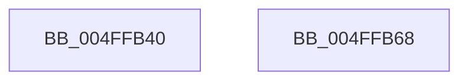

# local_unwind

- RVA: `0x004FFB40`–`0x004FFB69` (길이 `41` bytes)
- VA: `0x00000001404FFB40`
- 실행 섹션: `.text`
- PDB 이름 있음: `예`; PDB Function 태그: `아니요`
- unwind 정보 RVA: `0x000D04C4`
- 디코드: `11`개 명령, `41/41` bytes 표시
- 미해석 바이트: `0` (있으면 어셈블리에 `.byte`로 보존)

> 이 문서는 커널 이미지의 기계어와 PDB 기호를 분석해 생성했습니다. 4번과 5번은 함수 원형과 자료형을 바이너리 사용 방식에서 추정한 C 해석이며 원본 소스 복구 결과는 아닙니다.

## 1. Dependencies

- 직접 호출 지점: **1**; 고유 호출 대상: **1**
- 직접 호출자로 확인된 함수: **34**
- RIP 상대 이미지 참조: **0**

### Outgoing calls
- `0x004FFB5E` → [RtlUnwind](../2F/RtlUnwind_function_002F1CB0.md) (function, `0x002F1CB0`)

### Direct callers
- [ExpCenturyDpcRoutine$fin$0](../6D/ExpCenturyDpcRoutine_fin_0_function_006D1A27.md) at `0x006D1C7E`
- [IopTimerDispatch$fin$0](../6D/IopTimerDispatch_fin_0_function_006D249D.md) at `0x006D24CC`
- [IopIrpStackProfilerDpcRoutine$fin$1](../6D/IopIrpStackProfilerDpcRoutine_fin_1_function_006D35C1.md) at `0x006D381B`
- [KiBalanceSetManagerDeferredRoutine$fin$2](../6D/KiBalanceSetManagerDeferredRoutine_fin_2_function_006D3D6D.md) at `0x006D3D9C`
- [ExpTimerDpcRoutine$fin$2](../6D/ExpTimerDpcRoutine_fin_2_function_006D439B.md) at `0x006D43CA`
- [ExpTimeRefreshDpcRoutine$fin$2](../6D/ExpTimeRefreshDpcRoutine_fin_2_function_006D4A7A.md) at `0x006D4AA9`
- [PopThermalZoneDpc$fin$1](../6D/PopThermalZoneDpc_fin_1_function_006D55B0.md) at `0x006D55DF`
- [ExpTimeZoneDpcRoutine$fin$2](../6D/ExpTimeZoneDpcRoutine_fin_2_function_006D5CC1.md) at `0x006D5F37`
- [CmpEnableLazyFlushDpcRoutine$fin$0](../6D/CmpEnableLazyFlushDpcRoutine_fin_0_function_006D5F95.md) at `0x006D5FC4`
- [SLGetSubscriptionPfn](../../page/7C/SLGetSubscriptionPfn_function_007C9108.md) at `0x007C935C`
- [KiVerifyXcpt15](../../init/BE/KiVerifyXcpt15_function_00BEF260.md) at `0x00BEF27E`
- [KiVerifyXcpt10](../../init/C3/KiVerifyXcpt10_function_00C3A800.md) at `0x00C3A84E`
- [KiVerifyXcpt10](../../init/C3/KiVerifyXcpt10_function_00C3A800.md) at `0x00C3A864`
- [KiVerifyXcpt10](../../init/C3/KiVerifyXcpt10_function_00C3A800.md) at `0x00C3A8CB`
- [KiVerifyXcpt10](../../init/C3/KiVerifyXcpt10_function_00C3A800.md) at `0x00C3A93A`
- [KiVerifyXcpt12](../../init/C3/KiVerifyXcpt12_function_00C3A9D0.md) at `0x00C3AA2C`
- [KiVerifyXcpt14](../../init/C3/KiVerifyXcpt14_function_00C3AAB0.md) at `0x00C3AAFA`
- [sub_00C7EB14](../../init/C7/Unknown_function_00C7EB14.md) at `0x00C7EB30`
- [sub_00C7EB3D](../../init/C7/Unknown_function_00C7EB3D.md) at `0x00C7F79A`
- [KiVerifyXcpt1$fin$0](../../init/C7/KiVerifyXcpt1_fin_0_function_00C7F8AF.md) at `0x00C7F8D9`
- [KiVerifyXcpt10$fin$5](../../init/C7/KiVerifyXcpt10_fin_5_function_00C7F9CB.md) at `0x00C7F9F1`
- [KiVerifyXcpt10$fin$9](../../init/C7/KiVerifyXcpt10_fin_9_function_00C7FA2E.md) at `0x00C7FA83`
- [KiVerifyXcpt10$fin$9](../../init/C7/KiVerifyXcpt10_fin_9_function_00C7FA2E.md) at `0x00C7FA94`
- [KiVerifyXcpt10$fin$8](../../init/C7/KiVerifyXcpt10_fin_8_function_00C7FAA1.md) at `0x00C7FADE`
- [KiVerifyXcpt10$fin$7](../../init/C7/KiVerifyXcpt10_fin_7_function_00C7FAEB.md) at `0x00C7FB24`
- [KiVerifyXcpt12$fin$1](../../init/C7/KiVerifyXcpt12_fin_1_function_00C7FBCE.md) at `0x00C7FBF8`
- [KiVerifyXcpt12$fin$5](../../init/C7/KiVerifyXcpt12_fin_5_function_00C7FC86.md) at `0x00C7FCAB`
- [KiVerifyXcpt13$fin$1](../../init/C7/KiVerifyXcpt13_fin_1_function_00C7FD0B.md) at `0x00C7FD30`
- [KiVerifyXcpt2$fin$0](../../init/C7/KiVerifyXcpt2_fin_0_function_00C7FE26.md) at `0x00C7FE51`
- [KiVerifyXcpt3$fin$0](../../init/C7/KiVerifyXcpt3_fin_0_function_00C7FED8.md) at `0x00C7FF03`
- [KiVerifyXcpt4$fin$1](../../init/C7/KiVerifyXcpt4_fin_1_function_00C7FFB2.md) at `0x00C7FFDD`
- [KiVerifyXcpt5$fin$1](../../init/C8/KiVerifyXcpt5_fin_1_function_00C80056.md) at `0x00C80089`
- [KiVerifyXcpt6$fin$2](../../init/C8/KiVerifyXcpt6_fin_2_function_00C80129.md) at `0x00C80154`
- [KiVerifyXcpt7$fin$2](../../init/C8/KiVerifyXcpt7_fin_2_function_00C801F8.md) at `0x00C8022B`
- [KiVerifyXcpt8$fin$2](../../init/C8/KiVerifyXcpt8_fin_2_function_00C802CF.md) at `0x00C802FA`
- [KiVerifyXcpt9$fin$2](../../init/C8/KiVerifyXcpt9_fin_2_function_00C8039F.md) at `0x00C803CA`
- [KiVerifyXcptFinally$fin$0](../../init/C8/KiVerifyXcptFinally_fin_0_function_00C8040D.md) at `0x00C80439`
- [KiVerifyXcptFinally$fin$1](../../init/C8/KiVerifyXcptFinally_fin_1_function_00C80446.md) at `0x00C80475`

### Static image references
- 디코드된 RIP-relative 메모리 참조가 없습니다.

## 2. Other-region calls and transfers

- 다른 실행 섹션으로 향하는 call: **0**
- 별도 외부 분기/꼬리 이동을 확인하지 못했습니다.

## 3. Assembly (complete function range)

```asm
004FFB40  48 89 54 24 10                  mov qword ptr [rsp + 0x10], rdx
004FFB45  48 89 4C 24 08                  mov qword ptr [rsp + 8], rcx
004FFB4A  48 83 EC 28                     sub rsp, 0x28
004FFB4E  45 33 C9                        xor r9d, r9d
004FFB51  45 33 C0                        xor r8d, r8d
004FFB54  48 8B 54 24 38                  mov rdx, qword ptr [rsp + 0x38]
004FFB59  48 8B 4C 24 30                  mov rcx, qword ptr [rsp + 0x30]
004FFB5E  E8 4D 21 DF FF                  call 0x1402f1cb0
004FFB63  48 83 C4 28                     add rsp, 0x28
004FFB67  C3                              ret
004FFB68  CC                              int3
```

## 4. C-style interpretation (structured pseudocode)

```c
__int64 __fastcall local_unwind(__int64 a1, __int64 a2, int a3, int a4)
{
    __int64 result;
    __int64 v_rsp;
    unsigned __int64 v_stack_p10;
    unsigned __int64 v_stack_p8;

    v_stack_p10 = a2;
    v_stack_p8 = a1;
    v_rsp = (v_rsp) - (40);
    a4 = 0;
    a3 = 0;
    result = RtlUnwind(v_stack_p8, v_stack_p10, a3, a4);
    v_rsp = (v_rsp) + (40);
    return result;
}
```

## 5. (Beta) C Style

```c
int64_t local_unwind(int64_t Arg1, int64_t Arg2, int32_t Arg3, int32_t Arg4)
{
    int64_t result;
    int64_t local_rsp;
    uint64_t v_stack_p10;
    uint64_t v_stack_p8;

    v_stack_p10 = Arg2;
    v_stack_p8 = Arg1;
    local_rsp = (local_rsp) - (40);
    Arg4 = 0;
    Arg3 = 0;
    result = RtlUnwind(v_stack_p8, v_stack_p10, Arg3, Arg4);
    local_rsp = (local_rsp) + (40);
    return result;
}
```

## 6. Execution-region graph

[열기: 2D/3D 그래프와 함수 탐색 컨트롤 패널](../../../control-panel.html?section=text&rva=0x004FFB40&view=graph)

- 2D 그래프는 위에서 아래로 흐르고, 3D 그래프는 빈 공간을 드래그해 회전합니다. Shift+드래그는 이동, 휠은 확대·축소, 함수 노드 선택은 대상 보고서 이동입니다.

### Static fallback


