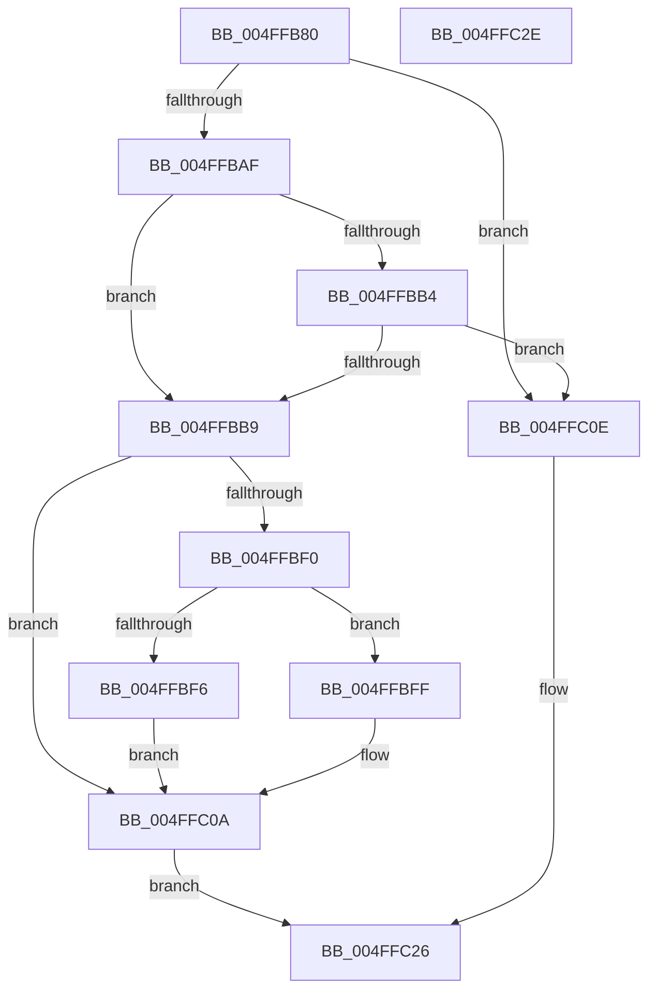

# snprintf

- RVA: `0x004FFB80`–`0x004FFC2F` (길이 `175` bytes)
- VA: `0x00000001404FFB80`
- 실행 섹션: `.text`
- PDB 이름 있음: `예`; PDB Function 태그: `아니요`
- unwind 정보 RVA: `0x000C2644`
- 디코드: `57`개 명령, `175/175` bytes 표시
- 미해석 바이트: `0` (있으면 어셈블리에 `.byte`로 보존)

> 이 문서는 커널 이미지의 기계어와 PDB 기호를 분석해 생성했습니다. 4번과 5번은 함수 원형과 자료형을 바이너리 사용 방식에서 추정한 C 해석이며 원본 소스 복구 결과는 아닙니다.

## 1. Dependencies

- 직접 호출 지점: **3**; 고유 호출 대상: **3**
- 직접 호출자로 확인된 함수: **0**
- RIP 상대 이미지 참조: **0**

### Outgoing calls
- `0x004FFBE4` → [output_l](../50/output_l_function_00503368.md) (function, `0x00503368`)
- `0x004FFC05` → [flsbuf](../50/flsbuf_function_0050292C.md) (function, `0x0050292C`)
- `0x004FFC1E` → [EmpCheckErrataList](../49/EmpCheckErrataList_function_0049E550.md) (function, `0x0049E550`)

### Direct callers
- 이 함수 시작 RVA로 연결되는 직접 call은 확인되지 않았습니다. 간접 호출은 완전히 역산할 수 없습니다.

### Static image references
- 디코드된 RIP-relative 메모리 참조가 없습니다.

## 2. Other-region calls and transfers

- 다른 실행 섹션으로 향하는 call: **0**
- 별도 외부 분기/꼬리 이동을 확인하지 못했습니다.

## 3. Assembly (complete function range)

```asm
004FFB80  4C 89 44 24 18                  mov qword ptr [rsp + 0x18], r8
004FFB85  4C 89 4C 24 20                  mov qword ptr [rsp + 0x20], r9
004FFB8A  55                              push rbp
004FFB8B  53                              push rbx
004FFB8C  57                              push rdi
004FFB8D  48 8B EC                        mov rbp, rsp
004FFB90  48 83 EC 70                     sub rsp, 0x70
004FFB94  83 65 D4 00                     and dword ptr [rbp - 0x2c], 0
004FFB98  0F 57 C0                        xorps xmm0, xmm0
004FFB9B  83 65 F4 00                     and dword ptr [rbp - 0xc], 0
004FFB9F  49 8B C0                        mov rax, r8
004FFBA2  48 8B D9                        mov rbx, rcx
004FFBA5  F3 0F 7F 45 E4                  movdqu xmmword ptr [rbp - 0x1c], xmm0
004FFBAA  4D 85 C0                        test r8, r8
004FFBAD  74 5F                           je 0x1404ffc0e
004FFBAF  48 85 D2                        test rdx, rdx
004FFBB2  74 05                           je 0x1404ffbb9
004FFBB4  48 85 C9                        test rcx, rcx
004FFBB7  74 55                           je 0x1404ffc0e
004FFBB9  B9 FF FF FF 7F                  mov ecx, 0x7fffffff
004FFBBE  C7 45 E0 42 00 00 00            mov dword ptr [rbp - 0x20], 0x42
004FFBC5  48 3B D1                        cmp rdx, rcx
004FFBC8  48 89 5D D8                     mov qword ptr [rbp - 0x28], rbx
004FFBCC  4C 8D 4D 38                     lea r9, [rbp + 0x38]
004FFBD0  48 89 5D C8                     mov qword ptr [rbp - 0x38], rbx
004FFBD4  0F 47 D1                        cmova edx, ecx
004FFBD7  45 33 C0                        xor r8d, r8d
004FFBDA  89 55 D0                        mov dword ptr [rbp - 0x30], edx
004FFBDD  48 8D 4D C8                     lea rcx, [rbp - 0x38]
004FFBE1  48 8B D0                        mov rdx, rax
004FFBE4  E8 7F 37 00 00                  call 0x140503368
004FFBE9  8B F8                           mov edi, eax
004FFBEB  48 85 DB                        test rbx, rbx
004FFBEE  74 1A                           je 0x1404ffc0a
004FFBF0  83 6D D0 01                     sub dword ptr [rbp - 0x30], 1
004FFBF4  78 09                           js 0x1404ffbff
004FFBF6  48 8B 4D C8                     mov rcx, qword ptr [rbp - 0x38]
004FFBFA  C6 01 00                        mov byte ptr [rcx], 0
004FFBFD  EB 0B                           jmp 0x1404ffc0a
004FFBFF  48 8D 55 C8                     lea rdx, [rbp - 0x38]
004FFC03  33 C9                           xor ecx, ecx
004FFC05  E8 22 2D 00 00                  call 0x14050292c
004FFC0A  8B C7                           mov eax, edi
004FFC0C  EB 18                           jmp 0x1404ffc26
004FFC0E  48 83 64 24 20 00               and qword ptr [rsp + 0x20], 0
004FFC14  45 33 C9                        xor r9d, r9d
004FFC17  45 33 C0                        xor r8d, r8d
004FFC1A  33 D2                           xor edx, edx
004FFC1C  33 C9                           xor ecx, ecx
004FFC1E  E8 2D E9 F9 FF                  call 0x14049e550
004FFC23  83 C8 FF                        or eax, 0xffffffff
004FFC26  48 83 C4 70                     add rsp, 0x70
004FFC2A  5F                              pop rdi
004FFC2B  5B                              pop rbx
004FFC2C  5D                              pop rbp
004FFC2D  C3                              ret
004FFC2E  CC                              int3
```

## 4. C-style interpretation (structured pseudocode)

```c
__int64 __fastcall snprintf(__int64 a1, __int64 a2, __int64 a3, __int64 a4)
{
    __int64 result;
    __int64 v_rsp;
    unsigned int v_stack_m24;
    unsigned __int64 v_stack_m34;
    unsigned int v_stack_m38;
    unsigned __int64 v_stack_m40;
    unsigned int v_stack_m44;
    unsigned int v_stack_m48;
    unsigned __int64 v_stack_m50;
    unsigned __int64 v_stack_m68;
    unsigned __int64 v_stack_p18;
    unsigned __int64 v_stack_p20;

    v_stack_p18 = a3;
    v_stack_p20 = a4;
    v_rsp = (v_rsp) - (112);
    v_stack_m34 = v_xmm0;
    if (a3 == 0) goto loc_004FFC0E;
    if (a2 == 0) goto loc_004FFBB9;
    if (a1 == 0) goto loc_004FFC0E;
loc_004FFBB9:
    v_stack_m38 = 66;
    v_stack_m40 = a1;
    v_stack_m50 = a1;
    if (a2 > ((unsigned int)(0x7FFFFFFFULL))) { a2 = (unsigned int)((unsigned int)(0x7FFFFFFFULL)); }
    a3 = 0;
    v_stack_m48 = (unsigned int)(a2);
    result = output_l(v_stack_m50, 0, a3, v_stack_p20);
    if (a1 == 0) goto loc_004FFC0A;
    if (sign_flag) goto loc_004FFBFF;
    *(unsigned __int8 *)(v_stack_m50) = 0;
    goto loc_004FFC0A;
loc_004FFBFF:
    a1 = 0;
    result = flsbuf(a1, v_stack_m50, a3, v_stack_p20);
loc_004FFC0A:
    goto loc_004FFC26;
loc_004FFC0E:
    a4 = 0;
    a3 = 0;
    a2 = 0;
    a1 = 0;
    result = EmpCheckErrataList(a1, a2, a3, a4);
    result = (unsigned int)((result) | (0xFFFFFFFFULL));
loc_004FFC26:
    v_rsp = (v_rsp) + (112);
    return result;
}
```

## 5. (Beta) C Style

```c
int64_t snprintf(int64_t Arg1, int64_t Arg2, int64_t Arg3, int64_t Arg4)
{
    int64_t result;
    int64_t local_rsp;
    uint32_t v_stack_m24;
    uint64_t v_stack_m34;
    uint32_t v_stack_m38;
    uint64_t v_stack_m40;
    uint32_t v_stack_m44;
    uint32_t v_stack_m48;
    uint64_t v_stack_m50;
    uint64_t v_stack_m68;
    uint64_t v_stack_p18;
    uint64_t v_stack_p20;

    v_stack_p18 = Arg3;
    v_stack_p20 = Arg4;
    local_rsp = (local_rsp) - (112);
    v_stack_m34 = v_xmm0;
    if (Arg3 == 0) goto loc_004FFC0E;
    if (Arg2 == 0) goto loc_004FFBB9;
    if (Arg1 == 0) goto loc_004FFC0E;
loc_004FFBB9:
    v_stack_m38 = 66;
    v_stack_m40 = Arg1;
    v_stack_m50 = Arg1;
    if (Arg2 > ((uint32_t)(0x7FFFFFFFULL))) { Arg2 = (uint32_t)((uint32_t)(0x7FFFFFFFULL)); }
    Arg3 = 0;
    v_stack_m48 = (uint32_t)(Arg2);
    result = output_l(v_stack_m50, 0, Arg3, v_stack_p20);
    if (Arg1 == 0) goto loc_004FFC0A;
    if (sign_flag) goto loc_004FFBFF;
    *(uint8_t *)(v_stack_m50) = 0;
    goto loc_004FFC0A;
loc_004FFBFF:
    Arg1 = 0;
    result = flsbuf(Arg1, v_stack_m50, Arg3, v_stack_p20);
loc_004FFC0A:
    goto loc_004FFC26;
loc_004FFC0E:
    Arg4 = 0;
    Arg3 = 0;
    Arg2 = 0;
    Arg1 = 0;
    result = EmpCheckErrataList(Arg1, Arg2, Arg3, Arg4);
    result = (uint32_t)((result) | (0xFFFFFFFFULL));
loc_004FFC26:
    local_rsp = (local_rsp) + (112);
    return result;
}
```

## 6. Execution-region graph

[열기: 2D/3D 그래프와 함수 탐색 컨트롤 패널](../../../control-panel.html?section=text&rva=0x004FFB80&view=graph)

- 2D 그래프는 위에서 아래로 흐르고, 3D 그래프는 빈 공간을 드래그해 회전합니다. Shift+드래그는 이동, 휠은 확대·축소, 함수 노드 선택은 대상 보고서 이동입니다.

### Static fallback


