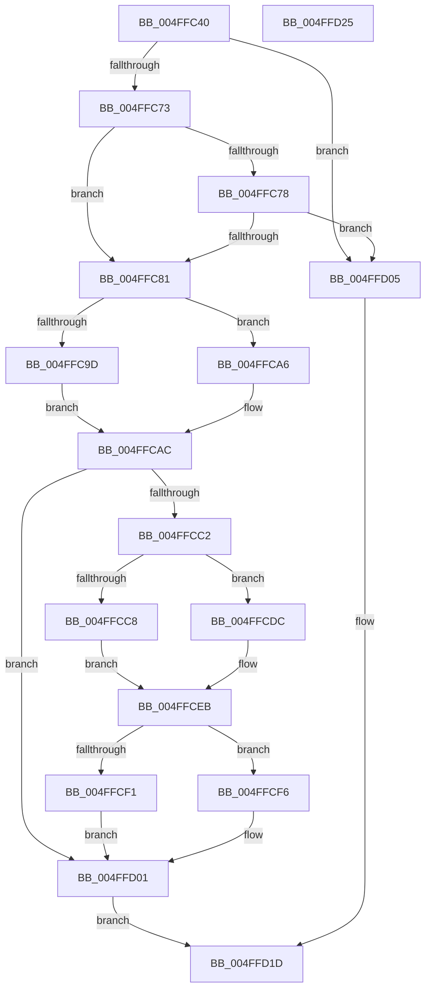

# snwprintf

- RVA: `0x004FFC40`–`0x004FFD26` (길이 `230` bytes)
- VA: `0x00000001404FFC40`
- 실행 섹션: `.text`
- PDB 이름 있음: `예`; PDB Function 태그: `아니요`
- unwind 정보 RVA: `0x000C2644`
- 디코드: `70`개 명령, `230/230` bytes 표시
- 미해석 바이트: `0` (있으면 어셈블리에 `.byte`로 보존)

> 이 문서는 커널 이미지의 기계어와 PDB 기호를 분석해 생성했습니다. 4번과 5번은 함수 원형과 자료형을 바이너리 사용 방식에서 추정한 C 해석이며 원본 소스 복구 결과는 아닙니다.

## 1. Dependencies

- 직접 호출 지점: **4**; 고유 호출 대상: **3**
- 직접 호출자로 확인된 함수: **0**
- RIP 상대 이미지 참조: **0**

### Outgoing calls
- `0x004FFCB6` → [woutput_l](../50/woutput_l_function_0050293C.md) (function, `0x0050293C`)
- `0x004FFCE2` → [flsbuf](../50/flsbuf_function_0050292C.md) (function, `0x0050292C`)
- `0x004FFCFC` → [flsbuf](../50/flsbuf_function_0050292C.md) (function, `0x0050292C`)
- `0x004FFD15` → [EmpCheckErrataList](../49/EmpCheckErrataList_function_0049E550.md) (function, `0x0049E550`)

### Direct callers
- 이 함수 시작 RVA로 연결되는 직접 call은 확인되지 않았습니다. 간접 호출은 완전히 역산할 수 없습니다.

### Static image references
- 디코드된 RIP-relative 메모리 참조가 없습니다.

## 2. Other-region calls and transfers

- 다른 실행 섹션으로 향하는 call: **0**
- 별도 외부 분기/꼬리 이동을 확인하지 못했습니다.

## 3. Assembly (complete function range)

```asm
004FFC40  4C 89 44 24 18                  mov qword ptr [rsp + 0x18], r8
004FFC45  4C 89 4C 24 20                  mov qword ptr [rsp + 0x20], r9
004FFC4A  55                              push rbp
004FFC4B  53                              push rbx
004FFC4C  57                              push rdi
004FFC4D  48 8B EC                        mov rbp, rsp
004FFC50  48 83 EC 70                     sub rsp, 0x70
004FFC54  83 65 D4 00                     and dword ptr [rbp - 0x2c], 0
004FFC58  0F 57 C0                        xorps xmm0, xmm0
004FFC5B  83 65 F4 00                     and dword ptr [rbp - 0xc], 0
004FFC5F  4D 8B D0                        mov r10, r8
004FFC62  48 8B D9                        mov rbx, rcx
004FFC65  F3 0F 7F 45 E4                  movdqu xmmword ptr [rbp - 0x1c], xmm0
004FFC6A  4D 85 C0                        test r8, r8
004FFC6D  0F 84 92 00 00 00               je 0x1404ffd05
004FFC73  48 85 D2                        test rdx, rdx
004FFC76  74 09                           je 0x1404ffc81
004FFC78  48 85 C9                        test rcx, rcx
004FFC7B  0F 84 84 00 00 00               je 0x1404ffd05
004FFC81  C7 45 E0 42 00 00 00            mov dword ptr [rbp - 0x20], 0x42
004FFC88  4C 8D 4D 38                     lea r9, [rbp + 0x38]
004FFC8C  48 89 5D D8                     mov qword ptr [rbp - 0x28], rbx
004FFC90  48 89 5D C8                     mov qword ptr [rbp - 0x38], rbx
004FFC94  48 81 FA FF FF FF 3F            cmp rdx, 0x3fffffff
004FFC9B  76 09                           jbe 0x1404ffca6
004FFC9D  C7 45 D0 FF FF FF 7F            mov dword ptr [rbp - 0x30], 0x7fffffff
004FFCA4  EB 06                           jmp 0x1404ffcac
004FFCA6  8D 04 12                        lea eax, [rdx + rdx]
004FFCA9  89 45 D0                        mov dword ptr [rbp - 0x30], eax
004FFCAC  45 33 C0                        xor r8d, r8d
004FFCAF  48 8D 4D C8                     lea rcx, [rbp - 0x38]
004FFCB3  49 8B D2                        mov rdx, r10
004FFCB6  E8 81 2C 00 00                  call 0x14050293c
004FFCBB  8B F8                           mov edi, eax
004FFCBD  48 85 DB                        test rbx, rbx
004FFCC0  74 3F                           je 0x1404ffd01
004FFCC2  83 6D D0 01                     sub dword ptr [rbp - 0x30], 1
004FFCC6  78 14                           js 0x1404ffcdc
004FFCC8  48 8B 4D C8                     mov rcx, qword ptr [rbp - 0x38]
004FFCCC  C6 01 00                        mov byte ptr [rcx], 0
004FFCCF  48 8B 4D C8                     mov rcx, qword ptr [rbp - 0x38]
004FFCD3  48 FF C1                        inc rcx
004FFCD6  48 89 4D C8                     mov qword ptr [rbp - 0x38], rcx
004FFCDA  EB 0F                           jmp 0x1404ffceb
004FFCDC  48 8D 55 C8                     lea rdx, [rbp - 0x38]
004FFCE0  33 C9                           xor ecx, ecx
004FFCE2  E8 45 2C 00 00                  call 0x14050292c
004FFCE7  48 8B 4D C8                     mov rcx, qword ptr [rbp - 0x38]
004FFCEB  83 6D D0 01                     sub dword ptr [rbp - 0x30], 1
004FFCEF  78 05                           js 0x1404ffcf6
004FFCF1  C6 01 00                        mov byte ptr [rcx], 0
004FFCF4  EB 0B                           jmp 0x1404ffd01
004FFCF6  48 8D 55 C8                     lea rdx, [rbp - 0x38]
004FFCFA  33 C9                           xor ecx, ecx
004FFCFC  E8 2B 2C 00 00                  call 0x14050292c
004FFD01  8B C7                           mov eax, edi
004FFD03  EB 18                           jmp 0x1404ffd1d
004FFD05  48 83 64 24 20 00               and qword ptr [rsp + 0x20], 0
004FFD0B  45 33 C9                        xor r9d, r9d
004FFD0E  45 33 C0                        xor r8d, r8d
004FFD11  33 D2                           xor edx, edx
004FFD13  33 C9                           xor ecx, ecx
004FFD15  E8 36 E8 F9 FF                  call 0x14049e550
004FFD1A  83 C8 FF                        or eax, 0xffffffff
004FFD1D  48 83 C4 70                     add rsp, 0x70
004FFD21  5F                              pop rdi
004FFD22  5B                              pop rbx
004FFD23  5D                              pop rbp
004FFD24  C3                              ret
004FFD25  CC                              int3
```

## 4. C-style interpretation (structured pseudocode)

```c
__int64 __fastcall snwprintf(__int64 a1, __int64 a2, __int64 a3, __int64 a4)
{
    __int64 result;
    __int64 v_rsp;
    unsigned int v_stack_m24;
    unsigned __int64 v_stack_m34;
    unsigned int v_stack_m38;
    unsigned __int64 v_stack_m40;
    unsigned int v_stack_m44;
    unsigned int v_stack_m48;
    unsigned __int64 v_stack_m50;
    unsigned __int64 v_stack_m68;
    unsigned __int64 v_stack_p18;
    unsigned __int64 v_stack_p20;

    v_stack_p18 = a3;
    v_stack_p20 = a4;
    v_rsp = (v_rsp) - (112);
    v_stack_m34 = v_xmm0;
    if (a3 == 0) goto loc_004FFD05;
    if (a2 == 0) goto loc_004FFC81;
    if (a1 == 0) goto loc_004FFD05;
loc_004FFC81:
    v_stack_m38 = 66;
    v_stack_m40 = a1;
    v_stack_m50 = a1;
    if (a2 <= 0x3FFFFFFFULL) goto loc_004FFCA6;
    v_stack_m48 = 0x7FFFFFFFULL;
    goto loc_004FFCAC;
loc_004FFCA6:
    v_stack_m48 = (unsigned int)(a2 + a2 * 1);
loc_004FFCAC:
    a3 = 0;
    result = woutput_l(v_stack_m50, 0, a3, v_stack_p20);
    if (a1 == 0) goto loc_004FFD01;
    if (sign_flag) goto loc_004FFCDC;
    *(unsigned __int8 *)(v_stack_m50) = 0;
    a1 = (v_stack_m50) + 1;
    v_stack_m50 = a1;
    goto loc_004FFCEB;
loc_004FFCDC:
    a1 = 0;
    result = flsbuf(a1, v_stack_m50, a3, v_stack_p20);
loc_004FFCEB:
    if (sign_flag) goto loc_004FFCF6;
    *(unsigned __int8 *)(v_stack_m50) = 0;
    goto loc_004FFD01;
loc_004FFCF6:
    a1 = 0;
    result = flsbuf(a1, v_stack_m50, a3, v_stack_p20);
loc_004FFD01:
    goto loc_004FFD1D;
loc_004FFD05:
    a4 = 0;
    a3 = 0;
    a2 = 0;
    a1 = 0;
    result = EmpCheckErrataList(a1, a2, a3, a4);
    result = (unsigned int)((result) | (0xFFFFFFFFULL));
loc_004FFD1D:
    v_rsp = (v_rsp) + (112);
    return result;
}
```

## 5. (Beta) C Style

```c
int64_t snwprintf(int64_t Arg1, int64_t Arg2, int64_t Arg3, int64_t Arg4)
{
    int64_t result;
    int64_t local_rsp;
    uint32_t v_stack_m24;
    uint64_t v_stack_m34;
    uint32_t v_stack_m38;
    uint64_t v_stack_m40;
    uint32_t v_stack_m44;
    uint32_t v_stack_m48;
    uint64_t v_stack_m50;
    uint64_t v_stack_m68;
    uint64_t v_stack_p18;
    uint64_t v_stack_p20;

    v_stack_p18 = Arg3;
    v_stack_p20 = Arg4;
    local_rsp = (local_rsp) - (112);
    v_stack_m34 = v_xmm0;
    if (Arg3 == 0) goto loc_004FFD05;
    if (Arg2 == 0) goto loc_004FFC81;
    if (Arg1 == 0) goto loc_004FFD05;
loc_004FFC81:
    v_stack_m38 = 66;
    v_stack_m40 = Arg1;
    v_stack_m50 = Arg1;
    if (Arg2 <= 0x3FFFFFFFULL) goto loc_004FFCA6;
    v_stack_m48 = 0x7FFFFFFFULL;
    goto loc_004FFCAC;
loc_004FFCA6:
    v_stack_m48 = (uint32_t)(Arg2 + Arg2 * 1);
loc_004FFCAC:
    Arg3 = 0;
    result = woutput_l(v_stack_m50, 0, Arg3, v_stack_p20);
    if (Arg1 == 0) goto loc_004FFD01;
    if (sign_flag) goto loc_004FFCDC;
    *(uint8_t *)(v_stack_m50) = 0;
    Arg1 = (v_stack_m50) + 1;
    v_stack_m50 = Arg1;
    goto loc_004FFCEB;
loc_004FFCDC:
    Arg1 = 0;
    result = flsbuf(Arg1, v_stack_m50, Arg3, v_stack_p20);
loc_004FFCEB:
    if (sign_flag) goto loc_004FFCF6;
    *(uint8_t *)(v_stack_m50) = 0;
    goto loc_004FFD01;
loc_004FFCF6:
    Arg1 = 0;
    result = flsbuf(Arg1, v_stack_m50, Arg3, v_stack_p20);
loc_004FFD01:
    goto loc_004FFD1D;
loc_004FFD05:
    Arg4 = 0;
    Arg3 = 0;
    Arg2 = 0;
    Arg1 = 0;
    result = EmpCheckErrataList(Arg1, Arg2, Arg3, Arg4);
    result = (uint32_t)((result) | (0xFFFFFFFFULL));
loc_004FFD1D:
    local_rsp = (local_rsp) + (112);
    return result;
}
```

## 6. Execution-region graph

[열기: 2D/3D 그래프와 함수 탐색 컨트롤 패널](../../../control-panel.html?section=text&rva=0x004FFC40&view=graph)

- 2D 그래프는 위에서 아래로 흐르고, 3D 그래프는 빈 공간을 드래그해 회전합니다. Shift+드래그는 이동, 휠은 확대·축소, 함수 노드 선택은 대상 보고서 이동입니다.

### Static fallback


