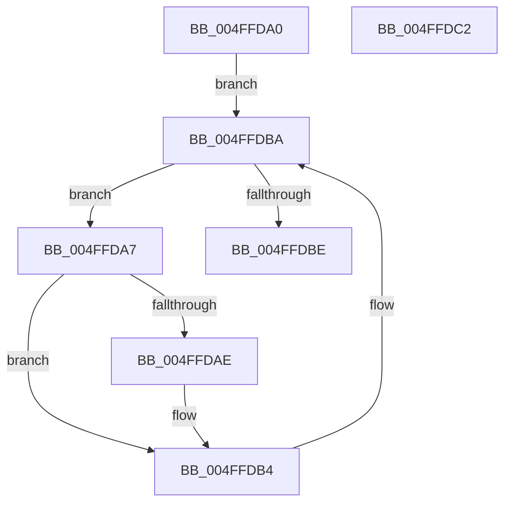

# strlwr

- RVA: `0x004FFDA0`–`0x004FFDC3` (길이 `35` bytes)
- VA: `0x00000001404FFDA0`
- 실행 섹션: `.text`
- PDB 이름 있음: `예`; PDB Function 태그: `아니요`
- unwind 정보 RVA: `0x000DB714`
- 디코드: `15`개 명령, `35/35` bytes 표시
- 미해석 바이트: `0` (있으면 어셈블리에 `.byte`로 보존)

> 이 문서는 커널 이미지의 기계어와 PDB 기호를 분석해 생성했습니다. 4번과 5번은 함수 원형과 자료형을 바이너리 사용 방식에서 추정한 C 해석이며 원본 소스 복구 결과는 아닙니다.

## 1. Dependencies

- 직접 호출 지점: **0**; 고유 호출 대상: **0**
- 직접 호출자로 확인된 함수: **0**
- RIP 상대 이미지 참조: **0**

### Outgoing calls
- 직접 디코드된 call 명령이 없습니다.

### Direct callers
- 이 함수 시작 RVA로 연결되는 직접 call은 확인되지 않았습니다. 간접 호출은 완전히 역산할 수 없습니다.

### Static image references
- 디코드된 RIP-relative 메모리 참조가 없습니다.

## 2. Other-region calls and transfers

- 다른 실행 섹션으로 향하는 call: **0**
- 별도 외부 분기/꼬리 이동을 확인하지 못했습니다.

## 3. Assembly (complete function range)

```asm
004FFDA0  8A 11                           mov dl, byte ptr [rcx]
004FFDA2  4C 8B C1                        mov r8, rcx
004FFDA5  EB 13                           jmp 0x1404ffdba
004FFDA7  8D 42 BF                        lea eax, [rdx - 0x41]
004FFDAA  3C 19                           cmp al, 0x19
004FFDAC  77 06                           ja 0x1404ffdb4
004FFDAE  80 C2 20                        add dl, 0x20
004FFDB1  41 88 10                        mov byte ptr [r8], dl
004FFDB4  49 FF C0                        inc r8
004FFDB7  41 8A 10                        mov dl, byte ptr [r8]
004FFDBA  84 D2                           test dl, dl
004FFDBC  75 E9                           jne 0x1404ffda7
004FFDBE  48 8B C1                        mov rax, rcx
004FFDC1  C3                              ret
004FFDC2  CC                              int3
```

## 4. C-style interpretation (structured pseudocode)

```c
__int64 __fastcall strlwr(__int64 a1)
{
    goto loc_004FFDBA;
loc_004FFDA7:
    if (((unsigned __int8)(*(unsigned __int8 *)(a1) - 65)) <= 25) {
        a2 = (unsigned __int8)((*(unsigned __int8 *)(a1)) + (32));
        *(unsigned __int8 *)(a1) = (unsigned __int8)(a2);
    }
    a3 = (a1) + 1;
loc_004FFDBA:
    if ((unsigned __int8)(*(unsigned __int8 *)(a3)) != 0) goto loc_004FFDA7;
    return a1;
}
```

## 5. (Beta) C Style

```c
void *strlwr(void *Arg1)
{
    uint8_t *arg1 = (uint8_t *)Arg1;

    goto loc_004FFDBA;
loc_004FFDA7:
    if (((uint8_t)(*(uint8_t *)(arg1) - 65)) <= 25) {
        a2 = (uint8_t)((*(uint8_t *)(arg1)) + (32));
        *(uint8_t *)(arg1) = (uint8_t)(a2);
    }
    a3 = (Arg1) + 1;
loc_004FFDBA:
    if ((uint8_t)(*(uint8_t *)(a3)) != 0) goto loc_004FFDA7;
    return Arg1;
}
```

### 관측된 메모리 오프셋

구조체 형식이 확인되지 않은 접근은 인자 기준의 오프셋으로만 기록했습니다.

| 기준 인자 | 오프셋 표현 | 폭 (bit) | 접근 |
|---|---:|---:|---|
| `Arg1` | `+ 0x0` | `8` | `R` |

## 6. Execution-region graph

[열기: 2D/3D 그래프와 함수 탐색 컨트롤 패널](../../../control-panel.html?section=text&rva=0x004FFDA0&view=graph)

- 2D 그래프는 위에서 아래로 흐르고, 3D 그래프는 빈 공간을 드래그해 회전합니다. Shift+드래그는 이동, 휠은 확대·축소, 함수 노드 선택은 대상 보고서 이동입니다.

### Static fallback


