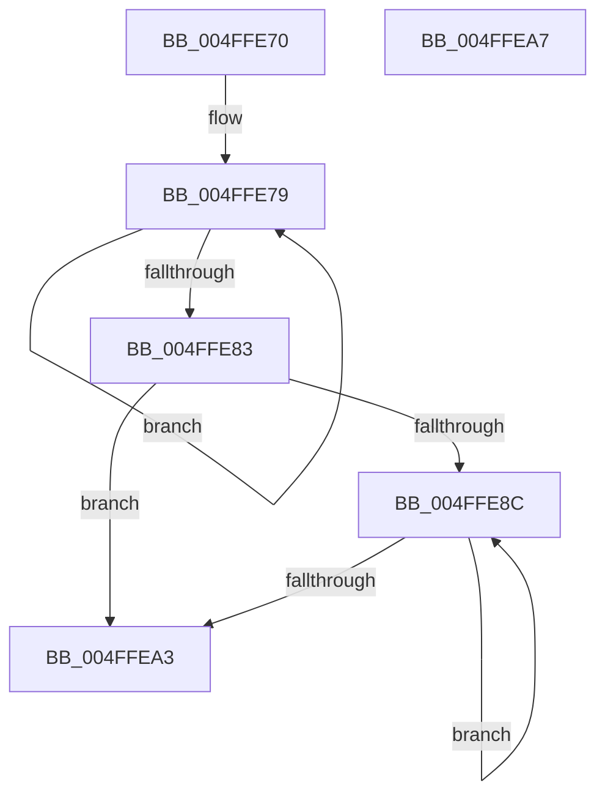

# strrev

- RVA: `0x004FFE70`–`0x004FFEA8` (길이 `56` bytes)
- VA: `0x00000001404FFE70`
- 실행 섹션: `.text`
- PDB 이름 있음: `예`; PDB Function 태그: `아니요`
- unwind 정보 RVA: `0x000DB714`
- 디코드: `21`개 명령, `56/56` bytes 표시
- 미해석 바이트: `0` (있으면 어셈블리에 `.byte`로 보존)

> 이 문서는 커널 이미지의 기계어와 PDB 기호를 분석해 생성했습니다. 4번과 5번은 함수 원형과 자료형을 바이너리 사용 방식에서 추정한 C 해석이며 원본 소스 복구 결과는 아닙니다.

## 1. Dependencies

- 직접 호출 지점: **0**; 고유 호출 대상: **0**
- 직접 호출자로 확인된 함수: **0**
- RIP 상대 이미지 참조: **0**

### Outgoing calls
- 직접 디코드된 call 명령이 없습니다.

### Direct callers
- 이 함수 시작 RVA로 연결되는 직접 call은 확인되지 않았습니다. 간접 호출은 완전히 역산할 수 없습니다.

### Static image references
- 디코드된 RIP-relative 메모리 참조가 없습니다.

## 2. Other-region calls and transfers

- 다른 실행 섹션으로 향하는 call: **0**
- 별도 외부 분기/꼬리 이동을 확인하지 못했습니다.

## 3. Assembly (complete function range)

```asm
004FFE70  4C 8B C1                        mov r8, rcx
004FFE73  4C 8B D1                        mov r10, rcx
004FFE76  4C 8B C9                        mov r9, rcx
004FFE79  41 8A 00                        mov al, byte ptr [r8]
004FFE7C  49 FF C0                        inc r8
004FFE7F  84 C0                           test al, al
004FFE81  75 F6                           jne 0x1404ffe79
004FFE83  49 83 E8 02                     sub r8, 2
004FFE87  49 3B C8                        cmp rcx, r8
004FFE8A  73 17                           jae 0x1404ffea3
004FFE8C  41 8A 08                        mov cl, byte ptr [r8]
004FFE8F  41 8A 11                        mov dl, byte ptr [r9]
004FFE92  41 88 09                        mov byte ptr [r9], cl
004FFE95  49 FF C1                        inc r9
004FFE98  41 88 10                        mov byte ptr [r8], dl
004FFE9B  49 FF C8                        dec r8
004FFE9E  4D 3B C8                        cmp r9, r8
004FFEA1  72 E9                           jb 0x1404ffe8c
004FFEA3  49 8B C2                        mov rax, r10
004FFEA6  C3                              ret
004FFEA7  CC                              int3
```

## 4. C-style interpretation (structured pseudocode)

```c
__int64 __fastcall strrev(__int64 a1)
{
loc_004FFE79:
    a3 = (a1) + 1;
    if ((unsigned __int8)(*(unsigned __int8 *)(a1)) != 0) goto loc_004FFE79;
    a3 = (a3) - (2);
    if (a1 >= a3) goto loc_004FFEA3;
loc_004FFE8C:
    *(unsigned __int8 *)(a1) = (unsigned __int8)(*(unsigned __int8 *)(a3));
    a4 = (a1) + 1;
    *(unsigned __int8 *)(a3) = (unsigned __int8)(*(unsigned __int8 *)(a1));
    a3 = (a3) - 1;
    if (a4 < a3) goto loc_004FFE8C;
loc_004FFEA3:
    return a1;
}
```

## 5. (Beta) C Style

```c
int64_t strrev(int64_t Arg1)
{
loc_004FFE79:
    a3 = (Arg1) + 1;
    if ((uint8_t)(*(uint8_t *)(Arg1)) != 0) goto loc_004FFE79;
    a3 = (a3) - (2);
    if (Arg1 >= a3) goto loc_004FFEA3;
loc_004FFE8C:
    *(uint8_t *)(Arg1) = (uint8_t)(*(uint8_t *)(a3));
    a4 = (Arg1) + 1;
    *(uint8_t *)(a3) = (uint8_t)(*(uint8_t *)(Arg1));
    a3 = (a3) - 1;
    if (a4 < a3) goto loc_004FFE8C;
loc_004FFEA3:
    return Arg1;
}
```

## 6. Execution-region graph

[열기: 2D/3D 그래프와 함수 탐색 컨트롤 패널](../../../control-panel.html?section=text&rva=0x004FFE70&view=graph)

- 2D 그래프는 위에서 아래로 흐르고, 3D 그래프는 빈 공간을 드래그해 회전합니다. Shift+드래그는 이동, 휠은 확대·축소, 함수 노드 선택은 대상 보고서 이동입니다.

### Static fallback


