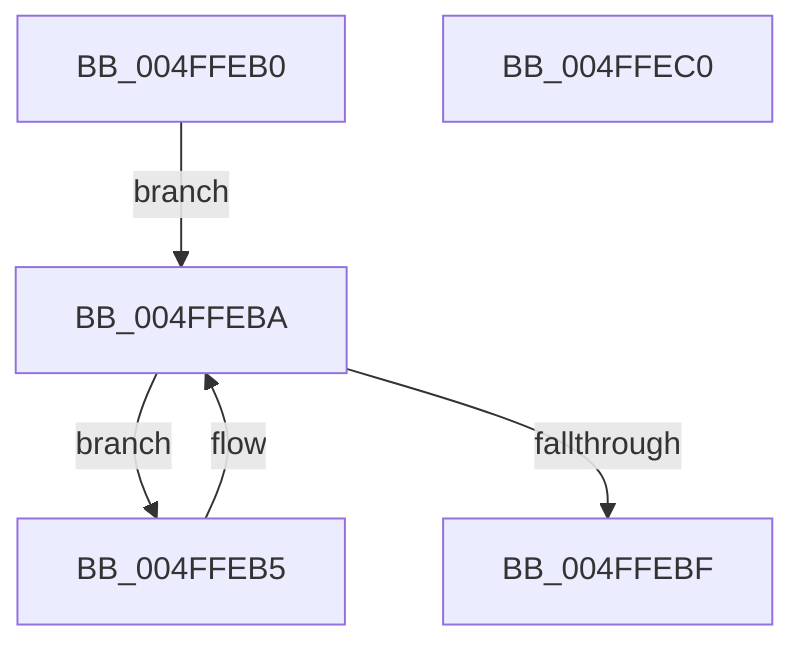

# strset

- RVA: `0x004FFEB0`–`0x004FFEC1` (길이 `17` bytes)
- VA: `0x00000001404FFEB0`
- 실행 섹션: `.text`
- PDB 이름 있음: `예`; PDB Function 태그: `아니요`
- unwind 정보 RVA: `0x000DB714`
- 디코드: `8`개 명령, `17/17` bytes 표시
- 미해석 바이트: `0` (있으면 어셈블리에 `.byte`로 보존)

> 이 문서는 커널 이미지의 기계어와 PDB 기호를 분석해 생성했습니다. 4번과 5번은 함수 원형과 자료형을 바이너리 사용 방식에서 추정한 C 해석이며 원본 소스 복구 결과는 아닙니다.

## 1. Dependencies

- 직접 호출 지점: **0**; 고유 호출 대상: **0**
- 직접 호출자로 확인된 함수: **0**
- RIP 상대 이미지 참조: **0**

### Outgoing calls
- 직접 디코드된 call 명령이 없습니다.

### Direct callers
- 이 함수 시작 RVA로 연결되는 직접 call은 확인되지 않았습니다. 간접 호출은 완전히 역산할 수 없습니다.

### Static image references
- 디코드된 RIP-relative 메모리 참조가 없습니다.

## 2. Other-region calls and transfers

- 다른 실행 섹션으로 향하는 call: **0**
- 별도 외부 분기/꼬리 이동을 확인하지 못했습니다.

## 3. Assembly (complete function range)

```asm
004FFEB0  48 8B C1                        mov rax, rcx
004FFEB3  EB 05                           jmp 0x1404ffeba
004FFEB5  88 11                           mov byte ptr [rcx], dl
004FFEB7  48 FF C1                        inc rcx
004FFEBA  80 39 00                        cmp byte ptr [rcx], 0
004FFEBD  75 F6                           jne 0x1404ffeb5
004FFEBF  C3                              ret
004FFEC0  CC                              int3
```

## 4. C-style interpretation (structured pseudocode)

```c
__int64 __fastcall strset(__int64 a1, unsigned __int8 a2)
{
    goto loc_004FFEBA;
loc_004FFEB5:
    *(unsigned __int8 *)(a1) = a2;
    a1 = (a1) + 1;
loc_004FFEBA:
    if ((*(unsigned __int8 *)(a1)) != 0) goto loc_004FFEB5;
    return a1;
}
```

## 5. (Beta) C Style

```c
int64_t strset(int64_t Arg1, uint8_t Arg2)
{
    goto loc_004FFEBA;
loc_004FFEB5:
    *(uint8_t *)(Arg1) = Arg2;
    Arg1 = (Arg1) + 1;
loc_004FFEBA:
    if ((*(uint8_t *)(Arg1)) != 0) goto loc_004FFEB5;
    return Arg1;
}
```

## 6. Execution-region graph

[열기: 2D/3D 그래프와 함수 탐색 컨트롤 패널](../../../control-panel.html?section=text&rva=0x004FFEB0&view=graph)

- 2D 그래프는 위에서 아래로 흐르고, 3D 그래프는 빈 공간을 드래그해 회전합니다. Shift+드래그는 이동, 휠은 확대·축소, 함수 노드 선택은 대상 보고서 이동입니다.

### Static fallback


