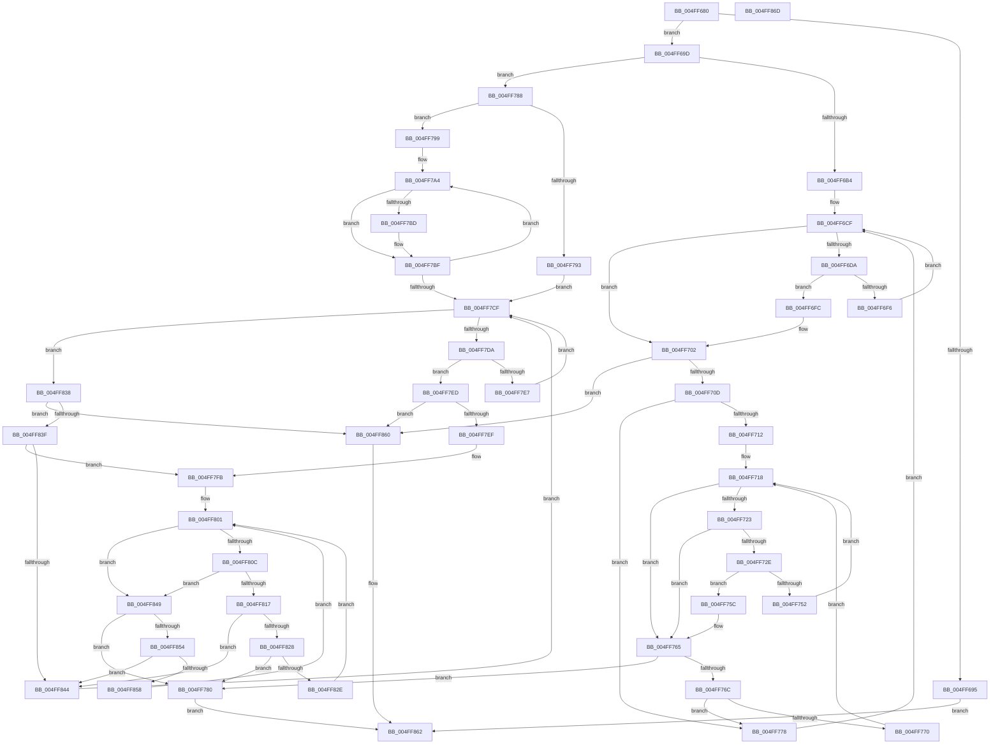

# strstr

- RVA: `0x004FF680`–`0x004FF86E` (길이 `494` bytes)
- VA: `0x00000001404FF680`
- 실행 섹션: `.text`
- PDB 이름 있음: `예`; PDB Function 태그: `아니요`
- unwind 정보 RVA: `0x000AA828`
- 디코드: `153`개 명령, `494/494` bytes 표시
- 미해석 바이트: `0` (있으면 어셈블리에 `.byte`로 보존)

> 이 문서는 커널 이미지의 기계어와 PDB 기호를 분석해 생성했습니다. 4번과 5번은 함수 원형과 자료형을 바이너리 사용 방식에서 추정한 C 해석이며 원본 소스 복구 결과는 아닙니다.

## 1. Dependencies

- 직접 호출 지점: **0**; 고유 호출 대상: **0**
- 직접 호출자로 확인된 함수: **31**
- RIP 상대 이미지 참조: **1**

### Outgoing calls
- 직접 디코드된 call 명령이 없습니다.

### Direct callers
- [HalInitializeBios](../53/HalInitializeBios_function_0053D9A0.md) at `0x0053D9DC`
- [HalpIommuInitializeDmaGuardPolicy](../55/HalpIommuInitializeDmaGuardPolicy_function_00555348.md) at `0x005553C6`
- [HvlDebuggerSupportInitialize](../58/HvlDebuggerSupportInitialize_function_00583790.md) at `0x005837F1`
- [HvlDebuggerSupportInitialize](../58/HvlDebuggerSupportInitialize_function_00583790.md) at `0x00583807`
- [HvlDebuggerSupportInitialize](../58/HvlDebuggerSupportInitialize_function_00583790.md) at `0x0058381D`
- [HvlDebuggerSupportInitialize](../58/HvlDebuggerSupportInitialize_function_00583790.md) at `0x00583835`
- [HvlDebuggerSupportInitialize](../58/HvlDebuggerSupportInitialize_function_00583790.md) at `0x00583882`
- [HvlDebuggerSupportInitialize](../58/HvlDebuggerSupportInitialize_function_00583790.md) at `0x00583913`
- [HvlDebuggerSupportInitialize](../58/HvlDebuggerSupportInitialize_function_00583790.md) at `0x00583995`
- [HvlDebuggerSupportInitialize](../58/HvlDebuggerSupportInitialize_function_00583790.md) at `0x005839BC`
- [HvlDebuggerSupportInitialize](../58/HvlDebuggerSupportInitialize_function_00583790.md) at `0x005839E2`
- [HvlDebuggerSupportInitialize](../58/HvlDebuggerSupportInitialize_function_00583790.md) at `0x00583A14`
- [InbvDetermineFunction](../59/InbvDetermineFunction_function_005901C0.md) at `0x005901FF`
- [KiIsSafeBoot](../5B/KiIsSafeBoot_function_005BF404.md) at `0x005BF41B`
- [KiIsWinPEBoot](../5B/KiIsWinPEBoot_function_005BF560.md) at `0x005BF577`
- [HvlPhase0Initialize](../../page/71/HvlPhase0Initialize_function_00717AC8.md) at `0x00717B64`
- [SepInitializeCodeIntegrity](../../page/79/SepInitializeCodeIntegrity_function_0079BACC.md) at `0x0079BB6F`
- [KiMatchLoadOption](../../pagelk/B6/KiMatchLoadOption_function_00B67598.md) at `0x00B675A8`
- [KiInitializeBootStructures](../../pagelk/B6/KiInitializeBootStructures_function_00B68530.md) at `0x00B6883F`
- [KdInitSystem](../../pagekd/B8/KdInitSystem_function_00B85E30.md) at `0x00B8600C`
- [KdInitSystem](../../pagekd/B8/KdInitSystem_function_00B85E30.md) at `0x00B8605D`
- [KdInitSystem](../../pagekd/B8/KdInitSystem_function_00B85E30.md) at `0x00B86090`
- [KdInitSystem](../../pagekd/B8/KdInitSystem_function_00B85E30.md) at `0x00B860D4`
- [KdInitSystem](../../pagekd/B8/KdInitSystem_function_00B85E30.md) at `0x00B860E8`
- [KdInitSystem](../../pagekd/B8/KdInitSystem_function_00B85E30.md) at `0x00B8611F`
- [KdInitSystem](../../pagekd/B8/KdInitSystem_function_00B85E30.md) at `0x00B86205`
- [KdInitSystem](../../pagekd/B8/KdInitSystem_function_00B85E30.md) at `0x00B8622A`
- [CcInitializeBcbProfiler](../../init/BE/CcInitializeBcbProfiler_function_00BEF294.md) at `0x00BEF372`
- [sub_00BF16D0](../../init/BF/Unknown_function_00BF16D0.md) at `0x00BF178C`
- [sub_00BF16D0](../../init/BF/Unknown_function_00BF16D0.md) at `0x00BF17A0`
- [InitBootProcessor](../../init/C1/InitBootProcessor_function_00C1B1C8.md) at `0x00C1B35E`
- [InitBootProcessor](../../init/C1/InitBootProcessor_function_00C1B1C8.md) at `0x00C1B372`
- [InitBootProcessor](../../init/C1/InitBootProcessor_function_00C1B1C8.md) at `0x00C1B3A3`
- [Phase1InitializationDiscard](../../init/C1/Phase1InitializationDiscard_function_00C1C728.md) at `0x00C1C82E`
- [Phase1InitializationDiscard](../../init/C1/Phase1InitializationDiscard_function_00C1C728.md) at `0x00C1C842`
- [Phase1InitializationDiscard](../../init/C1/Phase1InitializationDiscard_function_00C1C728.md) at `0x00C1C865`
- [Phase1InitializationDiscard](../../init/C1/Phase1InitializationDiscard_function_00C1C728.md) at `0x00C1C87C`
- [Phase1InitializationDiscard](../../init/C1/Phase1InitializationDiscard_function_00C1C728.md) at `0x00C1C8E3`
- [Phase1InitializationDiscard](../../init/C1/Phase1InitializationDiscard_function_00C1C728.md) at `0x00C1C8FA`
- [Phase1InitializationDiscard](../../init/C1/Phase1InitializationDiscard_function_00C1C728.md) at `0x00C1CABC`
- [Phase1InitializationDiscard](../../init/C1/Phase1InitializationDiscard_function_00C1C728.md) at `0x00C1CB4C`
- [Phase1InitializationDiscard](../../init/C1/Phase1InitializationDiscard_function_00C1C728.md) at `0x00C1CB67`
- [Phase1InitializationDiscard](../../init/C1/Phase1InitializationDiscard_function_00C1C728.md) at `0x00C1CDE5`
- [Phase1InitializationDiscard](../../init/C1/Phase1InitializationDiscard_function_00C1C728.md) at `0x00C1CDF9`
- [Phase1InitializationDiscard](../../init/C1/Phase1InitializationDiscard_function_00C1C728.md) at `0x00C1CF0A`
- [Phase1InitializationDiscard](../../init/C1/Phase1InitializationDiscard_function_00C1C728.md) at `0x00C1CF1E`
- [Phase1InitializationDiscard](../../init/C1/Phase1InitializationDiscard_function_00C1C728.md) at `0x00C1CF41`
- [Phase1InitializationDiscard](../../init/C1/Phase1InitializationDiscard_function_00C1C728.md) at `0x00C1CF55`
- [Phase1InitializationDiscard](../../init/C1/Phase1InitializationDiscard_function_00C1C728.md) at `0x00C1CF78`
- [Phase1InitializationDiscard](../../init/C1/Phase1InitializationDiscard_function_00C1C728.md) at `0x00C1CF8C`
- [Phase1InitializationDiscard](../../init/C1/Phase1InitializationDiscard_function_00C1C728.md) at `0x00C1CFB7`
- [Phase1InitializationDiscard](../../init/C1/Phase1InitializationDiscard_function_00C1C728.md) at `0x00C1CFCB`
- [Phase1InitializationDiscard](../../init/C1/Phase1InitializationDiscard_function_00C1C728.md) at `0x00C1CFEE`
- [Phase1InitializationDiscard](../../init/C1/Phase1InitializationDiscard_function_00C1C728.md) at `0x00C1D002`
- [Phase1InitializationDiscard](../../init/C1/Phase1InitializationDiscard_function_00C1C728.md) at `0x00C1D025`
- [Phase1InitializationDiscard](../../init/C1/Phase1InitializationDiscard_function_00C1C728.md) at `0x00C1D639`
- [Phase1InitializationDiscard](../../init/C1/Phase1InitializationDiscard_function_00C1C728.md) at `0x00C1D81F`
- [HalpProcIsSmtDisabled](../../init/C1/HalpProcIsSmtDisabled_function_00C1FBF4.md) at `0x00C1FCAE`
- [HalpMiscGetParameters](../../init/C1/HalpMiscGetParameters_function_00C1FD30.md) at `0x00C1FDB0`
- [HalpMiscGetParameters](../../init/C1/HalpMiscGetParameters_function_00C1FD30.md) at `0x00C1FDBF`
- [HalpMiscGetParameters](../../init/C1/HalpMiscGetParameters_function_00C1FD30.md) at `0x00C1FDDD`
- [HalpMiscGetParameters](../../init/C1/HalpMiscGetParameters_function_00C1FD30.md) at `0x00C1FDF8`
- [HalpMiscGetParameters](../../init/C1/HalpMiscGetParameters_function_00C1FD30.md) at `0x00C1FE13`
- [HalpMiscGetParameters](../../init/C1/HalpMiscGetParameters_function_00C1FD30.md) at `0x00C1FE4E`
- [HalpMiscGetParameters](../../init/C1/HalpMiscGetParameters_function_00C1FD30.md) at `0x00C1FE8D`
- [HalpMiscGetParameters](../../init/C1/HalpMiscGetParameters_function_00C1FD30.md) at `0x00C1FEA8`
- [HalpMiscGetParameters](../../init/C1/HalpMiscGetParameters_function_00C1FD30.md) at `0x00C1FEC3`
- [HalpMiscGetParameters](../../init/C1/HalpMiscGetParameters_function_00C1FD30.md) at `0x00C1FEDE`
- [HalpMiscGetParameters](../../init/C1/HalpMiscGetParameters_function_00C1FD30.md) at `0x00C1FEFB`
- [HalpMiscGetParameters](../../init/C1/HalpMiscGetParameters_function_00C1FD30.md) at `0x00C1FF16`
- [HalpMiscGetParameters](../../init/C1/HalpMiscGetParameters_function_00C1FD30.md) at `0x00C1FF31`
- [HalpMiscGetParameters](../../init/C1/HalpMiscGetParameters_function_00C1FD30.md) at `0x00C1FF49`
- [HalpMiscGetParameters](../../init/C1/HalpMiscGetParameters_function_00C1FD30.md) at `0x00C1FFF3`
- [HalpMiscGetParameters](../../init/C1/HalpMiscGetParameters_function_00C1FD30.md) at `0x00C20020`
- [HalpMiscGetParameters](../../init/C1/HalpMiscGetParameters_function_00C1FD30.md) at `0x00C2003B`
- [HalpMiscGetParameters](../../init/C1/HalpMiscGetParameters_function_00C1FD30.md) at `0x00C20056`
- [HalpMiscGetParameters](../../init/C1/HalpMiscGetParameters_function_00C1FD30.md) at `0x00C200BA`
- [HalpMiscGetParameters](../../init/C1/HalpMiscGetParameters_function_00C1FD30.md) at `0x00C200C9`
- [HalpMiscGetParameters](../../init/C1/HalpMiscGetParameters_function_00C1FD30.md) at `0x00C200D8`
- [HalpSetupAcpiPhase0](../../init/C2/HalpSetupAcpiPhase0_function_00C23EDC.md) at `0x00C23F62`
- [InbvDriverInitialize](../../init/C2/InbvDriverInitialize_function_00C2A420.md) at `0x00C2A498`
- [BvgaDriverInitialize](../../init/C2/BvgaDriverInitialize_function_00C2A500.md) at `0x00C2A560`
- [KiPerformGroupConfiguration](../../init/C3/KiPerformGroupConfiguration_function_00C38FB0.md) at `0x00C3900B`
- [KiPerformGroupConfiguration](../../init/C3/KiPerformGroupConfiguration_function_00C38FB0.md) at `0x00C3902C`
- [KiInitializeNxSupportDiscard](../../init/C3/KiInitializeNxSupportDiscard_function_00C39888.md) at `0x00C398C9`
- [KiInitializeNxSupportDiscard](../../init/C3/KiInitializeNxSupportDiscard_function_00C39888.md) at `0x00C398EC`
- [KiInitializeNxSupportDiscard](../../init/C3/KiInitializeNxSupportDiscard_function_00C39888.md) at `0x00C3991E`
- [KiInitializeNxSupportDiscard](../../init/C3/KiInitializeNxSupportDiscard_function_00C39888.md) at `0x00C3993D`
- [KiInitializeNxSupportDiscard](../../init/C3/KiInitializeNxSupportDiscard_function_00C39888.md) at `0x00C3995C`
- [KiInitializeNxSupportDiscard](../../init/C3/KiInitializeNxSupportDiscard_function_00C39888.md) at `0x00C3997B`
- [ViInitSystemPhase0](../../init/C4/ViInitSystemPhase0_function_00C4C1B0.md) at `0x00C4C336`
- [KitpInitAitSampleRate](../../init/C5/KitpInitAitSampleRate_function_00C53FC8.md) at `0x00C53FEF`
- [CmpGetBiosVersion](../../init/C5/CmpGetBiosVersion_function_00C59E90.md) at `0x00C59F8F`
- [MiInitializeBootDefaults](../../init/C5/MiInitializeBootDefaults_function_00C5ED70.md) at `0x00C5ED82`
- [MiCompensateForProcessorErrata](../../init/C6/MiCompensateForProcessorErrata_function_00C68950.md) at `0x00C68A3D`
- [VhdInitialize](../../init/C6/VhdInitialize_function_00C6DBB4.md) at `0x00C6DC1C`
- [VhdInitialize](../../init/C6/VhdInitialize_function_00C6DBB4.md) at `0x00C6DC35`
- [CimfsInitialize](../../init/C6/CimfsInitialize_function_00C6E64C.md) at `0x00C6E728`
- [RamdiskStart](../../init/C6/RamdiskStart_function_00C6EF68.md) at `0x00C6F05E`
- [RamdiskStart](../../init/C6/RamdiskStart_function_00C6EF68.md) at `0x00C6F0DC`
- [RamdiskStart](../../init/C6/RamdiskStart_function_00C6EF68.md) at `0x00C6F0F0`
- [RamdiskStart](../../init/C6/RamdiskStart_function_00C6EF68.md) at `0x00C6F11B`
- [RamdiskStart](../../init/C6/RamdiskStart_function_00C6EF68.md) at `0x00C6F12F`
- [KeInitializeClock](../../init/C7/KeInitializeClock_function_00C70C30.md) at `0x00C710AF`

### Static image references
- `0x004FF69D` → RVA `0x00E0A6C0` (`.data`; read)

## 2. Other-region calls and transfers

- 다른 실행 섹션으로 향하는 call: **0**
- 별도 외부 분기/꼬리 이동을 확인하지 못했습니다.

## 3. Assembly (complete function range)

```asm
004FF680  48 89 5C 24 08                  mov qword ptr [rsp + 8], rbx
004FF685  48 89 7C 24 18                  mov qword ptr [rsp + 0x18], rdi
004FF68A  80 3A 00                        cmp byte ptr [rdx], 0
004FF68D  4C 8B D2                        mov r10, rdx
004FF690  4C 8B C1                        mov r8, rcx
004FF693  75 08                           jne 0x1404ff69d
004FF695  48 8B C1                        mov rax, rcx
004FF698  E9 C5 01 00 00                  jmp 0x1404ff862
004FF69D  8A 05 1D B0 90 00               mov al, byte ptr [rip + 0x90b01d]
004FF6A3  BB F0 0F 00 00                  mov ebx, 0xff0
004FF6A8  44 8D 5B 0F                     lea r11d, [rbx + 0xf]
004FF6AC  A8 08                           test al, 8
004FF6AE  0F 85 D4 00 00 00               jne 0x1404ff788
004FF6B4  0F B6 3A                        movzx edi, byte ptr [rdx]
004FF6B7  0F 57 DB                        xorps xmm3, xmm3
004FF6BA  8B C7                           mov eax, edi
004FF6BC  C1 E0 08                        shl eax, 8
004FF6BF  0B C7                           or eax, edi
004FF6C1  66 0F 6E C0                     movd xmm0, eax
004FF6C5  F2 0F 70 C8 00                  pshuflw xmm1, xmm0, 0
004FF6CA  66 0F 70 E1 00                  pshufd xmm4, xmm1, 0
004FF6CF  49 8B C0                        mov rax, r8
004FF6D2  49 23 C3                        and rax, r11
004FF6D5  48 3B C3                        cmp rax, rbx
004FF6D8  77 28                           ja 0x1404ff702
004FF6DA  F3 41 0F 6F 00                  movdqu xmm0, xmmword ptr [r8]
004FF6DF  66 0F 6F C8                     movdqa xmm1, xmm0
004FF6E3  66 0F 74 C3                     pcmpeqb xmm0, xmm3
004FF6E7  66 0F 74 CC                     pcmpeqb xmm1, xmm4
004FF6EB  0F 56 C8                        orps xmm1, xmm0
004FF6EE  66 0F D7 C1                     pmovmskb eax, xmm1
004FF6F2  85 C0                           test eax, eax
004FF6F4  75 06                           jne 0x1404ff6fc
004FF6F6  49 83 C0 10                     add r8, 0x10
004FF6FA  EB D3                           jmp 0x1404ff6cf
004FF6FC  0F BC C0                        bsf eax, eax
004FF6FF  4C 03 C0                        add r8, rax
004FF702  41 8A 00                        mov al, byte ptr [r8]
004FF705  84 C0                           test al, al
004FF707  0F 84 53 01 00 00               je 0x1404ff860
004FF70D  40 3A F8                        cmp dil, al
004FF710  75 66                           jne 0x1404ff778
004FF712  49 8B D0                        mov rdx, r8
004FF715  4D 8B CA                        mov r9, r10
004FF718  49 8B C1                        mov rax, r9
004FF71B  49 23 C3                        and rax, r11
004FF71E  48 3B C3                        cmp rax, rbx
004FF721  77 42                           ja 0x1404ff765
004FF723  48 8B C2                        mov rax, rdx
004FF726  49 23 C3                        and rax, r11
004FF729  48 3B C3                        cmp rax, rbx
004FF72C  77 37                           ja 0x1404ff765
004FF72E  F3 41 0F 6F 09                  movdqu xmm1, xmmword ptr [r9]
004FF733  F3 0F 6F 02                     movdqu xmm0, xmmword ptr [rdx]
004FF737  66 0F 6F D1                     movdqa xmm2, xmm1
004FF73B  66 0F 74 CB                     pcmpeqb xmm1, xmm3
004FF73F  66 0F 74 D0                     pcmpeqb xmm2, xmm0
004FF743  66 0F 74 D3                     pcmpeqb xmm2, xmm3
004FF747  0F 56 D1                        orps xmm2, xmm1
004FF74A  66 0F D7 C2                     pmovmskb eax, xmm2
004FF74E  85 C0                           test eax, eax
004FF750  75 0A                           jne 0x1404ff75c
004FF752  48 83 C2 10                     add rdx, 0x10
004FF756  49 83 C1 10                     add r9, 0x10
004FF75A  EB BC                           jmp 0x1404ff718
004FF75C  0F BC C8                        bsf ecx, eax
004FF75F  48 03 D1                        add rdx, rcx
004FF762  4C 03 C9                        add r9, rcx
004FF765  41 8A 01                        mov al, byte ptr [r9]
004FF768  84 C0                           test al, al
004FF76A  74 14                           je 0x1404ff780
004FF76C  38 02                           cmp byte ptr [rdx], al
004FF76E  75 08                           jne 0x1404ff778
004FF770  48 FF C2                        inc rdx
004FF773  49 FF C1                        inc r9
004FF776  EB A0                           jmp 0x1404ff718
004FF778  49 FF C0                        inc r8
004FF77B  E9 4F FF FF FF                  jmp 0x1404ff6cf
004FF780  49 8B C0                        mov rax, r8
004FF783  E9 DA 00 00 00                  jmp 0x1404ff862
004FF788  49 8B C2                        mov rax, r10
004FF78B  49 23 C3                        and rax, r11
004FF78E  48 3B C3                        cmp rax, rbx
004FF791  77 06                           ja 0x1404ff799
004FF793  F3 0F 6F 02                     movdqu xmm0, xmmword ptr [rdx]
004FF797  EB 36                           jmp 0x1404ff7cf
004FF799  8A 0A                           mov cl, byte ptr [rdx]
004FF79B  0F 57 C0                        xorps xmm0, xmm0
004FF79E  41 B9 10 00 00 00               mov r9d, 0x10
004FF7A4  0F BE C1                        movsx eax, cl
004FF7A7  40 8A F9                        mov dil, cl
004FF7AA  66 0F 73 D8 01                  psrldq xmm0, 1
004FF7AF  66 0F 3A 20 C0 0F               pinsrb xmm0, eax, 0xf
004FF7B5  48 8D 42 01                     lea rax, [rdx + 1]
004FF7B9  84 C9                           test cl, cl
004FF7BB  74 02                           je 0x1404ff7bf
004FF7BD  8A 08                           mov cl, byte ptr [rax]
004FF7BF  40 84 FF                        test dil, dil
004FF7C2  48 0F 44 C2                     cmove rax, rdx
004FF7C6  48 8B D0                        mov rdx, rax
004FF7C9  49 83 E9 01                     sub r9, 1
004FF7CD  75 D5                           jne 0x1404ff7a4
004FF7CF  49 8B C0                        mov rax, r8
004FF7D2  49 23 C3                        and rax, r11
004FF7D5  48 3B C3                        cmp rax, rbx
004FF7D8  77 5E                           ja 0x1404ff838
004FF7DA  F3 41 0F 6F 08                  movdqu xmm1, xmmword ptr [r8]
004FF7DF  66 0F 3A 63 C1 0C               pcmpistri xmm0, xmm1, 0xc
004FF7E5  76 06                           jbe 0x1404ff7ed
004FF7E7  49 83 C0 10                     add r8, 0x10
004FF7EB  EB E2                           jmp 0x1404ff7cf
004FF7ED  73 71                           jae 0x1404ff860
004FF7EF  66 0F 3A 63 C1 0C               pcmpistri xmm0, xmm1, 0xc
004FF7F5  48 63 C1                        movsxd rax, ecx
004FF7F8  4C 03 C0                        add r8, rax
004FF7FB  49 8B D0                        mov rdx, r8
004FF7FE  4D 8B CA                        mov r9, r10
004FF801  48 8B C2                        mov rax, rdx
004FF804  49 23 C3                        and rax, r11
004FF807  48 3B C3                        cmp rax, rbx
004FF80A  77 3D                           ja 0x1404ff849
004FF80C  49 8B C1                        mov rax, r9
004FF80F  49 23 C3                        and rax, r11
004FF812  48 3B C3                        cmp rax, rbx
004FF815  77 32                           ja 0x1404ff849
004FF817  F3 0F 6F 0A                     movdqu xmm1, xmmword ptr [rdx]
004FF81B  F3 41 0F 6F 11                  movdqu xmm2, xmmword ptr [r9]
004FF820  66 0F 3A 63 D1 0C               pcmpistri xmm2, xmm1, 0xc
004FF826  71 1C                           jno 0x1404ff844
004FF828  0F 88 52 FF FF FF               js 0x1404ff780
004FF82E  48 83 C2 10                     add rdx, 0x10
004FF832  49 83 C1 10                     add r9, 0x10
004FF836  EB C9                           jmp 0x1404ff801
004FF838  41 8A 00                        mov al, byte ptr [r8]
004FF83B  84 C0                           test al, al
004FF83D  74 21                           je 0x1404ff860
004FF83F  41 3A 02                        cmp al, byte ptr [r10]
004FF842  74 B7                           je 0x1404ff7fb
004FF844  49 FF C0                        inc r8
004FF847  EB 86                           jmp 0x1404ff7cf
004FF849  41 8A 01                        mov al, byte ptr [r9]
004FF84C  84 C0                           test al, al
004FF84E  0F 84 2C FF FF FF               je 0x1404ff780
004FF854  38 02                           cmp byte ptr [rdx], al
004FF856  75 EC                           jne 0x1404ff844
004FF858  48 FF C2                        inc rdx
004FF85B  49 FF C1                        inc r9
004FF85E  EB A1                           jmp 0x1404ff801
004FF860  33 C0                           xor eax, eax
004FF862  48 8B 5C 24 08                  mov rbx, qword ptr [rsp + 8]
004FF867  48 8B 7C 24 18                  mov rdi, qword ptr [rsp + 0x18]
004FF86C  C3                              ret
004FF86D  CC                              int3
```

## 4. C-style interpretation (structured pseudocode)

```c
__int64 __fastcall strstr(__int64 a1, __int64 a2)
{
    __int64 result;
    unsigned __int64 v_stack_p18;
    unsigned __int64 v_stack_p8;

    v_stack_p8 = v_rbx;
    v_stack_p18 = v_rdi;
    if ((*(unsigned __int8 *)(a2)) != 0) goto loc_004FF69D;
    goto loc_004FF862;
loc_004FF69D:
    if ((((unsigned __int8)(*(unsigned __int8 *)(v_rip + 9482269))) & (8)) != 0) goto loc_004FF788;
    result = (unsigned int)(((unsigned int)((unsigned int)(*(unsigned __int8 *)(a2)))) << (8));
    result = (unsigned int)((result) | ((unsigned int)(*(unsigned __int8 *)(a2))));
loc_004FF6CF:
    result = (a1) & ((unsigned int)(0xFF0ULL) + 15);
    if (result > ((unsigned int)(0xFF0ULL))) goto loc_004FF702;
    if ((unsigned int)(result) != 0) goto loc_004FF6FC;
    a3 = (a1) + (16);
    goto loc_004FF6CF;
loc_004FF6FC:
    a3 = (a3) + (result);
loc_004FF702:
    if ((unsigned __int8)(*(unsigned __int8 *)(a3)) == 0) goto loc_004FF860;
    if (((unsigned __int8)(*(unsigned __int8 *)(a2))) != ((unsigned __int8)(*(unsigned __int8 *)(a3)))) goto loc_004FF778;
loc_004FF718:
    result = (a2) & ((unsigned int)(0xFF0ULL) + 15);
    if (result > ((unsigned int)(0xFF0ULL))) goto loc_004FF765;
    result = (a3) & ((unsigned int)(0xFF0ULL) + 15);
    if (result > ((unsigned int)(0xFF0ULL))) goto loc_004FF765;
    if ((unsigned int)(result) != 0) goto loc_004FF75C;
    a2 = (a3) + (16);
    a4 = (a2) + (16);
    goto loc_004FF718;
loc_004FF75C:
    a2 = (a2) + (a1);
    a4 = (a4) + (a1);
loc_004FF765:
    if ((unsigned __int8)(*(unsigned __int8 *)(a4)) == 0) goto loc_004FF780;
    if ((*(unsigned __int8 *)(a2)) != ((unsigned __int8)(*(unsigned __int8 *)(a4)))) goto loc_004FF778;
    a2 = (a2) + 1;
    a4 = (a4) + 1;
    goto loc_004FF718;
loc_004FF778:
    a3 = (a3) + 1;
    goto loc_004FF6CF;
loc_004FF780:
    goto loc_004FF862;
loc_004FF788:
    result = (a2) & ((unsigned int)(0xFF0ULL) + 15);
    if (result > ((unsigned int)(0xFF0ULL))) goto loc_004FF799;
    goto loc_004FF7CF;
loc_004FF799:
loc_004FF7A4:
    if ((unsigned __int8)(*(unsigned __int8 *)(a2)) != 0) {
        a1 = *(unsigned __int8 *)(a2 + 1);
    }
    result = a2 + 1;
    if ((unsigned __int8)((unsigned __int8)(*(unsigned __int8 *)(a2))) == 0) { result = a2; }
    a4 = (16) - (1);
    if (condition_is_not_equal) goto loc_004FF7A4;
loc_004FF7CF:
    result = (a3) & ((unsigned int)(0xFF0ULL) + 15);
    if (result > ((unsigned int)(0xFF0ULL))) goto loc_004FF838;
    if (result <= ((unsigned int)(0xFF0ULL))) goto loc_004FF7ED;
    a3 = (a3) + (16);
    goto loc_004FF7CF;
loc_004FF7ED:
    if (condition_is_above_or_equal) goto loc_004FF860;
    a3 = (a3) + ((int)((unsigned int)(a1)));
loc_004FF7FB:
loc_004FF801:
    result = (a3) & ((unsigned int)(0xFF0ULL) + 15);
    if (result > ((unsigned int)(0xFF0ULL))) goto loc_004FF849;
    result = (a2) & ((unsigned int)(0xFF0ULL) + 15);
    if (result > ((unsigned int)(0xFF0ULL))) goto loc_004FF849;
    if (!overflow_flag) goto loc_004FF844;
    if (sign_flag) goto loc_004FF780;
    a2 = (a3) + (16);
    a4 = (a2) + (16);
    goto loc_004FF801;
loc_004FF838:
    if ((unsigned __int8)(*(unsigned __int8 *)(a3)) == 0) goto loc_004FF860;
    if (((unsigned __int8)(*(unsigned __int8 *)(a3))) == (*(unsigned __int8 *)(a2))) goto loc_004FF7FB;
loc_004FF844:
    a3 = (a3) + 1;
    goto loc_004FF7CF;
loc_004FF849:
    if ((unsigned __int8)(*(unsigned __int8 *)(a4)) == 0) goto loc_004FF780;
    if ((*(unsigned __int8 *)(a2)) != ((unsigned __int8)(*(unsigned __int8 *)(a4)))) goto loc_004FF844;
    a2 = (a2) + 1;
    a4 = (a4) + 1;
    goto loc_004FF801;
loc_004FF860:
    result = 0;
loc_004FF862:
    return result;
}
```

## 5. (Beta) C Style

```c
int64_t strstr(int64_t Arg1, void *Arg2)
{
    uint8_t *arg2 = (uint8_t *)Arg2;

    int64_t result;
    uint64_t v_stack_p18;
    uint64_t v_stack_p8;

    v_stack_p8 = local_rbx;
    v_stack_p18 = local_rdi;
    if ((*(uint8_t *)(arg2)) != 0) goto loc_004FF69D;
    goto loc_004FF862;
loc_004FF69D:
    if ((((uint8_t)(*(uint8_t *)(v_rip + 0x90B01D))) & (8)) != 0) goto loc_004FF788;
    result = (uint32_t)(((uint32_t)((uint32_t)(*(uint8_t *)(arg2)))) << (8));
    result = (uint32_t)((result) | ((uint32_t)(*(uint8_t *)(arg2))));
loc_004FF6CF:
    result = (Arg1) & ((uint32_t)(0xFF0ULL) + 15);
    if (result > ((uint32_t)(0xFF0ULL))) goto loc_004FF702;
    if ((uint32_t)(result) != 0) goto loc_004FF6FC;
    a3 = (Arg1) + (16);
    goto loc_004FF6CF;
loc_004FF6FC:
    a3 = (a3) + (result);
loc_004FF702:
    if ((uint8_t)(*(uint8_t *)(a3)) == 0) goto loc_004FF860;
    if (((uint8_t)(*(uint8_t *)(arg2))) != ((uint8_t)(*(uint8_t *)(a3)))) goto loc_004FF778;
loc_004FF718:
    result = (Arg2) & ((uint32_t)(0xFF0ULL) + 15);
    if (result > ((uint32_t)(0xFF0ULL))) goto loc_004FF765;
    result = (a3) & ((uint32_t)(0xFF0ULL) + 15);
    if (result > ((uint32_t)(0xFF0ULL))) goto loc_004FF765;
    if ((uint32_t)(result) != 0) goto loc_004FF75C;
    Arg2 = (a3) + (16);
    a4 = (Arg2) + (16);
    goto loc_004FF718;
loc_004FF75C:
    Arg2 = (Arg2) + (Arg1);
    a4 = (a4) + (Arg1);
loc_004FF765:
    if ((uint8_t)(*(uint8_t *)(a4)) == 0) goto loc_004FF780;
    if ((*(uint8_t *)(arg2)) != ((uint8_t)(*(uint8_t *)(a4)))) goto loc_004FF778;
    Arg2 = (Arg2) + 1;
    a4 = (a4) + 1;
    goto loc_004FF718;
loc_004FF778:
    a3 = (a3) + 1;
    goto loc_004FF6CF;
loc_004FF780:
    goto loc_004FF862;
loc_004FF788:
    result = (Arg2) & ((uint32_t)(0xFF0ULL) + 15);
    if (result > ((uint32_t)(0xFF0ULL))) goto loc_004FF799;
    goto loc_004FF7CF;
loc_004FF799:
loc_004FF7A4:
    if ((uint8_t)(*(uint8_t *)(arg2)) != 0) {
        Arg1 = *(uint8_t *)(arg2 + 0x1);
    }
    result = Arg2 + 1;
    if ((uint8_t)((uint8_t)(*(uint8_t *)(arg2))) == 0) { result = Arg2; }
    a4 = (16) - (1);
    if (condition_is_not_equal) goto loc_004FF7A4;
loc_004FF7CF:
    result = (a3) & ((uint32_t)(0xFF0ULL) + 15);
    if (result > ((uint32_t)(0xFF0ULL))) goto loc_004FF838;
    if (result <= ((uint32_t)(0xFF0ULL))) goto loc_004FF7ED;
    a3 = (a3) + (16);
    goto loc_004FF7CF;
loc_004FF7ED:
    if (condition_is_above_or_equal) goto loc_004FF860;
    a3 = (a3) + ((int32_t)((uint32_t)(Arg1)));
loc_004FF7FB:
loc_004FF801:
    result = (a3) & ((uint32_t)(0xFF0ULL) + 15);
    if (result > ((uint32_t)(0xFF0ULL))) goto loc_004FF849;
    result = (Arg2) & ((uint32_t)(0xFF0ULL) + 15);
    if (result > ((uint32_t)(0xFF0ULL))) goto loc_004FF849;
    if (!overflow_flag) goto loc_004FF844;
    if (sign_flag) goto loc_004FF780;
    Arg2 = (a3) + (16);
    a4 = (Arg2) + (16);
    goto loc_004FF801;
loc_004FF838:
    if ((uint8_t)(*(uint8_t *)(a3)) == 0) goto loc_004FF860;
    if (((uint8_t)(*(uint8_t *)(a3))) == (*(uint8_t *)(arg2))) goto loc_004FF7FB;
loc_004FF844:
    a3 = (a3) + 1;
    goto loc_004FF7CF;
loc_004FF849:
    if ((uint8_t)(*(uint8_t *)(a4)) == 0) goto loc_004FF780;
    if ((*(uint8_t *)(arg2)) != ((uint8_t)(*(uint8_t *)(a4)))) goto loc_004FF844;
    Arg2 = (Arg2) + 1;
    a4 = (a4) + 1;
    goto loc_004FF801;
loc_004FF860:
    result = 0;
loc_004FF862:
    return result;
}
```

### 관측된 메모리 오프셋

구조체 형식이 확인되지 않은 접근은 인자 기준의 오프셋으로만 기록했습니다.

| 기준 인자 | 오프셋 표현 | 폭 (bit) | 접근 |
|---|---:|---:|---|
| `Arg2` | `+ 0x0` | `8` | `R` |
| `Arg2` | `+ 0x0` | `128` | `R` |

## 6. Execution-region graph

[열기: 2D/3D 그래프와 함수 탐색 컨트롤 패널](../../../control-panel.html?section=text&rva=0x004FF680&view=graph)

- 2D 그래프는 위에서 아래로 흐르고, 3D 그래프는 빈 공간을 드래그해 회전합니다. Shift+드래그는 이동, 휠은 확대·축소, 함수 노드 선택은 대상 보고서 이동입니다.

### Static fallback


